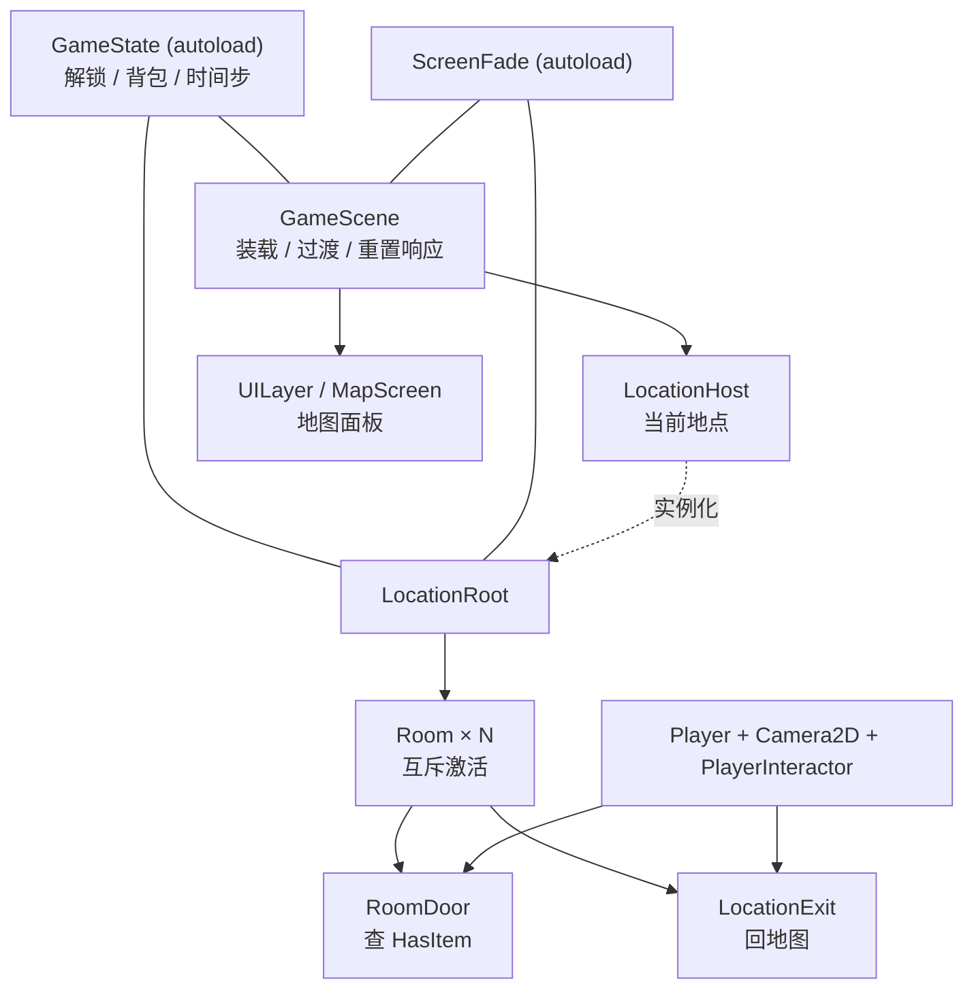
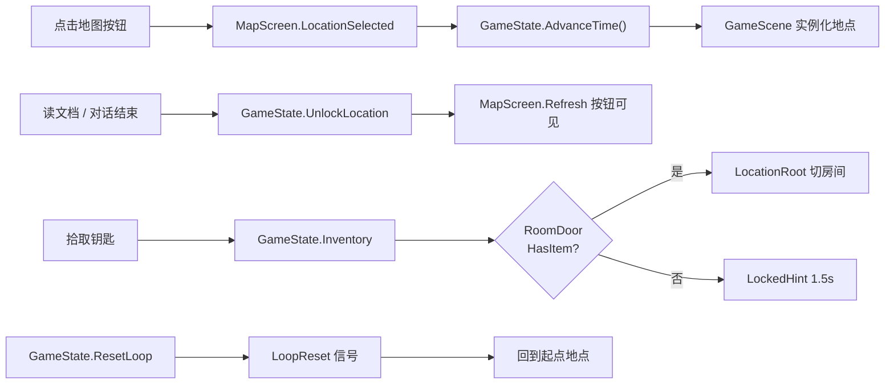
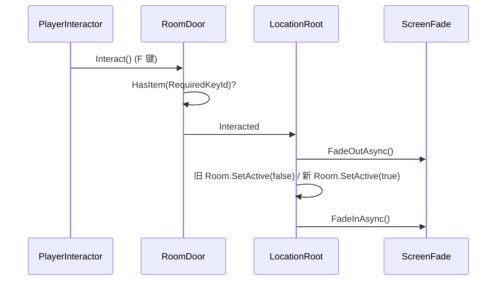

# 地图 & 场景系统 实现计划

> **面向 AI 代理的工作者：** 必需子技能：使用 superpowers:subagent-driven-development（推荐）或 superpowers:executing-plans 逐任务实现此计划。步骤使用复选框（`- [x]`）语法来跟踪进度。

**目标：** 做出可点击的大地图 UI、地点场景装载/卸载、地点内多房间切换、以及「信息解锁大地点 + 钥匙开房间门」两条通行权链路。

**架构：** 常驻根场景 `GameScene` 持有 `LocationHost`（挂当前地点）与 `UILayer/MapScreen`（地图面板）。地图点击 → `GameState.AdvanceTime()` → 实例化地点场景；地点内 `LocationRoot` 管理 `Room` 的互斥激活与 `RoomDoor`/`LocationExit` 交互；跨模块状态全部收在 autoload `GameState`，过渡表现收在 autoload `ScreenFade`。

**技术栈：** Godot 4.7.2 mono / C#（net8.0）；无测试框架，验证方式为 `dotnet build` + 无头运行 + `get_debug_output`。

**规格：** `docs/superpowers/specs/2026-11-06-map-scene-system-design.md`

---

## 验证策略（替代 TDD）

本项目不使用单元测试框架（AGENTS.md 明令禁止引入）。每个任务的「验证」由三件事组成：

1. `& $godot --headless --path . --build-solutions --quit` 编译无错
2. `& $godot --headless --path . --import` 资源导入无报错
3. 用 godot MCP `run_project` + `get_debug_output` 跑起来，确认**没有** `ERROR` / `SCRIPT ERROR`，并观察日志里的状态打印

每个任务在代码里埋一条 `GD.Print` 状态行（如 `[Map] 进入地点 classroom`），验收时按日志确认流程真的走到了。这不是测试替身，是运行时可观测性。

---

## 架构图



## 数据流图



## 调用链图



---

## 文件结构

| 文件 | 职责 |
|---|---|
| `Scripts/Core/GameState.cs` | autoload：解锁集合、背包、线索、时间步、三个信号 |
| `Scripts/Core/ScreenFade.cs` | autoload：全屏黑幕淡入淡出 |
| `Scripts/Core/Interactable.cs` | 交互物基类（`Area2D`，`Interact()` + `Interacted` 信号） |
| `Scripts/Map/MapConfig.cs` | `Resource`：初始解锁地点 id |
| `Scripts/Map/MapLocationButton.cs` | 地图按钮：`LocationId` + `LocationScene` |
| `Scripts/Map/MapScreen.cs` | 地图面板：刷新可见性、发 `LocationSelected` |
| `Scripts/Map/GameScene.cs` | 根场景编排：装载/卸载/过渡/重置 |
| `Scripts/Location/Room.cs` | 房间：互斥激活、相机限位 |
| `Scripts/Location/RoomDoor.cs` | 门：钥匙判定 + 切房间信号 |
| `Scripts/Location/LocationExit.cs` | 出口：回地图信号 |
| `Scripts/Location/LocationRoot.cs` | 地点根：房间管理、出口、玩家落点 |
| `Scripts/Player/Player.cs` | 左右移动（从 `Scripts/Player.cs` 移入，加 `Camera`） |
| `Scripts/Player/PlayerInteractor.cs` | 最小交互触发：最近的 `interactable` + F |
| `Scripts/Demo/PickupItem.cs` | demo：拾取钥匙 |
| `Scripts/Demo/ReadDocument.cs` | demo：读文档解锁地点 |
| `Scenes/Map/MapScreen.tscn` | 地图面板场景 |
| `Scenes/Root/GameScene.tscn` | 根场景（改写现有空场景） |
| `Scenes/player.tscn` | 加 Camera2D / InteractionRange |
| `Scenes/Locations/Classroom.tscn` | demo 地点：教室 + 器材室 |
| `Scenes/Locations/Playground.tscn` | demo 地点：操场 |
| `Resources/MapConfig.tres` | 初始解锁配置 |
| `project.godot` | autoload、`interact` 输入、主场景 |

---

## 任务 1：工程骨架（目录 / 输入 / autoload / Player）

**文件：**
- 移动：`Scripts/Player.cs` → `Scripts/Player/Player.cs`
- 修改：`project.godot`

- [x] **步骤 1：建目录并移动玩家脚本**

```powershell
New-Item -ItemType Directory -Force Scripts/Core, Scripts/Map, Scripts/Location, Scripts/Player, Scripts/Demo, Scenes/Map, Scenes/Locations, Resources | Out-Null
Move-Item Scripts/Player.cs Scripts/Player/Player.cs
```

- [x] **步骤 2：给 Player 加相机导出**

`Scripts/Player/Player.cs` 全文：

```csharp
using Godot;

public partial class Player : CharacterBody2D
{
	/// <summary>水平移动速度（像素/秒）。</summary>
	[Export] public float MoveSpeed { get; set; } = 200f;

	/// <summary>跟随玩家的相机，由地点场景设置限位。</summary>
	[Export] public Camera2D Camera { get; set; }

	public override void _PhysicsProcess(double delta)
	{
		float direction = Input.GetAxis("move_left", "move_right");
		Velocity = new Vector2(direction * MoveSpeed, 0f);
		MoveAndSlide();
	}
}
```

- [x] **步骤 3：注册 `interact` 输入（F 键）**

在 `project.godot` 的 `[input]` 段追加（保持与 `move_right` 同级）：

```ini
interact={
"deadzone": 0.2,
"events": [Object(InputEventKey,"resource_local_to_scene":false,"resource_name":"","device":-1,"window_id":0,"alt_pressed":false,"shift_pressed":false,"ctrl_pressed":false,"meta_pressed":false,"pressed":false,"keycode":0,"physical_keycode":70,"key_label":0,"unicode":0,"location":0,"echo":false,"script":null)
]
}
```

- [x] **步骤 4：注册 autoload 与主场景**

`project.godot` 的 `[autoload]` 段改为：

```ini
[autoload]

GameState="*res://Scripts/Core/GameState.cs"
ScreenFade="*res://Scripts/Core/ScreenFade.cs"
DialogueManager="*uid://c3rodes2l3gxb"
```

`[application]` 段加一行：

```ini
run/main_scene="res://Scenes/Root/GameScene.tscn"
```

- [x] **步骤 5：编译验证**

```powershell
& "D:\Downloads\Compressed\Godot_v4.7.2-stable_mono_win64\Godot_v4.7.2-stable_mono_win64.exe" --headless --path . --build-solutions --quit
```

预期：**编译 0 error**。此时 `GameState.cs` / `ScreenFade.cs` 还不存在，工程只会在**运行时**报 autoload 资源找不到——那不是编译错误，任务 2、3 会补上这两个脚本。

若此时报 `Player.cs` 找不到之类，说明移动脚本后 `Scenes/player.tscn` 里的 `ext_resource` 路径还在指旧位置——任务 7 会整份重写，不必现在修。

---

## 任务 2：`GameState`

**文件：**
- 创建：`Scripts/Core/GameState.cs`

- [x] **步骤 1：写实现**

```csharp
using Godot;
using System.Collections.Generic;

/// <summary>跨场景共享的游戏状态：解锁、背包、线索、时间步。跨循环保留什么见规格 §5.3。</summary>
public partial class GameState : Node
{
	/// <summary>全局唯一实例，由 autoload 保证在 _Ready 时赋值。</summary>
	public static GameState Instance { get; private set; }

	/// <summary>已解锁的大地点 id，跨循环保留。</summary>
	public HashSet<string> UnlockedLocations { get; } = new();

	/// <summary>本轮持有的道具 id，每轮清空。</summary>
	public HashSet<string> Inventory { get; } = new();

	/// <summary>手机里记录的线索 id，跨循环保留（本规格只留位）。</summary>
	public HashSet<string> Clues { get; } = new();

	/// <summary>本轮的时间推进计数，每轮归零。</summary>
	public int TimeStep { get; private set; }

	[Signal] public delegate void LocationUnlockedEventHandler(string locationId);
	[Signal] public delegate void TimeAdvancedEventHandler(int timeStep);
	[Signal] public delegate void LoopResetEventHandler();

	public override void _Ready()
	{
		Instance = this;
	}

	/// <summary>把 MapConfig 里的初始解锁地点灌入集合，重复调用无副作用。</summary>
	public void SeedInitialUnlocks(MapConfig config)
	{
		if (config == null)
		{
			GD.PushError("GameState.SeedInitialUnlocks: MapConfig 为空");
			return;
		}

		foreach (string id in config.InitialUnlockedLocationIds)
		{
			if (string.IsNullOrEmpty(id))
			{
				GD.PushError("GameState.SeedInitialUnlocks: MapConfig 里有空的地点 id");
				continue;
			}
			UnlockedLocations.Add(id);
		}
	}

	/// <summary>解锁一个大地点；已解锁时什么都不做。</summary>
	public void UnlockLocation(string locationId)
	{
		if (string.IsNullOrEmpty(locationId))
		{
			GD.PushError("GameState.UnlockLocation: 地点 id 为空");
			return;
		}
		if (!UnlockedLocations.Add(locationId)) return;

		GD.Print($"[Map] 解锁地点 {locationId}");
		EmitSignal(SignalName.LocationUnlocked, locationId);
	}

	public bool IsLocationUnlocked(string locationId) => UnlockedLocations.Contains(locationId);

	public bool HasItem(string itemId) => Inventory.Contains(itemId);

	/// <summary>本轮拾取道具。道具系统接管后由它替换。</summary>
	public void AddItem(string itemId)
	{
		if (string.IsNullOrEmpty(itemId))
		{
			GD.PushError("GameState.AddItem: 道具 id 为空");
			return;
		}
		Inventory.Add(itemId);
		GD.Print($"[Item] 获得 {itemId}");
	}

	/// <summary>从大地图进入地点时推进一格时间。</summary>
	public void AdvanceTime()
	{
		TimeStep++;
		GD.Print($"[Time] TimeStep = {TimeStep}");
		EmitSignal(SignalName.TimeAdvanced, TimeStep);
	}

	/// <summary>循环重置：清掉每轮状态，保留解锁与线索。</summary>
	public void ResetLoop()
	{
		Inventory.Clear();
		TimeStep = 0;
		GD.Print("[Loop] 重置");
		EmitSignal(SignalName.LoopReset);
	}
}
```

- [x] **步骤 2：编译**

```powershell
& "D:\Downloads\Compressed\Godot_v4.7.2-stable_mono_win64\Godot_v4.7.2-stable_mono_win64.exe" --headless --path . --build-solutions --quit
```

预期：只剩 `ScreenFade.cs` 不存在的报错。

---

## 任务 3：`ScreenFade` + `Interactable` + `PlayerInteractor`

**文件：**
- 创建：`Scripts/Core/ScreenFade.cs`
- 创建：`Scripts/Core/Interactable.cs`
- 创建：`Scripts/Player/PlayerInteractor.cs`

- [x] **步骤 1：写 `ScreenFade`**

```csharp
using Godot;
using System.Threading.Tasks;

/// <summary>全屏黑幕过渡。所有切换路径共用这一份实现。</summary>
public partial class ScreenFade : CanvasLayer
{
	private const float Duration = 0.25f;
	private ColorRect _rect;

	public override void _Ready()
	{
		Layer = 100;
		_rect = new ColorRect
		{
			Color = new Color(0f, 0f, 0f, 0f),
			MouseFilter = Control.MouseFilterEnum.Ignore,
			Visible = false,
		};
		_rect.SetAnchorsPreset(Control.LayoutPreset.FullRect);
		AddChild(_rect);
	}

	/// <summary>立刻铺满黑幕，用于启动时先遮住第一帧。</summary>
	public void SetOpaque()
	{
		_rect.Visible = true;
		_rect.Color = new Color(0f, 0f, 0f, 1f);
		_rect.MouseFilter = Control.MouseFilterEnum.Stop;
	}

	public async Task FadeOutAsync()
	{
		_rect.Visible = true;
		_rect.MouseFilter = Control.MouseFilterEnum.Stop;
		Tween tween = CreateTween();
		tween.TweenProperty(_rect, "color:a", 1f, Duration);
		await ToSignal(tween, Tween.SignalName.Finished);
	}

	public async Task FadeInAsync()
	{
		Tween tween = CreateTween();
		tween.TweenProperty(_rect, "color:a", 0f, Duration);
		await ToSignal(tween, Tween.SignalName.Finished);
		_rect.Visible = false;
		_rect.MouseFilter = Control.MouseFilterEnum.Ignore;
	}
}
```

- [x] **步骤 2：写 `Interactable`**

```csharp
using Godot;

/// <summary>可交互物基类：按 F 触发 Interact()，由使用方连接 Interacted 信号。</summary>
public partial class Interactable : Area2D
{
	[Signal] public delegate void InteractedEventHandler();

	public override void _EnterTree()
	{
		AddToGroup("interactable");
	}

	public virtual void Interact()
	{
		EmitSignal(SignalName.Interacted);
	}
}
```

用 `_EnterTree` 注册组，子类不必再调 `base._Ready()`。

- [x] **步骤 3：写 `PlayerInteractor`**

```csharp
using Godot;
using System.Linq;

/// <summary>最小交互触发：取范围内最近的 interactable，按 F 调它的 Interact()。</summary>
public partial class PlayerInteractor : Area2D
{
	private Interactable _current;

	public override void _PhysicsProcess(double delta)
	{
		_current = GetOverlappingAreas()
			.OfType<Interactable>()
			.OrderBy(a => a.GlobalPosition.DistanceSquaredTo(GlobalPosition))
			.FirstOrDefault();
	}

	public override void _UnhandledInput(InputEvent @event)
	{
		if (_current == null || !@event.IsActionPressed("interact")) return;

		_current.Interact();
		GetViewport().SetInputAsHandled();
	}
}
```

- [x] **步骤 4：编译**

```powershell
& "D:\Downloads\Compressed\Godot_v4.7.2-stable_mono_win64\Godot_v4.7.2-stable_mono_win64.exe" --headless --path . --build-solutions --quit
```

预期：0 error。此时两个 autoload 脚本都存在，工程可启动（主场景还不存在，启动会报 `no main scene` 或场景找不到——任务 7 解决）。

---

## 任务 4：地图侧（`MapConfig` / `MapLocationButton` / `MapScreen`）

**文件：**
- 创建：`Scripts/Map/MapConfig.cs`
- 创建：`Scripts/Map/MapLocationButton.cs`
- 创建：`Scripts/Map/MapScreen.cs`

- [x] **步骤 1：`MapConfig`**

```csharp
using Godot;

/// <summary>地图的静态配置：开局就可以去的大地点。</summary>
[GlobalClass]
public partial class MapConfig : Resource
{
	/// <summary>开局即在图上可见的地点 id。</summary>
	[Export] public string[] InitialUnlockedLocationIds { get; set; } = System.Array.Empty<string>();
}
```

- [x] **步骤 2：`MapLocationButton`**

```csharp
using Godot;

/// <summary>地图上的一个地点按钮，自带解锁 id 与要装载的场景。</summary>
public partial class MapLocationButton : Button
{
	/// <summary>与 GameState.UnlockedLocations 对应的地点 id。</summary>
	[Export] public string LocationId { get; set; }

	/// <summary>点击后装载的地点场景。</summary>
	[Export] public PackedScene LocationScene { get; set; }
}
```

- [x] **步骤 3：`MapScreen`**

```csharp
using Godot;
using System.Collections.Generic;

/// <summary>大地图面板：按解锁状态刷新按钮可见性，把点击转成 LocationSelected。</summary>
public partial class MapScreen : Control
{
	/// <summary>地图上全部地点按钮，显式配置避免按名字查找。</summary>
	[Export] public MapLocationButton[] Buttons { get; set; } = System.Array.Empty<MapLocationButton>();

	[Signal] public delegate void LocationSelectedEventHandler(string locationId, PackedScene locationScene);

	public override void _Ready()
	{
		Validate();
		foreach (MapLocationButton button in Buttons)
		{
			MapLocationButton captured = button;
			captured.Pressed += () => EmitSignal(SignalName.LocationSelected, captured.LocationId, captured.LocationScene);
		}
		Visible = false;
	}

	/// <summary>按 GameState 的解锁集合刷新每颗按钮的可见性。</summary>
	public void Refresh()
	{
		int visibleCount = 0;
		foreach (MapLocationButton button in Buttons)
		{
			button.Visible = GameState.Instance.IsLocationUnlocked(button.LocationId);
			if (button.Visible) visibleCount++;
		}

		if (visibleCount == 0)
		{
			GD.PushError("MapScreen.Refresh: 没有任何可见地点，地图死局");
		}
	}

	public void ShowMap()
	{
		Refresh();
		Visible = true;
	}

	public void HideMap()
	{
		Visible = false;
	}

	private void Validate()
	{
		if (Buttons.Length == 0)
		{
			GD.PushError("MapScreen: Buttons 为空");
			return;
		}

		HashSet<string> seen = new();
		foreach (MapLocationButton button in Buttons)
		{
			if (button == null)
			{
				GD.PushError("MapScreen: Buttons 里有 null 项");
				continue;
			}
			if (string.IsNullOrEmpty(button.LocationId))
			{
				GD.PushError($"MapScreen: 按钮 {button.Name} 的 LocationId 为空");
			}
			if (button.LocationScene == null)
			{
				GD.PushError($"MapScreen: 按钮 {button.Name} 的 LocationScene 为空");
			}
			if (!string.IsNullOrEmpty(button.LocationId) && !seen.Add(button.LocationId))
			{
				GD.PushError($"MapScreen: LocationId 重复 —— {button.LocationId}");
			}
		}
	}
}
```

- [x] **步骤 4：编译**

```powershell
& "D:\Downloads\Compressed\Godot_v4.7.2-stable_mono_win64\Godot_v4.7.2-stable_mono_win64.exe" --headless --path . --build-solutions --quit
```

预期：0 error。

---

## 任务 5：地点侧（`Room` / `RoomDoor` / `LocationExit` / `LocationRoot`）

**文件：**
- 创建：`Scripts/Location/Room.cs`
- 创建：`Scripts/Location/RoomDoor.cs`
- 创建：`Scripts/Location/LocationExit.cs`
- 创建：`Scripts/Location/LocationRoot.cs`

- [x] **步骤 1：`Room`**

```csharp
using Godot;
using System.Collections.Generic;

/// <summary>地点内的一个房间。同一时刻只有一个房间处于激活状态。</summary>
public partial class Room : Node2D
{
	/// <summary>玩家进入本房间时的默认落点。</summary>
	[Export] public Marker2D DefaultSpawn { get; set; }

	/// <summary>相机限位，本房间局部坐标。</summary>
	[Export] public Rect2I CameraBounds { get; set; }

	/// <summary>启用/停用整个房间：可见性、物理碰撞、处理模式一起切。</summary>
	public void SetActive(bool active)
	{
		Visible = active;
		ProcessMode = active ? ProcessModeEnum.Inherit : ProcessModeEnum.Disabled;

		foreach (CollisionShape2D shape in FindShapes(this))
		{
			shape.SetDeferred("disabled", !active);
		}
	}

	private static IEnumerable<CollisionShape2D> FindShapes(Node node)
	{
		foreach (Node child in node.GetChildren())
		{
			if (child is CollisionShape2D shape) yield return shape;
			foreach (CollisionShape2D nested in FindShapes(child)) yield return nested;
		}
	}
}
```

- [x] **步骤 2：`RoomDoor`**

```csharp
using Godot;

/// <summary>房间之间的门。配了钥匙 id 时，背包里没有就不开。</summary>
public partial class RoomDoor : Interactable
{
	[Export] public Room TargetRoom { get; set; }
	[Export] public Marker2D TargetSpawn { get; set; }

	/// <summary>开门所需道具 id；留空表示不锁。</summary>
	[Export] public string RequiredKeyId { get; set; } = string.Empty;

	/// <summary>锁着时闪一下的占位提示。</summary>
	[Export] public Label LockedHint { get; set; }

	private Timer _hintTimer;

	public override void _Ready()
	{
		if (TargetRoom == null)
		{
			GD.PushError($"RoomDoor {Name}: TargetRoom 为空");
		}
		if (TargetSpawn == null)
		{
			GD.PushError($"RoomDoor {Name}: TargetSpawn 为空");
		}
		if (!string.IsNullOrEmpty(RequiredKeyId) && LockedHint == null)
		{
			GD.PushError($"RoomDoor {Name}: 已上锁但 LockedHint 为空");
		}

		if (LockedHint != null)
		{
			LockedHint.Visible = false;
			_hintTimer = new Timer { OneShot = true, WaitTime = 1.5 };
			AddChild(_hintTimer);
			_hintTimer.Timeout += () => LockedHint.Visible = false;
		}
	}

	public override void Interact()
	{
		if (TargetRoom == null || TargetSpawn == null) return;

		if (!string.IsNullOrEmpty(RequiredKeyId) && !GameState.Instance.HasItem(RequiredKeyId))
		{
			if (LockedHint != null)
			{
				LockedHint.Visible = true;
				_hintTimer.Start();
			}
			return;
		}

		base.Interact();
	}
}
```

- [x] **步骤 3：`LocationExit`**

```csharp
using Godot;

/// <summary>地点出口：交互后回到大地图。</summary>
public partial class LocationExit : Interactable
{
}
```

- [x] **步骤 4：`LocationRoot`**

```csharp
using Godot;
using System.Collections.Generic;
using System.Threading.Tasks;

/// <summary>地点场景根节点：管理房间互斥激活、玩家出生、出口信号。</summary>
public partial class LocationRoot : Node2D
{
	/// <summary>从地图进入时激活的房间。</summary>
	[Export] public Room StartingRoom { get; set; }

	/// <summary>本地点唯一的玩家实例。</summary>
	[Export] public Player PlayerNode { get; set; }

	[Signal] public delegate void ExitRequestedEventHandler();

	private bool _transitioning;

	public override void _Ready()
	{
		if (StartingRoom == null)
		{
			GD.PushError($"LocationRoot {Name}: StartingRoom 为空");
			return;
		}
		if (PlayerNode == null || PlayerNode.Camera == null)
		{
			GD.PushError($"LocationRoot {Name}: PlayerNode 或它的 Camera 为空");
			return;
		}

		List<Room> rooms = FindAll<Room>(this);
		List<RoomDoor> doors = FindAll<RoomDoor>(this);
		List<LocationExit> exits = FindAll<LocationExit>(this);

		if (rooms.Count == 0)
		{
			GD.PushError($"LocationRoot {Name}: 一个 Room 都没有");
			return;
		}
		if (exits.Count != 1)
		{
			GD.PushError($"LocationRoot {Name}: LocationExit 数量为 {exits.Count}，应恰好 1 个");
			return;
		}

		foreach (Room room in rooms) room.SetActive(false);

		foreach (RoomDoor door in doors)
		{
			RoomDoor captured = door;
			captured.Interacted += () => _ = TransitionToRoomAsync(captured);
		}

		exits[0].Interacted += () => EmitSignal(SignalName.ExitRequested);

		ActivateRoom(StartingRoom, StartingRoom.DefaultSpawn);
		GD.Print($"[Map] 地点 {Name} 就绪，当前房间 {StartingRoom.Name}");
	}

	private async Task TransitionToRoomAsync(RoomDoor door)
	{
		if (_transitioning) return;
		_transitioning = true;

		GameState.Instance.AdvanceTime();

		ScreenFade fade = GetNode<ScreenFade>("/root/ScreenFade");
		await fade.FadeOutAsync();

		ActivateRoom(door.TargetRoom, door.TargetSpawn);

		await fade.FadeInAsync();
		_transitioning = false;
	}

	private void ActivateRoom(Room room, Marker2D spawn)
	{
		if (spawn == null)
		{
			GD.PushError($"LocationRoot {Name}: 房间 {room.Name} 缺少落点");
			return;
		}

		foreach (Room other in FindAll<Room>(this)) other.SetActive(other == room);
		PlayerNode.GlobalPosition = spawn.GlobalPosition;
		ApplyCameraBounds(room.CameraBounds);
	}

	private void ApplyCameraBounds(Rect2I bounds)
	{
		Camera2D camera = PlayerNode.Camera;
		camera.LimitLeft = bounds.Position.X;
		camera.LimitTop = bounds.Position.Y;
		camera.LimitRight = bounds.Position.X + bounds.Size.X;
		camera.LimitBottom = bounds.Position.Y + bounds.Size.Y;
		camera.ResetSmoothing();
	}

	private static List<T> FindAll<T>(Node root) where T : Node
	{
		List<T> result = new();
		foreach (Node child in root.GetChildren())
		{
			if (child is T match) result.Add(match);
			result.AddRange(FindAll<T>(child));
		}
		return result;
	}
}
```

- [x] **步骤 5：编译**

```powershell
& "D:\Downloads\Compressed\Godot_v4.7.2-stable_mono_win64\Godot_v4.7.2-stable_mono_win64.exe" --headless --path . --build-solutions --quit
```

预期：0 error。

---

## 任务 6：根场景编排 `GameScene`

**文件：**
- 创建：`Scripts/Map/GameScene.cs`

- [x] **步骤 1：写实现**

```csharp
using Godot;
using System.Threading.Tasks;

/// <summary>常驻根场景：装载/卸载地点、显隐地图、衔接过渡、响应循环重置。</summary>
public partial class GameScene : Node2D
{
	[Export] public MapConfig MapConfig { get; set; }
	[Export] public PackedScene StartLocation { get; set; }
	[Export] public MapScreen MapScreen { get; set; }
	[Export] public Node2D LocationHost { get; set; }

	private LocationRoot _currentLocation;
	private bool _transitioning;

	private ScreenFade Fade => GetNode<ScreenFade>("/root/ScreenFade");

	public override async void _Ready()
	{
		if (MapConfig == null || StartLocation == null || MapScreen == null || LocationHost == null)
		{
			GD.PushError("GameScene: 有导出引用为空，停止启动");
			return;
		}

		if (!ValidateConfigIds()) return;

		GameState.Instance.SeedInitialUnlocks(MapConfig);
		GameState.Instance.LoopReset += OnLoopReset;
		MapScreen.LocationSelected += OnLocationSelected;
		MapScreen.HideMap();

		Fade.SetOpaque();
		await LoadLocationAsync(StartLocation);
		await Fade.FadeInAsync();
	}

	/// <summary>MapConfig 里写的地点 id 必须在地图按钮中存在，否则是配置写错。</summary>
	private bool ValidateConfigIds()
	{
		foreach (string id in MapConfig.InitialUnlockedLocationIds)
		{
			bool found = false;
			foreach (MapLocationButton button in MapScreen.Buttons)
			{
				if (button != null && button.LocationId == id)
				{
					found = true;
					break;
				}
			}

			if (!found)
			{
				GD.PushError($"GameScene: MapConfig 的地点 {id} 在地图按钮里找不到");
				return false;
			}
		}
		return true;
	}

	private void OnLocationSelected(string locationId, PackedScene scene)
	{
		if (_transitioning) return;

		GameState.Instance.AdvanceTime();
		_ = EnterLocationAsync(locationId, scene);
	}

	private async void OnLoopReset()
	{
		if (_transitioning) return;

		_transitioning = true;
		await Fade.FadeOutAsync();
		UnloadLocation();
		await LoadLocationAsync(StartLocation);
		await Fade.FadeInAsync();
		_transitioning = false;
		GD.Print("[Loop] 已回到起点地点");
	}

	private async Task EnterLocationAsync(string locationId, PackedScene scene)
	{
		if (scene == null)
		{
			GD.PushError($"GameScene: 地点 {locationId} 的 LocationScene 为空");
			return;
		}

		_transitioning = true;
		await Fade.FadeOutAsync();
		UnloadLocation();
		await LoadLocationAsync(scene);
		MapScreen.HideMap();
		await Fade.FadeInAsync();
		_transitioning = false;
		GD.Print($"[Map] 进入地点 {locationId}");
	}

	private async Task LoadLocationAsync(PackedScene scene)
	{
		Node instance = scene.Instantiate();
		if (instance is not LocationRoot location)
		{
			GD.PushError($"GameScene: {scene.ResourcePath} 的根节点不是 LocationRoot");
			instance.QueueFree();
			return;
		}

		LocationHost.AddChild(location);
		_currentLocation = location;
		location.ExitRequested += OnExitRequested;
		await ToSignal(GetTree(), SceneTree.SignalName.ProcessFrame);
	}

	private void UnloadLocation()
	{
		if (_currentLocation == null) return;

		_currentLocation.ExitRequested -= OnExitRequested;
		LocationHost.RemoveChild(_currentLocation);
		_currentLocation.QueueFree();
		_currentLocation = null;
	}

	private async void OnExitRequested()
	{
		if (_transitioning) return;

		_transitioning = true;
		await Fade.FadeOutAsync();
		UnloadLocation();
		MapScreen.ShowMap();
		await Fade.FadeInAsync();
		_transitioning = false;
	}
}
```

- [x] **步骤 2：编译**

```powershell
& "D:\Downloads\Compressed\Godot_v4.7.2-stable_mono_win64\Godot_v4.7.2-stable_mono_win64.exe" --headless --path . --build-solutions --quit
```

预期：0 error。

---

## 任务 7：场景与资源文件

**文件：**
- 修改：`Scenes/player.tscn`
- 创建：`Scenes/Map/MapScreen.tscn`
- 改写：`Scenes/Root/GameScene.tscn`
- 创建：`Resources/MapConfig.tres`

- [x] **步骤 1：改 `Scenes/player.tscn`（加相机与交互范围）**

全文：

```ini
[gd_scene format=3]

[ext_resource type="Script" path="res://Scripts/Player/Player.cs" id="1_player"]
[ext_resource type="Script" path="res://Scripts/Player/PlayerInteractor.cs" id="2_interactor"]

[sub_resource type="RectangleShape2D" id="RectangleShape2D_body"]
size = Vector2(40, 80)

[sub_resource type="RectangleShape2D" id="RectangleShape2D_range"]
size = Vector2(120, 120)

[node name="Player" type="CharacterBody2D"]
script = ExtResource("1_player")
Camera = NodePath("Camera2D")

[node name="AnimatedSprite2D" type="AnimatedSprite2D" parent="."]

[node name="CollisionShape2D" type="CollisionShape2D" parent="."]
shape = SubResource("RectangleShape2D_body")

[node name="Camera2D" type="Camera2D" parent="."]

[node name="InteractionRange" type="Area2D" parent="."]
script = ExtResource("2_interactor")

[node name="CollisionShape2D" type="CollisionShape2D" parent="InteractionRange"]
shape = SubResource("RectangleShape2D_range")
```

> 原 `player.tscn` 里的 `uid://` 与 `unique_id=` 属性手写时可以省略，Godot 导入时会按路径重新解析；如果不放心，先用编辑器打开一次再保存。

- [x] **步骤 2：创建 `Scenes/Map/MapScreen.tscn`**

全文（占位色块 + 两颗文字按钮）：

```ini
[gd_scene format=3]

[ext_resource type="Script" path="res://Scripts/Map/MapScreen.cs" id="1_screen"]
[ext_resource type="Script" path="res://Scripts/Map/MapLocationButton.cs" id="2_button"]

[node name="MapScreen" type="Control"]
layout_mode = 3
anchors_preset = 15
anchor_right = 1.0
anchor_bottom = 1.0
grow_horizontal = 2
grow_vertical = 2
script = ExtResource("1_screen")
Buttons = Array[NodePath]([NodePath("LocationButtons/BtnClassroom"), NodePath("LocationButtons/BtnPlayground")])

[node name="Background" type="ColorRect" parent="."]
layout_mode = 1
anchors_preset = 15
anchor_right = 1.0
anchor_bottom = 1.0
grow_horizontal = 2
grow_vertical = 2
color = Color(0.2, 0.25, 0.3, 1)

[node name="Title" type="Label" parent="."]
layout_mode = 1
offset_left = 60.0
offset_top = 40.0
offset_right = 460.0
offset_bottom = 100.0
text = "学校地图（占位）"
theme_override_font_sizes/font_size = 42

[node name="LocationButtons" type="Control" parent="."]
layout_mode = 1
anchors_preset = 15
anchor_right = 1.0
anchor_bottom = 1.0
grow_horizontal = 2
grow_vertical = 2

[node name="BtnClassroom" type="Button" parent="LocationButtons"]
layout_mode = 0
offset_left = 320.0
offset_top = 260.0
offset_right = 520.0
offset_bottom = 340.0
text = "教室"
script = ExtResource("2_button")
LocationId = "classroom"

[node name="BtnPlayground" type="Button" parent="LocationButtons"]
layout_mode = 0
offset_left = 320.0
offset_top = 620.0
offset_right = 520.0
offset_bottom = 700.0
text = "操场"
script = ExtResource("2_button")
LocationId = "playground"
```

> `Buttons` 是 `Control` 数组，手写 `.tscn` 里的 `Array[NodePath](...)` 是否被接受由 Godot 4.7 的序列化决定。如果导入时报错，改用编辑器/MCP 打开场景后手动拖入两颗按钮再保存——这比继续猜序列化格式快。

- [x] **步骤 3：创建 `Resources/MapConfig.tres`**

```ini
[gd_resource type="Resource" script_class="MapConfig" format=3]

[ext_resource type="Script" path="res://Scripts/Map/MapConfig.cs" id="1_config"]

[resource]
script = ExtResource("1_config")
InitialUnlockedLocationIds = PackedStringArray("classroom")
```

- [x] **步骤 4：改写 `Scenes/Root/GameScene.tscn`**

全文：

```ini
[gd_scene format=3]

[ext_resource type="Script" path="res://Scripts/Map/GameScene.cs" id="1_game"]
[ext_resource type="PackedScene" path="res://Scenes/Map/MapScreen.tscn" id="2_map"]
[ext_resource type="Resource" path="res://Resources/MapConfig.tres" id="3_config"]

[node name="GameScene" type="Node2D"]
script = ExtResource("1_game")
MapConfig = ExtResource("3_config")
MapScreen = NodePath("UILayer/MapScreen")
StartLocation = null

[node name="LocationHost" type="Node2D" parent="."]

[node name="UILayer" type="CanvasLayer" parent="."]
layer = 10

[node name="MapScreen" parent="UILayer" instance=ExtResource("2_map")]
```

- [x] **步骤 5：导入资源**

```powershell
& "D:\Downloads\Compressed\Godot_v4.7.2-stable_mono_win64\Godot_v4.7.2-stable_mono_win64.exe" --headless --path . --import
```

预期：无 `ERROR`。若 `MapScreen.tscn` 的 `Buttons` 行报错，按步骤 2 的提示改用编辑器。

- [x] **步骤 6：起一次空跑，确认场景能加载**

```powershell
& "D:\Downloads\Compressed\Godot_v4.7.2-stable_mono_win64\Godot_v4.7.2-stable_mono_win64.exe" --headless --path . --quit-after 120
```

预期：日志出现 `GameScene: 有导出引用为空，停止启动`（`StartLocation` 还是 null，任务 8 才填）。**不能**出现脚本解析错误。

---

## 任务 8：demo 内容（拾取物 / 文档 / 两个地点）

**文件：**
- 创建：`Scripts/Demo/PickupItem.cs`
- 创建：`Scripts/Demo/ReadDocument.cs`
- 创建：`Scenes/Locations/Classroom.tscn`
- 创建：`Scenes/Locations/Playground.tscn`
- 修改：`Scenes/Root/GameScene.tscn`（填 `StartLocation`）

- [x] **步骤 1：`PickupItem`**

```csharp
using Godot;

/// <summary>demo 用的一次性拾取物：交互后把 itemId 放进背包并消失。</summary>
public partial class PickupItem : Interactable
{
	[Export] public string ItemId { get; set; } = "equipment_key";

	public override void _Ready()
	{
		if (string.IsNullOrEmpty(ItemId))
		{
			GD.PushError($"PickupItem {Name}: ItemId 为空");
		}
		if (GameState.Instance.HasItem(ItemId))
		{
			QueueFree();
		}
	}

	public override void Interact()
	{
		GameState.Instance.AddItem(ItemId);
		QueueFree();
	}
}
```

- [x] **步骤 2：`ReadDocument`**

```csharp
using Godot;

/// <summary>demo 用的一次性文档：读完解锁指定大地点。</summary>
public partial class ReadDocument : Interactable
{
	[Export] public string UnlocksLocationId { get; set; } = "playground";

	public override void _Ready()
	{
		if (string.IsNullOrEmpty(UnlocksLocationId))
		{
			GD.PushError($"ReadDocument {Name}: UnlocksLocationId 为空");
		}
	}

	public override void Interact()
	{
		GameState.Instance.UnlockLocation(UnlocksLocationId);
		GD.Print($"[Doc] 读完《{Name}》，解锁 {UnlocksLocationId}");
	}
}
```

- [x] **步骤 3：创建 `Scenes/Locations/Classroom.tscn`**

两个房间：`Room_Classroom`（起点，含出口、钥匙、通往器材室的门）、`Room_Equip`（含文档、回门）。

```ini
[gd_scene format=3]

[ext_resource type="Script" path="res://Scripts/Location/LocationRoot.cs" id="1_root"]
[ext_resource type="Script" path="res://Scripts/Location/Room.cs" id="2_room"]
[ext_resource type="Script" path="res://Scripts/Location/RoomDoor.cs" id="3_door"]
[ext_resource type="Script" path="res://Scripts/Location/LocationExit.cs" id="4_exit"]
[ext_resource type="Script" path="res://Scripts/Demo/PickupItem.cs" id="5_pickup"]
[ext_resource type="Script" path="res://Scripts/Demo/ReadDocument.cs" id="6_doc"]
[ext_resource type="PackedScene" path="res://Scenes/player.tscn" id="7_player"]

[sub_resource type="RectangleShape2D" id="RectangleShape2D_room"]
size = Vector2(1600, 600)

[sub_resource type="RectangleShape2D" id="RectangleShape2D_zone"]
size = Vector2(120, 200)

[node name="Classroom" type="Node2D"]
script = ExtResource("1_root")
StartingRoom = NodePath("Room_Classroom")
PlayerNode = NodePath("Player")

[node name="Room_Classroom" type="Node2D" parent="."]
script = ExtResource("2_room")
DefaultSpawn = NodePath("DefaultSpawn")
CameraBounds = Rect2i(0, 0, 1600, 600)

[node name="Bg" type="ColorRect" parent="Room_Classroom"]
offset_right = 1600.0
offset_bottom = 600.0
color = Color(0.35, 0.4, 0.45, 1)

[node name="Floor" type="StaticBody2D" parent="Room_Classroom"]

[node name="Shape" type="CollisionShape2D" parent="Room_Classroom/Floor"]
position = Vector2(800, 620)
shape = SubResource("RectangleShape2D_room")

[node name="DefaultSpawn" type="Marker2D" parent="Room_Classroom"]
position = Vector2(200, 520)

[node name="DoorToEquip" type="Area2D" parent="Room_Classroom"]
position = Vector2(1400, 500)
script = ExtResource("3_door")
TargetRoom = NodePath("../Room_Equip")
TargetSpawn = NodePath("../Room_Equip/DefaultSpawn")
RequiredKeyId = "equipment_key"
LockedHint = NodePath("LockedHint")

[node name="Shape" type="CollisionShape2D" parent="Room_Classroom/DoorToEquip"]
shape = SubResource("RectangleShape2D_zone")

[node name="LockedHint" type="Label" parent="Room_Classroom/DoorToEquip"]
offset_left = -60.0
offset_top = -120.0
offset_right = 60.0
offset_bottom = -80.0
text = "锁着"

[node name="ExitToMap" type="Area2D" parent="Room_Classroom"]
position = Vector2(80, 500)
script = ExtResource("4_exit")

[node name="Shape" type="CollisionShape2D" parent="Room_Classroom/ExitToMap"]
shape = SubResource("RectangleShape2D_zone")

[node name="Key" type="Area2D" parent="Room_Classroom"]
position = Vector2(600, 500)
script = ExtResource("5_pickup")
ItemId = "equipment_key"

[node name="Shape" type="CollisionShape2D" parent="Room_Classroom/Key"]
shape = SubResource("RectangleShape2D_zone")

[node name="Room_Equip" type="Node2D" parent="."]
script = ExtResource("2_room")
DefaultSpawn = NodePath("DefaultSpawn")
CameraBounds = Rect2i(0, 0, 1200, 600)

[node name="Bg" type="ColorRect" parent="Room_Equip"]
offset_right = 1200.0
offset_bottom = 600.0
color = Color(0.3, 0.32, 0.28, 1)

[node name="Floor" type="StaticBody2D" parent="Room_Equip"]

[node name="Shape" type="CollisionShape2D" parent="Room_Equip/Floor"]
position = Vector2(600, 620)
shape = SubResource("RectangleShape2D_room")

[node name="DefaultSpawn" type="Marker2D" parent="Room_Equip"]
position = Vector2(150, 520)

[node name="DoorToClassroom" type="Area2D" parent="Room_Equip"]
position = Vector2(1100, 500)
script = ExtResource("3_door")
TargetRoom = NodePath("../Room_Classroom")
TargetSpawn = NodePath("../Room_Classroom/DefaultSpawn")

[node name="Shape" type="CollisionShape2D" parent="Room_Equip/DoorToClassroom"]
shape = SubResource("RectangleShape2D_zone")

[node name="Notice" type="Area2D" parent="Room_Equip"]
position = Vector2(600, 500)
script = ExtResource("6_doc")
UnlocksLocationId = "playground"

[node name="Shape" type="CollisionShape2D" parent="Room_Equip/Notice"]
shape = SubResource("RectangleShape2D_zone")

[node name="Player" parent="." instance=ExtResource("7_player")]
position = Vector2(200, 520)
```

> `Room_Equip` 里那道不锁的门 `RequiredKeyId` 默认是空字符串，不用写。

- [x] **步骤 4：创建 `Scenes/Locations/Playground.tscn`**

```ini
[gd_scene format=3]

[ext_resource type="Script" path="res://Scripts/Location/LocationRoot.cs" id="1_root"]
[ext_resource type="Script" path="res://Scripts/Location/Room.cs" id="2_room"]
[ext_resource type="Script" path="res://Scripts/Location/LocationExit.cs" id="4_exit"]
[ext_resource type="PackedScene" path="res://Scenes/player.tscn" id="7_player"]

[sub_resource type="RectangleShape2D" id="RectangleShape2D_room"]
size = Vector2(1800, 600)

[sub_resource type="RectangleShape2D" id="RectangleShape2D_zone"]
size = Vector2(120, 200)

[node name="Playground" type="Node2D"]
script = ExtResource("1_root")
StartingRoom = NodePath("Room_Playground")
PlayerNode = NodePath("Player")

[node name="Room_Playground" type="Node2D" parent="."]
script = ExtResource("2_room")
DefaultSpawn = NodePath("DefaultSpawn")
CameraBounds = Rect2i(0, 0, 1800, 600)

[node name="Bg" type="ColorRect" parent="Room_Playground"]
offset_right = 1800.0
offset_bottom = 600.0
color = Color(0.25, 0.35, 0.25, 1)

[node name="Floor" type="StaticBody2D" parent="Room_Playground"]

[node name="Shape" type="CollisionShape2D" parent="Room_Playground/Floor"]
position = Vector2(900, 620)
shape = SubResource("RectangleShape2D_room")

[node name="DefaultSpawn" type="Marker2D" parent="Room_Playground"]
position = Vector2(200, 520)

[node name="ExitToMap" type="Area2D" parent="Room_Playground"]
position = Vector2(80, 500)
script = ExtResource("4_exit")

[node name="Shape" type="CollisionShape2D" parent="Room_Playground/ExitToMap"]
shape = SubResource("RectangleShape2D_zone")

[node name="Player" parent="." instance=ExtResource("7_player")]
position = Vector2(200, 520)
```

- [x] **步骤 5：给 `GameScene.tscn` 填起点地点**

`GameScene.tscn` 头部加：

```ini
[ext_resource type="PackedScene" path="res://Scenes/Locations/Classroom.tscn" id="4_start"]
```

根节点上把 `StartLocation = null` 改成：

```ini
StartLocation = ExtResource("4_start")
```

- [x] **步骤 6：导入并编译**

```powershell
& "D:\Downloads\Compressed\Godot_v4.7.2-stable_mono_win64\Godot_v4.7.2-stable_mono_win64.exe" --headless --path . --import
& "D:\Downloads\Compressed\Godot_v4.7.2-stable_mono_win64\Godot_v4.7.2-stable_mono_win64.exe" --headless --path . --build-solutions --quit
```

预期：无 `ERROR`。

---

## 任务 9：端到端验收

**文件：** 无（只跑与观察）

- [x] **步骤 1：跑起来**

```powershell
& "D:\Downloads\Compressed\Godot_v4.7.2-stable_mono_win64\Godot_v4.7.2-stable_mono_win64.exe" --path .
```

或走 MCP `run_project` + `get_debug_output`。

- [x] **步骤 2：逐条对照规格 §10.2**

按顺序走完，括号里是当时应有的 `TimeStep`：

- [x] 启动直接进「教室」，地图不出现（0）
- [x] 右侧门前按 F：门上方出现「锁着」，1.5 秒后消失，人没进器材室（**仍是 0**——撞锁不耗时间）
- [x] 钥匙处按 F：日志 `[Item] 获得 equipment_key`（0）
- [x] 再到右侧门按 F：黑屏 0.25 秒，落在器材室左侧，日志 `[Time] TimeStep = 1`（1）
- [x] 器材室内按 F 读文档：日志 `[Doc] 读完...` + `[Map] 解锁地点 playground`（1）
- [x] 器材室回门按 F 回教室：日志 `[Time] TimeStep = 2`（2）
- [x] 教室左侧出口按 F：回到地图，地图上出现「操场」（2）
- [x] 点「操场」：日志 `[Time] TimeStep = 3`，进入操场（3）
- [x] 操场左侧出口按 F 回地图（3）
- [x] 点「教室」再进：日志 `[Time] TimeStep = 4`，器材室**又锁上**（同一轮内也复原）（4）
- [x] 控制台执行 `GameState.Instance.ResetLoop()`（或临时加 F9 调试键）：回到教室、`[Loop] 重置`（0），地图上操场**仍在**

- [x] **步骤 3：故意破坏一次，确认报错不静默**

把 `GameScene.tscn` 里 `StartLocation` 改回 `null`，重跑。

预期：控制台 `GameScene: 有导出引用为空，停止启动`，游戏不黑屏卡死。改回来后继续。

---

## 已知风险

| 风险 | 处理 |
|---|---|
| 手写 `.tscn` 的 `Array[NodePath]` 序列化可能不被 4.7 接受 | 报错就用编辑器/MCP 打开 `MapScreen.tscn`，把两颗按钮拖进 `Buttons` 数组再保存 |
| `[Export] public Room TargetRoom` 在 `.tscn` 里写成 `NodePath("../Room_Equip")` | Godot 4 的节点类型导出即 NodePath 序列化；若报类型不匹配，改用编辑器拖引用 |
| `GameScene._Ready` 为 `async void` | Godot 允许；但不能在 `_Ready` 里 `await` 后假设节点仍有效，本实现只在开头 await 一次 |
| `Room.SetActive` 用 `SetDeferred` 关碰撞 | 与物理回调同帧时延迟一帧生效；demo 的切换都由按键触发，不在物理回调里，无影响 |
| `ResetLoop` 没有 UI 入口 | 验收时用临时调试键或在远端控制台调用；正式入口属于时间系统 |
