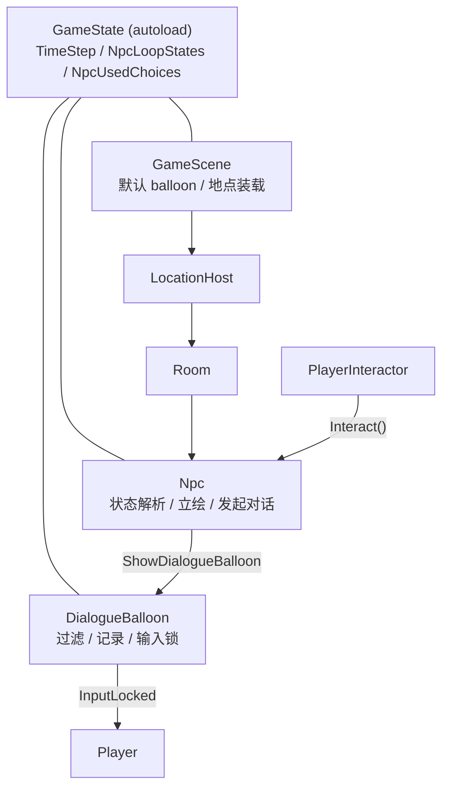
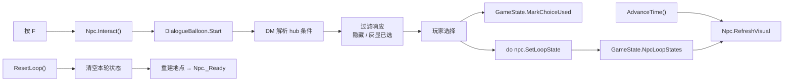
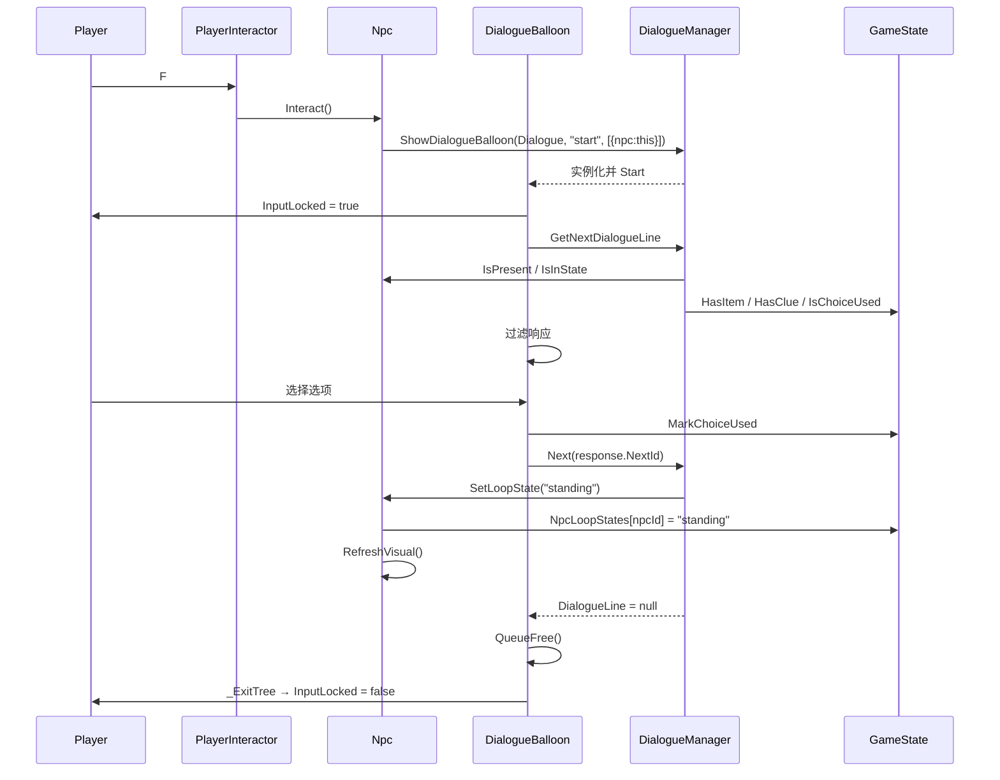

# NPC 系统 实现计划

> **面向 AI 代理的工作者：** 必需子技能：使用 superpowers:subagent-driven-development（推荐）或 superpowers:executing-plans 逐任务实现此计划。步骤使用复选框（`- [x]`）语法来跟踪进度。

**目标：** 做出「固定站位 NPC + 时间表状态 + 对话选项门控 + 已选记录 + 叫醒覆盖」的可玩闭环。

**架构：** NPC 节点从 `NpcStateFrame[]` 时间表与 `GameState` 的本轮覆盖推导有效状态与在场；对话全部交给 Dialogue Manager，选项条件只调用 `Npc` / `GameState` 的方法；`DialogueBalloon` 负责响应过滤、已选记录和玩家输入锁。

**技术栈：** Godot 4.7.2 mono / C#（net8.0）；无测试框架，验证方式为 `dotnet build` + 无头运行 + `get_debug_output` + demo 手测。

**规格：** `docs/superpowers/specs/2026-11-06-npc-system-design.md`

**本项目 git 只读**：任务不包含 commit / branch / checkout / push；每个任务以编译与运行验证收尾。

---

## 验证策略（替代 TDD）

本项目不使用单元测试框架（AGENTS.md 明令禁止引入）。每个任务的「验证」由三件事组成：

1. `& $godot --headless --path . --build-solutions --quit` 编译无错
2. `& $godot --headless --path . --import` 资源导入无报错
3. `& $godot --headless --path . --quit-after 120` 跑主场景，确认**没有** `ERROR` / `SCRIPT ERROR`，并观察 `[Npc]` / `[Dialogue]` 状态打印

交互验收用 godot MCP `run_project` + `get_debug_output`，或直接在编辑器里跑。每个新脚本埋一条 `GD.Print` 状态行，用于确认流程真的走到了。

---

## 架构图



## 数据流图



## 调用链图



---

## 文件结构

| 文件 | 职责 |
|---|---|
| `Scripts/Npc/NpcStateFrame.cs` | `Resource`：`FromStep` / `StateId` / `Texture` / `Visible` |
| `Scripts/Npc/Npc.cs` | NPC：帧表校验、有效状态解析、立绘/在场、发起对话、条件与突变方法 |
| `Scripts/Dialogue/DialogueBalloon.cs` | 对话 UI：正文/选项、响应过滤、已选记录、输入锁 |
| `Scenes/Dialogue/DialogueBalloon.tscn` | 从 ExampleBalloon 复制改造的 balloon 场景 |
| `Scripts/Core/GameState.cs` | 新增本轮 NPC 状态、已选记录、`HasClue` |
| `Scripts/Player/Player.cs` | 新增 `player` 组、`InputLocked` |
| `Scripts/Player/PlayerInteractor.cs` | 锁定时不响应 F |
| `Scripts/Map/GameScene.cs` | 导出并设置默认 balloon |
| `Scripts/Location/LocationRoot.cs` | 同地点 `NpcId` 重复校验 |
| `Scenes/Root/GameScene.tscn` | 挂 `DialogueBalloonScene` 引用 |
| `Scenes/Locations/Classroom.tscn` | 加 `Npc_Student`、状态帧、占位贴图 |
| `Dialogue/Npc/student.dialogue` | demo 剧本 |

---

## 任务 1：`NpcStateFrame` + `GameState` 扩展

**文件：**
- 创建：`Scripts/Npc/NpcStateFrame.cs`
- 修改：`Scripts/Core/GameState.cs`（全文替换）

- [x] **步骤 1：创建 `NpcStateFrame.cs`**

```csharp
using Godot;

/// <summary>NPC 在某一步之后的状态：立绘、是否在场。</summary>
[GlobalClass]
public partial class NpcStateFrame : Resource
{
	/// <summary>从第几步开始生效。</summary>
	[Export] public int FromStep { get; set; }

	/// <summary>状态 id，例如 "standing" / "sleeping" / "absent"。</summary>
	[Export] public string StateId { get; set; } = "";

	/// <summary>该状态的立绘；Visible 为 false 时可为空。</summary>
	[Export] public Texture2D Texture { get; set; }

	/// <summary>该帧是否在场。</summary>
	[Export] public bool Visible { get; set; } = true;
}
```

- [x] **步骤 2：改写 `GameState.cs`**

```csharp
using Godot;
using System.Collections.Generic;

/// <summary>跨场景共享的游戏状态：解锁、背包、线索、时间步、NPC 本轮状态。</summary>
public partial class GameState : Node
{
	/// <summary>全局唯一实例，由 autoload 保证在 _Ready 时赋值。</summary>
	public static GameState Instance { get; private set; }

	/// <summary>已解锁的大地点 id，跨循环保留。</summary>
	public HashSet<string> UnlockedLocations { get; } = new();

	/// <summary>本轮持有的道具 id，每轮清空。</summary>
	public HashSet<string> Inventory { get; } = new();

	/// <summary>手机里记录的线索 id，跨循环保留（本规格只留位）。</summary>
	public HashSet<string> Clues { get; } = new();

	/// <summary>本轮的时间推进计数，每轮归零。</summary>
	public int TimeStep { get; private set; }

	/// <summary>本轮 NPC 状态覆盖：npcId → stateId。</summary>
	private readonly Dictionary<string, string> _npcLoopStates = new();

	/// <summary>本轮已选的一次性选项：npcId → staticId 集合。</summary>
	private readonly Dictionary<string, HashSet<string>> _npcUsedChoices = new();

	[Signal] public delegate void LocationUnlockedEventHandler(string locationId);
	[Signal] public delegate void TimeAdvancedEventHandler(int timeStep);
	[Signal] public delegate void LoopResetEventHandler();

	public override void _Ready()
	{
		Instance = this;
	}

	/// <summary>把 MapConfig 里的初始解锁地点灌入集合，重复调用无副作用。</summary>
	public void SeedInitialUnlocks(MapConfig config)
	{
		if (config == null)
		{
			GD.PushError("GameState.SeedInitialUnlocks: MapConfig 为空");
			return;
		}

		foreach (string id in config.InitialUnlockedLocationIds)
		{
			if (string.IsNullOrEmpty(id))
			{
				GD.PushError("GameState.SeedInitialUnlocks: MapConfig 里有空的地点 id");
				continue;
			}
			UnlockedLocations.Add(id);
		}
	}

	/// <summary>解锁一个大地点；已解锁时什么都不做。</summary>
	public void UnlockLocation(string locationId)
	{
		if (string.IsNullOrEmpty(locationId))
		{
			GD.PushError("GameState.UnlockLocation: 地点 id 为空");
			return;
		}
		if (!UnlockedLocations.Add(locationId)) return;

		GD.Print($"[Map] 解锁地点 {locationId}");
		EmitSignal(SignalName.LocationUnlocked, locationId);
	}

	public bool IsLocationUnlocked(string locationId) => UnlockedLocations.Contains(locationId);

	public bool HasItem(string itemId) => Inventory.Contains(itemId);

	/// <summary>本轮拾取道具。道具系统接管后由它替换。</summary>
	public void AddItem(string itemId)
	{
		if (string.IsNullOrEmpty(itemId))
		{
			GD.PushError("GameState.AddItem: 道具 id 为空");
			return;
		}
		Inventory.Add(itemId);
		GD.Print($"[Item] 获得 {itemId}");
	}

	/// <summary>手机里是否记录了某条线索。</summary>
	public bool HasClue(string clueId)
	{
		if (string.IsNullOrEmpty(clueId))
		{
			GD.PushError("GameState.HasClue: 线索 id 为空");
			return false;
		}
		return Clues.Contains(clueId);
	}

	/// <summary>本轮某个 NPC 的状态覆盖；没有时返回空字符串。</summary>
	public string GetNpcLoopState(string npcId)
	{
		if (string.IsNullOrEmpty(npcId))
		{
			GD.PushError("GameState.GetNpcLoopState: NPC id 为空");
			return "";
		}
		return _npcLoopStates.TryGetValue(npcId, out string stateId) ? stateId : "";
	}

	/// <summary>写入某个 NPC 的本轮状态覆盖。</summary>
	public void SetNpcLoopState(string npcId, string stateId)
	{
		if (string.IsNullOrEmpty(npcId) || string.IsNullOrEmpty(stateId))
		{
			GD.PushError("GameState.SetNpcLoopState: NPC id 或状态 id 为空");
			return;
		}
		_npcLoopStates[npcId] = stateId;
		GD.Print($"[Npc] {npcId} 本轮状态覆盖 -> {stateId}");
	}

	/// <summary>某个 NPC 的一次性选项是否已选过。</summary>
	public bool IsChoiceUsed(string npcId, string staticId)
	{
		if (string.IsNullOrEmpty(npcId) || string.IsNullOrEmpty(staticId))
		{
			GD.PushError("GameState.IsChoiceUsed: NPC id 或选项 id 为空");
			return false;
		}
		return _npcUsedChoices.TryGetValue(npcId, out HashSet<string> used) && used.Contains(staticId);
	}

	/// <summary>记录某个 NPC 的一次性选项已选。</summary>
	public void MarkChoiceUsed(string npcId, string staticId)
	{
		if (string.IsNullOrEmpty(npcId) || string.IsNullOrEmpty(staticId))
		{
			GD.PushError("GameState.MarkChoiceUsed: NPC id 或选项 id 为空");
			return;
		}
		if (!_npcUsedChoices.TryGetValue(npcId, out HashSet<string> used))
		{
			used = new HashSet<string>();
			_npcUsedChoices[npcId] = used;
		}
		used.Add(staticId);
		GD.Print($"[Npc] {npcId} 已选 {staticId}");
	}

	/// <summary>从大地图进入地点、或房间之间切换时推进一格时间。</summary>
	public void AdvanceTime()
	{
		TimeStep++;
		GD.Print($"[Time] TimeStep = {TimeStep}");
		EmitSignal(SignalName.TimeAdvanced, TimeStep);
	}

	/// <summary>循环重置：清掉每轮状态，保留解锁与线索。</summary>
	public void ResetLoop()
	{
		Inventory.Clear();
		TimeStep = 0;
		_npcLoopStates.Clear();
		_npcUsedChoices.Clear();
		GD.Print("[Loop] 重置");
		EmitSignal(SignalName.LoopReset);
	}
}
```

- [x] **步骤 3：编译验证**

```powershell
& "D:\Downloads\Compressed\Godot_v4.7.2-stable_mono_win64\Godot_v4.7.2-stable_mono_win64.exe" --headless --path . --build-solutions --quit
```

预期：**0 error**。此时 `Npc.cs` 还不存在，不影响编译。

---

## 任务 2：玩家输入锁

**文件：**
- 修改：`Scripts/Player/Player.cs`（全文替换）
- 修改：`Scripts/Player/PlayerInteractor.cs`（全文替换）

- [x] **步骤 1：改写 `Player.cs`**

```csharp
using Godot;

/// <summary>玩家：左右移动，对话时锁输入。</summary>
public partial class Player : CharacterBody2D
{
	/// <summary>水平移动速度（像素/秒）。</summary>
	[Export] public float MoveSpeed { get; set; } = 200f;

	/// <summary>跟随玩家的相机，由地点场景设置限位。</summary>
	[Export] public Camera2D Camera { get; set; }

	/// <summary>对话等 UI 打开时锁住移动与交互；由持有 UI 的一方负责复位。</summary>
	public bool InputLocked { get; set; }

	public override void _EnterTree()
	{
		AddToGroup("player");
	}

	public override void _PhysicsProcess(double delta)
	{
		if (InputLocked)
		{
			Velocity = Vector2.Zero;
			return;
		}

		float direction = Input.GetAxis("move_left", "move_right");
		Velocity = new Vector2(direction * MoveSpeed, 0f);
		MoveAndSlide();
	}
}
```

- [x] **步骤 2：改写 `PlayerInteractor.cs`**

```csharp
using Godot;
using System.Linq;

/// <summary>最小交互触发：取范围内最近的 interactable，按 F 调它的 Interact()。</summary>
public partial class PlayerInteractor : Area2D
{
	private Interactable _current;
	private Player _player;

	public override void _Ready()
	{
		_player = GetParent<Player>();
		if (_player == null)
		{
			GD.PushError("PlayerInteractor: 父节点不是 Player");
		}
	}

	public override void _PhysicsProcess(double delta)
	{
		_current = GetOverlappingAreas()
			.OfType<Interactable>()
			.OrderBy(a => a.GlobalPosition.DistanceSquaredTo(GlobalPosition))
			.FirstOrDefault();
	}

	public override void _UnhandledInput(InputEvent @event)
	{
		if (_player == null || _player.InputLocked) return;
		if (_current == null || !@event.IsActionPressed("interact")) return;

		_current.Interact();
		GetViewport().SetInputAsHandled();
	}
}
```

- [x] **步骤 3：编译验证**

```powershell
& "D:\Downloads\Compressed\Godot_v4.7.2-stable_mono_win64\Godot_v4.7.2-stable_mono_win64.exe" --headless --path . --build-solutions --quit
```

预期：**0 error**。

- [x] **步骤 4：无头跑现有 demo**

```powershell
& "D:\Downloads\Compressed\Godot_v4.7.2-stable_mono_win64\Godot_v4.7.2-stable_mono_win64.exe" --headless --path . --quit-after 120
```

预期：没有 `SCRIPT ERROR`；玩家仍能正常创建（无输入，不会移动）。编辑器里手测 A/D、F 开门仍正常。

---

## 任务 3：`Npc` + `DialogueBalloon` 脚本

**文件：**
- 创建：`Scripts/Npc/Npc.cs`
- 创建：`Scripts/Dialogue/DialogueBalloon.cs`

`Npc` 与 `DialogueBalloon` 互相引用（NPC 发起对话，balloon 记录 `NpcId`），必须一起创建后编译。

- [x] **步骤 1：创建 `Npc.cs`**

```csharp
using Godot;
using System.Collections.Generic;
using DialogueManagerRuntime;

/// <summary>固定站位的 NPC：时间表状态、立绘切换、发起对话。</summary>
public partial class Npc : Interactable
{
	/// <summary>全局唯一 id，用于已选记录与本轮状态覆盖；建议 "地点.名字"。</summary>
	[Export] public string NpcId { get; set; } = "";

	/// <summary>这个 NPC 的对话资源。</summary>
	[Export] public Resource Dialogue { get; set; }

	/// <summary>按 FromStep 升序的状态帧；首帧必须是 0。</summary>
	[Export] public NpcStateFrame[] Frames { get; set; } = System.Array.Empty<NpcStateFrame>();

	/// <summary>立绘槽。</summary>
	[Export] public Sprite2D Sprite { get; set; }

	private bool _valid;
	private bool _present;
	private string _effectiveStateId = "";

	public override void _Ready()
	{
		if (GameState.Instance == null)
		{
			GD.PushError($"Npc {NpcId}: GameState 未就绪");
			Monitorable = false;
			return;
		}

		_valid = Validate();
		if (!_valid) return;

		RefreshVisual();
		GameState.Instance.TimeAdvanced += OnTimeAdvanced;
	}

	public override void _ExitTree()
	{
		if (GodotObject.IsInstanceValid(GameState.Instance))
		{
			GameState.Instance.TimeAdvanced -= OnTimeAdvanced;
		}
	}

	/// <summary>当前时间帧是否在场。</summary>
	public bool IsPresent() => _present;

	/// <summary>有效状态（本轮覆盖优先）是否等于 stateId。</summary>
	public bool IsInState(string stateId) => _effectiveStateId == stateId;

	/// <summary>写入本轮状态覆盖并立即刷新；stateId 必须出现在帧表里。</summary>
	public void SetLoopState(string stateId)
	{
		if (!_valid) return;
		if (string.IsNullOrEmpty(stateId))
		{
			GD.PushError($"Npc {NpcId}.SetLoopState: 状态 id 为空");
			return;
		}
		if (!HasState(stateId))
		{
			GD.PushError($"Npc {NpcId}.SetLoopState: 帧表里没有状态 {stateId}");
			return;
		}

		GameState.Instance.SetNpcLoopState(NpcId, stateId);
		RefreshVisual();
	}

	public override void Interact()
	{
		if (!_valid) return;
		if (!_present)
		{
			GD.PushWarning($"Npc {NpcId}: 不在场，忽略交互");
			return;
		}
		if (Dialogue == null)
		{
			GD.PushError($"Npc {NpcId}: Dialogue 为空");
			return;
		}

		GD.Print($"[Npc] 交互 {NpcId}");
		var states = new Godot.Collections.Array<Variant>
		{
			new Godot.Collections.Dictionary { { "npc", this } }
		};

		Node balloon = DialogueManager.ShowDialogueBalloon(Dialogue, "start", states);
		if (balloon == null)
		{
			GD.PushError($"Npc {NpcId}: ShowDialogueBalloon 返回空");
			return;
		}
		if (balloon is DialogueBalloon dialogueBalloon)
		{
			dialogueBalloon.Npc = this;
		}
		else
		{
			GD.PushError($"Npc {NpcId}: 默认 balloon 不是 DialogueBalloon");
			balloon.QueueFree();
		}
	}

	private void OnTimeAdvanced(int timeStep)
	{
		RefreshVisual();
	}

	private void RefreshVisual()
	{
		if (!_valid) return;

		NpcStateFrame frame = ResolveFrame(GameState.Instance.TimeStep);
		if (frame == null)
		{
			GD.PushError($"Npc {NpcId}: TimeStep {GameState.Instance.TimeStep} 没有可用帧");
			return;
		}

		string overrideState = GameState.Instance.GetNpcLoopState(NpcId);
		_effectiveStateId = string.IsNullOrEmpty(overrideState) ? frame.StateId : overrideState;

		NpcStateFrame textureFrame = FindFrame(_effectiveStateId);
		if (textureFrame == null)
		{
			GD.PushError($"Npc {NpcId}: 帧表里没有状态 {_effectiveStateId}");
			return;
		}

		_present = frame.Visible;
		Sprite.Texture = textureFrame.Texture;
		Visible = _present;
		SetDeferred(Area2D.PropertyName.Monitorable, _present);

		Label debugLabel = GetNodeOrNull<Label>("DebugLabel");
		if (debugLabel != null)
		{
			debugLabel.Text = $"{NpcId}:{_effectiveStateId}";
		}

		GD.Print($"[Npc] {NpcId} TimeStep={GameState.Instance.TimeStep} state={_effectiveStateId} present={_present}");
	}

	private NpcStateFrame ResolveFrame(int timeStep)
	{
		NpcStateFrame result = null;
		foreach (NpcStateFrame frame in Frames)
		{
			if (frame.FromStep <= timeStep) result = frame;
			else break;
		}
		return result;
	}

	private NpcStateFrame FindFrame(string stateId)
	{
		foreach (NpcStateFrame frame in Frames)
		{
			if (frame.StateId == stateId) return frame;
		}
		return null;
	}

	private bool HasState(string stateId) => FindFrame(stateId) != null;

	private bool Validate()
	{
		bool valid = true;

		if (string.IsNullOrEmpty(NpcId))
		{
			GD.PushError("Npc: NpcId 为空");
			valid = false;
		}
		if (Dialogue == null)
		{
			GD.PushError($"Npc {NpcId}: Dialogue 为空");
			valid = false;
		}
		if (Sprite == null)
		{
			GD.PushError($"Npc {NpcId}: Sprite 为空");
			valid = false;
		}
		if (Frames == null || Frames.Length == 0)
		{
			GD.PushError($"Npc {NpcId}: Frames 为空");
			Monitorable = false;
			Visible = false;
			return false;
		}
		if (Frames[0] == null || Frames[0].FromStep != 0)
		{
			GD.PushError($"Npc {NpcId}: 首帧 FromStep 必须是 0");
			valid = false;
		}

		int previousStep = -1;
		var textures = new Dictionary<string, Texture2D>();
		foreach (NpcStateFrame frame in Frames)
		{
			if (frame == null)
			{
				GD.PushError($"Npc {NpcId}: Frames 里有空元素");
				valid = false;
				continue;
			}
			if (frame.FromStep <= previousStep)
			{
				GD.PushError($"Npc {NpcId}: FromStep 必须严格递增（重复或倒退：{frame.FromStep}）");
				valid = false;
			}
			previousStep = frame.FromStep;

			if (string.IsNullOrEmpty(frame.StateId))
			{
				GD.PushError($"Npc {NpcId}: 第 {frame.FromStep} 帧 StateId 为空");
				valid = false;
				continue;
			}
			if (frame.Visible && frame.Texture == null)
			{
				GD.PushError($"Npc {NpcId}: 状态 {frame.StateId} 在场但 Texture 为空");
				valid = false;
			}

			if (textures.TryGetValue(frame.StateId, out Texture2D existing))
			{
				if (existing != frame.Texture)
				{
					GD.PushError($"Npc {NpcId}: 状态 {frame.StateId} 对应了不同贴图");
					valid = false;
				}
			}
			else
			{
				textures[frame.StateId] = frame.Texture;
			}
		}

		if (!valid)
		{
			Monitorable = false;
			Visible = false;
		}
		return valid;
	}
}
```

- [x] **步骤 2：创建 `DialogueBalloon.cs`**

```csharp
using Godot;
using Godot.Collections;
using DialogueManagerRuntime;

/// <summary>NPC 对话 balloon：正文、选项过滤、已选记录、玩家输入锁。</summary>
public partial class DialogueBalloon : CanvasLayer
{
	/// <summary>发起本次对话的 NPC；非 NPC 对话时为空。</summary>
	public Npc Npc { get; set; }

	[Export] public string NextAction = "ui_accept";
	[Export] public string SkipAction = "ui_cancel";

	private Control balloon;
	private RichTextLabel characterLabel;
	private DialogueLabel dialogueLabel;
	private DialogueResponsesMenu responsesMenu;
	private Polygon2D progress;

	private Resource dialogueResource;
	private string startFromLabel = "";
	private Array<Variant> temporaryGameStates = new();
	private Array<DialogueResponse> filteredResponses = new();
	private DialogueLine dialogueLine;
	private bool isWaitingForInput;
	private bool willHideBalloon;

	private Player player;
	private GameState gameState;

	private readonly Timer mutationCooldown = new();

	private DialogueLine CurrentLine
	{
		get => dialogueLine;
		set
		{
			if (value == null)
			{
				QueueFree();
				return;
			}
			dialogueLine = value;
			ApplyDialogueLine();
		}
	}

	public override void _Ready()
	{
		balloon = GetNode<Control>("%Balloon");
		characterLabel = GetNode<RichTextLabel>("%CharacterLabel");
		dialogueLabel = GetNode<DialogueLabel>("%DialogueLabel");
		responsesMenu = GetNode<DialogueResponsesMenu>("%ResponsesMenu");
		progress = GetNode<Polygon2D>("%Progress");

		balloon.Hide();
		balloon.GuiInput += OnBalloonGuiInput;

		if (string.IsNullOrEmpty(responsesMenu.NextAction))
		{
			responsesMenu.NextAction = NextAction;
		}
		responsesMenu.ResponseSelected += OnResponseSelected;

		mutationCooldown.Timeout += OnMutationCooldownTimeout;
		AddChild(mutationCooldown);
		DialogueManager.Mutated += OnMutated;

		gameState = GameState.Instance;
		if (gameState == null)
		{
			GD.PushError("DialogueBalloon: GameState 未就绪");
		}
		else
		{
			gameState.LoopReset += OnLoopReset;
		}
	}

	public override void _ExitTree()
	{
		DialogueManager.Mutated -= OnMutated;
		if (GodotObject.IsInstanceValid(gameState))
		{
			gameState.LoopReset -= OnLoopReset;
		}
		if (GodotObject.IsInstanceValid(player))
		{
			player.InputLocked = false;
		}
	}

	public override void _Process(double delta)
	{
		base._Process(delta);

		if (dialogueLine != null)
		{
			progress.Visible = !dialogueLabel.IsTyping
				&& filteredResponses.Count == 0
				&& !dialogueLine.HasTag("voice");
		}
	}

	public async void Start(Resource resource = null, string label = "", Array<Variant> extraGameStates = null)
	{
		if (gameState == null)
		{
			GD.PushError("DialogueBalloon.Start: GameState 未就绪");
			QueueFree();
			return;
		}

		player = GetTree().GetFirstNodeInGroup("player") as Player;
		if (player == null)
		{
			GD.PushError("DialogueBalloon.Start: 找不到 player");
		}
		else
		{
			player.InputLocked = true;
		}

		temporaryGameStates = new Array<Variant> { this } + (extraGameStates ?? new Array<Variant>());
		isWaitingForInput = false;

		if (IsInstanceValid(resource)) dialogueResource = resource;
		if (label != "") startFromLabel = label;

		GD.Print($"[Dialogue] 打开 {Npc?.NpcId ?? "(无 NPC)"}");
		CurrentLine = await DialogueManager.GetNextDialogueLine(dialogueResource, startFromLabel, temporaryGameStates);
		Show();
	}

	private void OnBalloonGuiInput(InputEvent @event)
	{
		if (dialogueLabel.IsTyping)
		{
			bool mouseWasClicked = @event is InputEventMouseButton mb
				&& mb.ButtonIndex == MouseButton.Left
				&& @event.IsPressed();
			bool skipButtonWasPressed = @event.IsActionPressed(SkipAction);
			if (mouseWasClicked || skipButtonWasPressed)
			{
				GetViewport().SetInputAsHandled();
				dialogueLabel.SkipTyping();
				return;
			}
		}

		if (!isWaitingForInput) return;
		if (filteredResponses.Count > 0) return;

		GetViewport().SetInputAsHandled();

		if (@event is InputEventMouseButton mouseButton
			&& mouseButton.IsPressed()
			&& mouseButton.ButtonIndex == MouseButton.Left)
		{
			Next(dialogueLine.NextId);
		}
		else if (@event.IsActionPressed(NextAction) && GetViewport().GuiGetFocusOwner() == balloon)
		{
			Next(dialogueLine.NextId);
		}
	}

	private async void ApplyDialogueLine()
	{
		mutationCooldown.Stop();
		isWaitingForInput = false;
		balloon.FocusMode = Control.FocusModeEnum.All;
		balloon.GrabFocus();

		characterLabel.Visible = !string.IsNullOrEmpty(dialogueLine.Character);
		characterLabel.Text = Tr(dialogueLine.Character, "dialogue");

		dialogueLabel.Hide();
		dialogueLabel.DialogueLine = dialogueLine;

		Array<DialogueResponse> filtered = FilterResponses(dialogueLine);
		filteredResponses = filtered;

		if (dialogueLine.Responses.Count > 0 && !HasSelectable(filtered))
		{
			GD.PushError($"DialogueBalloon: {Npc?.NpcId} 的选项全部不可选，关闭对话");
			QueueFree();
			return;
		}

		responsesMenu.Hide();
		responsesMenu.Responses = filtered;

		balloon.Show();
		willHideBalloon = false;
		dialogueLabel.Show();

		if (!string.IsNullOrEmpty(dialogueLine.Text))
		{
			dialogueLabel.TypeOut();
			await ToSignal(dialogueLabel, DialogueLabel.SignalName.FinishedTyping);
			if (!IsInsideTree()) return;
		}

		if (filtered.Count > 0)
		{
			balloon.FocusMode = Control.FocusModeEnum.None;
			responsesMenu.Show();
			responsesMenu.FocusFirstItem();
		}
		else if (!string.IsNullOrEmpty(dialogueLine.Time))
		{
			if (!float.TryParse(dialogueLine.Time, out float time))
			{
				time = dialogueLine.Text.Length * 0.02f;
			}
			await ToSignal(GetTree().CreateTimer(time), Timer.SignalName.Timeout);
			if (!IsInsideTree()) return;
			Next(dialogueLine.NextId);
		}
		else
		{
			isWaitingForInput = true;
			balloon.FocusMode = Control.FocusModeEnum.All;
			balloon.GrabFocus();
		}
	}

	private Array<DialogueResponse> FilterResponses(DialogueLine line)
	{
		var result = new Array<DialogueResponse>();

		foreach (DialogueResponse response in line.Responses)
		{
			if (response.GetTagValue("hide_if") == "true") continue;

			bool repeatable = response.HasTag("repeatable");
			bool used = Npc != null
				&& gameState != null
				&& !repeatable
				&& !string.IsNullOrEmpty(response.StaticId)
				&& gameState.IsChoiceUsed(Npc.NpcId, response.StaticId);

			if (used)
			{
				response.IsAllowed = false;
				result.Add(response);
				continue;
			}

			if (!response.IsAllowed)
			{
				if (response.GetTagValue("show_if") == "true") result.Add(response);
				continue;
			}

			result.Add(response);
		}

		return result;
	}

	private static bool HasSelectable(Array<DialogueResponse> responses)
	{
		foreach (DialogueResponse response in responses)
		{
			if (response.IsAllowed) return true;
		}
		return false;
	}

	private void OnResponseSelected(DialogueResponse response)
	{
		if (Npc != null && !response.HasTag("repeatable"))
		{
			if (string.IsNullOrEmpty(response.StaticId))
			{
				GD.PushError($"DialogueBalloon: {Npc.NpcId} 的一次性选项缺少 [ID:]");
			}
			else if (gameState != null)
			{
				gameState.MarkChoiceUsed(Npc.NpcId, response.StaticId);
			}
		}

		GD.Print($"[Dialogue] 选择 {response.Text}");
		Next(response.NextId);
	}

	private async void Next(string nextId)
	{
		CurrentLine = await DialogueManager.GetNextDialogueLine(dialogueResource, nextId, temporaryGameStates);
	}

	private void OnMutated(Dictionary mutation)
	{
		if (!(bool)mutation["is_inline"])
		{
			isWaitingForInput = false;
			willHideBalloon = true;
			mutationCooldown.Start(0.1f);
		}
	}

	private void OnMutationCooldownTimeout()
	{
		if (willHideBalloon)
		{
			willHideBalloon = false;
			balloon.Hide();
		}
	}

	private void OnLoopReset()
	{
		QueueFree();
	}
}
```

- [x] **步骤 3：编译验证**

```powershell
& "D:\Downloads\Compressed\Godot_v4.7.2-stable_mono_win64\Godot_v4.7.2-stable_mono_win64.exe" --headless --path . --build-solutions --quit
```

预期：**0 error**。若报 `DialogueBalloon` / `Npc` 找不到，说明两个文件没有同时存在。

---

## 任务 4：balloon 场景 + `GameScene` 默认 balloon

**文件：**
- 创建：`Scenes/Dialogue/DialogueBalloon.tscn`（从 addon 复制改造）
- 修改：`Scripts/Map/GameScene.cs`（全文替换）
- 修改：`Scenes/Root/GameScene.tscn`

- [x] **步骤 1：复制 balloon 场景**

```powershell
New-Item -ItemType Directory -Force Scenes/Dialogue | Out-Null
Copy-Item addons/dialogue_manager/example_balloon/ExampleBalloon.tscn Scenes/Dialogue/DialogueBalloon.tscn
```

- [x] **步骤 2：改场景头与脚本引用**

把文件开头的：

```text
[gd_scene format=3 uid="uid://blvx2ftn6ycqd"]

[ext_resource type="Script" uid="uid://5b3w40kwakl3" path="res://addons/dialogue_manager/example_balloon/ExampleBalloon.cs" id="1_36de5"]
```

改为：

```text
[gd_scene format=3]

[ext_resource type="Script" path="res://Scripts/Dialogue/DialogueBalloon.cs" id="1_36de5"]
```

同时删除根节点行的 `unique_id` 并把根节点改名、加 layer：

```text
[node name="ExampleBalloon" type="CanvasLayer" unique_id=615431052]
```

改为：

```text
[node name="DialogueBalloon" type="CanvasLayer"]
layer = 50
```

- [x] **步骤 3：删掉无用的音频节点**

删除文件末尾：

```text
[node name="AudioStreamPlayer" type="AudioStreamPlayer" parent="." unique_id=140912110]
unique_name_in_owner = true
```

- [x] **步骤 4：显式关闭菜单的二次过滤**

在 `ResponsesMenu` 节点下、`AutoFocusFirstItem = false` 之后加一行：

```text
HideFailedResponses = false
```

- [x] **步骤 5：`GameScene.cs` 全文替换**

```csharp
using Godot;
using System.Threading.Tasks;
using DialogueManagerRuntime;

/// <summary>常驻根场景：装载/卸载地点、显隐地图、衔接过渡、响应循环重置。</summary>
public partial class GameScene : Node2D
{
	/// <summary>初始解锁配置。</summary>
	[Export] public MapConfig MapConfig { get; set; }

	/// <summary>开局与循环重置后进入的起点地点。</summary>
	[Export] public PackedScene StartLocation { get; set; }

	/// <summary>地图面板。</summary>
	[Export] public MapScreen MapScreen { get; set; }

	/// <summary>当前地点的挂载点。</summary>
	[Export] public Node2D LocationHost { get; set; }

	/// <summary>本游戏的对话 balloon 场景。</summary>
	[Export] public PackedScene DialogueBalloonScene { get; set; }

	private LocationRoot _currentLocation;
	private bool _transitioning;

	private ScreenFade Fade => GetNode<ScreenFade>("/root/ScreenFade");

	public override async void _Ready()
	{
		if (MapConfig == null || StartLocation == null || MapScreen == null
			|| LocationHost == null || DialogueBalloonScene == null)
		{
			GD.PushError("GameScene: 有导出引用为空，停止启动");
			return;
		}
		if (!ValidateConfigIds()) return;

		Error balloonError = DialogueManager.SetDefaultBalloon(DialogueBalloonScene);
		if (balloonError != Error.Ok)
		{
			GD.PushError($"GameScene: 设置默认对话 balloon 失败（{balloonError}）");
			return;
		}

		// set_default_balloon 写的是 runtime/balloon_path，而 DMSettings.get_setting
		// 读的是 dialogue_manager/runtime/balloon_path；直接写读取键，
		// 否则 show_dialogue_balloon 会回退到 addon 的示例 balloon。
		ProjectSettings.SetSetting("dialogue_manager/runtime/balloon_path", DialogueBalloonScene.ResourcePath);

		GameState.Instance.SeedInitialUnlocks(MapConfig);
		GameState.Instance.LoopReset += OnLoopReset;
		MapScreen.LocationSelected += OnLocationSelected;
		MapScreen.HideMap();

		Fade.SetOpaque();
		await LoadLocationAsync(StartLocation);
		await Fade.FadeInAsync();
	}

	// 临时调试入口：时间系统接入后删掉，循环重置改由时间系统触发。
	public override void _UnhandledInput(InputEvent @event)
	{
		if (!@event.IsActionPressed("debug_reset_loop")) return;

		GameState.Instance.ResetLoop();
		GetViewport().SetInputAsHandled();
	}

	/// <summary>MapConfig 里写的地点 id 必须在地图按钮中存在，否则是配置写错。</summary>
	private bool ValidateConfigIds()
	{
		foreach (string id in MapConfig.InitialUnlockedLocationIds)
		{
			bool found = false;
			foreach (MapLocationButton button in MapScreen.Buttons)
			{
				if (button != null && button.LocationId == id)
				{
					found = true;
					break;
				}
			}

			if (!found)
			{
				GD.PushError($"GameScene: MapConfig 的地点 {id} 在地图按钮里找不到");
				return false;
			}
		}
		return true;
	}

	private void OnLocationSelected(string locationId, PackedScene scene)
	{
		if (_transitioning) return;

		GameState.Instance.AdvanceTime();
		_ = EnterLocationAsync(locationId, scene);
	}

	private async void OnLoopReset()
	{
		if (_transitioning) return;

		_transitioning = true;
		await Fade.FadeOutAsync();
		UnloadLocation();
		await LoadLocationAsync(StartLocation);
		await Fade.FadeInAsync();
		_transitioning = false;
		GD.Print("[Loop] 已回到起点地点");
	}

	private async Task EnterLocationAsync(string locationId, PackedScene scene)
	{
		if (scene == null)
		{
			GD.PushError($"GameScene: 地点 {locationId} 的 LocationScene 为空");
			return;
		}

		_transitioning = true;
		await Fade.FadeOutAsync();
		UnloadLocation();
		await LoadLocationAsync(scene);
		MapScreen.HideMap();
		await Fade.FadeInAsync();
		_transitioning = false;
		GD.Print($"[Map] 进入地点 {locationId}");
	}

	private async Task LoadLocationAsync(PackedScene scene)
	{
		Node instance = scene.Instantiate();
		if (instance is not LocationRoot location)
		{
			GD.PushError($"GameScene: {scene.ResourcePath} 的根节点不是 LocationRoot");
			instance.QueueFree();
			return;
		}

		LocationHost.AddChild(location);
		_currentLocation = location;
		location.ExitRequested += OnExitRequested;
		await ToSignal(GetTree(), SceneTree.SignalName.ProcessFrame);
	}

	private void UnloadLocation()
	{
		if (_currentLocation == null) return;

		_currentLocation.ExitRequested -= OnExitRequested;
		LocationHost.RemoveChild(_currentLocation);
		_currentLocation.QueueFree();
		_currentLocation = null;
	}

	private async void OnExitRequested()
	{
		if (_transitioning) return;

		_transitioning = true;
		await Fade.FadeOutAsync();
		UnloadLocation();
		MapScreen.ShowMap();
		await Fade.FadeInAsync();
		_transitioning = false;
	}
}
```

- [x] **步骤 6：`GameScene.tscn` 挂 balloon 引用**

在文件头部的 ext_resource 列表末尾加：

```text
[ext_resource type="PackedScene" path="res://Scenes/Dialogue/DialogueBalloon.tscn" id="5_balloon"]
```

在根节点 `LocationHost = NodePath("LocationHost")` 之后加：

```text
DialogueBalloonScene = ExtResource("5_balloon")
```

根节点的 `node_paths` 不需要改（`PackedScene` 不是节点引用）。

- [x] **步骤 7：导入 + 编译 + 无头运行**

```powershell
& "D:\Downloads\Compressed\Godot_v4.7.2-stable_mono_win64\Godot_v4.7.2-stable_mono_win64.exe" --headless --path . --import
& "D:\Downloads\Compressed\Godot_v4.7.2-stable_mono_win64\Godot_v4.7.2-stable_mono_win64.exe" --headless --path . --build-solutions --quit
& "D:\Downloads\Compressed\Godot_v4.7.2-stable_mono_win64\Godot_v4.7.2-stable_mono_win64.exe" --headless --path . --quit-after 120
```

预期：没有 `ERROR` / `SCRIPT ERROR`；日志有 `[Map] 地点 Classroom 就绪`。此时还没有 NPC，balloon 不会被打开。

---

## 任务 5：`LocationRoot` 的 `NpcId` 重复校验

**文件：**
- 修改：`Scripts/Location/LocationRoot.cs`

- [x] **步骤 1：在 `_Ready` 的出口校验之后追加**

在 `if (exits.Count != 1) { ... return; }` 之后、`foreach (Room room in rooms) room.SetActive(false);` 之前插入：

```csharp
		List<Npc> npcs = FindAll<Npc>(this);
		HashSet<string> npcIds = new();
		foreach (Npc npc in npcs)
		{
			if (string.IsNullOrEmpty(npc.NpcId)) continue; // Npc 自己会报错
			if (!npcIds.Add(npc.NpcId))
			{
				GD.PushError($"LocationRoot {Name}: NpcId {npc.NpcId} 重复");
			}
		}
```

- [x] **步骤 2：编译验证**

```powershell
& "D:\Downloads\Compressed\Godot_v4.7.2-stable_mono_win64\Godot_v4.7.2-stable_mono_win64.exe" --headless --path . --build-solutions --quit
```

预期：**0 error**。

---

## 任务 6：demo 剧本 + 教室 NPC

**文件：**
- 创建：`Dialogue/Npc/student.dialogue`
- 修改：`Scenes/Locations/Classroom.tscn`

- [x] **步骤 1：创建 `Dialogue/Npc/student.dialogue`**

```dialogue
~ start
if npc.IsInState("sleeping")
    同学: （趴在桌上睡着了。）
    - 叫醒她 [#repeatable] => wake
    - 算了 [#repeatable] => END
else
    同学: 有什么事吗？
    - 关于器材室 [ID:ask_equipment] => ask_equipment
    - 关于昨天 [ID:ask_yesterday] => ask_yesterday
    - 算了 [#repeatable] => END

~ ask_equipment
同学: 器材室的钥匙好像掉在教室中间。
=> END

~ ask_yesterday
同学: 昨天……我好像做了一个很长的梦。
=> END

~ wake
同学: 唔……我睡着了？
do npc.SetLoopState("standing")
同学: 谢谢你叫醒我。
=> END
```

**语法要点（实现时已踩过）**：DM 4.2.0 的标签必须写 `[#repeatable]`，裸 `#repeatable` 不会被解析；选项正文不要加方括号（`- 叫醒她`，不是 `- [叫醒她]`）；`~ cue` 下的台词/`do`/`=> END` 必须顶格，不能缩进，只有 `if/else` 分支内部缩进一层。

- [x] **步骤 2：给 `Classroom.tscn` 加 ext_resource**

在现有 ext_resource 列表末尾加：

```text
[ext_resource type="Script" path="res://Scripts/Npc/Npc.cs" id="8_npc"]
[ext_resource type="Script" path="res://Scripts/Npc/NpcStateFrame.cs" id="9_frame"]
[ext_resource type="Resource" path="res://Dialogue/Npc/student.dialogue" id="10_dialogue"]
```

- [x] **步骤 3：加占位贴图与状态帧 sub_resource**

在现有 `[sub_resource type="RectangleShape2D" id="RectangleShape2D_zone"]` 之后插入：

```text
[sub_resource type="Gradient" id="Gradient_stand"]
colors = PackedColorArray(0.4, 0.6, 0.95, 1, 0.1, 0.2, 0.5, 1)

[sub_resource type="GradientTexture2D" id="GradientTexture2D_stand"]
gradient = SubResource("Gradient_stand")
width = 120
height = 200
fill_from = Vector2(0.5, 0)
fill_to = Vector2(0.5, 1)

[sub_resource type="Gradient" id="Gradient_sleep"]
colors = PackedColorArray(0.55, 0.5, 0.6, 1, 0.25, 0.22, 0.3, 1)

[sub_resource type="GradientTexture2D" id="GradientTexture2D_sleep"]
gradient = SubResource("Gradient_sleep")
width = 120
height = 200
fill_from = Vector2(0.5, 0)
fill_to = Vector2(0.5, 1)

[sub_resource type="Resource" id="NpcStateFrame_0"]
script = ExtResource("9_frame")
FromStep = 0
StateId = "standing"
Texture = SubResource("GradientTexture2D_stand")
Visible = true

[sub_resource type="Resource" id="NpcStateFrame_1"]
script = ExtResource("9_frame")
FromStep = 1
StateId = "standing"
Texture = SubResource("GradientTexture2D_stand")
Visible = true

[sub_resource type="Resource" id="NpcStateFrame_2"]
script = ExtResource("9_frame")
FromStep = 2
StateId = "sleeping"
Texture = SubResource("GradientTexture2D_sleep")
Visible = true

[sub_resource type="Resource" id="NpcStateFrame_3"]
script = ExtResource("9_frame")
FromStep = 3
StateId = "sleeping"
Texture = SubResource("GradientTexture2D_sleep")
Visible = true

[sub_resource type="Resource" id="NpcStateFrame_4"]
script = ExtResource("9_frame")
FromStep = 4
StateId = "absent"
Visible = false
```

- [x] **步骤 4：在 `Room_Classroom` 里加 NPC 节点**

在 `[node name="Room_Equip" ...]` 之前插入：

```text
[node name="Npc_Student" type="Area2D" parent="Room_Classroom" node_paths=PackedStringArray("Sprite")]
position = Vector2(1200, 520)
script = ExtResource("8_npc")
NpcId = "classroom.student"
Dialogue = ExtResource("10_dialogue")
Frames = Array[ExtResource("9_frame")]([SubResource("NpcStateFrame_0"), SubResource("NpcStateFrame_1"), SubResource("NpcStateFrame_2"), SubResource("NpcStateFrame_3"), SubResource("NpcStateFrame_4")])
Sprite = NodePath("Sprite")

[node name="Sprite" type="Sprite2D" parent="Room_Classroom/Npc_Student"]
position = Vector2(0, -100)
texture = SubResource("GradientTexture2D_stand")

[node name="Shape" type="CollisionShape2D" parent="Room_Classroom/Npc_Student"]
shape = SubResource("RectangleShape2D_zone")

[node name="DebugLabel" type="Label" parent="Room_Classroom/Npc_Student"]
offset_left = -80.0
offset_top = 10.0
offset_right = 80.0
offset_bottom = 50.0
text = "classroom.student:standing"
```

- [x] **步骤 5：导入 + 编译 + 无头运行**

```powershell
& "D:\Downloads\Compressed\Godot_v4.7.2-stable_mono_win64\Godot_v4.7.2-stable_mono_win64.exe" --headless --path . --import
& "D:\Downloads\Compressed\Godot_v4.7.2-stable_mono_win64\Godot_v4.7.2-stable_mono_win64.exe" --headless --path . --build-solutions --quit
& "D:\Downloads\Compressed\Godot_v4.7.2-stable_mono_win64\Godot_v4.7.2-stable_mono_win64.exe" --headless --path . --quit-after 120
```

预期日志包含：

```text
[Npc] classroom.student TimeStep=0 state=standing present=True
[Map] 地点 Classroom 就绪，当前房间 Room_Classroom
```

没有 `ERROR` / `SCRIPT ERROR`。如果 `.dialogue` 编译报错，先修剧本再继续。

---

## 任务 7：端到端验收

**文件：** 无新增；按规格 §10.2 逐条手测。

- [x] **步骤 1：启动项目**

用 godot MCP `run_project`（`projectPath` 传绝对路径 `D:\Projects\GodotProjects\pandagj-2026`），或直接在编辑器里按 F5。

- [x] **步骤 2：逐条走验收清单**

- [x] 第 0 步：NPC 站着（蓝色块，DebugLabel 显示 `classroom.student:standing`）；靠近按 F 打开对话框，玩家不能移动，再按 F 不会重复打开
- [x] 选「关于器材室」→ 台词播完结束；再次交互，该选项灰显不可点，「关于昨天」仍可选
- [x] 出口回地图再进（第 1 步）：NPC 仍站着，已选项仍灰显
- [x] 再回地图再进（第 2 步）：NPC 睡着（灰色块，DebugLabel 显示 `sleeping`），hub 只有「叫醒她」「算了」
- [x] 选「叫醒她」→ 立绘立即变蓝色（DebugLabel 显示 `standing`），台词继续到结束
- [x] 再回地图再进（第 3 步）：时间表是 `sleeping`、本轮覆盖是 `standing` → NPC 仍是蓝色
- [x] 再回地图再进（第 4 步）：时间表是 `absent` → NPC 消失，靠近不能按 F
- [x] F9 重置：回到第 0 步，NPC 站着，已选记录清空，「关于器材室」恢复可选
- [x] 对话中按 F9：balloon 关闭，玩家能移动
- [x] 故意把 `Npc_Student` 的 `Dialogue` 置空：控制台报错，按 F 不崩溃
- [x] 故意把 `NpcStateFrame_0` 的 `FromStep` 改成 1：控制台报错，该 NPC 不参与交互
- [x] 故意删掉 `NpcStateFrame_0` 的 `Texture` 但保留 `Visible = true`：控制台报错，该 NPC 不参与交互

- [x] **步骤 3：检查日志**

用 `get_debug_output` 确认每次状态变化都有 `[Npc] ... TimeStep=... state=... present=...`，每次选择都有 `[Dialogue] 选择 ...`，没有 `ERROR` / `SCRIPT ERROR`。

- [x] **步骤 4：清理 demo 调试物（可选，验收通过后再做）**

删除 `Npc_Student/DebugLabel` 节点，并删除 `Npc.RefreshVisual` 里的：

```csharp
		Label debugLabel = GetNodeOrNull<Label>("DebugLabel");
		if (debugLabel != null)
		{
			debugLabel.Text = $"{NpcId}:{_effectiveStateId}";
		}
```

正式美术替换 `GradientTexture2D` 后，把状态帧的 `Texture` 换成正式立绘。

---

## 任务 8：文档同步

**文件：**
- 修改：`AGENTS.md`（当前结构 / NPC 系统小节）
- 修改：`docs/superpowers/specs/2026-11-06-npc-system-design.md`（状态改为「已实现」）

- [x] **步骤 1：更新 `AGENTS.md` 与 POT 登记**

在 `Scripts/` 列表加：

```text
- `Scripts/Npc/`：`Npc`（时间表状态、立绘、发起对话）、`NpcStateFrame`（状态帧资源）。
- `Scripts/Dialogue/`：`DialogueBalloon`（NPC 对话 UI、选项过滤、已选记录、输入锁）。
```

在「当前结构」的场景列表加：

```text
- `Scenes/Dialogue/DialogueBalloon.tscn`：对话 balloon（从 Dialogue Manager 示例复制改造）。
- `Dialogue/Npc/student.dialogue`：教室 NPC 的 demo 剧本。
```

同时在 `project.godot` 的 `[internationalization] locale/translations_pot_files` 追加 `res://Dialogue/Npc/student.dialogue`（与 `day1.dialogue` 并列）。

- [x] **步骤 2：更新规格状态**

把规格头部：

```text
| 状态 | 待审核 |
```

改为：

```text
| 状态 | 已实现 |
```

- [x] **步骤 3：最终编译 + 无头运行**

```powershell
& "D:\Downloads\Compressed\Godot_v4.7.2-stable_mono_win64\Godot_v4.7.2-stable_mono_win64.exe" --headless --path . --build-solutions --quit
& "D:\Downloads\Compressed\Godot_v4.7.2-stable_mono_win64\Godot_v4.7.2-stable_mono_win64.exe" --headless --path . --quit-after 120
```

预期：**0 error**，无 `SCRIPT ERROR`。

---

## 风险与注意事项

| 项 | 说明 |
|---|---|
| `Monitorable` 是唯一在场开关 | 不要用 `CollisionShape2D.Disabled`；`Room.SetActive` 会覆盖它 |
| `NpcId` 全局唯一 | 已选记录和本轮覆盖按 `NpcId` 存；同地点重复由 `LocationRoot` 报错，跨地点靠 `地点.名字` 命名 |
| 输入锁是单 bool | 未来多系统同时锁输入时要改成计数/令牌 |
| `HasClue` 只读 | 线索系统未实现，当前一律 false，demo 不依赖 |
| `[#repeatable]` 漏标 | 叫醒等状态动作漏标会在第二次同轮变灰；内容 review 要查 |
| `[ID:]` 漏写 | 会在控制台报错，并按可重复处理，不会静默共享错误记录键 |
| 默认 balloon 回退 | addon 的 `SetDefaultBalloon` 写 `runtime/balloon_path`，`DMSettings.get_setting` 读 `dialogue_manager/runtime/balloon_path`；只调它会返回 `Ok` 但回退到示例 balloon。`GameScene` 必须直接补写读取键 |
| 非 NPC 对话 | `Npc` 为空时不记录、不灰显；后续手机/文档对话复用 balloon 时要显式决定 |
