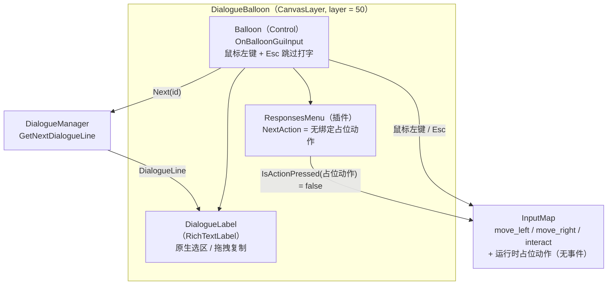
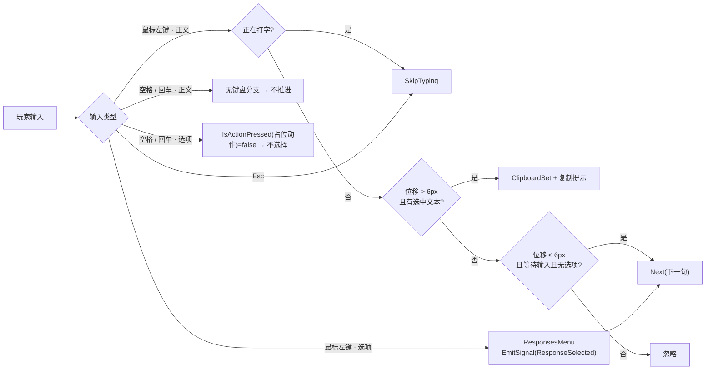
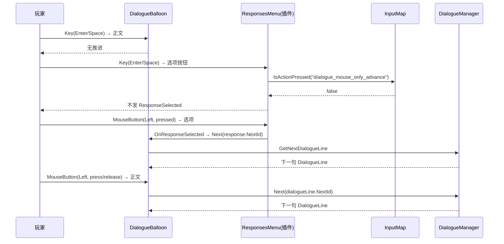

# 对话推进只保留鼠标左键 实现计划

> **面向 AI 代理的工作者：** 必需子技能：使用 superpowers:subagent-driven-development（推荐）或 superpowers:executing-plans 逐任务实现此计划。步骤使用复选框（`- [ ]`）语法来跟踪进度。

**目标：** 对话系统里移除「空格/回车推进下一条」与「空格/回车确认选项」，推进对话只保留鼠标左键。

**架构：** 在 `DialogueBalloon` 内部中和两条键盘路径：删掉本项目自己的 `ui_accept` 推进分支；插件 `DialogueResponsesMenu` 自带的 `ui_accept` 选项确认则通过把它的 `NextAction` 指向一个「运行时新建、无任何按键绑定」的输入动作来失效。Esc 跳过打字、鼠标推进、拖拽复制全部保持原样。

**技术栈：** Godot 4.7.2 mono / C#；Dialogue Manager 4.2.0；`InputMap` 运行时动作。

**规格：** `docs/superpowers/specs/2026-11-07-dialogue-mouse-only-advance-design.md`

**测试说明：** 项目约定不引入单元测试框架（`AGENTS.md` 的「开发约定」），验证方式为：C# 编译 → 无头启动 → 临时无头自检场景 → 有窗口手测。计划中不包含 git commit 步骤（项目 git 只读）。

**执行记录（2026-11-07，内联执行）：**

- 任务 1、2、3 已完成：`Scripts/Dialogue/DialogueBalloon.cs` 改动落地；`dotnet build` 0 错误（1 个与本次无关的既有警告）；`godot --headless --path . --build-solutions --quit` 与 `--headless --path . --quit-after 120` 均无报错；临时无头自检 7 项断言全部 PASS（临时文件已删除）。
- 任务 4（有窗口手测）待用户确认：headless 的 dummy 显示服务器鼠标位置异常，鼠标命中测试无法自动化。
- 未执行 git commit / branch / checkout（项目 git 只读）。

---

## 文件结构

| 文件 | 职责 | 本次动作 |
|---|---|---|
| `Scripts/Dialogue/DialogueBalloon.cs` | 对话 balloon：输入判定、选项过滤、推进 | 修改：移除键盘推进路径 |
| `AGENTS.md` | 项目长期约定 | 修改：补一条输入规则 |
| `docs/superpowers/specs/2026-11-07-dialogue-mouse-only-advance-design.md` | 本次设计规格 | 新增 |
| `docs/superpowers/plans/2026-11-07-dialogue-mouse-only-advance.md` | 本计划 | 新增 |
| `docs/superpowers/specs/2026-11-06-npc-system-design.md` | NPC 系统规格 | 修改：作废 `NextAction` 字段条目 |
| `docs/superpowers/specs/2026-11-07-dialogue-text-selection-copy-design.md` | 拖拽选择规格 | 修改：标注键盘推进描述已被新规格取代 |

---

## 架构与数据流

### 架构图



### 数据流



### 调用链



---

### 任务 1：改掉 `DialogueBalloon` 的两条键盘推进路径

**文件：**
- 修改：`Scripts/Dialogue/DialogueBalloon.cs:15`（导出字段）、`Scripts/Dialogue/DialogueBalloon.cs:38`（新增常量）、`Scripts/Dialogue/DialogueBalloon.cs:97`（`_Ready`）、`Scripts/Dialogue/DialogueBalloon.cs:240`（`OnBalloonGuiInput` 末尾）

- [ ] **步骤 1：删除 `NextAction` 导出字段**

改前：

```csharp
[Export] public string NextAction = "ui_accept";
[Export] public string SkipAction = "ui_cancel";
```

改后：

```csharp
[Export] public string SkipAction = "ui_cancel";
```

- [ ] **步骤 2：新增无绑定占位动作常量**

在 `DocumentCollectedColor` 常量之后加：

```csharp
/// <summary>没有任何按键绑定的占位动作：用来关掉响应菜单自带的空格/回车选择。</summary>
private static readonly StringName MouseOnlyAdvanceAction = "dialogue_mouse_only_advance";
```

- [ ] **步骤 3：`_Ready` 里把响应菜单的 `NextAction` 指向占位动作**

改前：

```csharp
if (string.IsNullOrEmpty(responsesMenu.NextAction))
{
    responsesMenu.NextAction = NextAction;
}
responsesMenu.ResponseSelected += OnResponseSelected;
```

改后：

```csharp
// 响应菜单自带 ui_accept（空格/回车）键盘选择；对话只保留鼠标左键，
// 因此给它一个没有任何按键绑定的动作，IsActionPressed 恒为 false。
if (!InputMap.HasAction(MouseOnlyAdvanceAction))
{
    InputMap.AddAction(MouseOnlyAdvanceAction);
}
responsesMenu.NextAction = MouseOnlyAdvanceAction;
responsesMenu.ResponseSelected += OnResponseSelected;
```

- [ ] **步骤 4：删除 `OnBalloonGuiInput` 末尾的键盘推进分支**

删除整段：

```csharp
if (!isWaitingForInput) return;
if (filteredResponses.Count > 0) return;

if (@event.IsActionPressed(NextAction) && GetViewport().GuiGetFocusOwner() == balloon)
{
    GetViewport().SetInputAsHandled();
    Next(dialogueLine.NextId);
}
```

方法末尾保留鼠标分支的收尾：

```csharp
// 位移超过阈值但没有选中（拖在对话框空白处）：什么都不做。
return;
}
```

- [ ] **步骤 5：更新正文焦点注释**

改前：

```csharp
// 点击正文会抢走 Balloon 的键盘焦点，导致空格/回车推进失效。
dialogueLabel.FocusMode = Control.FocusModeEnum.None;
```

改后：

```csharp
// 引擎在 set_selection_enabled(true) 里会把 focus_mode 设成 ALL；
// 正文不需要键盘焦点，改回 None，避免抢走 Balloon 的焦点。
dialogueLabel.FocusMode = Control.FocusModeEnum.None;
```

- [ ] **步骤 6：编译**

运行：`dotnet build`
预期：`已成功生成`，0 错误（既有 1 个 `LoopEndNotice.Show` 警告与本次无关）。

---

### 任务 2：验证行为

**文件：**
- 临时创建：`TempVerify/TempVerifyDialogueInput.cs`、`TempVerify/TempVerifyDialogueInput.tscn`（验证后删除）

- [ ] **步骤 1：编译并跑主场景**

运行：

```powershell
& $godot --headless --path . --build-solutions --quit
& $godot --headless --path . --quit-after 120
```

预期：两条命令都无报错，主场景打印 `[Map] 地点 Classroom 就绪`。

- [ ] **步骤 2：写临时自检场景**

`TempVerify/TempVerifyDialogueInput.cs` 的关键断言（完整文件见规格 §8.1）：

```csharp
DialogueBalloon balloon = GD.Load<PackedScene>("res://Scenes/Dialogue/DialogueBalloon.tscn")
    .Instantiate<DialogueBalloon>();
AddChild(balloon);
await ToSignal(GetTree(), SceneTree.SignalName.ProcessFrame);
DialogueResponsesMenu menu = balloon.GetNode<DialogueResponsesMenu>("Balloon/CenterContainer/ResponsesMenu");

bool hasAction = InputMap.HasAction("dialogue_mouse_only_advance");

// 空格事件确实到达引擎：ui_accept 被按下
Input.ParseInputEvent(new InputEventKey { Keycode = Key.Space, Pressed = true });
await ToSignal(GetTree(), SceneTree.SignalName.ProcessFrame);
bool uiAcceptPressed = Input.IsActionPressed("ui_accept");
bool keylessPressed = Input.IsActionPressed("dialogue_mouse_only_advance");
```

再用 `res://Dialogue/Npc/yuka.dialogue` 打开一段带选项的对话，按空格后断言：正文未变、选项数量不变。

- [ ] **步骤 3：运行自检**

运行：

```powershell
& $godot --headless --path . res://TempVerify/TempVerifyDialogueInput.tscn
```

预期输出：

```
[verify] PASS 占位动作已注册
[verify] PASS 空格命中 ui_accept
[verify] PASS 空格不命中占位动作
[verify] PASS 响应菜单 NextAction 指向占位动作
[verify] PASS 选项已显示
[verify] PASS 空格不推进对话
[verify] PASS 空格不选择选项
[verify] 全部通过
```

- [ ] **步骤 4：删除临时文件并重新编译**

```powershell
Remove-Item -Recurse -Force "TempVerify"
& $godot --headless --path . --build-solutions --quit
```

预期：构建通过，工程里不再有 `TempVerify`。

---

### 任务 3：同步文档

**文件：**
- 修改：`AGENTS.md`（对话系统段落）
- 修改：`docs/superpowers/specs/2026-11-06-npc-system-design.md:283`
- 修改：`docs/superpowers/specs/2026-11-07-dialogue-text-selection-copy-design.md`（头部状态 + 键盘推进描述）

- [ ] **步骤 1：`AGENTS.md` 对话系统段落补规则**

在「对话系统」小节的拖拽选择那条后面补：

```
- 对话推进只保留鼠标左键：空格/回车既不推进下一句，也不确认选项；`DialogueBalloon` 把插件 `ResponsesMenu.NextAction` 指向运行时注册的无绑定动作 `dialogue_mouse_only_advance`。Esc 跳过打字保留。
```

- [ ] **步骤 2：作废 NPC 规格里的 `NextAction` 字段条目**

`docs/superpowers/specs/2026-11-06-npc-system-design.md`：

```markdown
| `NextAction` | `ui_accept` | 推进正文/确认选项 |
| `SkipAction` | `ui_cancel` | 跳过打字机；不关闭对话 |
```

改为：

```markdown
| `SkipAction` | `ui_cancel` | 跳过打字机；不关闭对话 |

> 2026-11-07 起 `NextAction` 已移除：对话推进只保留鼠标左键，详见 `docs/superpowers/specs/2026-11-07-dialogue-mouse-only-advance-design.md`。
```

- [ ] **步骤 3：标注旧规格里的键盘推进描述已作废**

`docs/superpowers/specs/2026-11-07-dialogue-text-selection-copy-design.md` 头部状态行后加一行：

```markdown
| 后续变更 | 2026-11-07：键盘推进（空格/回车）被移除，详见 `docs/superpowers/specs/2026-11-07-dialogue-mouse-only-advance-design.md` |
```

并把「键盘空格 / 回车 | 仍推进；不改变选区」一行改为「键盘空格 / 回车 | 不再推进（2026-11-07 起只保留鼠标左键）；不改变选区」。

---

### 任务 4：有窗口手测（待用户确认）

- [ ] 打开任意 NPC 对话，连按空格/回车：正文不推进
- [ ] 出现选项时按空格/回车：不高亮、不选择、不推进
- [ ] 鼠标左键点击正文：正常推进
- [ ] 鼠标左键点击选项：正常选择并推进
- [ ] 正文拖拽选中文本：仍然自动复制并提示「已复制」
- [ ] 打字过程中按 Esc：仍然跳过打字
- [ ] 手机主菜单：鼠标点击正常，空格不再误触选项
