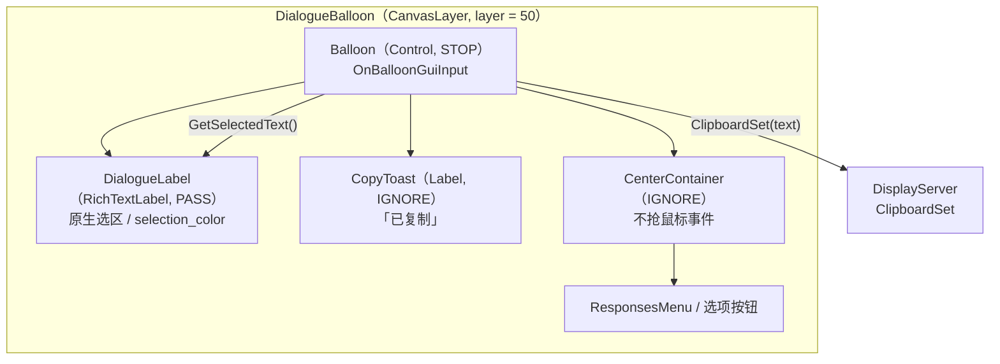
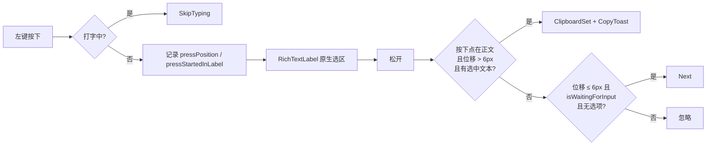
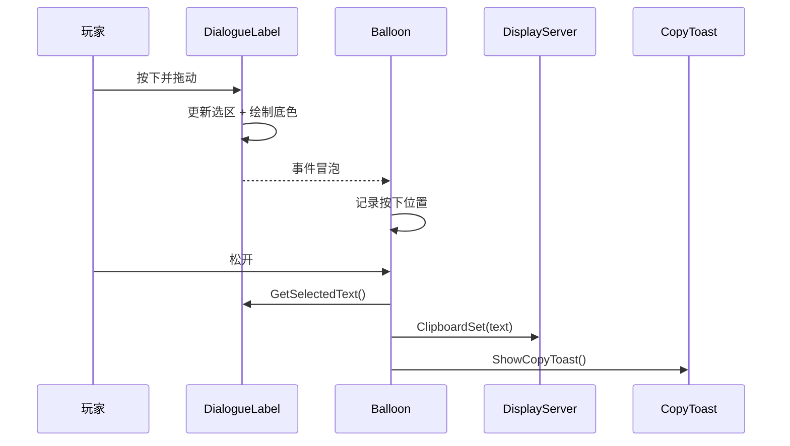

# 对话文本拖拽选择与自动复制 实现计划

> **面向 AI 代理的工作者：** 必需子技能：使用 superpowers:subagent-driven-development（推荐）或 superpowers:executing-plans 逐任务实现此计划。步骤使用复选框（`- [ ]`）语法来跟踪进度。

**目标：** 让对话正文支持鼠标拖拽选择，选区显示底色，松开后自动复制纯文本到系统剪贴板，同时保留「单击推进对话」。

**架构：** 打开 `DialogueLabel`（`RichTextLabel`）的原生选区能力，由引擎负责高亮与选区计算；`DialogueBalloon` 把左键推进从「按下触发」改成「松开判定」，用 6px 位移阈值区分单击与拖拽；复制成功后由 `CopyToast` 显示 0.7 秒提示。场景侧需要把全屏 `CenterContainer` 设为 `IGNORE`，并处理 `selection_enabled` 对 `focus_mode` 的副作用。

**技术栈：** Godot 4.7.2 mono / C#；Dialogue Manager 4.2.0；`RichTextLabel` 原生选区。

**规格：** `docs/superpowers/specs/2026-11-07-dialogue-text-selection-copy-design.md`

**测试说明：** 项目约定不引入单元测试框架（`AGENTS.md` 的「开发约定」），本计划的验证方式是：C# 编译 → 无头启动 → 有窗口手测。计划中不包含 git commit 步骤（项目 git 只读）。

**执行记录（2026-11-07，内联执行）：**

- 任务 1-7、9 已完成：场景 / 脚本修改落地，C# 编译 0 警告 / 0 错误，`--headless --path . --quit-after 120` 与 `DialogueBalloon.tscn` 单独无头实例化均无报错；`AGENTS.md` 已同步。
- 任务 8（有窗口手测）待用户确认；拖拽高亮、剪贴板内容与提示动画只能在窗口环境验证。
- 未执行 git commit / branch / checkout（项目 git 只读）。

---

## 架构与数据流

### 架构图



### 数据流



### 调用链



---

## 文件结构

| 文件 | 职责 | 变更 |
|---|---|---|
| `Scenes/Dialogue/DialogueBalloon.tscn` | 对话 balloon 的节点树与主题 | `CenterContainer` 设 `IGNORE`；主题加 `selection_color`；新增 `CopyToast` |
| `Scripts/Dialogue/DialogueBalloon.cs` | 对话流程、输入判定、复制与提示 | 选区生命周期、松开判定、复制、提示 |
| `AGENTS.md` | 项目结构与约定说明 | 对话系统段落补一条行为说明 |

不改：`addons/dialogue_manager/**`、`project.godot`、`Dialogue/**/*.dialogue`、`Scripts/Core/GameState.cs`、`Scripts/Player/Player.cs`。

---

## 任务 1：场景——让鼠标事件到达正文

**文件：**
- 修改：`Scenes/Dialogue/DialogueBalloon.tscn:182-188`（`CenterContainer` 节点）

**背景：** `Balloon/CenterContainer` 是铺满全屏的 `CenterContainer`，`Container` 默认 `mouse_filter = PASS`，且绘制在 `MarginContainer`（对话框面板）之后。引擎命中测试会先命中它，`DialogueLabel` 收不到鼠标按下，原生选区无法启动。

- [x] **步骤 1：关闭 Godot 编辑器**

关闭正在打开本项目的 Godot 编辑器，避免编辑器保存场景时覆盖外部改动。

- [x] **步骤 2：把 `CenterContainer` 设为 `IGNORE`**

找到：

```ini
[node name="CenterContainer" type="CenterContainer" parent="Balloon" unique_id=473552711]
layout_mode = 1
anchors_preset = 15
```

改为：

```ini
[node name="CenterContainer" type="CenterContainer" parent="Balloon" unique_id=473552711]
layout_mode = 1
mouse_filter = 2
anchors_preset = 15
```

说明：`mouse_filter = 2` 是 `IGNORE`，只影响该节点自己作为事件目标；命中测试先递归子节点，`ResponsesMenu` 里的选项按钮仍然可点。

- [x] **步骤 3：导入资源验证场景可加载**

运行：

```powershell
$godot = "D:\Downloads\Compressed\Godot_v4.7.2-stable_mono_win64\Godot_v4.7.2-stable_mono_win64.exe"
& $godot --headless --path . --import
```

预期：无场景解析错误、无资源导入错误。

---

## 任务 2：场景——选中底色与「已复制」提示

**文件：**
- 修改：`Scenes/Dialogue/DialogueBalloon.tscn:66-76`（`Theme_qq3yp` 子资源）
- 修改：`Scenes/Dialogue/DialogueBalloon.tscn` 文件末尾（新增 `CopyToast`）

- [x] **步骤 1：给 Balloon 主题加选中底色**

在 `[sub_resource type="Theme" id="Theme_qq3yp"]` 的键值区追加一行（放在 `MarginContainer/constants/margin_top = 15` 之后即可）：

```ini
RichTextLabel/colors/selection_color = Color(1, 1, 1, 0.35)
```

说明：`DialogueLabel` 会继承 `Balloon` 的主题；默认的 `selection_color` 是高饱和蓝 `Color(0.1, 0.1, 1, 0.8)`，不适合黑色对话框。

- [x] **步骤 2：新增 `CopyToast` 节点**

在 `DialogueBalloon.tscn` 文件末尾（`ResponseExample` 节点之后）追加：

```ini
[node name="CopyToast" type="Label" parent="Balloon"]
unique_name_in_owner = true
visible = false
modulate = Color(1, 1, 1, 0)
layout_mode = 1
anchors_preset = 3
anchor_left = 1.0
anchor_top = 1.0
anchor_right = 1.0
anchor_bottom = 1.0
offset_left = -150.0
offset_top = -246.0
offset_right = -34.0
offset_bottom = -226.0
grow_horizontal = 0
grow_vertical = 0
mouse_filter = 2
theme_override_colors/font_color = Color(1, 1, 1, 0.75)
theme_override_font_sizes/font_size = 16
text = "已复制"
horizontal_alignment = 2
```

说明：节点放在 `Balloon` 下、`CenterContainer` 之后，绘制在对话框面板上方；位置在面板顶部（高 219px）上方 7px、右侧 34px。`mouse_filter = 2` 确保提示不挡点击。

- [x] **步骤 3：导入资源验证**

运行：

```powershell
& $godot --headless --path . --import
```

预期：没有 `Parse Error` / `Invalid node` / 主题键错误。

---

## 任务 3：脚本——新增字段与 `_Ready` 初始化

**文件：**
- 修改：`Scripts/Dialogue/DialogueBalloon.cs:13-18`（字段区）
- 修改：`Scripts/Dialogue/DialogueBalloon.cs:49-56`（`_Ready` 开头）

- [x] **步骤 1：新增字段**

在 `private Polygon2D progress;` 之后追加：

```csharp
	/// <summary>区分「拖拽选择」与「单击推进」的位移阈值（像素）。</summary>
	[Export] public float ClickDragThreshold = 6.0f;

	private Label copyToast;
	private Tween copyToastTween;
	private bool pointerPressed;
	private bool pressStartedInLabel;
	private Vector2 pressPosition;
```

- [x] **步骤 2：在 `_Ready` 取得提示节点并关闭选区**

在 `progress = GetNode<Polygon2D>("%Progress");` 之后追加：

```csharp
		copyToast = GetNodeOrNull<Label>("%CopyToast");
		if (copyToast == null)
		{
			GD.PushError("DialogueBalloon: 找不到 %CopyToast，复制提示不可用");
		}
		dialogueLabel.SelectionEnabled = false;
```

- [x] **步骤 3：编译验证**

运行：

```powershell
& $godot --headless --path . --build-solutions --quit
```

预期：编译通过；`SelectionEnabled`、`Tween`、`Vector2` 均能解析。

---

## 任务 4：脚本——每句的选区生命周期

**文件：**
- 修改：`Scripts/Dialogue/DialogueBalloon.cs:172-231`（`ApplyDialogueLine`）

- [x] **步骤 1：新一句开始时关闭选区并清掉上一句提示**

在 `ApplyDialogueLine` 的最开头（`mutationCooldown.Stop();` 之前）插入：

```csharp
		// 新的一句：关掉上一句的选区，并清掉上一句的复制提示。
		dialogueLabel.SelectionEnabled = false;
		copyToastTween?.Kill();
		if (copyToast != null) copyToast.Visible = false;
```

`SelectionEnabled = false` 在引擎里会顺带 `deselect()`，不需要额外调用 `Deselect()`。

- [x] **步骤 2：打字完成后打开选区，并避免抢焦点**

找到 `ApplyDialogueLine` 里的打字块：

```csharp
		if (!string.IsNullOrEmpty(dialogueLine.Text))
		{
			dialogueLabel.TypeOut();
			await ToSignal(dialogueLabel, DialogueLabel.SignalName.FinishedTyping);
			if (!GodotObject.IsInstanceValid(this)) return;
		}
```

在它之后、`if (filtered.Count > 0)` 之前插入：

```csharp
		// 打字完成（或本句无文字）：本句正文可以拖拽选择。
		dialogueLabel.SelectionEnabled = true;
		// 引擎在 set_selection_enabled(true) 里会把 focus_mode 设成 ALL；
		// 点击正文会抢走 Balloon 的键盘焦点，导致空格/回车推进失效。
		dialogueLabel.FocusMode = Control.FocusModeEnum.None;
```

- [x] **步骤 3：编译验证**

运行：

```powershell
& $godot --headless --path . --build-solutions --quit
```

预期：编译通过；`FocusModeEnum.None` 可解析。

---

## 任务 5：脚本——复制与「已复制」提示

**文件：**
- 修改：`Scripts/Dialogue/DialogueBalloon.cs`（在 `OnResponseSelected` 之前或 `OnMutated` 附近新增方法）

- [x] **步骤 1：新增 `CopySelectedText`**

```csharp
	private void CopySelectedText(string text)
	{
		if (!DisplayServer.HasFeature(DisplayServer.Feature.Clipboard))
		{
			GD.PushError("DialogueBalloon: 当前平台没有剪贴板，无法复制对话");
			return;
		}

		DisplayServer.ClipboardSet(text);
		ShowCopyToast();
		GD.Print($"[Dialogue] 已复制 {text.Length} 字");
	}
```

- [x] **步骤 2：新增 `ShowCopyToast`**

```csharp
	private void ShowCopyToast()
	{
		if (copyToast == null) return;   // 缺失已在 _Ready 报错

		copyToastTween?.Kill();
		copyToast.Visible = true;
		copyToast.Modulate = new Color(1, 1, 1, 0);

		copyToastTween = CreateTween();
		copyToastTween.TweenProperty(copyToast, "modulate:a", 1.0f, 0.1f);
		copyToastTween.TweenInterval(0.35f);
		copyToastTween.TweenProperty(copyToast, "modulate:a", 0.0f, 0.25f);
		copyToastTween.TweenCallback(Callable.From(() => copyToast.Visible = false));
	}
```

- [x] **步骤 3：编译验证**

运行：

```powershell
& $godot --headless --path . --build-solutions --quit
```

预期：编译通过；`DisplayServer.Feature.Clipboard`、`TweenProperty`、`Callable.From` 可解析。

---

## 任务 6：脚本——输入判定改为「按下记录 / 松开判定」

**文件：**
- 修改：`Scripts/Dialogue/DialogueBalloon.cs:139-170`（整个 `OnBalloonGuiInput`）

- [x] **步骤 1：替换 `OnBalloonGuiInput`**

用下面的实现替换原方法（保留打字中跳过打字的行为）：

```csharp
	private void OnBalloonGuiInput(InputEvent @event)
	{
		// 打字中：点击或 Esc 都是跳过打字（现有行为）。
		if (dialogueLabel.IsTyping)
		{
			bool mouseWasClicked = @event is InputEventMouseButton mb
				&& mb.ButtonIndex == MouseButton.Left
				&& @event.IsPressed();
			bool skipButtonWasPressed = @event.IsActionPressed(SkipAction);
			if (mouseWasClicked || skipButtonWasPressed)
			{
				GetViewport().SetInputAsHandled();
				dialogueLabel.SkipTyping();
				return;
			}
		}

		if (@event is InputEventMouseButton mouseButton && mouseButton.ButtonIndex == MouseButton.Left)
		{
			if (mouseButton.Pressed)
			{
				// 只要不是打字中，按下就记录位置；复制与推进都留到松开时判定。
				// 选项菜单 / 自动推进等待期间也记录，否则那两种状态下无法拖拽复制。
				pointerPressed = true;
				pressPosition = mouseButton.Position;
				pressStartedInLabel = dialogueLabel.GetGlobalRect()
					.HasPoint(mouseButton.GlobalPosition);
				return;
			}

			if (!pointerPressed) return;
			pointerPressed = false;

			float dragDistance = mouseButton.Position.DistanceTo(pressPosition);
			string selected = dialogueLabel.GetSelectedText();

			if (pressStartedInLabel
				&& dragDistance > ClickDragThreshold
				&& !string.IsNullOrWhiteSpace(selected))
			{
				GetViewport().SetInputAsHandled();
				CopySelectedText(selected);
				return;
			}

			if (dragDistance <= ClickDragThreshold
				&& isWaitingForInput
				&& filteredResponses.Count == 0)
			{
				GetViewport().SetInputAsHandled();
				Next(dialogueLine.NextId);
			}

			// 位移超过阈值但没有选中（拖在对话框空白处）：什么都不做。
			return;
		}

		if (!isWaitingForInput) return;
		if (filteredResponses.Count > 0) return;

		if (@event.IsActionPressed(NextAction) && GetViewport().GuiGetFocusOwner() == balloon)
		{
			GetViewport().SetInputAsHandled();
			Next(dialogueLine.NextId);
		}
	}
```

- [x] **步骤 2：编译验证**

运行：

```powershell
& $godot --headless --path . --build-solutions --quit
```

预期：编译通过。

---

## 任务 7：编译与无头运行

**文件：** 无（验证任务）

- [x] **步骤 1：构建 C#**

```powershell
$godot = "D:\Downloads\Compressed\Godot_v4.7.2-stable_mono_win64\Godot_v4.7.2-stable_mono_win64.exe"
& $godot --headless --path . --build-solutions --quit
```

预期：无编译错误、无新增 warning。

- [x] **步骤 2：无头启动主场景**

```powershell
& $godot --headless --path . --quit-after 120
```

预期：无脚本运行时错误；`SceneTree` 正常退出。

---

## 任务 8：有窗口手测

**文件：** 无（验证任务）

启动游戏（任选其一）：

```powershell
& $godot --path .
```

或用 godot MCP 的 `run_project` + `get_debug_output`。

按规格 §8.2 验收：

- [ ] 对话打字中点击 → 只跳过打字，不出现选区
- [ ] 打字完成后原地单击正文 → 进入下一句
- [ ] 打字完成后原地单击对话框空白 → 进入下一句
- [ ] 拖选半句 → 选中底色可见；松开后对话不推进
- [ ] 松开后 PowerShell `Get-Clipboard` 或记事本粘贴内容与选区一致
- [ ] 跨行拖选 → 纯文本，无 BBCode、无自动折行产生的额外换行
- [ ] 「已复制」出现在对话框右上缘，约 0.7 秒后消失，不遮挡正文
- [ ] 有选项菜单时拖选正文 → 复制正常；点击选项正常进入分支
- [ ] 拖动 3~5px 后松开 → 仍按单击推进
- [ ] 复制后选区保持高亮；在正文上再次按下或进入新一句后清除
- [ ] 对话结束 / 循环重置 → 无残留提示、无报错
- [ ] 键盘空格 / 回车推进、Esc 跳过打字仍正常
- [ ] 拖选复制后点击正文，再按空格 / 回车 → 仍能推进（焦点没有被正文抢走）
- [ ] 不同窗口尺寸下提示位置仍在对话框右上方

如果「能点、但拖不出选区」：检查 `CenterContainer` 是否漏了 `mouse_filter = 2`。
如果空格/回车失效：检查是否漏了 `dialogueLabel.FocusMode = Control.FocusModeEnum.None;`。
如果复制报错：检查 `DisplayServer.HasFeature(DisplayServer.Feature.Clipboard)` 的返回与平台。

---

## 任务 9：同步项目文档

**文件：**
- 修改：`AGENTS.md`（「## 对话系统」段落）
- 检查：`docs/superpowers/specs/2026-11-07-dialogue-text-selection-copy-design.md` 的 mermaid 图与实现一致

- [x] **步骤 1：在 `AGENTS.md` 的对话系统段落补一行**

在「对话系统」列表末尾追加：

```markdown
- 对白正文支持鼠标拖拽选择：打字完成后打开 `RichTextLabel` 原生选区（主题 `selection_color`），松开时若有选中文本则自动写入系统剪贴板并显示「已复制」；原地单击仍推进对话，判定阈值 `DialogueBalloon.ClickDragThreshold`（默认 6px）。`Balloon/CenterContainer` 必须保持 `mouse_filter = 2`，否则全屏容器会抢走正文的鼠标事件。
```

- [x] **步骤 2：检查 mermaid 图**

确认规格里的架构图 / 数据流图 / 调用链图与最终实现一致；如果实现中节点名或流程有变化，同步改图。

- [x] **步骤 3：最终 diff 检查**

```powershell
git status --short
git diff -- Scenes/Dialogue/DialogueBalloon.tscn Scripts/Dialogue/DialogueBalloon.cs AGENTS.md
```

预期：只包含本计划的变更；`addons/`、`project.godot`、`.dialogue` 没有改动。**不要执行 git commit / branch / checkout / push。**

- [x] **步骤 4：同步规格状态**

实现并手测通过后，把 `docs/superpowers/specs/2026-11-07-dialogue-text-selection-copy-design.md` 头部的 `状态` 改为 `已实现（YYYY-MM-DD）`，并按实际手测结果勾选 §8.2 清单。

---

## 完成标准

- C# 编译通过，无头运行无报错。
- 拖拽正文出现半透明白底色；松开自动复制正文纯文本；对话不推进。
- 原地单击（位移 ≤ 6px）仍推进对话；打字中点击仍跳过打字。
- 「已复制」提示出现并在约 0.7 秒后消失。
- 选项菜单、循环重置、对话结束、键盘推进均无回归。
- `AGENTS.md` 与规格文档同步。
