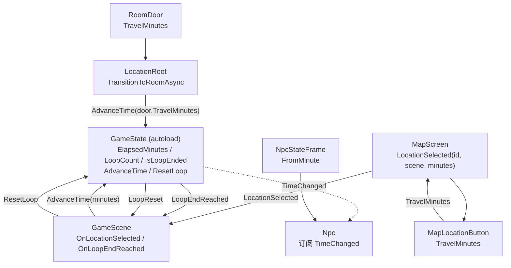
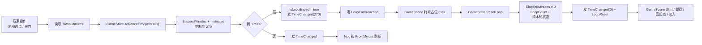
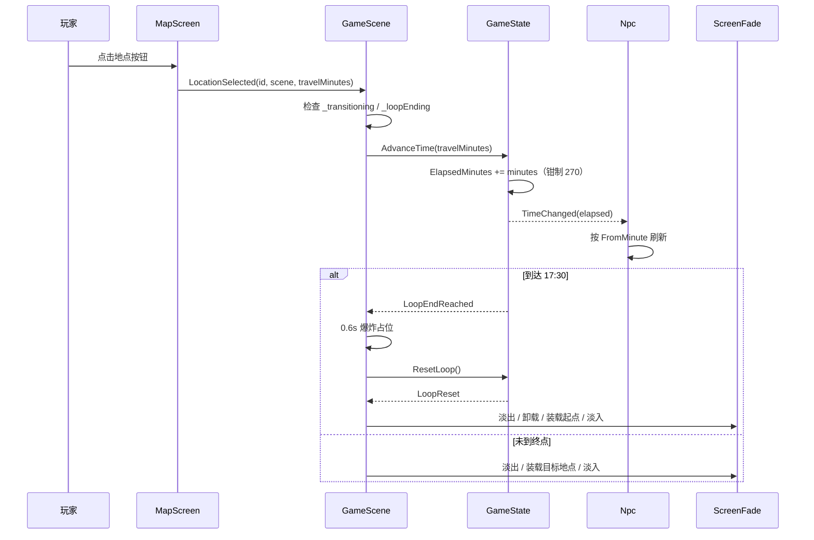

# 时间系统 实现计划

> **面向 AI 代理的工作者：** 必需子技能：使用 superpowers:subagent-driven-development（推荐）或 superpowers:executing-plans 逐任务实现此计划。步骤使用复选框（`- [ ]`）语法来跟踪进度。

**目标：** 把现有的 `TimeStep` 步数时钟换成 13:00–17:30 的分钟时钟：地图旅行 / 房间切换按配置扣分钟，NPC 按 `FromMinute` 换帧，17:30 触发循环重置。

**架构：** `GameState` 持有 `ElapsedMinutes` / `LoopCount` / `IsLoopEnded`；`AdvanceTime(minutes)` 由地图按钮和房门调用；`GameScene` 响应 `LoopEndReached` 并调用 `ResetLoop`；`Npc` 订阅 `TimeChanged` 按分钟解析帧。

**技术栈：** Godot 4.7.2 mono / C#（net8.0）；无测试框架，验证方式为 `--build-solutions` + `--import` + `--quit-after` + godot MCP `run_project` / `get_debug_output` + demo 手测。

**规格：** `docs/superpowers/specs/2026-11-07-time-system-design.md`

**本项目 git 只读**：任务不包含 commit / branch / checkout / push；每个任务以编译与运行验证收尾。

---

## 验证策略（替代 TDD）

本项目不使用单元测试框架（AGENTS.md 明令禁止引入）。每个任务的「验证」由三件事组成：

1. `& $godot --headless --path . --import` 资源导入无报错
2. `& $godot --headless --path . --build-solutions --quit` 编译无错
3. `& $godot --headless --path . --quit-after 120` 跑主场景，确认**没有** `ERROR` / `SCRIPT ERROR`，并观察 `[Time]` / `[Npc]` / `[Loop]` 状态打印

交互验收用 godot MCP `run_project` + `get_debug_output`，或直接在编辑器里跑。每个关键流程埋一条 `GD.Print` 状态行，用于确认流程真的走到了。

> 任务 1 是跨文件 API 迁移：**步骤 1–9 必须连续完成后再编译**。中间不要编译，因为旧调用点还在引用已删除的 `TimeStep` / `TimeAdvanced` / 无参 `AdvanceTime()`。

---

## 架构图



## 数据流图



## 调用链图



---

## 文件结构

| 文件 | 职责 | 类型 |
|---|---|---|
| `Scripts/Core/GameState.cs` | 分钟时钟、周目、终末信号、`ResetLoop` | 修改 |
| `Scripts/Npc/NpcStateFrame.cs` | `FromMinute` 时间帧资源 | 修改 |
| `Scripts/Npc/Npc.cs` | 按分钟解析帧、订阅 `TimeChanged` | 修改 |
| `Scripts/Map/MapLocationButton.cs` | `TravelMinutes` | 修改 |
| `Scripts/Map/MapScreen.cs` | `LocationSelected` 带分钟 | 修改 |
| `Scripts/Map/GameScene.cs` | 终末响应、地图/房门调用点 | 修改 |
| `Scripts/Location/RoomDoor.cs` | `TravelMinutes` | 修改 |
| `Scripts/Location/LocationRoot.cs` | 房间切换前扣时 | 修改 |
| `Scenes/Locations/Classroom.tscn` | demo 帧迁到 `FromMinute` | 修改 |
| `Scenes/Map/MapScreen.tscn` | 按钮显式 `TravelMinutes` | 修改 |
| `project.godot` | 删除旧的输入动作；只保留移动与交互 | 修改 |
| `AGENTS.md` | 文档同步 | 修改 |

不改：`Dialogue/*.dialogue`、`Resources/MapConfig.tres`、`Scripts/Audio/AudioManager.cs`、`Scripts/Core/ScreenFade.cs`。

---

## 任务 1：时钟核心与所有调用点迁移

**文件：**
- 修改：`Scripts/Core/GameState.cs`（全文替换）
- 修改：`Scripts/Npc/NpcStateFrame.cs`（全文替换）
- 修改：`Scripts/Npc/Npc.cs`（全文替换）
- 修改：`Scripts/Map/MapLocationButton.cs`（全文替换）
- 修改：`Scripts/Map/MapScreen.cs`（全文替换）
- 修改：`Scripts/Map/GameScene.cs`（全文替换）
- 修改：`Scripts/Location/RoomDoor.cs`（全文替换）
- 修改：`Scripts/Location/LocationRoot.cs`（全文替换）
- 修改：`project.godot`（删除旧的输入动作；只保留移动与交互）

> 步骤 1–9 必须连续完成后再做步骤 10 的编译。中间编译会报「找不到 `TimeStep` / `TimeAdvanced`」等错误，这是预期的迁移中间态。

- [x] **步骤 1：替换 `GameState.cs`**

```csharp
using Godot;
using System.Collections.Generic;

/// <summary>跨场景共享的游戏状态：时钟、周目、解锁、背包、线索、NPC 本轮状态。</summary>
public partial class GameState : Node
{
	/// <summary>循环开始时的时间（分钟，从 0 点算）。13:00 = 780。</summary>
	public const int LoopStartMinuteOfDay = 13 * 60;

	/// <summary>循环结束时的时间（分钟，从 0 点算）。17:30 = 1050。</summary>
	public const int LoopEndMinuteOfDay = 17 * 60 + 30;

	/// <summary>一轮的分钟长度。270。</summary>
	public const int LoopDurationMinutes = LoopEndMinuteOfDay - LoopStartMinuteOfDay;

	/// <summary>全局唯一实例，由 autoload 保证在 _Ready 时赋值。</summary>
	public static GameState Instance { get; private set; }

	/// <summary>已解锁的大地点 id，同一进程内跨循环保留。</summary>
	public HashSet<string> UnlockedLocations { get; } = new();

	/// <summary>本轮持有的道具 id，每轮清空。</summary>
	public HashSet<string> Inventory { get; } = new();

	/// <summary>手机里记录的线索 id，同一进程内跨循环保留。</summary>
	public HashSet<string> Clues { get; } = new();

	/// <summary>本轮已经过的分钟数；0 = 13:00，270 = 17:30。</summary>
	public int ElapsedMinutes { get; private set; }

	/// <summary>当前进程内的周目序号；开局 1，每次 ResetLoop +1。</summary>
	public int LoopCount { get; private set; } = 1;

	/// <summary>是否已到 17:30；ResetLoop 后复位。</summary>
	public bool IsLoopEnded { get; private set; }

	/// <summary>本轮 NPC 状态覆盖：npcId → stateId。</summary>
	private readonly Dictionary<string, string> _npcLoopStates = new();

	/// <summary>本轮已选的一次性选项：npcId → staticId 集合。</summary>
	private readonly Dictionary<string, HashSet<string>> _npcUsedChoices = new();

	[Signal] public delegate void LocationUnlockedEventHandler(string locationId);
	[Signal] public delegate void TimeChangedEventHandler(int elapsedMinutes);
	[Signal] public delegate void LoopEndReachedEventHandler();
	[Signal] public delegate void LoopResetEventHandler();

	public override void _Ready()
	{
		Instance = this;
	}

	/// <summary>把 MapConfig 里的初始解锁地点灌入集合，重复调用无副作用。</summary>
	public void SeedInitialUnlocks(MapConfig config)
	{
		if (config == null)
		{
			GD.PushError("GameState.SeedInitialUnlocks: MapConfig 为空");
			return;
		}

		foreach (string id in config.InitialUnlockedLocationIds)
		{
			if (string.IsNullOrEmpty(id))
			{
				GD.PushError("GameState.SeedInitialUnlocks: MapConfig 里有空的地点 id");
				continue;
			}
			UnlockedLocations.Add(id);
		}
	}

	/// <summary>解锁一个大地点；已解锁时什么都不做。</summary>
	public void UnlockLocation(string locationId)
	{
		if (string.IsNullOrEmpty(locationId))
		{
			GD.PushError("GameState.UnlockLocation: 地点 id 为空");
			return;
		}
		if (!UnlockedLocations.Add(locationId)) return;

		GD.Print($"[Map] 解锁地点 {locationId}");
		EmitSignal(SignalName.LocationUnlocked, locationId);
	}

	public bool IsLocationUnlocked(string locationId) => UnlockedLocations.Contains(locationId);

	public bool HasItem(string itemId) => Inventory.Contains(itemId);

	/// <summary>本轮拾取道具。道具系统接管后由它替换。</summary>
	public void AddItem(string itemId)
	{
		if (string.IsNullOrEmpty(itemId))
		{
			GD.PushError("GameState.AddItem: 道具 id 为空");
			return;
		}
		Inventory.Add(itemId);
		GD.Print($"[Item] 获得 {itemId}");
	}

	/// <summary>手机里是否记录了某条线索。</summary>
	public bool HasClue(string clueId)
	{
		if (string.IsNullOrEmpty(clueId))
		{
			GD.PushError("GameState.HasClue: 线索 id 为空");
			return false;
		}
		return Clues.Contains(clueId);
	}

	/// <summary>本轮某个 NPC 的状态覆盖；没有时返回空字符串。</summary>
	public string GetNpcLoopState(string npcId)
	{
		if (string.IsNullOrEmpty(npcId))
		{
			GD.PushError("GameState.GetNpcLoopState: NPC id 为空");
			return "";
		}
		return _npcLoopStates.TryGetValue(npcId, out string stateId) ? stateId : "";
	}

	/// <summary>写入某个 NPC 的本轮状态覆盖。</summary>
	public void SetNpcLoopState(string npcId, string stateId)
	{
		if (string.IsNullOrEmpty(npcId) || string.IsNullOrEmpty(stateId))
		{
			GD.PushError("GameState.SetNpcLoopState: NPC id 或状态 id 为空");
			return;
		}
		_npcLoopStates[npcId] = stateId;
		GD.Print($"[Npc] {npcId} 本轮状态覆盖 -> {stateId}");
	}

	/// <summary>某个 NPC 的一次性选项是否已选过。</summary>
	public bool IsChoiceUsed(string npcId, string staticId)
	{
		if (string.IsNullOrEmpty(npcId) || string.IsNullOrEmpty(staticId))
		{
			GD.PushError("GameState.IsChoiceUsed: NPC id 或选项 id 为空");
			return false;
		}
		return _npcUsedChoices.TryGetValue(npcId, out HashSet<string> used) && used.Contains(staticId);
	}

	/// <summary>记录某个 NPC 的一次性选项已选。</summary>
	public void MarkChoiceUsed(string npcId, string staticId)
	{
		if (string.IsNullOrEmpty(npcId) || string.IsNullOrEmpty(staticId))
		{
			GD.PushError("GameState.MarkChoiceUsed: NPC id 或选项 id 为空");
			return;
		}
		if (!_npcUsedChoices.TryGetValue(npcId, out HashSet<string> used))
		{
			used = new HashSet<string>();
			_npcUsedChoices[npcId] = used;
		}
		used.Add(staticId);
		GD.Print($"[Npc] {npcId} 已选 {staticId}");
	}

	/// <summary>推进 minutes 分钟；返回 true 表示本次推进触发或已处于终末。</summary>
	public bool AdvanceTime(int minutes)
	{
		if (IsLoopEnded) return true;
		if (minutes < 0)
		{
			GD.PushError("GameState.AdvanceTime: minutes 不能为负");
			return false;
		}
		if (minutes == 0) return false;

		int next = ElapsedMinutes + minutes;
		ElapsedMinutes = next > LoopDurationMinutes ? LoopDurationMinutes : next;
		GD.Print($"[Time] {GetClockText()} (+{minutes})");
		EmitSignal(SignalName.TimeChanged, ElapsedMinutes);

		if (ElapsedMinutes >= LoopDurationMinutes)
		{
			IsLoopEnded = true;
			EmitSignal(SignalName.LoopEndReached);
			return true;
		}

		return false;
	}

	/// <summary>循环重置：时间归零、周目 +1，清本轮状态，保留解锁与线索。</summary>
	public void ResetLoop()
	{
		ElapsedMinutes = 0;
		IsLoopEnded = false;
		LoopCount++;

		Inventory.Clear();
		_npcLoopStates.Clear();
		_npcUsedChoices.Clear();

		GD.Print($"[Loop] 第 {LoopCount} 周目开始");
		EmitSignal(SignalName.TimeChanged, 0);
		EmitSignal(SignalName.LoopReset);
	}

	/// <summary>返回 "13:45" 形式的时钟文本。</summary>
	public string GetClockText()
	{
		int total = LoopStartMinuteOfDay + ElapsedMinutes;
		return $"{total / 60:00}:{total % 60:00}";
	}

	/// <summary>只读：本轮已过去的分钟数。</summary>
	public int GetElapsedMinutes() => ElapsedMinutes;

	/// <summary>只读：当前周目序号。</summary>
	public int GetLoopCount() => LoopCount;

	/// <summary>是否一周目；一周目固定锁用。</summary>
	public bool IsFirstLoop() => LoopCount == 1;
}
```

- [x] **步骤 2：替换 `NpcStateFrame.cs`**

```csharp
using Godot;

/// <summary>NPC 在循环内某分钟之后的状态：立绘、是否在场。</summary>
[GlobalClass]
public partial class NpcStateFrame : Resource
{
	/// <summary>从循环内第几分钟开始生效；0 = 13:00，45 = 13:45。</summary>
	[Export] public int FromMinute { get; set; }

	/// <summary>状态 id，例如 "standing" / "sleeping" / "absent"。</summary>
	[Export] public string StateId { get; set; } = "";

	/// <summary>该状态的立绘；Visible 为 false 时可为空。</summary>
	[Export] public Texture2D Texture { get; set; }

	/// <summary>该帧是否在场。</summary>
	[Export] public bool Visible { get; set; } = true;
}
```

- [x] **步骤 3：替换 `Npc.cs`**

```csharp
using Godot;
using System.Collections.Generic;
using DialogueManagerRuntime;

/// <summary>固定站位的 NPC：时间表状态、立绘切换、发起对话。</summary>
public partial class Npc : Interactable
{
	/// <summary>全局唯一 id，用于已选记录与本轮状态覆盖；建议 "地点.名字"。</summary>
	[Export] public string NpcId { get; set; } = "";

	/// <summary>这个 NPC 的对话资源。</summary>
	[Export] public Resource Dialogue { get; set; }

	/// <summary>按 FromMinute 升序的状态帧；首帧必须是 0（13:00）。</summary>
	[Export] public NpcStateFrame[] Frames { get; set; } = System.Array.Empty<NpcStateFrame>();

	/// <summary>立绘槽。</summary>
	[Export] public Sprite2D Sprite { get; set; }

	private bool _valid;
	private bool _present;
	private string _effectiveStateId = "";

	public override void _Ready()
	{
		if (GameState.Instance == null)
		{
			GD.PushError($"Npc {NpcId}: GameState 未就绪");
			Monitorable = false;
			return;
		}

		_valid = Validate();
		if (!_valid) return;

		RefreshVisual();
		GameState.Instance.TimeChanged += OnTimeChanged;
	}

	public override void _ExitTree()
	{
		if (GodotObject.IsInstanceValid(GameState.Instance))
		{
			GameState.Instance.TimeChanged -= OnTimeChanged;
		}
	}

	/// <summary>当前时间帧是否在场。</summary>
	public bool IsPresent() => _present;

	/// <summary>有效状态（本轮覆盖优先）是否等于 stateId。</summary>
	public bool IsInState(string stateId) => _effectiveStateId == stateId;

	/// <summary>写入本轮状态覆盖并立即刷新；stateId 必须出现在帧表里。</summary>
	public void SetLoopState(string stateId)
	{
		if (!_valid) return;
		if (string.IsNullOrEmpty(stateId))
		{
			GD.PushError($"Npc {NpcId}.SetLoopState: 状态 id 为空");
			return;
		}
		if (!HasState(stateId))
		{
			GD.PushError($"Npc {NpcId}.SetLoopState: 帧表里没有状态 {stateId}");
			return;
		}

		GameState.Instance.SetNpcLoopState(NpcId, stateId);
		RefreshVisual();
	}

	public override void Interact()
	{
		if (!_valid) return;
		if (!_present)
		{
			GD.PushWarning($"Npc {NpcId}: 不在场，忽略交互");
			return;
		}
		if (Dialogue == null)
		{
			GD.PushError($"Npc {NpcId}: Dialogue 为空");
			return;
		}

		GD.Print($"[Npc] 交互 {NpcId}");
		var states = new Godot.Collections.Array<Variant>
		{
			new Godot.Collections.Dictionary { { "npc", this } }
		};

		Node balloon = DialogueManager.ShowDialogueBalloon(Dialogue, "start", states);
		if (balloon == null)
		{
			GD.PushError($"Npc {NpcId}: ShowDialogueBalloon 返回空");
			return;
		}
		if (balloon is DialogueBalloon dialogueBalloon)
		{
			dialogueBalloon.Npc = this;
		}
		else
		{
			GD.PushError($"Npc {NpcId}: 默认 balloon 不是 DialogueBalloon");
			balloon.QueueFree();
		}
	}

	private void OnTimeChanged(int elapsedMinutes)
	{
		RefreshVisual();
	}

	private void RefreshVisual()
	{
		if (!_valid) return;

		NpcStateFrame frame = ResolveFrame(GameState.Instance.ElapsedMinutes);
		if (frame == null)
		{
			GD.PushError($"Npc {NpcId}: {GameState.Instance.GetClockText()} 没有可用帧");
			return;
		}

		string overrideState = GameState.Instance.GetNpcLoopState(NpcId);
		_effectiveStateId = string.IsNullOrEmpty(overrideState) ? frame.StateId : overrideState;

		NpcStateFrame textureFrame = FindFrame(_effectiveStateId);
		if (textureFrame == null)
		{
			GD.PushError($"Npc {NpcId}: 帧表里没有状态 {_effectiveStateId}");
			return;
		}

		_present = frame.Visible;
		Sprite.Texture = textureFrame.Texture;
		Visible = _present;
		SetDeferred(Area2D.PropertyName.Monitorable, _present);

		Label debugLabel = GetNodeOrNull<Label>("DebugLabel");
		if (debugLabel != null)
		{
			debugLabel.Text = $"{NpcId}:{_effectiveStateId} @{GameState.Instance.GetClockText()}";
		}

		GD.Print($"[Npc] {NpcId} {GameState.Instance.GetClockText()} state={_effectiveStateId} present={_present}");
	}

	private NpcStateFrame ResolveFrame(int elapsedMinutes)
	{
		NpcStateFrame result = null;
		foreach (NpcStateFrame frame in Frames)
		{
			if (frame.FromMinute <= elapsedMinutes) result = frame;
			else break;
		}
		return result;
	}

	private NpcStateFrame FindFrame(string stateId)
	{
		foreach (NpcStateFrame frame in Frames)
		{
			if (frame.StateId == stateId) return frame;
		}
		return null;
	}

	private bool HasState(string stateId) => FindFrame(stateId) != null;

	private bool Validate()
	{
		bool valid = true;

		if (string.IsNullOrEmpty(NpcId))
		{
			GD.PushError("Npc: NpcId 为空");
			valid = false;
		}
		if (Dialogue == null)
		{
			GD.PushError($"Npc {NpcId}: Dialogue 为空");
			valid = false;
		}
		if (Sprite == null)
		{
			GD.PushError($"Npc {NpcId}: Sprite 为空");
			valid = false;
		}
		if (Frames == null || Frames.Length == 0)
		{
			GD.PushError($"Npc {NpcId}: Frames 为空");
			Monitorable = false;
			Visible = false;
			return false;
		}
		if (Frames[0] == null)
		{
			GD.PushError($"Npc {NpcId}: 首帧为空");
			valid = false;
		}
		else if (Frames[0].FromMinute != 0)
		{
			GD.PushError($"Npc {NpcId}: 首帧 FromMinute 必须是 0");
			valid = false;
		}

		int previousMinute = -1;
		var textures = new Dictionary<string, Texture2D>();
		foreach (NpcStateFrame frame in Frames)
		{
			if (frame == null)
			{
				GD.PushError($"Npc {NpcId}: Frames 里有空元素");
				valid = false;
				continue;
			}
			if (frame.FromMinute <= previousMinute)
			{
				GD.PushError($"Npc {NpcId}: FromMinute 必须严格递增（重复或倒退：{frame.FromMinute}）");
				valid = false;
			}
			previousMinute = frame.FromMinute;

			if (string.IsNullOrEmpty(frame.StateId))
			{
				GD.PushError($"Npc {NpcId}: 第 {frame.FromMinute} 分钟帧 StateId 为空");
				valid = false;
				continue;
			}
			if (frame.Visible && frame.Texture == null)
			{
				GD.PushError($"Npc {NpcId}: 状态 {frame.StateId} 在场但 Texture 为空");
				valid = false;
			}

			if (textures.TryGetValue(frame.StateId, out Texture2D existing))
			{
				if (existing != frame.Texture)
				{
					GD.PushError($"Npc {NpcId}: 状态 {frame.StateId} 对应了不同贴图");
					valid = false;
				}
			}
			else
			{
				textures[frame.StateId] = frame.Texture;
			}
		}

		if (!valid)
		{
			Monitorable = false;
			Visible = false;
		}
		return valid;
	}
}
```

- [x] **步骤 4：替换 `MapLocationButton.cs`**

```csharp
using Godot;

/// <summary>地图上的一个地点按钮，自带解锁 id、要装载的场景与旅行耗时。</summary>
public partial class MapLocationButton : Button
{
	/// <summary>与 GameState.UnlockedLocations 对应的地点 id。</summary>
	[Export] public string LocationId { get; set; }

	/// <summary>点击后装载的地点场景。</summary>
	[Export] public PackedScene LocationScene { get; set; }

	/// <summary>前往该地点消耗的分钟数；0 表示免费。</summary>
	[Export] public int TravelMinutes { get; set; } = 30;
}
```

- [x] **步骤 5：替换 `MapScreen.cs`**

```csharp
using Godot;
using System.Collections.Generic;

/// <summary>大地图面板：按解锁状态刷新按钮可见性，把点击转成 LocationSelected。</summary>
public partial class MapScreen : Control
{
	/// <summary>地图上全部地点按钮，显式配置避免按名字查找。</summary>
	[Export] public MapLocationButton[] Buttons { get; set; } = System.Array.Empty<MapLocationButton>();

	[Signal] public delegate void LocationSelectedEventHandler(
		string locationId,
		PackedScene locationScene,
		int travelMinutes);

	public override void _Ready()
	{
		Validate();
		foreach (MapLocationButton button in Buttons)
		{
			MapLocationButton captured = button;
			captured.Pressed += () => EmitSignal(
				SignalName.LocationSelected,
				captured.LocationId,
				captured.LocationScene,
				captured.TravelMinutes);
		}
		Visible = false;
	}

	/// <summary>按 GameState 的解锁集合刷新每颗按钮的可见性。</summary>
	public void Refresh()
	{
		int visibleCount = 0;
		foreach (MapLocationButton button in Buttons)
		{
			button.Visible = GameState.Instance.IsLocationUnlocked(button.LocationId);
			if (button.Visible) visibleCount++;
		}

		if (visibleCount == 0)
		{
			GD.PushError("MapScreen.Refresh: 没有任何可见地点，地图死局");
		}
	}

	public void ShowMap()
	{
		Refresh();
		Visible = true;
	}

	public void HideMap()
	{
		Visible = false;
	}

	private void Validate()
	{
		if (Buttons.Length == 0)
		{
			GD.PushError("MapScreen: Buttons 为空");
			return;
		}

		HashSet<string> seen = new();
		foreach (MapLocationButton button in Buttons)
		{
			if (button == null)
			{
				GD.PushError("MapScreen: Buttons 里有 null 项");
				continue;
			}
			if (string.IsNullOrEmpty(button.LocationId))
			{
				GD.PushError($"MapScreen: 按钮 {button.Name} 的 LocationId 为空");
			}
			if (button.LocationScene == null)
			{
				GD.PushError($"MapScreen: 按钮 {button.Name} 的 LocationScene 为空");
			}
			if (button.TravelMinutes < 0)
			{
				GD.PushError($"MapScreen: 按钮 {button.Name} 的 TravelMinutes 不能为负");
			}
			if (!string.IsNullOrEmpty(button.LocationId) && !seen.Add(button.LocationId))
			{
				GD.PushError($"MapScreen: LocationId 重复 —— {button.LocationId}");
			}
		}
	}
}
```

- [x] **步骤 6：替换 `GameScene.cs`**

```csharp
using Godot;
using System.Threading.Tasks;
using DialogueManagerRuntime;

/// <summary>常驻根场景：装载/卸载地点、显隐地图、衔接过渡、响应循环重置与终末。</summary>
public partial class GameScene : Node2D
{
	/// <summary>初始解锁配置。</summary>
	[Export] public MapConfig MapConfig { get; set; }

	/// <summary>开局与循环重置后进入的起点地点。</summary>
	[Export] public PackedScene StartLocation { get; set; }

	/// <summary>地图面板。</summary>
	[Export] public MapScreen MapScreen { get; set; }

	/// <summary>当前地点的挂载点。</summary>
	[Export] public Node2D LocationHost { get; set; }

	/// <summary>本游戏的对话 balloon 场景。</summary>
	[Export] public PackedScene DialogueBalloonScene { get; set; }

	private LocationRoot _currentLocation;
	private bool _transitioning;
	private bool _loopEnding;

	private ScreenFade Fade => GetNode<ScreenFade>("/root/ScreenFade");

	public override async void _Ready()
	{
		if (MapConfig == null || StartLocation == null || MapScreen == null
			|| LocationHost == null || DialogueBalloonScene == null)
		{
			GD.PushError("GameScene: 有导出引用为空，停止启动");
			return;
		}
		if (GameState.Instance == null)
		{
			GD.PushError("GameScene: GameState 未就绪，停止启动");
			return;
		}
		if (!ValidateConfigIds()) return;

		Error balloonError = DialogueManager.SetDefaultBalloon(DialogueBalloonScene);
		if (balloonError != Error.Ok)
		{
			GD.PushError($"GameScene: 设置默认对话 balloon 失败（{balloonError}）");
			return;
		}

		// set_default_balloon 写的是 runtime/balloon_path，而 DMSettings.get_setting
		// 读的是 dialogue_manager/runtime/balloon_path；直接写读取键，
		// 否则 show_dialogue_balloon 会回退到 addon 的示例 balloon。
		ProjectSettings.SetSetting("dialogue_manager/runtime/balloon_path", DialogueBalloonScene.ResourcePath);

		GameState.Instance.SeedInitialUnlocks(MapConfig);
		GameState.Instance.LoopReset += OnLoopReset;
		GameState.Instance.LoopEndReached += OnLoopEndReached;
		MapScreen.LocationSelected += OnLocationSelected;
		MapScreen.HideMap();

		Fade.SetOpaque();
		await LoadLocationAsync(StartLocation);
		await Fade.FadeInAsync();
	}

	/// <summary>MapConfig 里写的地点 id 必须在地图按钮中存在，否则是配置写错。</summary>
	private bool ValidateConfigIds()
	{
		foreach (string id in MapConfig.InitialUnlockedLocationIds)
		{
			bool found = false;
			foreach (MapLocationButton button in MapScreen.Buttons)
			{
				if (button != null && button.LocationId == id)
				{
					found = true;
					break;
				}
			}

			if (!found)
			{
				GD.PushError($"GameScene: MapConfig 的地点 {id} 在地图按钮里找不到");
				return false;
			}
		}
		return true;
	}

	private void OnLocationSelected(string locationId, PackedScene scene, int travelMinutes)
	{
		if (_transitioning || _loopEnding) return;
		if (GameState.Instance.AdvanceTime(travelMinutes)) return;

		_ = EnterLocationAsync(locationId, scene);
	}

	private async void OnLoopEndReached()
	{
		if (_loopEnding) return;
		_loopEnding = true;

		GD.Print("[Loop] 17:30 爆炸");
		await ToSignal(GetTree().CreateTimer(0.6), Timer.SignalName.Timeout);

		GameState.Instance.ResetLoop();
		_loopEnding = false;
	}

	private async void OnLoopReset()
	{
		if (_transitioning) return;

		_transitioning = true;
		await Fade.FadeOutAsync();
		UnloadLocation();
		await LoadLocationAsync(StartLocation);
		await Fade.FadeInAsync();
		_transitioning = false;
		GD.Print("[Loop] 已回到起点地点");
	}

	private async Task EnterLocationAsync(string locationId, PackedScene scene)
	{
		if (scene == null)
		{
			GD.PushError($"GameScene: 地点 {locationId} 的 LocationScene 为空");
			return;
		}

		_transitioning = true;
		await Fade.FadeOutAsync();
		UnloadLocation();
		await LoadLocationAsync(scene);
		MapScreen.HideMap();
		await Fade.FadeInAsync();
		_transitioning = false;
		GD.Print($"[Map] 进入地点 {locationId}");
	}

	private async Task LoadLocationAsync(PackedScene scene)
	{
		Node instance = scene.Instantiate();
		if (instance is not LocationRoot location)
		{
			GD.PushError($"GameScene: {scene.ResourcePath} 的根节点不是 LocationRoot");
			instance.QueueFree();
			return;
		}

		LocationHost.AddChild(location);
		_currentLocation = location;
		location.ExitRequested += OnExitRequested;
		await ToSignal(GetTree(), SceneTree.SignalName.ProcessFrame);
	}

	private void UnloadLocation()
	{
		if (_currentLocation == null) return;

		_currentLocation.ExitRequested -= OnExitRequested;
		LocationHost.RemoveChild(_currentLocation);
		_currentLocation.QueueFree();
		_currentLocation = null;
	}

	private async void OnExitRequested()
	{
		if (_transitioning || _loopEnding) return;

		_transitioning = true;
		await Fade.FadeOutAsync();
		UnloadLocation();
		MapScreen.ShowMap();
		await Fade.FadeInAsync();
		_transitioning = false;
	}
}
```

- [x] **步骤 7：替换 `RoomDoor.cs`**

```csharp
using Godot;

/// <summary>房间之间的门。配了钥匙 id 时，背包里没有就不开。</summary>
public partial class RoomDoor : Interactable
{
	/// <summary>门通向的房间。</summary>
	[Export] public Room TargetRoom { get; set; }

	/// <summary>目标房间内的落点。</summary>
	[Export] public Marker2D TargetSpawn { get; set; }

	/// <summary>开门所需道具 id；留空表示不锁。</summary>
	[Export] public string RequiredKeyId { get; set; } = string.Empty;

	/// <summary>穿过这扇门消耗的分钟数；0 表示免费。</summary>
	[Export] public int TravelMinutes { get; set; } = 5;

	/// <summary>锁着时闪一下的占位提示。</summary>
	[Export] public Label LockedHint { get; set; }

	private Timer _hintTimer;

	public override void _Ready()
	{
		if (TargetRoom == null)
		{
			GD.PushError($"RoomDoor {Name}: TargetRoom 为空");
		}
		if (TargetSpawn == null)
		{
			GD.PushError($"RoomDoor {Name}: TargetSpawn 为空");
		}
		if (!string.IsNullOrEmpty(RequiredKeyId) && LockedHint == null)
		{
			GD.PushError($"RoomDoor {Name}: 已上锁但 LockedHint 为空");
		}
		if (TravelMinutes < 0)
		{
			GD.PushError($"RoomDoor {Name}: TravelMinutes 不能为负");
		}

		if (LockedHint == null) return;

		LockedHint.Visible = false;
		_hintTimer = new Timer { OneShot = true, WaitTime = 1.5 };
		AddChild(_hintTimer);
		_hintTimer.Timeout += () => LockedHint.Visible = false;
	}

	public override void Interact()
	{
		if (TargetRoom == null || TargetSpawn == null) return;

		if (!string.IsNullOrEmpty(RequiredKeyId) && !GameState.Instance.HasItem(RequiredKeyId))
		{
			if (LockedHint == null) return;

			LockedHint.Visible = true;
			_hintTimer.Start();
			return;
		}

		base.Interact();
	}
}
```

- [x] **步骤 8：替换 `LocationRoot.cs`**

```csharp
using Godot;
using System.Collections.Generic;
using System.Threading.Tasks;

/// <summary>地点场景根节点：管理房间互斥激活、玩家出生、出口信号。</summary>
public partial class LocationRoot : Node2D
{
	/// <summary>从地图进入时激活的房间。</summary>
	[Export] public Room StartingRoom { get; set; }

	/// <summary>本地点唯一的玩家实例。</summary>
	[Export] public Player PlayerNode { get; set; }

	[Signal] public delegate void ExitRequestedEventHandler();

	private bool _transitioning;

	public override void _Ready()
	{
		if (StartingRoom == null)
		{
			GD.PushError($"LocationRoot {Name}: StartingRoom 为空");
			return;
		}
		if (PlayerNode == null || PlayerNode.Camera == null)
		{
			GD.PushError($"LocationRoot {Name}: PlayerNode 或它的 Camera 为空");
			return;
		}

		List<Room> rooms = FindAll<Room>(this);
		List<RoomDoor> doors = FindAll<RoomDoor>(this);
		List<LocationExit> exits = FindAll<LocationExit>(this);

		if (rooms.Count == 0)
		{
			GD.PushError($"LocationRoot {Name}: 一个 Room 都没有");
			return;
		}
		if (exits.Count != 1)
		{
			GD.PushError($"LocationRoot {Name}: LocationExit 数量为 {exits.Count}，应恰好 1 个");
			return;
		}

		List<Npc> npcs = FindAll<Npc>(this);
		HashSet<string> npcIds = new();
		foreach (Npc npc in npcs)
		{
			if (string.IsNullOrEmpty(npc.NpcId)) continue; // Npc 自己会报错
			if (!npcIds.Add(npc.NpcId))
			{
				GD.PushError($"LocationRoot {Name}: NpcId {npc.NpcId} 重复");
			}
		}

		foreach (Room room in rooms) room.SetActive(false);

		foreach (RoomDoor door in doors)
		{
			RoomDoor captured = door;
			captured.Interacted += () => _ = TransitionToRoomAsync(captured);
		}

		exits[0].Interacted += () => EmitSignal(SignalName.ExitRequested);

		ActivateRoom(StartingRoom, StartingRoom.DefaultSpawn);
		GD.Print($"[Map] 地点 {Name} 就绪，当前房间 {StartingRoom.Name}");
	}

	private async Task TransitionToRoomAsync(RoomDoor door)
	{
		if (_transitioning) return;
		if (GameState.Instance == null)
		{
			GD.PushError($"LocationRoot {Name}: GameState 未就绪");
			return;
		}
		if (GameState.Instance.AdvanceTime(door.TravelMinutes)) return;

		_transitioning = true;

		ScreenFade fade = GetNode<ScreenFade>("/root/ScreenFade");
		await fade.FadeOutAsync();

		ActivateRoom(door.TargetRoom, door.TargetSpawn);

		await fade.FadeInAsync();
		_transitioning = false;
	}

	private void ActivateRoom(Room room, Marker2D spawn)
	{
		if (spawn == null)
		{
			GD.PushError($"LocationRoot {Name}: 房间 {room.Name} 缺少落点");
			return;
		}

		foreach (Room other in FindAll<Room>(this)) other.SetActive(other == room);
		PlayerNode.GlobalPosition = spawn.GlobalPosition;
		ApplyCameraBounds(room.CameraBounds);
	}

	private void ApplyCameraBounds(Rect2I bounds)
	{
		Camera2D camera = PlayerNode.Camera;
		camera.LimitLeft = bounds.Position.X;
		camera.LimitTop = bounds.Position.Y;
		camera.LimitRight = bounds.Position.X + bounds.Size.X;
		camera.LimitBottom = bounds.Position.Y + bounds.Size.Y;
		camera.ResetSmoothing();
	}

	private static List<T> FindAll<T>(Node root) where T : Node
	{
		List<T> result = new();
		foreach (Node child in root.GetChildren())
		{
			if (child is T match) result.Add(match);
			result.AddRange(FindAll<T>(child));
		}
		return result;
	}
}
```

- [x] **步骤 9：删除 `project.godot` 里旧的输入动作**

打开 `project.godot` 的 `[input]` 段，删除唯一的旧输入块（不是 `move_left` / `move_right` / `interact` 的那个）。

删除后 `[input]` 只剩三个动作：

```ini
[input]

move_left={ ... }
move_right={ ... }
interact={ ... }
```

不要改这三个动作的键位，也不要留下空的输入块。

- [x] **步骤 10：编译验证**

```powershell
& "D:\Downloads\Compressed\Godot_v4.7.2-stable_mono_win64\Godot_v4.7.2-stable_mono_win64.exe" --headless --path . --build-solutions --quit
```

预期：**0 error**。如果报 `TimeStep` / `TimeAdvanced` 找不到，说明还有调用点没迁移；全局搜索确认：

```powershell
Select-String -Path Scripts/*.cs,Scripts/**/*.cs -Pattern "TimeStep|TimeAdvanced"
```

预期：**没有匹配**（除了旧规格文档）。

---

## 任务 2：场景配置迁移

**文件：**
- 修改：`Scenes/Locations/Classroom.tscn`
- 修改：`Scenes/Map/MapScreen.tscn`

- [x] **步骤 1：把 `Classroom.tscn` 的 demo 帧迁到 `FromMinute`**

在 `NpcStateFrame_0` 的 `script = ExtResource("9_frame")` 之后加一行：

```text
FromMinute = 0
```

然后替换四处：

```text
FromStep = 1  →  FromMinute = 30
FromStep = 2  →  FromMinute = 60
FromStep = 3  →  FromMinute = 120
FromStep = 4  →  FromMinute = 240
```

迁移后的帧表含义：

| 帧 | `FromMinute` | 时间 | 状态 |
|---|---|---|---|
| 0 | 0 | 13:00 | standing |
| 1 | 30 | 13:30 | standing |
| 2 | 60 | 14:00 | sleeping |
| 3 | 120 | 15:00 | sleeping |
| 4 | 240 | 17:00 | absent |

> demo 的 NPC 是「同学」，帧表只是借用老师的时段来验证时间切换；正式 NPC 内容按剧本重新配置。

- [x] **步骤 2：给 `MapScreen.tscn` 的两颗按钮显式填 `TravelMinutes`**

在 `BtnClassroom` 的 `LocationScene = ExtResource("3_classroom")` 之后加：

```text
TravelMinutes = 30
```

在 `BtnPlayground` 的 `LocationScene = ExtResource("4_playground")` 之后加：

```text
TravelMinutes = 30
```

> demo 的器材室门用默认 5；正式场景的 15 / 20 / 10 在具体 `RoomDoor.TravelMinutes` 上填，本次不创建那些场景。

- [x] **步骤 3：导入 + 编译 + 无头运行**

```powershell
& "D:\Downloads\Compressed\Godot_v4.7.2-stable_mono_win64\Godot_v4.7.2-stable_mono_win64.exe" --headless --path . --import
& "D:\Downloads\Compressed\Godot_v4.7.2-stable_mono_win64\Godot_v4.7.2-stable_mono_win64.exe" --headless --path . --build-solutions --quit
& "D:\Downloads\Compressed\Godot_v4.7.2-stable_mono_win64\Godot_v4.7.2-stable_mono_win64.exe" --headless --path . --quit-after 120
```

预期日志包含：

```text
[Npc] classroom.student 13:00 state=standing present=True
[Map] 地点 Classroom 就绪，当前房间 Room_Classroom
```

没有 `ERROR` / `SCRIPT ERROR`。如果出现 `FromMinute 必须严格递增`，说明 `FromStep` 没替换干净。

---

## 任务 3：端到端验收（不改代码）

**文件：**
- 无新增 / 修改；按规格 §10.1 逐条手测。

- [x] **步骤 1：导入 + 编译 + 无头运行**

```powershell
& "D:\Downloads\Compressed\Godot_v4.7.2-stable_mono_win64\Godot_v4.7.2-stable_mono_win64.exe" --headless --path . --import
& "D:\Downloads\Compressed\Godot_v4.7.2-stable_mono_win64\Godot_v4.7.2-stable_mono_win64.exe" --headless --path . --build-solutions --quit
& "D:\Downloads\Compressed\Godot_v4.7.2-stable_mono_win64\Godot_v4.7.2-stable_mono_win64.exe" --headless --path . --quit-after 120
```

预期：0 error，无 `SCRIPT ERROR`，日志有 `[Npc] classroom.student 13:00 state=standing present=True`。

- [x] **步骤 2：启动项目**

用 godot MCP `run_project`（`projectPath` 传绝对路径 `D:\Projects\GodotProjects\pandagj-2026`），或在编辑器里按 F5。

- [x] **步骤 3：验证启动状态**

预期日志 / DebugLabel：

```text
[Npc] classroom.student 13:00 state=standing present=True
```

NPC 是蓝色块，DebugLabel 显示 `classroom.student:standing @13:00`。

- [x] **步骤 4：验证锁门不扣时**

先不要拿钥匙，走到器材室门按 F：只显示 `LockedHint`，日志没有 `[Time]`。

- [x] **步骤 5：验证房间切换扣时**

拿钥匙，再开器材室门：日志 `[Time] 13:05 (+5)`，进入器材室。

- [x] **步骤 6：验证读文档不扣时 + 返回教室**

读器材室的文档：日志 `[Map] 解锁地点 playground`，没有 `[Time]`。从器材室回教室的门也扣 5 分钟（`[Time] 13:10 (+5)`）；再从教室出口回地图，不扣时。

- [x] **步骤 7：验证地图旅行扣时**

点击「操场」：日志 `[Time] 13:40 (+30)`，进入操场。13:05 + 5（回教室门）+ 30 = 13:40；后续以这个时间为基准。

- [x] **步骤 8：验证 NPC 换帧**

从操场出口回地图（0），点击「教室」（+30）→ 14:10。教室 NPC 应为 `sleeping`：

```text
[Time] 14:10 (+30)
[Npc] classroom.student 14:10 state=sleeping present=True
```

再重复两次地图往返（14:40 / 15:10），NPC 仍 `sleeping`。继续重复到 17:10：NPC 应为 `absent`、不可见、不能按 F。

- [x] **步骤 9：验证 17:30 终末与转移中止**

在 17:10 从当前地点出口回地图（0），点击任意地点（+30）。`AdvanceTime` 钳制到 17:30，触发终末，**不应装载目标地点**。预期：

```text
[Time] 17:30 (+30)
[Loop] 17:30 爆炸
[Loop] 第 2 周目开始
[Loop] 已回到起点地点
[Npc] classroom.student 13:00 state=standing present=True
```

回到起点教室，时间 13:00，`LoopCount` 2。

- [x] **步骤 10：验证负数 / 0**

不新增按键；检查 `GameState.AdvanceTime` 的早退分支：

- `minutes < 0` → `GD.PushError` + `return false`
- `minutes == 0` → `return false`，不发信号

代码审查 + 编译通过即可。

- [x] **步骤 11：检查日志**

用 `get_debug_output` 确认每次时间变化都有 `[Time] ...`，每次循环重置有 `[Loop] ...`，没有 `ERROR` / `SCRIPT ERROR`。

---

## 任务 4：文档同步

**文件：**
- 修改：`AGENTS.md`
- 修改：`docs/superpowers/specs/2026-11-07-time-system-design.md`（状态）

- [x] **步骤 1：在 `AGENTS.md` 的「NPC 系统」之前加「时间系统」小节**

```markdown
## 时间系统

- `GameState.ElapsedMinutes`：循环内分钟，0 = 13:00，270 = 17:30；`AdvanceTime(int minutes)` 返回 `true` 表示本次推进触发或已处于终末。
- 默认扣时点：地图旅行（`MapLocationButton.TravelMinutes`，默认 30）与房间切换（`RoomDoor.TravelMinutes`，默认 5；正式门按剧本填 15/20/5/10）。从地点退回地图不扣时；对话 / 调查 / 拾取不扣时。
- `TimeChanged(int elapsedMinutes)` 驱动 NPC 换帧；`NpcStateFrame.FromMinute` 是循环内分钟（0 = 13:00，45 = 13:45）。
- 17:30 发 `LoopEndReached`；`GameScene` 等 0.6 秒后调 `ResetLoop()`。`ResetLoop()` 把时间归零、`LoopCount++`、清背包与本轮 NPC 状态 / 已选选项；`UnlockedLocations` / `Clues` 保留。
- `LoopCount` 只在当前进程内有效，只用于一周目固定锁；二 / 三 / 四周目是预期打法，不是系统强制的状态机，不按周目数限制地点 / 道具 / 对话 / 路线。
- 工程只保留 `move_left` / `move_right` / `interact` 三个输入；循环重置只由 17:30 终末触发。
```

- [x] **步骤 2：把「NPC 系统」里的 `FromStep` 改成 `FromMinute`**

原文（`AGENTS.md` 第 49 行）：

```text
`Frames` 首帧 `FromStep=0`、严格递增
```

改为：

```text
`Frames` 首帧 `FromMinute=0`（0=13:00）、严格递增
```

- [x] **步骤 3：更新规格状态**

把：

```text
| 状态 | 设计已确认（2026-11-07），尚未实现 |
```

改为：

```text
| 状态 | 已实现（2026-11-07） |
```

- [x] **步骤 4：最终导入 + 编译 + 无头运行**

```powershell
& "D:\Downloads\Compressed\Godot_v4.7.2-stable_mono_win64\Godot_v4.7.2-stable_mono_win64.exe" --headless --path . --import
& "D:\Downloads\Compressed\Godot_v4.7.2-stable_mono_win64\Godot_v4.7.2-stable_mono_win64.exe" --headless --path . --build-solutions --quit
& "D:\Downloads\Compressed\Godot_v4.7.2-stable_mono_win64\Godot_v4.7.2-stable_mono_win64.exe" --headless --path . --quit-after 120
```

预期：0 error，无 `SCRIPT ERROR`，日志有 `[Npc] classroom.student 13:00 state=standing present=True`。

---

## 风险与注意事项

| 项 | 说明 |
|---|---|
| 迁移中间态 | 任务 1 的步骤 1–9 必须连续完成再编译；中间出现 `TimeStep` / `TimeAdvanced` 找不到是预期的 |
| `AdvanceTime` 返回值 | 所有调用点必须 `if (AdvanceTime(...)) return;`；否则终末后仍可能装载目标地点 |
| `LoopEndReached` 不直接重置 | `AdvanceTime` 只发信号；`GameScene` 等 0.6 秒再调 `ResetLoop`，避免「正要进地点时被重置」的调用栈交错 |
| `IsLoopEnded` 保护 | 终末后再次调用 `AdvanceTime` 直接返回 `true`，不重复发信号 |
| `.tscn` 旧字段 | `FromStep` 改名后会被忽略、所有帧默认 0，触发校验错误；任务 2 必须替换干净 |
| 锁着的门 | `RoomDoor.Interact` 在钥匙不足时直接返回，不会发 `Interacted`，因此不扣时 |
| 未激活房间的 NPC | `Room.SetActive` 会设 `ProcessMode=Disabled`，但信号回调仍会执行；NPC 在切进房间前已刷新 |
| `LoopCount` 作用域 | 只用于一周目固定锁；不要按周目数锁二 / 三 / 四周目的地 / 道具 / 对话 |
| 新开 exe | 没有存档；`LoopCount`、解锁、线索、背包全部从初始状态开始。玩家自己的知识不受影响 |
| 三周目 14:50 | 以括号耗时为数据源；14:50 是内容标注误差。数据驱动，改配置即可 |
| 地下空间 / 化学实验室 / 保健室 | 本次不接入；等剧本补入口与耗时后加门 / 场景；不要临时用默认 5 分钟静默补上 |
| 17:00 地下失败 / 新井三小时分析 | 内容层用 `GetElapsedMinutes()` 判断；本次只提供时钟，不实现具体剧情 / 调度器 |
| 时间 UI | 本次不做；用 `GetClockText()` 和 `[Time]` 日志验收；未来接 HUD / 手机时钟时只读 `GetElapsedMinutes()` |
| 爆炸表现 | 本次只有 0.6 秒停顿 + 黑幕；VFX / 音效后续接在 `OnLoopEndReached` 里，不改时间系统 |
| 一周目书桌 | 书桌交互本身不在本次实现；只保证 `AdvanceTime` 可被任意交互调用。一周目没有书桌时，时间不会自己走到 17:30，这是内容接入前的已知空档 |
