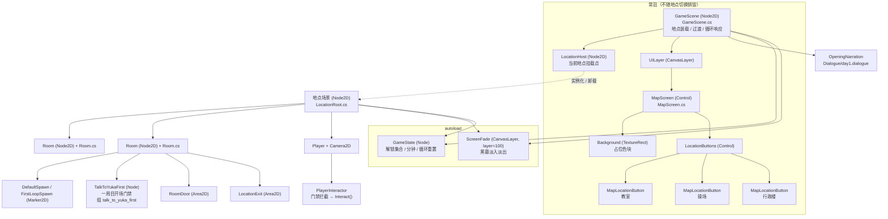
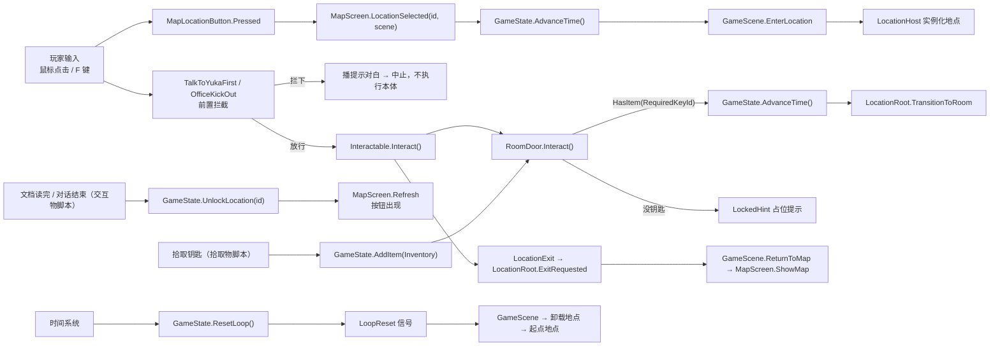
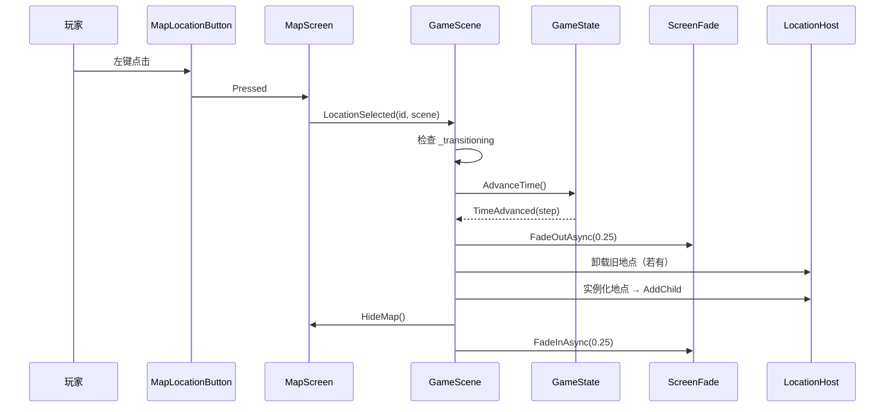
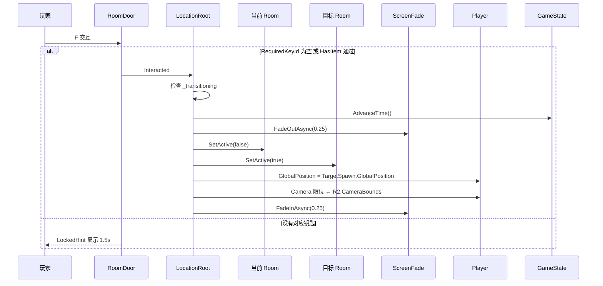
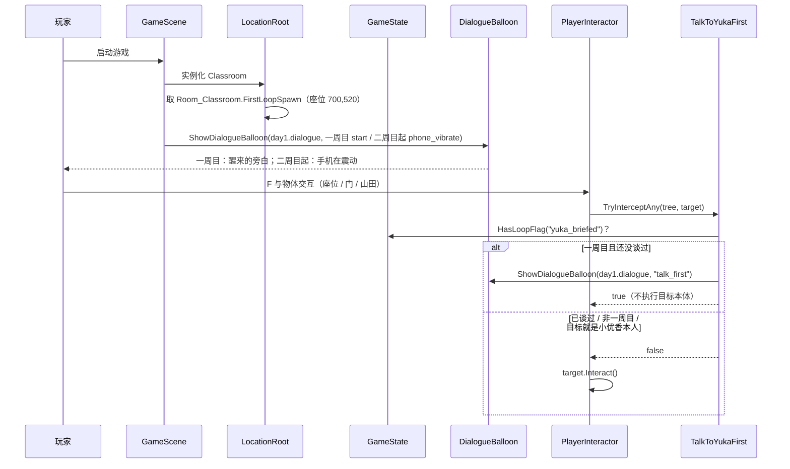

# 地图 & 场景系统 · 设计规格

| 项 | 内容 |
|---|---|
| 日期 | 2026-11-06 |
| 项目 | pandagj-2026（Godot 4.7.2 mono / C#） |
| 模块 | 地图&场景系统（程序文档「模块划分」第 1 项） |
| 状态 | 已实现（2026-11-06，见 `docs/superpowers/plans/2026-11-06-map-scene-system.md`） |
| 上游需求 | 飞书 wiki《Panda jam 八岐大蛇》· 系统设计画板 · 流程设计画板 · 程序文档 |

---

## 0. 决策索引

评审时如需推翻某条，直接指出编号。

| # | 决策 |
|---|---|
| Q1 | 地图本质是 **UI 面板**（`CanvasLayer` 下的 `Control`），开关即显隐，不是 2D 世界层 |
| Q2 | 一个地点 = 一个 `.tscn`；地点内的多个房间共处同一场景 |
| Q3 | 地图按钮直接摆在地图场景里，每颗按钮自带 `LocationId` + `LocationScene` |
| Q4→Q19 | **地点解锁状态跨循环继承**，背包道具每轮重置（原「解锁也重置」的决定已被 Q19 推翻） |
| Q5 | 整张地图等比适配 1920×1080，固定布局，鼠标点击 |
| Q6 | 每个地点有一个出口，F 交互返回地图 |
| Q7 | 每次进入地点都重新实例化干净场景，变化写入 `GameState` |
| Q8 | 时间推进只发生在**移动**上：从大地图进入大地点、以及地点内切换房间，各推进一格；其余 F 交互不推进 |
| Q9 | 开局从**起点地点**（教室）开始，走出该地点才出现地图 |
| Q10 | 未解锁地点在地图上**完全不显示**，解锁后按钮才出现 |
| Q11 | 房间之间走到门口按 F，短暂淡出淡入后切换 |
| Q12 | 地点场景根节点挂 `LocationRoot.cs`，用导出引用声明出生点/出口 |
| Q13 | `Player` 由每个地点场景自带，相机挂在 Player 下 |
| Q14 | `GameState` 持有解锁集合、时间推进与循环重置的接口；地图只读它 |
| Q15 | 美术未到位时用占位背景 + 文字按钮，先跑通链路 |
| Q16 | 初始可见地点由一份独立 `MapConfig` 资源定义 |
| Q17 | ~~钥匙携带地点解锁目标~~ → 已作废，见 Q24 / Q26：**地点靠信息解锁，钥匙只开房间** |
| Q18 | 一个房间 = 地点场景内的一个 `Room` 子节点，同一时刻只激活一个 |
| Q19 | 循环重置后回到起点地点（教室） |
| Q21 | ~~已解锁地点的钥匙不再生成~~ → 作废，钥匙与地点不再挂钩；其原则（不生成没用的道具）推广为 §5.3 的拾取物规则 |
| Q22 | `MapConfig` 只装初始解锁 ID，不装按钮布局 |
| Q23 | 继承/重置清单见 §5.3 |
| Q24 | 地点解锁的唯一入口是 `GameState.UnlockLocation(id)`，由交互物脚本在对话/文档读完后调用 |
| Q25 | 房间锁**每次进入地点都复原**（比「每轮复原」更严格） |
| Q26 | 门导出 `RequiredKeyId`，背包里有对应钥匙即可开，**不消耗** |
| Q27 | 解锁新地点**不做即时提示**，下次开地图自然看到 |

---

## 1. 目标与范围

### 1.1 本规格覆盖

- 地图 UI 面板：显示、隐藏、按钮刷新、点击派发
- 地点场景的装载与卸载
- 地点内多房间的激活/停用与切换
- 地点解锁（信息 → `GameState` → 地图按钮出现）
- 房间门锁（钥匙 → `GameState.Inventory` → 门开/不开）
- **最小交互触发**：玩家按 F 调用邻近交互物的 `Interact()`——只做到「demo 能跑通」，选点规则与提示 UI 仍归玩家系统
- **时间推进点**：地图→地点、房间→房间，两条路径各调一次 `GameState.AdvanceTime()`
- 循环重置时场景系统的响应（回到起点地点）
- 过渡表现（黑幕淡入淡出）
- 端到端验收 demo 的内容约定

### 1.2 本规格不覆盖

- 时间系统内部：时段长度、末日判定、`ResetLoop()` 由谁在哪一刻调用
- NPC 系统、对话系统、道具系统的内部实现（只约定接口触点）
- 存档/读档
- 地图美术绘制与最终按钮造型

---

## 2. 术语

| 术语 | 含义 |
|---|---|
| **地图 / MapScreen** | 整个学校平面图的 UI 面板，玩家在此选择目的地 |
| **地点 / Location** | 一个可在地图上点击进入的区域，对应一个 `.tscn`（如「教室」「操场」） |
| **房间 / Room** | 地点内部的子区域（如「教室」「走廊」），同一时刻只显示一个 |
| **交互物 / Interactable** | 玩家面向它按 F 触发行为的 `Area2D`，加入组 `interactable` |

---

## 3. 架构

### 3.1 架构图



**为什么 `ScreenFade` 是 autoload**：地图↔地点、房间↔房间、循环重置三处都要淡入淡出，抽成一处只有一份实现；它不是事件总线，也不承担任何状态。

### 3.2 节点结构

```
res://Scenes/Root/GameScene.tscn        (Node2D, GameScene.cs)
├── LocationHost                        (Node2D)
└── UILayer                             (CanvasLayer, layer = 10)
    └── MapScreen                       (Control, 实例自 Scenes/Map/MapScreen.tscn)
        ├── Background                  (TextureRect)
        └── LocationButtons             (Control)
            ├── BtnClassroom            (MapLocationButton)
            ├── BtnAdministration       (MapLocationButton)
            └── BtnPlayground           (MapLocationButton)

res://Scenes/Locations/Classroom.tscn   (Node2D, LocationRoot.cs)
├── Room_Classroom                      (Node2D, Room.cs)   ← StartingRoom
│   ├── ...背景 / 碰撞 / 交互物
│   ├── DefaultSpawn                    (Marker2D)
│   ├── DoorToEquip                     (RoomDoor, RequiredKeyId = "equipment_key")
│   │   └── LockedHint                  (Label, 占位提示)
│   └── ExitToMap                       (LocationExit)
├── Room_Equip                          (Node2D, Room.cs)
│   ├── ...背景 / 碰撞 / 交互物
│   ├── DefaultSpawn                    (Marker2D)
│   └── DoorToClassroom                 (RoomDoor, RequiredKeyId 留空)
└── Player                              (player.tscn 实例, 其下含 Camera2D)
```

### 3.3 职责划分

| 单位 | 职责 | 不负责 |
|---|---|---|
| `GameScene` | 地点装载/卸载、地图显隐、过渡编排、响应 `LoopReset` | 房间内部逻辑、解锁判定 |
| `MapScreen` | 按 `GameState` 刷新按钮、把点击转成 `LocationSelected` 信号 | 装载场景、推进时间 |
| `MapLocationButton` | 持有 `LocationId` / `LocationScene`，转发 `Pressed` | 任何解锁判断 |
| `LocationRoot` | 房间激活/切换（切换时推进时间）、玩家出生点、相机限位、向外发 `ExitRequested` | 进地图、淡入淡出细节 |
| `Room` | 自停用/启用、相机限位数据 | 知道其它房间的存在 |
| `RoomDoor` | 暴露 `Interact()`、查背包判定钥匙、发 `Interacted` | 切房间 / 回地图 |
| `LocationExit` | 暴露 `Interact()` 并发 `Interacted` | 任何判定 |
| `GameState` | 解锁集合、时间步、循环重置、道具/线索占位、`HasItem` | 任何节点引用 |
| `ScreenFade` | 黑幕淡入淡出 | 任何业务判断 |

### 3.4 脚本目录约定

脚本按模块分目录，不放在 `Scripts/` 根下：

```
Scripts/
├── Core/       跨模块共享：GameState.cs  ScreenFade.cs  Interactable.cs
├── Map/        地图&场景系统·地图侧：GameScene.cs  MapScreen.cs
│               MapLocationButton.cs  MapConfig.cs
├── Location/   地图&场景系统·地点侧：LocationRoot.cs  Room.cs
│               RoomDoor.cs  LocationExit.cs
├── Player/     玩家系统：Player.cs  PlayerInteractor.cs
└── Demo/       demo 临时脚本：PickupItem.cs  ReadDocument.cs
```

| 目录 | 对应程序文档模块 | 说明 |
|---|---|---|
| `Core/` | 无（基础设施） | `GameState` 被地图、时间、道具、对话多个模块共用；`Interactable` 是交互物的公共基类 |
| `Map/` | 地图&场景系统 | 地图面板、按钮、配置、根场景编排 |
| `Location/` | 地图&场景系统 | 地点场景内部的房间与门 |
| `Player/` | 玩家系统 | 现有的 `Player.cs` 从 `Scripts/` 根移入 |
| `Demo/` | — | 验收 demo 用，正式系统到位后删除 |

> `Map/` 与 `Location/` 同属「地图&场景系统」，拆开只是因为两者之间只通过 `GameScene` 与 `LocationRoot.ExitRequested` 通信，分目录后依赖方向一眼可见。
>
> 文件夹**不引入 namespace**：Godot C# 默认全部类在全局命名空间，jam 期间加 namespace 只会制造 `using` 噪声。

---

## 4. 场景契约

### 4.1 `GameScene`（`Scripts/Map/GameScene.cs`）

导出字段：

| 字段 | 类型 | 说明 |
|---|---|---|
| `MapConfig` | `MapConfig` | 初始解锁配置 |
| `StartLocation` | `PackedScene` | 起点地点（教室） |
| `MapScreen` | `MapScreen` | 地图面板 |
| `LocationHost` | `Node2D` | 地点挂载点 |
| `OpeningNarration` | `Resource` | 一周目开场剧情（`Dialogue/day1.dialogue`） |

行为：

- `_Ready()`：校验导出引用 → `GameState.SeedInitialUnlocks(MapConfig)` → 订阅 `GameState.LoopReset` 与 `MapScreen.LocationSelected` → 实例化起点地点 → 淡入 → 一周目时播 `OpeningNarration` 的 `start` cue。
- `EnterLocation(PackedScene, string locationId)`：守卫 → 淡出 → 卸载旧地点 → 实例化并挂到 `LocationHost` → 连接 `ExitRequested` → 隐藏地图 → 淡入。
- `ReturnToMap()`：守卫 → 淡出 → 卸载地点 → 显示地图 → 淡入。
- `OnLoopReset()`：守卫 → 淡出 → 卸载地点 → 清空每轮状态由 `GameState` 负责 → 实例化起点地点 → 淡入。
- `_transitioning` 布尔守卫：过渡期间忽略一切进入/返回请求（防连点、防重置与点击交错）。

### 4.2 地点场景 `LocationRoot`（`Scripts/Location/LocationRoot.cs`）

导出字段：

| 字段 | 类型 | 说明 |
|---|---|---|
| `StartingRoom` | `Room` | 从地图进入时激活的房间 |
| `PlayerNode` | `Player` | 本地点唯一的玩家实例（属性名带 `Node` 后缀，避免与类型名 `Player` 混淆） |

信号：`ExitRequested`

`_Ready()` 流程：

1. 校验 `StartingRoom`、`PlayerNode` 非空。
2. 递归查找本场景内所有 `Room`，全部 `SetActive(false)`。
3. 递归查找所有 `RoomDoor` / `LocationExit`，连接它们的 `Interacted` 信号（不依赖父子层级查找）。
4. 校验 `LocationExit` **恰好一个**，0 个或多个都报错。
5. `StartingRoom.SetActive(true)`，玩家放到该房间的落点（优先 `FirstLoopSpawn`，留空时 `DefaultSpawn`，见 `ResolveStartSpawn`），套用相机限位。

`TransitionToRoomAsync(RoomDoor door)`：**`GameState.AdvanceTime()`** → 淡出 → 当前房间 `SetActive(false)` → `door.TargetRoom.SetActive(true)` → 玩家放到 `door.TargetSpawn` → 套用 `TargetRoom.CameraBounds` → 淡入。全程走 `_transitioning` 守卫。

推进时间放在淡出之前，与「地图→地点」的顺序一致（先记时间，再换画面）。门锁没打开时不会走到这里，所以「撞锁」不消耗时间。

### 4.3 `Room`（`Scripts/Location/Room.cs`）

导出字段：

| 字段 | 类型 | 说明 |
|---|---|---|
| `DefaultSpawn` | `Marker2D` | 玩家进入本房间的默认落点 |
| `FirstLoopSpawn` | `Marker2D` | 地点载入时的起始落点（如教室座位）；留空则沿用默认落点 |
| `CameraBounds` | `Rect2I` | 相机限位，房间局部坐标 |

> `LocationRoot` 只在**初始激活**时选落点；`RoomDoor` 切换仍用门上的 `TargetSpawn`。

`SetActive(bool active)`：

- `Visible = active`
- 遍历所有 `CollisionShape2D`，`SetDeferred("disabled", !active)`
- `ProcessMode = active ? Inherit : Disabled`

> `Visible = false` 不会停掉物理，所以必须显式关碰撞，否则站在隐藏房间里仍会被挡住。

### 4.4 `RoomDoor`（`Scripts/Location/RoomDoor.cs`）

继承 `Interactable`（`Area2D`），加入组 `interactable`。

| 字段 | 类型 | 说明 |
|---|---|---|
| `TargetRoom` | `Room` | 目标房间 |
| `TargetSpawn` | `Marker2D` | 目标房间内的落点 |
| `RequiredKeyId` | `string` | 开门所需钥匙 id；留空 = 不锁 |
| `LockedHint` | `Label` | 锁着时的占位提示（如「锁着」），正式提示 UI 到位后可去掉 |

`Interact()`：`RequiredKeyId` 为空，或 `GameState.HasItem(RequiredKeyId)` 为真 → 发 `Interacted`，由 `LocationRoot` 执行切换；否则不发信号，`LockedHint` 显示 1.5 秒后自动隐藏。

钥匙**不消耗**（Q26）；门锁**不记忆状态**——场景重建后一切复原（Q25）。

### 4.5 `LocationExit`（`Scripts/Location/LocationExit.cs`）

继承 `Interactable`，加入组 `interactable`。无导出字段。

`Interact()` → 发 `Interacted` → `LocationRoot` 发 `ExitRequested` → `GameScene.ReturnToMap()`。

### 4.6 `MapScreen`（`Scripts/Map/MapScreen.cs`）

| 字段 | 类型 | 说明 |
|---|---|---|
| `Buttons` | `MapLocationButton[]` | 地图上全部地点按钮（显式数组，避免按名查找） |

信号：`LocationSelected(string locationId, PackedScene locationScene)`

方法：

- `Refresh()`：逐颗按钮 `Visible = GameState.IsLocationUnlocked(id)`。
- `ShowMap()`：`Visible = true` → `Refresh()`。
- `HideMap()`：`Visible = false`。
- `_Ready()`：连接每颗按钮的 `Pressed` → 发 `LocationSelected`。

`_Ready()` 校验：按钮数组为空 → 报错；`LocationId` 为空 → 报错；`LocationScene` 为空 → 报错；`LocationId` 重复 → 报错。

### 4.7 `MapLocationButton`（`Scripts/Map/MapLocationButton.cs`）

继承 `Button`（占位阶段直接显示文字；美术到位改为贴图时只改这一处基类与主题）。

| 字段 | 类型 | 说明 |
|---|---|---|
| `LocationId` | `string` | 与 `GameState.UnlockedLocations` 及对话/文档里的解锁目标字符串对应 |
| `LocationScene` | `PackedScene` | 点击后要装载的地点场景 |

### 4.8 `Interactable`（`Scripts/Core/Interactable.cs`）

```csharp
public partial class Interactable : Area2D
{
    [Signal] public delegate void InteractedEventHandler();
    public virtual void Interact() => EmitSignal(SignalName.Interacted);
}
```

**接口边界**：`RoomDoor` / `LocationExit` 在 `interactable` 组里、`Interact()` 可被调用。至于「怎么选中它」，见 4.10 的最小实现。

### 4.9 `Player` 补充

在 `player.tscn` 中加 `Camera2D` 子节点，`Scripts/Player/Player.cs` 增加：

```csharp
[Export] public Camera2D Camera { get; set; }
```

`LocationRoot` 直接对 `Player.Camera` 设置限位；为 `null` 时报错。

### 4.10 `PlayerInteractor`（`Scripts/Player/PlayerInteractor.cs`，最小版）

挂在 `player.tscn` 下，持有一个居中的 `Area2D`（`InteractionRange`）收集重叠的 `interactable`。

- 每帧在重叠集合里取「离玩家最近的一个」记为 `_current`。
- `_UnhandledInput` 里按下 `interact`（F）且 `_current != null` → 依次尝试前置拦截，全部放行才调 `_current.Interact()`。
- 前置拦截器：`OfficeKickOut.TryInterceptAny`（办公室赶人）、`TalkToYukaFirst.TryInterceptAny`（一周目开场门禁，见 §7.8）。拦截器自己播对白并返回 `true`，调用方随即 `SetInputAsHandled()` 并中止。

```csharp
public override void _UnhandledInput(InputEvent @event)
{
    if (_player == null || _player.InputLocked) return;
    if (_current == null || !@event.IsActionPressed("interact")) return;

    if (OfficeKickOut.TryInterceptAny(GetTree(), _current)) { GetViewport().SetInputAsHandled(); return; }
    if (TalkToYukaFirst.TryInterceptAny(GetTree(), _current)) { GetViewport().SetInputAsHandled(); return; }

    _current.Interact();
    GetViewport().SetInputAsHandled();
}
```

---

## 5. 状态与配置

### 5.1 `GameState`（autoload，`Scripts/Core/GameState.cs`）

| 成员 | 类型 | 跨循环 | 说明 |
|---|---|---|---|
| `UnlockedLocations` | `HashSet<string>` | ✅ 继承 | 地点解锁集合 |
| `Inventory` | `HashSet<string>`（占位） | ❌ 清空 | 道具系统接管前的占位 |
| `Clues` | `HashSet<string>`（占位） | ✅ 继承 | 手机线索，本规格只留位 |
| `TimeStep` | `int` | ❌ 归零 | 时间推进计数 |
| `Instance` | `GameState`（静态） | — | `_Ready()` 赋值；取用前为 `null` 时报错 |

信号：

| 信号 | 触发时机 |
|---|---|
| `LocationUnlocked(string locationId)` | `UnlockLocation()` 首次写入时 |
| `TimeAdvanced(int timeStep)` | `AdvanceTime()` 之后 |
| `LoopReset` | `ResetLoop()` 之后 |

方法：

| 方法 | 说明 |
|---|---|
| `SeedInitialUnlocks(MapConfig config)` | 开局把 `InitialUnlockedLocationIds` 灌入解锁集合（幂等） |
| `UnlockLocation(string id)` | 唯一解锁入口；已解锁则无操作、不发信号 |
| `IsLocationUnlocked(string id)` | 地图刷新用 |
| `AdvanceTime()` | `TimeStep++` → 发 `TimeAdvanced`；**只在两条移动路径上调用**：地图→地点（`GameScene`）、房间→房间（`LocationRoot`） |
| `ResetLoop()` | 清空每轮状态 → 发 `LoopReset` |
| `HasItem(string itemId)` | 门锁判定用；道具系统接管前只是 `Inventory.Contains` |
| `AddItem(string itemId)` | 拾取物脚本调用；道具系统接管后由它替换 |

> `Inventory` 的权威归属是道具系统；本规格只要求 `HasItem` 能回答「现在有没有这把钥匙」。

> `AdvanceTime()` **不得**在自己的调用栈里触发 `ResetLoop()`。末日判定与会话重置由时间系统在独立流程中执行，避免「正要进入地点时被重置」的调用栈交错。此约束写入规格，供时间系统实现时遵守。

### 5.2 `MapConfig`（`Scripts/Map/MapConfig.cs` + `Resources/MapConfig.tres`）

```csharp
[GlobalClass]
public partial class MapConfig : Resource
{
    [Export] public string[] InitialUnlockedLocationIds { get; set; }
}
```

只装初始解锁 ID。按钮布局、背景图、起点地点都在别处（Q22）。

### 5.3 继承 / 重置清单

| 状态 | 跨循环继承 | 每轮重置 |
|---|---|---|
| 地点解锁状态（`UnlockedLocations`） | ✅ | |
| 手机里已记录的线索（`Clues`） | ✅ | |
| 背包道具（`Inventory`） | | ✅ 清空 |
| 时间进度（`TimeStep`） | | ✅ 归零 |
| 房间门锁 / 抽屉锁 | | ✅ 复原 |
| 房间里已拾取的物品 | | ✅ 重新出现 |
| NPC 位置与对话进度 | | ✅ 复原（由 NPC 系统按 `TimeStep` 重布） |

> 因为每次进入地点都重新实例化（Q7），「门锁 / 已拾取物品 / NPC」的重置是**构造结果**，不需要额外清理代码。注意这比「每轮复原」更严格：同一轮内离开地点再回来，也会全部复原（Q25=A）。
>
> **拾取物生成规则**（Q21 原则的推广）：拾取物在生成时检查 `GameState.HasItem(该道具 id)`，已持有则不生成——否则同一轮内反复进出会刷出一堆已拥有的钥匙。

---

## 6. 数据流



数据是三层单向流，层与层之间只通过 `GameState` 对接：

1. **大地点通行权**：对话/文档 → `GameState.UnlockedLocations` → 地图按钮可见性。地图不认识对话，对话不认识地图。
2. **房间通行权**：拾取物 → `GameState.Inventory` → `RoomDoor` 的 `RequiredKeyId` 判定。门不认识拾取物。
3. **位置**：`MapScreen` → `GameScene` → `LocationHost` → `LocationRoot`。下层不回写上层。

---

## 7. 关键流程与调用链

### 7.1 启动

```
GameScene._Ready()
├── 校验 MapConfig / StartLocation / MapScreen / LocationHost / OpeningNarration
├── GameState.SeedInitialUnlocks(MapConfig)
├── GameState.LoopReset += OnLoopReset
├── MapScreen.LocationSelected += OnLocationSelected
├── MapScreen.HideMap()
├── ScreenFade 置黑
├── 实例化 StartLocation → LocationHost
├── 连接 location.ExitRequested → ReturnToMap
├── MapScreen.Refresh()            // 先算好可见性，避免第一次开图闪一下
├── ScreenFade.FadeInAsync()
└── IsFirstLoop() ? 播 OpeningNarration 的 start cue : 播 phone_vibrate cue 并自动打开记事本
```

落点由 `LocationRoot._Ready` 决定：优先用 `Room.FirstLoopSpawn`（教室座位），留空时用 `DefaultSpawn`。

### 7.2 地图 → 地点



顺序约束：**先推进时间、后进入场景**。若时间系统另有异步判定，进入场景不会被它的 `ResetLoop()` 打断（§5.1 约束）。

### 7.3 地点 → 地图

```
玩家在出口按 F
└── LocationExit.Interact()
    └── Interacted → LocationRoot
        └── ExitRequested → GameScene.ReturnToMap()
            ├── 守卫检查
            ├── ScreenFade.FadeOutAsync()
            ├── QueueFree(location)
            ├── MapScreen.ShowMap()   // 内部先 Refresh
            └── ScreenFade.FadeInAsync()
```

此路径**不调用** `AdvanceTime()`（Q8）。

### 7.4 房间切换



### 7.5 地点解锁（信息驱动）

```
对话结束 / 文档读完
└── 交互物脚本调用 GameState.UnlockLocation("playground")
    ├── 写入 UnlockedLocations（跨循环保留）
    └── 发 LocationUnlocked(id)     // 本规格不消费，留给以后的日志/提示
下次 MapScreen.ShowMap() → Refresh() → 该按钮 Visible = true
```

解锁不做即时弹窗（Q27）。`GameState.UnlockLocation` 是**唯一**入口，对话系统和文档交互物都只调它，不直接改集合。

### 7.6 房间开锁（道具驱动）

```
玩家在 RoomDoor 前按 F
└── RoomDoor.Interact()
    ├── RequiredKeyId 为空                → 发 Interacted → 切房间
    ├── GameState.HasItem(RequiredKeyId)  → 发 Interacted → 切房间
    └── 否则                              → 不发信号；LockedHint 显示 1.5s
```

### 7.7 循环重置

```
时间系统 → GameState.ResetLoop()
├── Inventory.Clear() / TimeStep = 0
├── UnlockedLocations 保留
└── 发 LoopReset
    └── GameScene.OnLoopReset()
        ├── 守卫检查
        ├── ScreenFade.FadeOutAsync()
        ├── QueueFree(location)
        ├── 实例化 StartLocation
        └── ScreenFade.FadeInAsync()
```

> 重载后 `LoopCount` 已 +1，因此落点回到 `DefaultSpawn`、开场旁白不再播、门禁自动失效。

### 7.8 一周目开场（出生在座位 + 先找小优香）



- 门禁判定顺序：`_room.IsAncestorOf(target)`（只拦本房间）→ 目标是 `RequiredNpcId` 本人则放行 → `IsArmed()`（一周目且无 `yuka_briefed`）。
- `yuka_briefed` 由 `yuka.dialogue` 的 `choose_read` / `choose_out` 分支写入，所以「谈过话」= 走完开场对话并做出选择。
- 对话期间 `Player.InputLocked` 已挡重复触发，门禁不额外加布尔状态。

---

## 8. 过渡表现

- `ScreenFade` 为 `CanvasLayer(layer = 100)` + 全屏黑 `ColorRect`。
- 时长统一 **0.25s**，用 `Tween` 改 `ColorRect.Modulate.A`。
- 淡入过程中 `ColorRect.MouseFilter = Stop`（吃掉点击），淡完 `Ignore` + `Visible = false`。
- 提供 `SetOpaque()` 供启动时先铺黑再淡入。
- 不提供可配置时长——只有一处常量，需要改时改一处。

---

## 9. 错误处理

项目约定：空引用/资源缺失必须显式报错，不静默兜底。全部用 `GD.PushError` 或 `GD.PushWarning` + 中断本次操作。

| 场景 | 处理 |
|---|---|
| `MapConfig` / `StartLocation` / `MapScreen` / `LocationHost` 为空 | 启动时报错并停止装载 |
| `MapLocationButton.LocationId` 为空 | 启动时报错 |
| `MapLocationButton.LocationScene` 为空 | 启动时报错 |
| 两个按钮 `LocationId` 相同 | 启动时报错 |
| `MapConfig` 的 id 在地图按钮中找不到 | 启动时报错（配置写错） |
| `MapScreen.Refresh()` 后一个可见按钮都没有 | 报错（地图死局，玩家无法继续） |
| `LocationRoot.StartingRoom` / `Player` 为空 | 报错并放弃装载地点 |
| 地点内 `Room` 数量为 0 | 报错 |
| 地点内 `LocationExit` 数量 ≠ 1 | 报错 |
| `Room.DefaultSpawn` 为空 | 报错 |
| `RoomDoor.TargetRoom` / `TargetSpawn` 为空 | 报错，忽略该次交互 |
| `RoomDoor.RequiredKeyId` 非空但 `LockedHint` 为空 | 报错（锁着时玩家得不到任何反馈） |
| `Player.Camera` 为空 | 报错 |
| 过渡期间收到新的进入/返回请求 | 静默忽略（这是正常的连点保护，不是错误） |

---

## 10. 验收 demo

美术全部用占位（纯色块 + 文字），只验证链路。

### 10.1 内容

| 物件 | 配置 |
|---|---|
| 地点「教室」 | 2 个房间：`Room_Classroom`（起点，含出口）、`Room_Equip`（器材室，`RequiredKeyId = "equipment_key"`） |
| `Room_Classroom` 内 | 「器材室钥匙」拾取物 |
| `Room_Equip` 内 | 「操场使用须知」文档：读完 → `UnlockLocation("playground")` |
| 地点「操场」 | 1 个房间，含出口 |
| 地图 | `BtnClassroom`（初始可见）、`BtnPlayground`（初始隐藏） |
| `MapConfig.tres` | `InitialUnlockedLocationIds = ["classroom"]` |

> 这样两条链路各走一遍：**钥匙 → 房间**、**文档 → 大地点**。钥匙和文档都用最小临时实现（拾取物脚本 / 一次性交互物脚本），不属于正式道具系统与对话系统。

### 10.2 验收清单

- [ ] 启动后直接进入「教室」，不出现地图
- [ ] 走到器材室门前按 F：**进不去**，门上方出现「锁着」提示，1.5s 后消失
- [ ] 拾取「器材室钥匙」后再按 F：淡出淡入，玩家落在器材室出生点，且 `TimeStep` +1
- [ ] 器材室→教室回门按 F 能返回（回门不上锁），`TimeStep` 再 +1
- [ ] 撞锁那一次**不推进时间**（`TimeStep` 不变）
- [ ] 在器材室读完文档后从出口回地图：「操场」按钮出现（无弹窗提示，Q27）
- [ ] 点击「操场」能进入，且 `TimeStep` +1；出口能回地图
- [ ] 同一轮内再进「教室」：器材室**又锁上了**（Q25=A）
- [ ] 在操场时调用 `GameState.ResetLoop()`：回到「教室」，`Inventory` 清空、`TimeStep` 归零
- [ ] 重置后地图上「操场」**仍然存在**（解锁继承）
- [ ] 故意删掉某个 `StartLocation` 引用：启动即报错，不黑屏卡死

---

## 11. 文件清单

| 文件 | 类型 |
|---|---|
| `Scripts/Core/GameState.cs` | 新建 |
| `Scripts/Core/ScreenFade.cs` | 新建 |
| `Scripts/Core/Interactable.cs` | 新建 |
| `Scripts/Map/GameScene.cs` | 新建 |
| `Scripts/Map/MapScreen.cs` | 新建 |
| `Scripts/Map/MapLocationButton.cs` | 新建 |
| `Scripts/Map/MapConfig.cs` | 新建 |
| `Scripts/Location/LocationRoot.cs` | 新建 |
| `Scripts/Location/Room.cs` | 新建 |
| `Scripts/Location/RoomDoor.cs` | 新建 |
| `Scripts/Location/LocationExit.cs` | 新建 |
| `Scripts/Player/Player.cs` | 移动 + 修改（加 `Camera` 导出） |
| `Scripts/Player/PlayerInteractor.cs` | 新建（最小交互触发） |
| `Scripts/Demo/PickupItem.cs` | 新建（demo 临时的钥匙拾取物） |
| `Scripts/Demo/ReadDocument.cs` | 新建（demo 临时的文档交互物） |
| `Scenes/Root/GameScene.tscn` | 修改（补节点结构） |
| `Scenes/Map/MapScreen.tscn` | 新建 |
| `Scenes/Locations/Classroom.tscn` | 新建（demo） |
| `Scenes/Locations/Playground.tscn` | 新建（demo） |
| `Resources/MapConfig.tres` | 新建 |
| `project.godot` | 修改（注册 `GameState` / `ScreenFade` autoload、新增 `interact` 输入、设置主场景） |

---

## 12. 待定与风险

| 项 | 说明 |
|---|---|
| `interact` 输入 | 现工程只有 `move_left` / `move_right`，需新增 F 键动作；键位固定 F（3C 已定） |
| 玩家侧交互检测 | 本规格只实现最小版（`PlayerInteractor`：找最近的 `interactable`，按 F 调 `Interact()`）；换目标高亮、交互提示、对话中禁用输入，都留给玩家系统 |
| 主场景 | `project.godot` 未指定 `run/main_scene`，实现时设为 `GameScene.tscn` |
| 地图美术 | 未产出；占位阶段 `Background` 用色块，按钮坐标即为最终布局的初稿 |
| 房间切换的碰撞时序 | `CollisionShape2D.Disabled` 用 `SetDeferred`，若在物理回调中切换需再加一帧 |
| 地点数量 | 现按 6 个地点估算（教室/办公室/操场/器材准备室/保健室/走廊），按钮全部摆在同一张图上 |
| 地点解锁的通知 | Q27 决定暂不做提示；`LocationUnlocked` 信号保留，以后接提示 UI 时不用改触发方 |
| 抽屉钥匙 | 程序文档提到「一种开抽屉，一种开房间」。抽屉属于交互/道具系统，本规格只覆盖开房间；两者共用 `RequiredKeyId` 的判定思路，但不在本规格实现 |
| 交互提示 UI | 当前用门的 `LockedHint` 占位；正式的「按 F 交互」提示属于玩家系统 |
