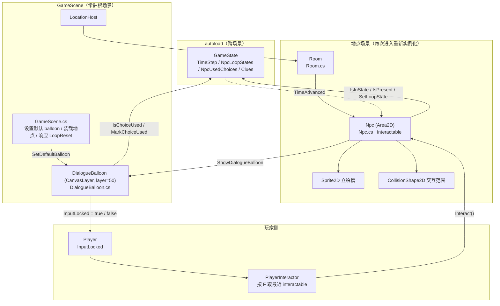
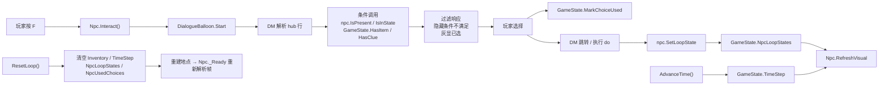
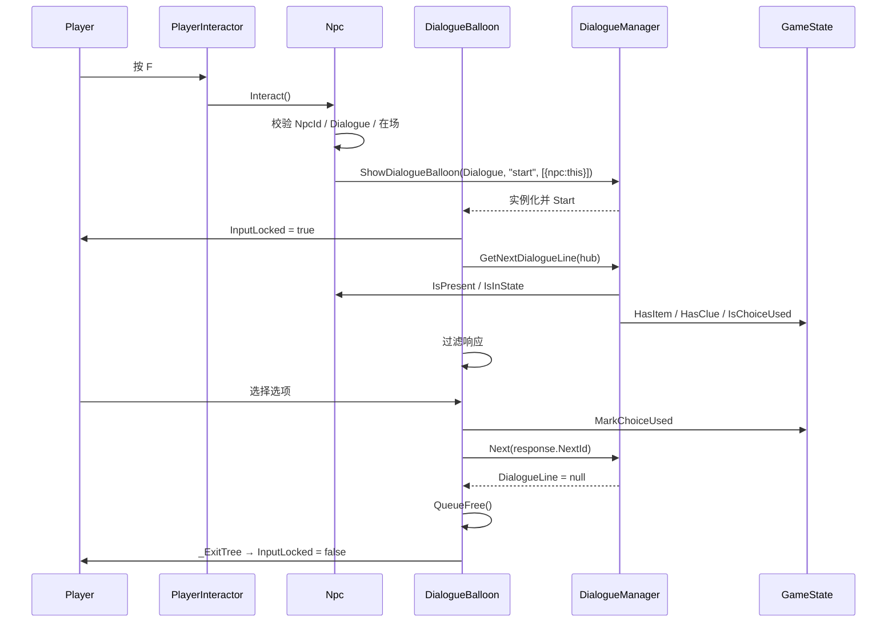

# NPC 系统 · 设计规格

| 项 | 内容 |
|---|---|
| 日期 | 2026-11-06 |
| 项目 | pandagj-2026（Godot 4.7.2 mono / C#） |
| 模块 | NPC 系统（程序文档「模块划分」中的 NPC 与对话交互部分） |
| 状态 | 已实现 |
| 上游需求 | 飞书 wiki《Panda jam 八岐大蛇》· 系统设计画板 · 流程设计画板 |
| 依赖 | 地图&场景系统（`docs/superpowers/specs/2026-11-06-map-scene-system-design.md`）、Dialogue Manager 4.2.0 |

---

## 0. 决策索引

评审时如需推翻某条，直接指出编号。

| # | 决策 |
|---|---|
| Q1 | 本规格只做「通用 NPC 状态 + 选项门控 + 叫醒」闭环；偷窃、打电话等交互不实现，但状态接口能表达它们 |
| Q2 | 「立绘」指场景内 NPC 角色图；对话框不做 galgame 大立绘 |
| Q3 | NPC 状态由**状态帧时间表**驱动，不用单一阈值，也不用外部事件推 |
| Q4 | 叫醒等交互造成的状态是**本轮覆盖**；跨地点重建仍生效，循环重置清空 |
| Q5 | 每个 NPC 一个 `.dialogue`，统一 `~ start` 作为 hub；选项门控全部写在剧本里 |
| Q6 | 条件不满足的选项**默认隐藏**；个别选项用 `[#show_if=true]` 显示为灰色 |
| Q7 | 支持按时间表出现/消失 |
| Q8 | 自动记录已选选项；已选选项不隐藏，显示为不可点击 |
| Q9 | 本规格包含最小可用 balloon（名字 + 正文 + 选项）；正式 galgame 皮肤不在本规格 |
| Q10 | 状态数据用 `NpcStateFrame` 数组，直接导出在 NPC 节点上（同 Q3、Q17） |
| Q11 | 已选记录**本轮有效**：离开地点再回来仍记得，循环重置清空 |
| Q12 | 选项默认一次性；`[#repeatable]` 标记可重复（闲聊/离开/叫醒） |
| Q13 | 不在场 = 节点常驻，隐藏 + 关闭可检测性；不从场景移除 |
| Q14 | 一次性选项必须写 `[ID:xxx]`；缺失时报错，并在运行时按可重复处理 |
| Q15 | 玩家输入锁由 balloon 持有，`_ExitTree` 兜底解锁 |
| Q16 | 对话只能通过选项走到 `=> END`，不能用 ESC 取消；`ui_cancel` 只跳过打字机 |
| Q17 | 状态帧数组直接导出在 NPC 节点上，不单独做 `NpcSchedule.tres` |
| Q18 | 验收 demo：教室 1 个 NPC，站着 → 睡着 → 离开 |
| Q19 | 本轮覆盖只改状态与贴图，**不改变在场**；在场永远由当前时间帧的 `Visible` 决定 |

---

## 1. 目标与范围

### 1.1 本规格覆盖

- NPC 作为可交互物：靠近按 F 打开对话
- NPC 状态时间表：按 `TimeStep` 切换立绘、出现/消失
- 本轮状态覆盖：叫醒等交互改变 NPC 状态，跨地点重建仍生效
- 对话选项门控：按 NPC 状态、在场、道具、线索、已有记录决定可见/可选
- 已选选项记录：自动写入，本轮内灰显不可点
- 最小对话 balloon：名字、正文、选项、打字机、输入锁
- 循环重置时 NPC 状态、已选记录、对话 UI 的复位
- 端到端验收 demo

### 1.2 本规格不覆盖

- NPC 移动、寻路、AI 行为——NPC 位置固定
- 偷窃、打电话、送礼等具体交互——只保证状态接口能表达，不实现
- 手机/线索系统的内部实现——只加只读的 `GameState.HasClue`
- 对话美术：galgame 大立绘、动画、语音、口型
- 时间系统：谁在何时调用 `AdvanceTime()` / `ResetLoop()`（沿用地图规格）
- 存档/读档
- 多语言导出（新增 `.dialogue` 不强制登记 POT）

---

## 2. 术语

| 术语 | 含义 |
|---|---|
| **状态帧 / NpcStateFrame** | 一条「从第 N 步起，NPC 处于某状态」的数据 |
| **有效状态** | 本轮覆盖（若有）优先，否则取当前时间帧的 `StateId` |
| **在场** | 当前时间帧的 `Visible`；与有效状态相互独立（Q19） |
| **hub** | NPC 对话的统一入口标签 `~ start`，每次交互都从这里开始 |
| **balloon** | Dialogue Manager 的对话 UI 场景，本规格指 `DialogueBalloon.tscn` |
| **已选记录** | 某个一次性选项被选中过的标记，存在 `GameState`，本轮有效 |

---

## 3. 架构

### 3.1 架构图



**为什么 balloon 挂在 `GameScene` 而不是地点场景**：Dialogue Manager 的 `_start_balloon` 把 balloon 加到当前主场景下。主场景是 `GameScene`，所以地点被卸载时 balloon 不会被一起销毁；循环重置时由 balloon 自己监听 `LoopReset` 关闭。

### 3.2 节点结构

```
res://Scenes/Root/GameScene.tscn        (Node2D, GameScene.cs)
├── LocationHost                        (Node2D)
└── UILayer                             (CanvasLayer)
    └── MapScreen                       (Control)

res://Scenes/Dialogue/DialogueBalloon.tscn   (CanvasLayer, layer = 50)
├── Balloon                             (Control)
│   ├── MarginContainer
│   │   └── PanelContainer
│   │       └── MarginContainer
│   │           └── HBoxContainer
│   │               └── VBoxContainer
│   │                   ├── CharacterLabel   (RichTextLabel)
│   │                   └── DialogueLabel    (DialogueLabel)
│   └── CenterContainer
│       └── ResponsesMenu               (DialogueResponsesMenu)
│           └── ResponseExample         (Button, 模板，运行时移除)
└── ...

res://Scenes/Locations/Classroom.tscn   (只列 NPC 相关部分)
└── Room_Classroom
    └── Npc_Student                     (Area2D, Npc.cs)
        ├── Sprite                      (Sprite2D)
        ├── Shape                       (CollisionShape2D)
        └── DebugLabel                  (Label, 仅 demo)
```

`DialogueBalloon.tscn` 从 `addons/dialogue_manager/example_balloon/ExampleBalloon.tscn` 复制后改造，**不直接修改 addon 目录**。改造内容：根节点保持 `CanvasLayer`，`layer` 设为 50；删除示例警告按钮与示例音效；保留 `CharacterLabel`、`DialogueLabel`、`ResponsesMenu`、`ResponseExample`。

### 3.3 职责划分

| 单位 | 职责 | 不负责 |
|---|---|---|
| `Npc` | 校验帧表、解析有效状态、切立绘/在场、发起对话、暴露条件与突变方法 | 对话内容、选项过滤、玩家输入 |
| `NpcStateFrame` | 纯数据：`FromStep` / `StateId` / `Texture` / `Visible` | 任何逻辑 |
| `DialogueBalloon` | 显示正文与选项、过滤响应、记录已选、锁玩家、关闭自身 | NPC 状态解析、地点装载 |
| `GameState` | 本轮 NPC 覆盖、已选记录、线索只读、时间步与循环重置 | 任何节点引用 |
| `GameScene` | 设置默认 balloon、地点装载（已有）、响应循环重置（已有） | NPC 内部逻辑 |
| `LocationRoot` | 房间激活（已有）、同地点 `NpcId` 唯一性校验（新增） | NPC 状态 |
| `Player` | 提供 `InputLocked`、加入 `player` 组 | 对话流程 |
| `PlayerInteractor` | 锁定时不响应 F | 对话流程 |

### 3.4 脚本目录约定

```
Scripts/
├── Core/       GameState.cs（修改）  ScreenFade.cs  Interactable.cs
├── Map/        GameScene.cs（修改）  MapScreen.cs  MapLocationButton.cs  MapConfig.cs
├── Location/   LocationRoot.cs（修改）  Room.cs  RoomDoor.cs  LocationExit.cs
├── Player/     Player.cs（修改）  PlayerInteractor.cs（修改）
├── Npc/        Npc.cs（新建）  NpcStateFrame.cs（新建）
├── Dialogue/   DialogueBalloon.cs（新建）
└── Demo/       PickupItem.cs  ReadDocument.cs
```

`Npc/` 是 NPC 系统；`Dialogue/` 放通用对话 UI，不依赖 NPC 类型之外的业务。文件夹仍**不引入 namespace**；`Npc.cs`、`DialogueBalloon.cs`、`GameScene.cs` 需要 `using DialogueManagerRuntime;` 引用 addon 的 C# 类型。

---

## 4. 场景契约

### 4.1 `NpcStateFrame`（`Scripts/Npc/NpcStateFrame.cs`）

```csharp
[GlobalClass]
public partial class NpcStateFrame : Resource
{
    /// <summary>从第几步开始生效。</summary>
    [Export] public int FromStep { get; set; }

    /// <summary>状态 id，例如 "standing" / "sleeping" / "absent"。</summary>
    [Export] public string StateId { get; set; } = "";

    /// <summary>该状态的立绘；Visible 为 false 时可为空。</summary>
    [Export] public Texture2D Texture { get; set; }

    /// <summary>该帧是否在场。</summary>
    [Export] public bool Visible { get; set; } = true;
}
```

### 4.2 `Npc`（`Scripts/Npc/Npc.cs`）

导出字段：

| 字段 | 类型 | 说明 |
|---|---|---|
| `NpcId` | `string` | 全局唯一 id，用于已选记录与本轮覆盖；建议 `地点.名字`，如 `classroom.student` |
| `Dialogue` | `Resource` | `.dialogue` 导入后的 `DialogueResource` |
| `Frames` | `NpcStateFrame[]` | 状态帧时间表，按 `FromStep` 升序 |
| `Sprite` | `Sprite2D` | 立绘槽 |

公开方法（供 `.dialogue` 调用）：

| 方法 | 说明 |
|---|---|
| `bool IsPresent()` | 当前时间帧是否在场 |
| `bool IsInState(string stateId)` | 有效状态是否等于 `stateId` |
| `void SetLoopState(string stateId)` | 写入本轮覆盖并立即刷新；`stateId` 必须出现在 `Frames` 里 |

`_Ready()` 流程：

1. 校验 `NpcId` 非空、`Dialogue` 非空、`Frames` 非空、`Sprite` 非空。
2. 校验帧表：首帧 `FromStep == 0`；`FromStep` 严格递增；`StateId` 非空；`Visible == true` 的帧必须有 `Texture`；同一个 `StateId` 在多帧出现时 `Texture` 必须一致（`Visible` 允许不同）。
3. 订阅 `GameState.TimeAdvanced`。
4. `RefreshVisual()`。

`RefreshVisual()`：

```
当前帧   = 最后一个 FromStep <= GameState.TimeStep 的帧
有效状态 = GameState.GetNpcLoopState(NpcId) 非空 ? 该值 : 当前帧.StateId
立绘     = 表里第一个 StateId == 有效状态 的帧的 Texture
在场     = 当前帧.Visible
```

执行：

- `Sprite.Texture = 立绘`
- `Visible = 在场`
- `SetDeferred("monitorable", 在场)`
- demo 的 `DebugLabel`（若存在）显示 `$"{NpcId}:{有效状态}"`

**在场不用 `CollisionShape2D.Disabled` 控制。** `Room.SetActive()` 会递归把所有子 `CollisionShape2D` 的 `disabled` 一起改；如果 NPC 用 shape 表达不在场，房间重新激活时会把 NPC 的关闭状态覆盖掉。统一用 `Area2D.Monitorable` 作为唯一开关：`PlayerInteractor.GetOverlappingAreas()` 只返回可被检测的 area。

NPC 没有 `_Process` / `_PhysicsProcess`，`ProcessMode` 交给所在 `Room` 管，脚本不自行设置。

`Interact()`：

```
不在场            → PushWarning，返回
Dialogue 为空     → PushError，返回
其它校验失败      → PushError，返回
否则：
  balloon = DialogueManager.ShowDialogueBalloon(
      Dialogue, "start", [{ "npc": this }])
  balloon 是 DialogueBalloon → balloon.Npc = this
  否则 → PushError
```

`_ExitTree()`：退订 `GameState.TimeAdvanced`。

**校验失败时的行为**：报错并把该 NPC 的 `Monitorable` 设为 `false`，不参与交互。错误必须在控制台可见；不使用猜测的帧或默认贴图继续跑剧情。

### 4.3 `DialogueBalloon`（`Scripts/Dialogue/DialogueBalloon.cs` + `Scenes/Dialogue/DialogueBalloon.tscn`）

运行时属性：

| 属性 | 类型 | 说明 |
|---|---|---|
| `Npc` | `Npc` | 由发起对话的 NPC 在 `ShowDialogueBalloon` 返回后赋值；非 NPC 对话为空 |

导出字段：

| 字段 | 默认 | 说明 |
|---|---|---|
| `NextAction` | `ui_accept` | 推进正文/确认选项 |
| `SkipAction` | `ui_cancel` | 跳过打字机；不关闭对话 |

`Start(Resource dialogueResource, string label, Array<Variant> extraGameStates)`：

1. 取 `GameState.Instance`；为空则 `PushError` 并关闭。
2. 取 group `player` 里的 `Player`；找到则 `InputLocked = true`，找不到则 `PushError`。
3. 保存 `temporaryGameStates = [this] + extraGameStates`。
4. `DialogueManager.GetNextDialogueLine(...)`，`Show()`。

`_ExitTree()`：若 `Player` 仍有效，`InputLocked = false`；退订 `GameState.LoopReset`。

`LoopReset`：`QueueFree()`。对话中发生循环重置时，balloon 必须先关闭，避免旧对话盖在新地点上。

**响应过滤**（顺序不能反）：

```
foreach response in dialogueLine.Responses:
    if response.GetTagValue("hide_if") == "true":
        移除
        continue

    used = Npc != null
           && !response.HasTag("repeatable")
           && !string.IsNullOrEmpty(response.StaticId)
           && GameState.IsChoiceUsed(Npc.NpcId, response.StaticId)

    if used:
        response.IsAllowed = false
        保留（灰显）
        continue

    if !response.IsAllowed:
        if response.GetTagValue("show_if") == "true":
            保留（灰显）
        else:
            移除
        continue

    保留
```

规则解释：

- **已选优先于条件**：已选选项即使条件已经变成 false，也保留为灰显，符合「已选过不要隐藏」。
- `[#repeatable]` 选项不记录、不灰显；它们靠自己的 `if` 条件控制出现。
- `[#show_if=true]` 只用于「条件不满足但要显示成灰色」的少数选项；默认隐藏。

**选择与记录**：

```
ResponseSelected(response):
    if Npc != null && !response.HasTag("repeatable"):
        if string.IsNullOrEmpty(response.StaticId):
            PushError("一次性选项缺少 [ID:]")
            // 按可重复处理，不写记录
        else:
            GameState.MarkChoiceUsed(Npc.NpcId, response.StaticId)
    Next(response.NextId)
```

**数量判断**：balloon 内所有「有没有选项 / 要不要等输入」的判断都使用**过滤后的列表**，不能用 `DialogueLine.Responses`。原列表可能包含被隐藏或全部灰显的选项。

**`ResponsesMenu.HideFailedResponses` 必须保持 `false`。** 隐藏条件不满足的选项由 balloon 自己过滤；如果菜单也过滤一遍，`[#show_if=true]` 的选项会在「保留为灰色」和「被菜单删掉」之间产生两套规则。菜单只负责把 `IsAllowed=false` 的项画成 disabled，不负责决定哪些项该存在。

**无可选项保护**：如果原行有响应，但过滤后没有任何 `IsAllowed == true` 的选项，`PushError` 并关闭 balloon。否则菜单没有可聚焦项，玩家会被卡住。

**关闭**：`DialogueLine == null` 时始终 `QueueFree()`，不 `Hide()`，保证 `_ExitTree` 一定执行、输入锁一定释放。

### 4.4 `GameState` 新增（`Scripts/Core/GameState.cs`）

| 成员 | 类型 | 跨循环 | 说明 |
|---|---|---|---|
| `_npcLoopStates` | `Dictionary<string, string>` | ❌ 清空 | `npcId → stateId`，本轮覆盖 |
| `_npcUsedChoices` | `Dictionary<string, HashSet<string>>` | ❌ 清空 | `npcId → 已选 staticId 集合` |

方法：

| 方法 | 说明 |
|---|---|
| `string GetNpcLoopState(string npcId)` | 没有覆盖时返回 `""` |
| `void SetNpcLoopState(string npcId, string stateId)` | 写入/覆盖；空参数报错 |
| `bool IsChoiceUsed(string npcId, string staticId)` | 空参数报错并返回 `false` |
| `void MarkChoiceUsed(string npcId, string staticId)` | 写入；空参数报错 |
| `bool HasClue(string clueId)` | 只读；线索写入仍归线索系统 |

`ResetLoop()` 在现有 `Inventory.Clear()` / `TimeStep = 0` 之后追加：

```
_npcLoopStates.Clear();
_npcUsedChoices.Clear();
```

`UnlockedLocations` 与 `Clues` 保留。

### 4.5 `Player` / `PlayerInteractor` 修改

`Player`：

```csharp
/// <summary>对话等 UI 打开时锁住移动与交互。</summary>
public bool InputLocked { get; set; }

public override void _EnterTree()
{
    AddToGroup("player");
}

public override void _PhysicsProcess(double delta)
{
    if (InputLocked)
    {
        Velocity = Vector2.Zero;
        return;
    }
    // 现有移动逻辑
}
```

`PlayerInteractor`：

- `_Ready()` 里取 `GetParent<Player>()` 并校验非空。
- `_UnhandledInput` 在 `InputLocked` 为 true 时直接返回，不响应 F。

### 4.6 `GameScene` 修改

新增导出：

| 字段 | 类型 | 说明 |
|---|---|---|
| `DialogueBalloonScene` | `PackedScene` | 本游戏的对话 balloon |

`_Ready()` 在装载起点地点之前：

```
if DialogueBalloonScene == null:
    PushError，停止启动
Error err = DialogueManager.SetDefaultBalloon(DialogueBalloonScene)
if err != Error.Ok:
    PushError，停止启动
ProjectSettings.SetSetting(
    "dialogue_manager/runtime/balloon_path",
    DialogueBalloonScene.ResourcePath)
```

addon 的 `set_default_balloon` 实际写的是 `runtime/balloon_path`，而 `DMSettings.get_setting` 读的是 `dialogue_manager/runtime/balloon_path`；只调 `SetDefaultBalloon` 会返回 `Ok` 但读不到配置，`ShowDialogueBalloon` 随即静默回退到 addon 的示例 balloon（已用真实 `GameScene` 冒烟复现）。所以必须在它之后补写读取键。两处都只写运行时 `ProjectSettings`，不落盘。

### 4.7 `LocationRoot` 修改

`_Ready()` 在现有房间/出口校验之后追加：

```
List<Npc> npcs = FindAll<Npc>(this);
HashSet<string> seen = new();
foreach (Npc npc in npcs)
{
    if (string.IsNullOrEmpty(npc.NpcId)) continue;  // Npc 自己会报错
    if (!seen.Add(npc.NpcId))
        PushError($"LocationRoot {Name}: NpcId {npc.NpcId} 重复");
}
```

只报错，不自动改名或禁用。`NpcId` 的全局唯一（跨地点）靠命名约定（`地点.名字`）；`LocationRoot` 只能查同一地点内的重复。

---

## 5. 状态与配置

### 5.1 状态帧解析

| 情况 | 结果 |
|---|---|
| `TimeStep` 小于所有帧的 `FromStep` | 不可能——首帧强制 `FromStep == 0` |
| `TimeStep` 落在两帧之间 | 取较小的那帧 |
| `TimeStep` 超过最后一帧 | 取最后一帧（状态保持） |
| 有本轮覆盖 | 有效状态 = 覆盖值；立绘取该状态第一次出现的帧；在场仍取当前时间帧 |
| 没有本轮覆盖 | 有效状态 = 当前帧 `StateId`；立绘 = 当前帧 `Texture` |
| 当前帧 `Visible == false` | NPC 隐藏、`Monitorable = false`；有效状态仍可查询 |

**`IsInState` 回答的是状态，不是在场。** 需要「在场且睡着」时写 `npc.IsPresent() and npc.IsInState("sleeping")`。

### 5.2 继承 / 重置清单

| 状态 | 跨循环继承 | 每轮重置 |
|---|---|---|
| `UnlockedLocations` | ✅ | |
| `Clues` | ✅ | |
| `Inventory` | | ✅ 清空 |
| `TimeStep` | | ✅ 归零 |
| `NpcLoopStates`（叫醒等覆盖） | | ✅ 清空 |
| `NpcUsedChoices`（已选选项） | | ✅ 清空 |
| NPC 贴图/在场 | | ✅ 由 `TimeStep` 重新推导 |
| 对话进度 | | ✅ 下次交互回到 hub |

地点每次进入都重新实例化（地图规格 Q7），所以 NPC 节点的贴图/在场不需要额外的清理代码；`GameState` 里的本轮状态由 `ResetLoop()` 清空。

### 5.3 状态变化时机

| 触发 | 谁刷新 | 说明 |
|---|---|---|
| NPC `_Ready` | 自己 | 进入地点时按当前 `TimeStep` 解析 |
| `GameState.TimeAdvanced` | 所有 NPC | 房间切换/进入地点时 `TimeStep` 变化；信号在房间激活前发出 |
| `Npc.SetLoopState` | 自己 | 对话突变调用后立即刷新 |
| `GameState.LoopReset` | 地点重建 | 旧节点销毁，新节点 `_Ready` 重新解析 |

`AdvanceTime()` 在 `GameScene`（地图→地点）和 `LocationRoot`（房间→房间）里调用，顺序都是「先推进时间，再换画面」。NPC 在信号回调里读到的是新 `TimeStep`。

---

## 6. `.dialogue` 写法约定

### 6.1 结构

每个 NPC 一个文件，统一用 `~ start` 作为 hub：

```dialogue
~ start
if npc.IsInState("sleeping")
    同学: （趴在桌上睡着了。）
    - 叫醒她 [#repeatable] => wake
    - 算了 [#repeatable] => END
else
    同学: 有什么事吗？
    - 关于器材室 [ID:ask_equipment] => ask_equipment
    - 关于昨天 [ID:ask_yesterday] => ask_yesterday
    - 算了 [#repeatable] => END

~ ask_equipment
同学: 器材室的钥匙好像掉在教室中间。
=> END

~ ask_yesterday
同学: 昨天……我好像做了一个很长的梦。
=> END

~ wake
同学: 唔……我睡着了？
do npc.SetLoopState("standing")
同学: 谢谢你叫醒我。
=> END
```

**cue 与缩进**：`~ start` 这类 cue 行是标签，**下面的台词、`do`、`=> END` 必须顶格写**，不能缩进；只有 `if` / `else` 分支内部的台词和选项缩进一层。把 cue 的正文缩进会被编译器报 `Invalid indentation`（`Cues should never have child lines`）。

### 6.2 语法约定

| 项 | 约定 |
|---|---|
| 说话人 | 必须用 ASCII `": "`（`同学: 台词`）；DM 只按 `": "` 切分，中文全角冒号不会生效 |
| 条件 | 响应条件写成 `[if 表达式 /]`，不是 `if 表达式` |
| 一次性选项 | 必须写 `[ID:xxx]`；`StaticId` 用于已选记录 |
| 可重复选项 | 写 `[#repeatable]`；不进记录、不灰显 |
| 灰色但不可选 | 写 `[#show_if=true]`；配合自身条件为 false 时显示为 disabled |
| 永久隐藏 | 写 `[#hide_if=true]` |
| 标签语法 | 统一写成 `[#tag]`。裸 `#tag` 不会被 DM 解析；选项正文也不要加方括号，`- 叫醒她` 会显示为「叫醒她」，`- [叫醒她]` 会把方括号一起显示出来 |
| cue 正文 | `~ start` 之后的台词/`do`/`=> END` 顶格写；只有 `if/else` 分支内部缩进一层 |
| 状态突变 | `do npc.SetLoopState("state")` |
| 出口 | 每个 hub 必须有一个无条件、`[#repeatable]` 的出口（如「算了」） |

### 6.3 条件可用接口

条件只调用**方法**，不读 C# 属性。addon 的 dotnet 桥用反射保证 C# 方法可调用；非 `[Export]` 的 C# 属性不保证出现在 Godot 的属性列表里。

| 表达式 | 来源 | 说明 |
|---|---|---|
| `npc.IsPresent()` | `Npc` | 当前时间帧是否在场 |
| `npc.IsInState("sleeping")` | `Npc` | 有效状态（含本轮覆盖） |
| `GameState.HasItem("lighter")` | `GameState` | 本轮背包 |
| `GameState.HasClue("letter")` | `GameState` | 跨循环线索 |
| `GameState.GetNpcLoopState("other.npc")` | `GameState` | 查询别的 NPC 的本轮覆盖；需要跨 NPC 条件时用 |

`TimeStep` 不直接暴露给剧本。NPC 自己的时间条件由 `IsInState` 表达；如果以后需要全局时间条件，再在 `GameState` 加 `GetTimeStep()`，不要为了这个把 `TimeStep` 标成 `[Export]`。

### 6.4 突变与副作用

`.dialogue` 里的 `do` 可以直接调用现有方法：

| 写法 | 效果 |
|---|---|
| `do npc.SetLoopState("standing")` | 写本轮 NPC 状态并刷新立绘 |
| `do GameState.UnlockLocation("playground")` | 解锁大地点 |
| `do GameState.AddItem("lighter")` | 获得道具 |

`SetLoopState` 必须传该 NPC 帧表里出现过的 `StateId`；未知 id 会报错且不写入。

---

## 7. 数据流



数据是单向的：

1. **状态**：`TimeStep` + 本轮覆盖 → `Npc` 的立绘/在场。NPC 不认识对话。
2. **条件**：`.dialogue` 读 `Npc` 与 `GameState` 的方法。剧本不认识场景节点。
3. **记录**：balloon 写 `GameState`。NPC 不写已选记录，剧本不写已选记录。

---

## 8. 关键流程与调用链

### 8.1 交互 → 对话 → 结束



### 8.2 叫醒 → 状态覆盖 → 立绘刷新

```
玩家选择 [叫醒她]
└── balloon.ResponseSelected
    ├── 记录：叫醒选项带 [#repeatable]，不写已选
    └── Next("wake")
        └── DM 执行 do npc.SetLoopState("standing")
            ├── Npc 校验 "standing" 在 Frames 里
            ├── GameState.SetNpcLoopState("classroom.student", "standing")
            ├── Npc.RefreshVisual()
            │   ├── 有效状态 = "standing"
            │   ├── Sprite.Texture = standing 的贴图
            │   └── 在场仍取当前时间帧
            └── DM 继续下一行
```

### 8.3 时间推进 → NPC 刷新

```
GameScene.OnLocationSelected / LocationRoot.TransitionToRoomAsync
└── GameState.AdvanceTime()
    ├── TimeStep++
    ├── 发 TimeAdvanced(TimeStep)
    │   └── 所有 Npc.OnTimeAdvanced()
    │       └── RefreshVisual()
    │           ├── 当前帧 ← 新 TimeStep
    │           ├── 有效状态 ← 本轮覆盖 ?? 当前帧.StateId
    │           └── 在场 ← 当前帧.Visible
    └── 继续装载/切换房间
```

### 8.4 循环重置

```
时间系统 / F9
└── GameState.ResetLoop()
    ├── Inventory.Clear()
    ├── TimeStep = 0
    ├── NpcLoopStates.Clear()
    ├── NpcUsedChoices.Clear()
    └── 发 LoopReset
        ├── DialogueBalloon.OnLoopReset → QueueFree()
        │   └── _ExitTree → Player.InputLocked = false
        └── GameScene.OnLoopReset
            ├── 淡出
            ├── 卸载当前地点
            ├── 重新实例化起点地点
            │   └── Npc._Ready → 按 TimeStep=0 解析
            └── 淡入
```

### 8.5 响应过滤的边界情况

| 情况 | 结果 |
|---|---|
| 条件 true，未选过 | 正常可选 |
| 条件 true，已选过，非 `[#repeatable]` | 灰显不可点 |
| 条件 false，未选过，无 `show_if` | 隐藏 |
| 条件 false，未选过，`[#show_if=true]` | 灰显不可点 |
| 条件 false，已选过 | 灰显不可点（已选优先） |
| `[#repeatable]`，条件 true | 可选，不记录 |
| `[#hide_if=true]` | 无论如何隐藏 |
| 过滤后没有任何 `IsAllowed == true` | 报错并关闭 balloon |

---

## 9. 错误处理

项目约定：空引用/资源缺失必须显式报错，不静默兜底。全部用 `GD.PushError` / `GD.PushWarning`，并按表中行为中止本次操作。

| 场景 | 处理 |
|---|---|
| `NpcId` 为空 | 报错；该 NPC `Monitorable=false`，不参与交互 |
| `Dialogue` 为空 | 报错；不打开对话 |
| `Frames` 为空 | 报错；不参与交互 |
| 首帧 `FromStep != 0` | 报错；不参与交互 |
| `FromStep` 非严格递增或重复 | 报错；不参与交互 |
| `StateId` 为空 | 报错；不参与交互 |
| `Visible=true` 但 `Texture` 为空 | 报错；不参与交互 |
| 同一 `StateId` 对应不同 `Texture` | 报错；不参与交互 |
| `SetLoopState` 传了帧表里没有的 id | 报错；不写入、不刷新 |
| 同一地点 `NpcId` 重复 | `LocationRoot` 报错；不自动改名/禁用 |
| 一次性选项缺少 `[ID:]` | balloon 报错；该选项按可重复处理，避免卡死 |
| 过滤后没有可选选项 | balloon 报错并关闭，避免无焦点卡死 |
| `GameState.Instance` 为空 | 报错；NPC 不刷新/balloon 关闭 |
| 找不到 group `player` | balloon 报错；对话继续，但移动不会被锁（开发期可见） |
| `DialogueBalloonScene` 为空 / `SetDefaultBalloon` 返回非 `Ok` | `GameScene` 报错并停止启动 |
| NPC 不在场时被调用 `Interact()` | `PushWarning`，直接返回 |
| 对话期间收到新的 F | `PlayerInteractor` 因 `InputLocked` 直接返回 |
| 对话期间发生循环重置 | balloon 关闭并解锁；地点随后重建 |

---

## 10. 验收 demo

### 10.1 内容

| 物件 | 配置 |
|---|---|
| `Npc_Student` | 在 `Room_Classroom` 内，位置约 `(1200, 520)`，`NpcId = "classroom.student"` |
| 状态帧 | `0 standing`（贴图 A，可见）→ `1 standing`（同 A）→ `2 sleeping`（贴图 B，可见）→ `3 sleeping`（同 B）→ `4 absent`（无贴图，不可见） |
| 对话 | `Dialogue/Npc/student.dialogue`，内容同 §6.1 |
| 占位贴图 | demo 用 `GradientTexture2D` 生成蓝/灰两块纯色；正式美术替换 `Texture` |
| `DebugLabel` | 显示 `$"{NpcId}:{有效状态}"`，仅 demo 保留 |

帧表用重复的 `StateId`（0/1 都是 `standing`，2/3 都是 `sleeping`）是为了让 demo 有足够的步数观察覆盖持久和第 4 步离开；正式内容可以一帧一个状态。

### 10.2 验收清单

- [ ] 启动后第 0 步，NPC 站着；靠近按 F 打开 balloon，玩家不能移动，再按 F 不会重复打开
- [ ] 选「关于器材室」→ 台词播完结束；同一轮内再次交互，该选项灰显不可点，「关于昨天」仍可选
- [ ] 出口回地图再进（第 1 步），NPC 仍站着，已选项仍灰显
- [ ] 再回地图再进（第 2 步），NPC 睡着，hub 只有「叫醒她」「算了」，没有 awake 分支的信息选项
- [ ] 选「叫醒她」→ 立绘立即变站着，台词继续到结束
- [ ] 再回地图再进（第 3 步），时间表是 `sleeping`、本轮覆盖是 `standing` → NPC 站着
- [ ] 再回地图再进（第 4 步），时间表是 `absent` → NPC 消失，靠近不能按 F
- [ ] F9 重置 → 回到第 0 步，NPC 站着，已选记录清空，信息选项恢复可选
- [ ] 对话中按 F9 → balloon 关闭，玩家能移动
- [ ] 故意把 `Dialogue` 置空 → 控制台报错，按 F 不崩溃
- [ ] 故意把某帧 `FromStep` 改成非 0 → 控制台报错，该 NPC 不参与交互
- [ ] 故意删掉某帧的 `Texture` 但保持 `Visible=true` → 控制台报错，该 NPC 不参与交互

---

## 11. 文件清单

| 文件 | 类型 |
|---|---|
| `Scripts/Npc/Npc.cs` | 新建 |
| `Scripts/Npc/NpcStateFrame.cs` | 新建 |
| `Scripts/Dialogue/DialogueBalloon.cs` | 新建（从 `ExampleBalloon.cs` 改造） |
| `Scenes/Dialogue/DialogueBalloon.tscn` | 新建（从 `ExampleBalloon.tscn` 复制改造） |
| `Scripts/Core/GameState.cs` | 修改（NPC 覆盖、已选记录、`HasClue`） |
| `Scripts/Player/Player.cs` | 修改（`player` 组、`InputLocked`） |
| `Scripts/Player/PlayerInteractor.cs` | 修改（锁定时不响应 F） |
| `Scripts/Map/GameScene.cs` | 修改（导出并设置默认 balloon） |
| `Scripts/Location/LocationRoot.cs` | 修改（同地点 `NpcId` 重复校验） |
| `Scenes/Root/GameScene.tscn` | 修改（挂 `DialogueBalloonScene` 引用） |
| `Scenes/Locations/Classroom.tscn` | 修改（加 `Npc_Student` 与状态帧） |
| `Dialogue/Npc/student.dialogue` | 新建（demo 剧本） |
| `project.godot` | 修改（`[internationalization]` 登记 `student.dialogue`；插件也可能自动写） |

`project.godot` 只新增 POT 登记；没有新 autoload、没有新输入动作。`Scenes/player.tscn` 不需要修改（`player` 组在代码里加）。

---

## 12. 约束与风险

| 项 | 说明 |
|---|---|
| 在场开关 | 必须用 `Area2D.Monitorable`，不能用 `CollisionShape2D.Disabled`；`Room.SetActive` 会覆盖后者 |
| `NpcId` 全局唯一 | 已选记录和本轮覆盖都按 `NpcId` 存；`LocationRoot` 只能查同地点重复，跨地点靠 `地点.名字` 命名约定 |
| 输入锁 | 当前是单 bool；如果以后有多个系统同时锁输入（过场、暂停菜单），要改成计数或令牌 |
| `HasClue` | 只读访问器；线索系统尚未实现，当前返回 false，demo 不依赖线索门控 |
| C# 方法调用延迟 | addon 的 dotnet 桥在调用 C# 方法前等一帧；DM 的 `MutationBehaviour.Wait` 会等待，顺序不受影响，但立绘变化不是同帧 |
| `[#repeatable]` 漏标 | 状态动作（叫醒）如果漏标，会在第二次进入同一轮时变成灰显；内容 review 要检查 |
| `[ID:]` 漏写 | 一次性选项漏写会在控制台报错，并按可重复处理；不会静默共享错误的记录键 |
| 默认 balloon 回退 | addon 的 `SetDefaultBalloon` 写 `runtime/balloon_path`，`DMSettings.get_setting` 读 `dialogue_manager/runtime/balloon_path`；只调它会返回 `Ok` 但回退到示例 balloon。`GameScene` 必须直接补写读取键 |
| 非 NPC 对话 | balloon 的 `Npc` 为空时不记录、不灰显；本规格只有 NPC 使用 balloon，后续文档/手机对话复用时要显式决定是否记录 |
| 地点重建 | NPC 状态不写节点字段，全部从 `GameState` + `TimeStep` 推导；以后给 NPC 加「本次进入地点内才有效」的临时状态时，要明确它是否该进 `GameState` |
