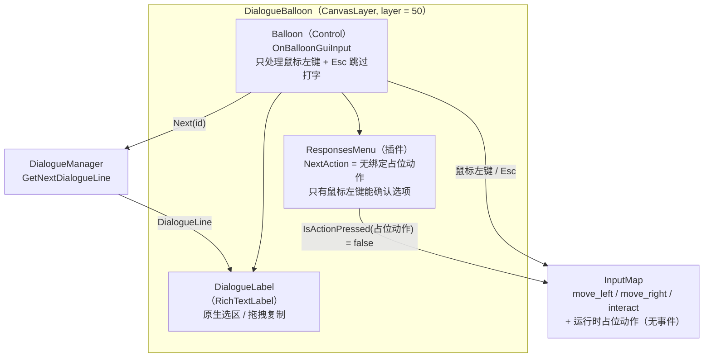
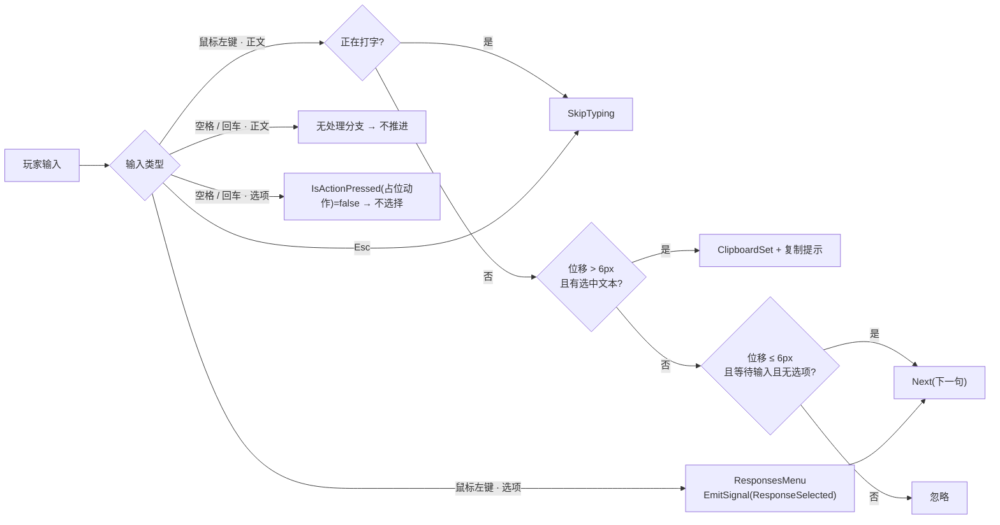
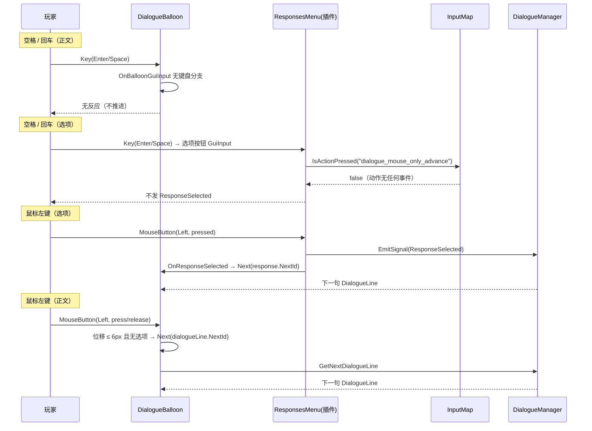

# 对话推进只保留鼠标左键 · 设计规格

| 项 | 内容 |
|---|---|
| 日期 | 2026-11-07 |
| 项目 | pandagj-2026（Godot 4.7.2 mono / C#） |
| 模块 | 对话系统 · 输入方式（正文推进 / 选项确认） |
| 状态 | 已实现（2026-11-07）；C# 编译、无头启动、无头行为自检通过，鼠标交互待有窗口手测 |
| 上游需求 | 用户当轮需求：移除对话系统里「空格/回车推进下一条」，只保留鼠标左键推进 |
| 依赖 | Dialogue Manager 4.2.0；`Scripts/Dialogue/DialogueBalloon.cs`；`addons/dialogue_manager/nodes/responses_menu/DialogueResponsesMenu.cs` |

---

## 0. 决策索引

评审时如需推翻某条，直接指出编号。

| 编号 | 决策 | 理由 |
|---|---|---|
| D1 | 正文推进只接受鼠标左键，删除 `ui_accept`（空格/回车）分支 | 用户当轮明确要求 |
| D2 | 选项确认也只接受鼠标左键（用户已确认「全部改为鼠标左键」） | 只留一条推进方式，避免「空格能选选项」与规则冲突 |
| D3 | Esc 跳过打字保留 | 属于「跳过动画」而非「推进对话」，用户未要求删除 |
| D4 | 不修改 `addons/dialogue_manager/`，改用运行时注册的无绑定输入动作中和插件的键盘选择 | 项目约定禁止直接改 addon 目录；也不污染 `project.godot` 的输入映射 |
| D5 | 不在 `_Input` 里吞 `ui_accept` | 会连带吞掉密码面板 LineEdit 的回车确认、记事本换行 |

---

## 1. 目标与范围

### 1.1 本规格覆盖

- 删除 `DialogueBalloon.OnBalloonGuiInput` 里 `NextAction`（`ui_accept`＝空格/回车/Kp Enter）推进下一句的分支。
- 让插件 `DialogueResponsesMenu` 自带的 `ui_accept` 选项确认失效。
- 保留：鼠标左键推进正文、鼠标左键点击选项、拖拽选择文本并复制、Esc 跳过打字、鼠标悬停高亮选项。

### 1.2 本规格不覆盖

- 不改 `project.godot` 的输入映射（工程仍只有 `move_left` / `move_right` / `interact` 三个自定义输入）。
- 不改任何 `.dialogue` 剧本、场景文件、插件源码。
- 不改手机（`PhoneScreen`）的文档列表 / 记事本面板的键盘行为——它们不是对话系统，且不与 balloon 同时存在。
- 不删除 `SkipAction`（Esc 跳过打字）。

---

## 2. 现状：两条键盘推进路径

改之前，空格/回车能通过两条路径推进对话：

| 路径 | 代码位置 | 行为 |
|---|---|---|
| A. 推进下一句 | `Scripts/Dialogue/DialogueBalloon.cs` `OnBalloonGuiInput` 末尾 | `IsActionPressed(NextAction)` 且焦点在 balloon 上 → `Next(dialogueLine.NextId)` |
| B. 确认选项 | `addons/dialogue_manager/nodes/responses_menu/DialogueResponsesMenu.cs` `OnResponseGuiInput` | 焦点在选项按钮上时 `IsActionPressed(NextAction)` → `EmitSignal(ResponseSelected)` |

两条路径用的都是同一个动作名。`DialogueBalloon._Ready` 原本把它传给插件：

```csharp
if (string.IsNullOrEmpty(responsesMenu.NextAction))
{
    responsesMenu.NextAction = NextAction;   // NextAction = "ui_accept"
}
```

插件内部对空名字有回退（`NextAction.IsEmpty ? "ui_accept" : NextAction`），所以不能简单地置空——置空等于回退成 `ui_accept`。

---

## 3. 方案对比

| 方案 | 做法 | 结论 |
|---|---|---|
| **A. balloon 内中和两条路径** | 删掉 A 路径分支；给插件的 `NextAction` 指向一个「运行时新建、无任何按键绑定」的动作 | **采用**。只改 1 个项目文件，不碰 addon，不碰输入映射 |
| B. 改 addon 源码 | 直接删插件里的键盘分支 | 放弃。项目约定禁止直接改 addon 目录，插件升级即被覆盖 |
| C. `_Input` 吞掉 `ui_accept` | 在 balloon 的 `_Input` 里标记事件已处理 | 放弃。会连带吞掉密码面板 LineEdit 的回车确认与记事本换行 |

---

## 4. 详细设计

### 4.1 `Scripts/Dialogue/DialogueBalloon.cs`

#### 4.1.1 删除导出字段 `NextAction`

```csharp
// 改前
[Export] public string NextAction = "ui_accept";
[Export] public string SkipAction = "ui_cancel";

// 改后
[Export] public string SkipAction = "ui_cancel";
```

`DialogueBalloon.tscn` 未设置该字段，删除后场景不受影响。

#### 4.1.2 注册无绑定的占位动作并交给响应菜单

```csharp
/// <summary>没有任何按键绑定的占位动作：用来关掉响应菜单自带的空格/回车选择。</summary>
private static readonly StringName MouseOnlyAdvanceAction = "dialogue_mouse_only_advance";
```

`_Ready()` 中：

```csharp
// 响应菜单自带 ui_accept（空格/回车）键盘选择；对话只保留鼠标左键，
// 因此给它一个没有任何按键绑定的动作，IsActionPressed 恒为 false。
if (!InputMap.HasAction(MouseOnlyAdvanceAction))
{
    InputMap.AddAction(MouseOnlyAdvanceAction);
}
responsesMenu.NextAction = MouseOnlyAdvanceAction;
```

要点：

- `InputMap.AddAction` 只建动作、不加事件 → `Input.IsActionPressed` 永远返回 `false`，且不会触发「不存在的动作」报错。
- 动作只在运行时注册，不写进 `project.godot`；工程自定义输入仍然只有三个。
- `HasAction` 判断保证重复实例化 balloon 时不会重复注册。

#### 4.1.3 删除 `OnBalloonGuiInput` 的键盘推进分支

```csharp
// 改前（方法末尾）
if (!isWaitingForInput) return;
if (filteredResponses.Count > 0) return;

if (@event.IsActionPressed(NextAction) && GetViewport().GuiGetFocusOwner() == balloon)
{
    GetViewport().SetInputAsHandled();
    Next(dialogueLine.NextId);
}
```

改后方法只保留鼠标分支（左键：打字中→跳过打字；否则按下记位置、松开判定拖拽复制或单击推进）。

#### 4.1.4 保留焦点行为

`balloon.GrabFocus()` 与 `dialogueLabel.FocusMode = None` 保留：

- balloon 持焦点 → Esc（`ui_cancel`）能到 `OnBalloonGuiInput` → 跳过打字。
- 正文不持焦点 → 点击正文不会把焦点抢走，避免 Esc 失效；鼠标选区不依赖焦点。

---

## 5. 架构图



---

## 6. 数据流图



---

## 7. 调用链图



---

## 8. 验证

### 8.1 已执行

| 命令 | 结果 |
|---|---|
| `dotnet build` | 0 错误；1 个既有警告（`LoopEndNotice.Show`，与本次改动无关） |
| `godot --headless --path . --build-solutions --quit` | 通过，无报错 |
| `godot --headless --path . --quit-after 120` | 主场景正常启动，无报错 |
| 临时无头自检场景（验证后已删除） | 见下表 |

临时自检（`TempVerify/TempVerifyDialogueInput.tscn`，已删除）实测：

| 断言 | 结果 |
|---|---|
| 占位动作已注册 | PASS |
| 空格命中 `ui_accept`（证明按键事件确实到达） | PASS |
| 空格不命中占位动作 | PASS |
| 响应菜单 `NextAction` 指向占位动作 | PASS |
| 选项已显示 | PASS |
| 空格不推进对话 | PASS |
| 空格不选择选项 | PASS |

### 8.2 有窗口手测清单（待用户确认）

- [ ] 打开任意 NPC 对话，连按空格/回车：正文不推进。
- [ ] 出现选项时按空格/回车：不高亮、不选择、不推进。
- [ ] 鼠标左键点击正文：正常推进下一句。
- [ ] 鼠标左键点击选项：正常选择并推进。
- [ ] 正文拖拽选中文本：仍然自动复制并提示「已复制」。
- [ ] 打字过程中按 Esc：仍然跳过打字。
- [ ] 打开手机 → 重要的事 / 记事本：鼠标点击正常；空格不再误触选项。

### 8.3 已知限制

headless 的 dummy 显示服务器把鼠标位置报成 `(28800, 28800)`，GUI 命中测试不可用，因此「鼠标左键点击选项」无法在无头环境自动化验证，只能有窗口手测；键盘路径全部可自动化验证。

---

## 9. 文件清单

| 文件 | 动作 |
|---|---|
| `Scripts/Dialogue/DialogueBalloon.cs` | 修改：删 `NextAction` 导出、删键盘推进分支、响应菜单指向无绑定占位动作、注释更新 |
| `AGENTS.md` | 修改：对话系统段落补一条「只保留鼠标左键推进」的规则 |
| `docs/superpowers/specs/2026-11-07-dialogue-mouse-only-advance-design.md` | 新增：本文件 |
| `docs/superpowers/plans/2026-11-07-dialogue-mouse-only-advance.md` | 新增：实现计划与执行记录 |
| `docs/superpowers/specs/2026-11-06-npc-system-design.md` | 修改：`NextAction` 导出字段表条目作废 |
| `docs/superpowers/specs/2026-11-07-dialogue-text-selection-copy-design.md` | 修改：标注键盘推进相关描述已由本规格取代 |

不改：`addons/dialogue_manager/**`、`Scenes/**`、`Dialogue/**`、`project.godot`。

---

## 10. 约束与风险

| 风险 | 处置 |
|---|---|
| 插件升级后重新引入 `ui_accept` 选项确认 | 插件的 `NextAction` 由本项目在 `_Ready` 显式覆盖，升级不会覆盖我们的赋值 |
| 占位动作名与将来别的系统冲突 | 名字带 `dialogue_` 前缀，语义唯一；只在运行时注册，不落盘 |
| 误伤其它 UI 的回车 | 本方案不在 `_Input` 吞事件，密码面板 / 记事本不受影响 |
| 玩家习惯了键盘推进 | 用户当轮明确要求删除，属预期变更 |
