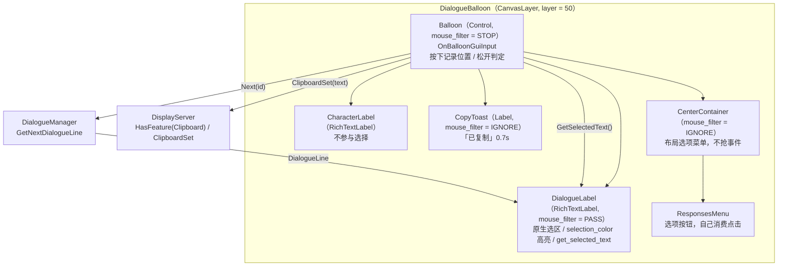
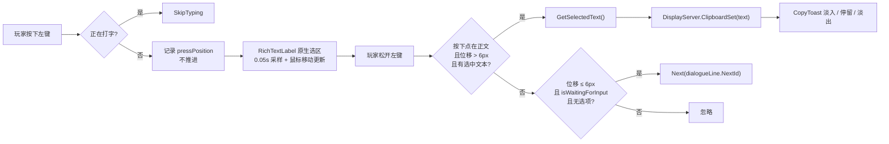
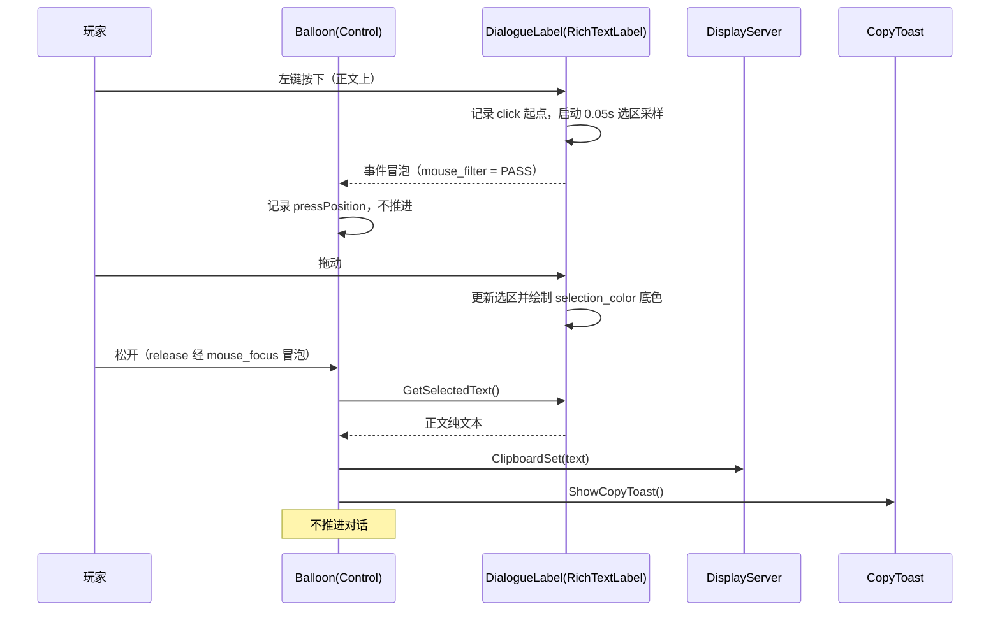
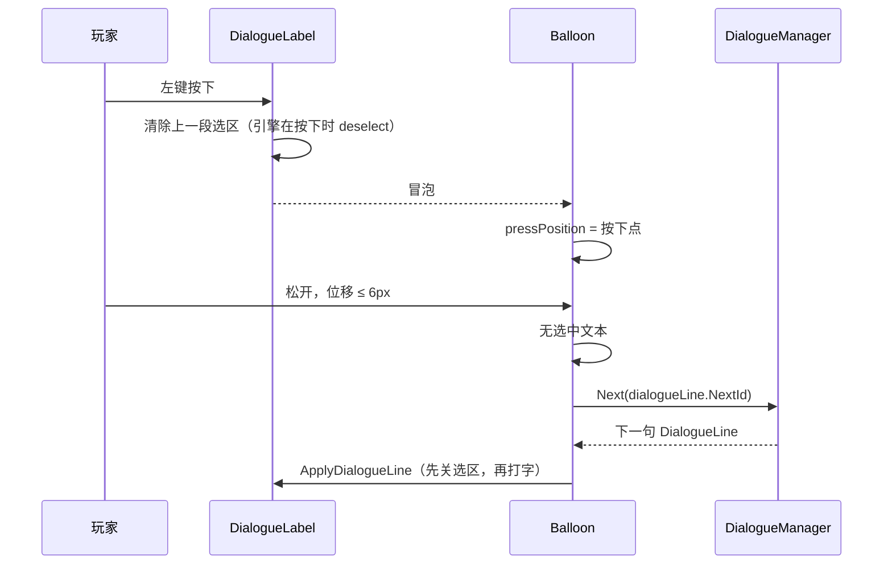

# 对话文本拖拽选择与自动复制 · 设计规格

| 项 | 内容 |
|---|---|
| 日期 | 2026-11-07 |
| 项目 | pandagj-2026（Godot 4.7.2 mono / C#） |
| 模块 | 对话系统 · 对白正文的选择与剪贴板复制 |
| 状态 | 已实现（2026-11-07）；C# 编译与无头启动验证通过，有窗口交互待手测确认 |
| 上游需求 | 用户当轮需求：对话系统允许拖拽选择说话文本，选中文本有底色，拖拽完成后自动复制 |
| 依赖 | Dialogue Manager 4.2.0；`Scenes/Dialogue/DialogueBalloon.tscn`；`Scripts/Dialogue/DialogueBalloon.cs`；`DialogueLabel`（RichTextLabel） |

---

## 0. 决策索引

评审时如需推翻某条，直接指出编号。

| # | 决策 |
|---|---|
| Q1 | 采用**原生 `RichTextLabel` 选区**（方案 A）；不自绘高亮、不做坐标→字符映射 |
| Q2 | 左键**拖拽 = 选择并复制**，原地**单击 = 推进对话**；用 6px 位移阈值区分 |
| Q3 | 自动复制的内容**只有正文纯文本**，不含角色名、不含 BBCode |
| Q4 | **打字机动画完成后**才允许选择；有选项菜单时也允许 |
| Q5 | 复制后**保留选区高亮**；下一次在正文上按下、或新一句开始时清除，不加额外动画 |
| Q6 | 复制成功显示「已复制」小提示，0.7 秒淡入 → 停留 → 淡出 |
| Q7 | 选中底色用主题色 `Color(1, 1, 1, 0.35)`（半透明白），放在现有 Balloon 主题里可直接调 |
| Q8 | 不改 `addons/dialogue_manager/` 下的任何场景或脚本；不改 `project.godot`、不新增输入动作 |
| Q9 | 平台没有剪贴板 API 时 `PushError`，不静默伪装成功 |
| Q10 | 选择范围只限当前这一句的正文；角色名、选项按钮文字不参与 |
| Q11 | 不实现 Ctrl+A / Ctrl+C 等键盘选区快捷键；自动复制已经覆盖需求 |
| Q12 | 按项目约定 git 只读：本规格与实现都**不执行 commit** |
| Q13 | 双击 / 三击选词**不纳入支持**：第一次单击会推进对话，第二次按下已经落在新句上；拖拽是唯一选择方式 |

---

## 1. 目标与范围

### 1.1 本规格覆盖

- 对话正文的鼠标拖拽选择
- 选中文本的底色显示（`RichTextLabel` 原生选区）
- 松开鼠标后自动写入系统剪贴板（仅正文纯文本）
- 「已复制」视觉反馈
- 拖拽选择与「左键推进对话」的输入共存规则（单击 / 拖拽的判定边界）
- 打字机动画、选项菜单、对话关闭与循环重置下的边界行为
- 端到端验收清单

### 1.2 本规格不覆盖

- 角色名、选项按钮文字的选择与复制
- 键盘选区（Shift + 方向键、Ctrl+A、Ctrl+C）
- 双击 / 三击选词（第一次单击会推进对话，本作不提供该手势）
- 右键菜单 / 「复制」菜单项
- 手机、主机手柄上的文本选择
- 历史对话记录 / 对话回看界面
- 复制到剪贴板之外的导出（文件、日志、翻译接口）
- Linux / Web / 移动端的剪贴板兼容层

---

## 2. 术语

| 术语 | 含义 |
|---|---|
| **正文 / DialogueLabel** | 当前一句对白的主体文本，`DialogueBalloon` 里的 `%DialogueLabel`（`RichTextLabel` 子类） |
| **选区 / Selection** | `RichTextLabel` 内部维护的 from → to 字符范围，由引擎绘制高亮 |
| **拖拽** | 左键按下后移动超过 `ClickDragThreshold`（6px）再松开 |
| **原地单击** | 左键按下与松开的位移 ≤ 6px，用于推进对话 |
| **剪贴板** | `DisplayServer.ClipboardSet` 写入的系统剪贴板 |
| **提示 / CopyToast** | 对话框右上缘的「已复制」Label |

---

## 3. 架构

### 3.1 架构图



### 3.2 职责划分

| 单位 | 职责 | 不负责 |
|---|---|---|
| `DialogueLabel`（引擎 `RichTextLabel`） | 记录选区、绘制选中底色、返回 `GetSelectedText()` | 判断单击还是拖拽、写剪贴板、弹提示 |
| `DialogueBalloon` | 输入状态机、打字中跳过、单击推进、拖拽完成复制、提示与错误上报 | 字符命中测试、选区绘制 |
| `CopyToast` | 显示「已复制」并淡出 | 任何输入与复制逻辑 |
| `DisplayServer` | 系统剪贴板 | 文本处理 |
| `DialogueManager` | 提供下一句 `DialogueLine` | 选择与复制 |

### 3.3 为什么用原生选区

| 方案 | 做法 | 结论 |
|---|---|---|
| **A. 原生 RichTextLabel 选区** | 打开 `SelectionEnabled`，主题设 `selection_color`，松开时取 `GetSelectedText()` | **采用**。高亮、自动折行、选区拖拽全部由引擎处理 |
| B. 自绘选择层 | 关闭原生选择，自己画矩形 | 放弃。`RichTextLabel` 没有公开的「鼠标坐标 → 字符索引」API，自建映射在 BBCode、自动折行、打字机可见字符上都会出错 |
| C. 独立选择模式 | 按键进入选择模式后才允许选择 | 放弃。多一层模式，且与已确认的「拖拽选择 + 单击推进」冲突 |

### 3.4 改动范围

```
Scenes/Dialogue/DialogueBalloon.tscn   修改（CenterContainer 鼠标穿透 + 主题一行 + CopyToast 节点）
Scripts/Dialogue/DialogueBalloon.cs    修改（输入判定 / 选区开关 / 复制 / 提示）
AGENTS.md                              修改（对话系统段落补一条行为说明）
docs/superpowers/specs/…              本文件
```

不改：

- `addons/dialogue_manager/nodes/dialogue_label/DialogueLabel.tscn`（`mouse_filter = 1`、`deselect_on_focus_loss_enabled = false` 已满足要求）
- `addons/dialogue_manager/nodes/dialogue_label/DialogueLabel.cs`
- `project.godot`、任何 `.dialogue` 剧本、任何输入映射

---

## 4. 详细设计

### 4.1 场景改动（`Scenes/Dialogue/DialogueBalloon.tscn`）

#### 4.1.1 让鼠标事件落到正文上（必须）

现有 `Balloon/CenterContainer` 是铺满全屏的 `CenterContainer`。Godot 的 `Container` 默认 `mouse_filter = PASS`，而命中测试会从后往前遍历 `Balloon` 的子节点：`CenterContainer` 排在 `MarginContainer` 之后（绘制在上层），会先被当成鼠标事件目标。这样 `DialogueLabel` 永远收不到按下事件，原生选区无法启动。

修改：

```ini
[node name="CenterContainer" type="CenterContainer" parent="Balloon"]
mouse_filter = 2
```

- `mouse_filter = 2` 是 `IGNORE`。它只影响该节点自己作为事件目标；命中测试**先递归子节点**，所以 `ResponsesMenu` 里的按钮仍然可点。
- 修改后：点击落在对话框面板内 → 目标变成 `DialogueLabel`（或其容器）；点击面板外 → 目标仍是 `Balloon`，推进逻辑不变。
- 这条是选区能否工作的前提，漏掉时表现为「能点、但怎么拖都没有高亮」。

#### 4.1.2 选中底色

在现有 `Theme_qq3yp` 子资源里增加一行：

```ini
RichTextLabel/colors/selection_color = Color(1, 1, 1, 0.35)
```

- 该主题挂在 `Balloon` 上，`DialogueLabel` 与 `CharacterLabel` 都会继承；只有 `DialogueLabel` 打开了选区，`CharacterLabel` 不受影响。
- Godot 默认的 `selection_color` 是 `Color(0.1, 0.1, 1, 0.8)`（高饱和蓝），与黑色对话框不搭，所以显式覆盖。
- `font_selected_color` 保持默认透明，选中文字仍用原字色绘制，不会出现「选中后字消失」。

#### 4.1.3 「已复制」提示节点

在 `Balloon` 下新增 `CopyToast`（与 `MarginContainer`、`CenterContainer` 同级，绘制在它们之后）：

```ini
[node name="CopyToast" type="Label" parent="Balloon"]
unique_name_in_owner = true
visible = false
modulate = Color(1, 1, 1, 0)
layout_mode = 1
anchors_preset = 3
anchor_left = 1.0
anchor_top = 1.0
anchor_right = 1.0
anchor_bottom = 1.0
offset_left = -150.0
offset_top = -246.0
offset_right = -34.0
offset_bottom = -226.0
grow_horizontal = 0
grow_vertical = 0
mouse_filter = 2
theme_override_colors/font_color = Color(1, 1, 1, 0.75)
theme_override_font_sizes/font_size = 16
text = "已复制"
horizontal_alignment = 2
```

- 位置：对话框面板顶部（面板高 219px）上方 7px、右侧留 34px，不遮挡正文。
- `mouse_filter = 2`（IGNORE）：提示不参与点击，不会挡住推进。
- 初始 `visible = false`；淡入由代码控制。

### 4.2 `DialogueBalloon.cs` 新增成员

```csharp
/// <summary>区分「拖拽选择」与「单击推进」的位移阈值（像素）。</summary>
[Export] public float ClickDragThreshold { get; set; } = 6.0f;

private Label copyToast;
private Tween copyToastTween;
private bool pointerPressed;
private bool pressStartedInLabel;
private Vector2 pressPosition;
```

`_Ready()` 增加：

```csharp
copyToast = GetNodeOrNull<Label>("%CopyToast");
if (copyToast == null)
{
    GD.PushError("DialogueBalloon: 找不到 %CopyToast，复制提示不可用");
}
dialogueLabel.SelectionEnabled = false;
```

### 4.3 选区启用时机（`ApplyDialogueLine`）

```csharp
private async void ApplyDialogueLine()
{
    // 新的一句：先关掉选区并清掉上一句的高亮
    dialogueLabel.SelectionEnabled = false;

    // 上一句的「已复制」提示不带到新一句
    copyToastTween?.Kill();
    if (copyToast != null) copyToast.Visible = false;

    // …现有逻辑：mutationCooldown / focus / CharacterLabel / DialogueLine / 选项过滤…

    if (!string.IsNullOrEmpty(dialogueLine.Text))
    {
        dialogueLabel.TypeOut();
        await ToSignal(dialogueLabel, DialogueLabel.SignalName.FinishedTyping);
        if (!GodotObject.IsInstanceValid(this)) return;
    }

    // 打字完成（或本句无文字）：本句正文可以拖拽选择
    dialogueLabel.SelectionEnabled = true;
    // 引擎在 set_selection_enabled(true) 里会把 focus_mode 设成 ALL；
    // 点击正文会抢走 Balloon 的键盘焦点，导致空格/回车推进失效，所以改回 None。
    dialogueLabel.FocusMode = Control.FocusModeEnum.None;

    // …现有逻辑：选项菜单 / 自动推进 / isWaitingForInput…
}
```

要点：

- `SelectionEnabled = false` 在引擎里会顺带 `deselect()`，**不需要额外的 `Deselect()` 调用**（Godot 源码 `set_selection_enabled` 内已处理）。
- `SelectionEnabled = true` 在引擎里会把 `focus_mode` 改成 `FOCUS_ALL`；必须随即改回 `FOCUS_NONE`，否则点击正文后 `GuiGetFocusOwner()` 变成正文，`ui_accept` 推进失效。鼠标选区不依赖焦点，改回 `None` 不影响拖拽。
- 打字机进行中不打开选区：避免选中尚未显示的字，同时保留「点击 = 跳过打字」。
- 有选项菜单时保持可选：玩家可以先复制台词再点选项。
- 自动推进行（`[time]`）也保持可选；若玩家在自动推进倒计时里拖选，台词到点仍会翻页，这是已知行为，不额外处理。

### 4.4 输入状态机（`OnBalloonGuiInput`）

**改造原则**：左键推进从「按下触发」改为「松开触发」，按下只记录位置；跳过打字仍在按下时立即执行。

```csharp
private void OnBalloonGuiInput(InputEvent @event)
{
    // 打字中：点击或 Esc 都是跳过打字（现有行为）
    if (dialogueLabel.IsTyping)
    {
        bool mouseWasClicked = @event is InputEventMouseButton mb
            && mb.ButtonIndex == MouseButton.Left
            && @event.IsPressed();
        bool skipButtonWasPressed = @event.IsActionPressed(SkipAction);
        if (mouseWasClicked || skipButtonWasPressed)
        {
            GetViewport().SetInputAsHandled();
            dialogueLabel.SkipTyping();
            return;
        }
    }

    if (@event is InputEventMouseButton mouseButton && mouseButton.ButtonIndex == MouseButton.Left)
    {
        if (mouseButton.Pressed)
        {
            // 只要不是打字中，按下就记录位置；复制与推进都留到松开时判定。
            // 选项菜单 / 自动推进等待期间也记录，否则那两种状态下无法拖拽复制。
            pointerPressed = true;
            pressPosition = mouseButton.Position;   // Balloon 局部坐标
            pressStartedInLabel = dialogueLabel.GetGlobalRect()
                .HasPoint(mouseButton.GlobalPosition);
            return;
        }

        if (!pointerPressed) return;
        pointerPressed = false;

        float dragDistance = mouseButton.Position.DistanceTo(pressPosition);
        string selected = dialogueLabel.GetSelectedText();

        if (pressStartedInLabel
            && dragDistance > ClickDragThreshold
            && !string.IsNullOrWhiteSpace(selected))
        {
            GetViewport().SetInputAsHandled();
            CopySelectedText(selected);
            return;
        }

        if (dragDistance <= ClickDragThreshold
            && isWaitingForInput
            && filteredResponses.Count == 0)
        {
            GetViewport().SetInputAsHandled();
            Next(dialogueLine.NextId);
        }

        // 位移 > 阈值但没有选中（拖在对话框空白处）：什么都不做
        return;
    }

    if (!isWaitingForInput) return;
    if (filteredResponses.Count > 0) return;

    if (@event.IsActionPressed(NextAction) && GetViewport().GuiGetFocusOwner() == balloon)
    {
        GetViewport().SetInputAsHandled();
        Next(dialogueLine.NextId);
    }
}
```

状态表：

| 状态 | 按下左键 | 拖动 | 松开左键 |
|---|---|---|---|
| 打字中（`SelectionEnabled = false`） | 跳过打字 | 不产生选区 | 忽略 |
| 等待推进，无选项 | 记录位置，不推进 | 原生选区更新并显示底色 | 位移 ≤ 6px → 推进；按下点在正文且位移 > 6px 且选中文本非空 → 复制；其余忽略 |
| 有选项菜单 | 记录位置，不推进；正文可拖选 | 同左 | 按下点在正文且位移 > 6px 且选中文本非空 → 复制；位移 ≤ 6px → 不推进（等玩家点选项）；选项按钮自己消费点击，不经过 Balloon |
| 自动推进等待（`isWaitingForInput = false`） | 记录位置 | 可显示选区 | 按下点在正文且位移 > 6px 且选中文本非空 → 复制；否则忽略；不推进 |
| 新一句开始 | `SelectionEnabled = false` 清选区 | — | — |

为什么这一套可行（引擎行为依据，Godot 4.x `rich_text_label.cpp` / `viewport.cpp`）：

- `DialogueLabel` 的 `mouse_filter = PASS`（前提：`CenterContainer` 已按 §4.1.1 设为 `IGNORE`，否则全屏容器的命中优先于正文）：按下先到 Label（开始选区），再冒泡到 `Balloon`（`STOP`）；松开由视图层发给按下时的 `mouse_focus`（Label）并沿父链冒泡，所以 `Balloon` 一定同时收到按下和松开。
- 选区路径**不调用 `accept_event()`**，因此不会阻断 `Balloon` 的推进判定。
- 选区在按下后由内部 0.05s 定时器 + 鼠标移动更新；拖动到正文外也能继续更新（clamped），不需要自己处理。
- `Balloon` 的 `GuiInput` 收到的事件坐标已经变换为 Balloon 局部坐标，按下与松开的 `mb.Position` 可直接相减。
- 判断「按下点是否在正文上」用 `dialogueLabel.GetGlobalRect().HasPoint(mb.GlobalPosition)`：`Balloon` 所在的 `CanvasLayer` 只有 `layer = 50`、没有 transform，所以 `GetGlobalRect()` 与视口坐标一致；以后若给该 CanvasLayer 加偏移，这里要改成用 `GetGlobalTransformWithCanvas()` 换算。
- 这条判断只用于避免「按下点在对话框空白、却把上一句残留的选区再复制一次」；按下点落在正文矩形的空白尾部时仍可能复制旧选区，属于可接受的边界。

### 4.5 复制与提示

```csharp
private void CopySelectedText(string text)
{
    if (!DisplayServer.HasFeature(DisplayServer.Feature.Clipboard))
    {
        GD.PushError("DialogueBalloon: 当前平台没有剪贴板，无法复制对话");
        return;
    }

    DisplayServer.ClipboardSet(text);
    ShowCopyToast();
    GD.Print($"[Dialogue] 已复制 {text.Length} 字");
}

private void ShowCopyToast()
{
    if (copyToast == null) return;   // 缺失已在 _Ready 报错

    copyToastTween?.Kill();
    copyToast.Visible = true;
    copyToast.Modulate = new Color(1, 1, 1, 0);

    copyToastTween = CreateTween();
    copyToastTween.TweenProperty(copyToast, "modulate:a", 1.0f, 0.1f);
    copyToastTween.TweenInterval(0.35f);
    copyToastTween.TweenProperty(copyToast, "modulate:a", 0.0f, 0.25f);
    copyToastTween.TweenCallback(Callable.From(() => copyToast.Visible = false));
}
```

复制内容语义（`RichTextLabel.GetSelectedText()` 的引擎行为）：

- 只拼接 `ITEM_TEXT` / `ITEM_DROPCAP` / `ITEM_NEWLINE`，**BBCode 标签被剥离**；
- 自动折行**不会**插入换行，只有剧本原文里的换行才产生 `\n`；
- 内联图片替换为一个空格；
- 不包含 `CharacterLabel` 的角色名。

因此无需再做字符串清洗；`string.IsNullOrWhiteSpace` 只用于过滤空选区。

### 4.6 错误处理

| 场景 | 处理 |
|---|---|
| `%CopyToast` 节点缺失 | `_Ready` 里 `PushError`；复制逻辑仍工作，只是没有视觉提示（错误已可见） |
| 平台没有剪贴板（`HasFeature` 为 false） | `PushError`；不写剪贴板、不弹提示 |
| `GameState` / `player` 缺失 | 沿用现有逻辑与报错，不改 |
| 选项全部不可选 | 沿用现有逻辑：报错并关闭对话 |
| 拖拽结束但没有选中文本 | 正常情况（拖在空白处），不报错、不推进 |
| 选中的只有空白字符 | 视为没有选中，不复制 |

---

## 5. 数据流



数据是单向的：玩家输入 → `Balloon` 判定 → `DialogueLabel` 选区 / `DisplayServer` 剪贴板 / `DialogueManager` 下一句。`DialogueLabel` 不知道剪贴板与提示的存在。

---

## 6. 关键流程与调用链

### 6.1 拖拽选择 → 自动复制



### 6.2 原地单击 → 推进



### 6.3 新一句的选区生命周期

```
DialogueBalloon.ApplyDialogueLine()
├── dialogueLabel.SelectionEnabled = false   // 清掉上一句选区
├── dialogueLabel.DialogueLine = line
├── dialogueLabel.TypeOut()
├── await dialogueLabel.FinishedTyping
│   └── 期间点击 → SkipTyping，不产生选区
└── dialogueLabel.SelectionEnabled = true    // 本句正文可选择
    ├── dialogueLabel.FocusMode = None        // 不抢 Balloon 的键盘焦点
    ├── 有选项 → ResponsesMenu.Show()（仍可选择）
    └── 无选项 → isWaitingForInput = true（单击推进 / 拖拽复制）
```

### 6.4 关闭与重置

```
DialogueManager 结束 / LoopReset / 选项全不可用
└── DialogueBalloon.QueueFree()
    ├── 选区随节点销毁，无残留
    ├── Tween 绑定在节点上，节点释放后自动停止
    └── player.InputLocked = false（现有 _ExitTree）
```

---

## 7. 交互细节与边界

| 情况 | 行为 |
|---|---|
| 打字中点击 | 跳过打字（现有行为），不产生选区 |
| 打字完成后单击正文 / 对话框空白 | 推进下一句 |
| 拖拽正文超过 6px | 选区显示半透明白底色；松开自动复制；不推进 |
| 拖动 3~5px 后松开 | 视为单击，推进 |
| 拖拽起点在空白、终点在正文 | 原生不会产生选区；按下点不在正文 → 不推进、不复制 |
| 已有选区时点空白推进 | 松开的位移 ≤ 6px 走推进；按下点不在正文，不会重复复制旧选区 |
| 已有选区时在空白处拖动 > 6px | 按下点不在正文 → 不复制、不推进；旧高亮保留到下一次在正文上按下 |
| 在正文矩形的空白尾部按下并拖动 > 6px | 可能再次复制旧选区（引擎没有公开的「命中字形」判断），属于可接受的边界 |
| 双击正文 | 第一次单击按「原地单击」推进；第二次按下落在新句上，不承诺选词（见 Q13） |
| 三击正文 | 同双击，不纳入支持 |
| 拖选跨过自动折行 | 复制结果不会插入折行，只在原文换行处有 `\n` |
| 选项菜单显示时拖选正文 | 允许复制；选项按钮的点击不经过 Balloon，不会误推进 |
| 拖选后立即再点一下 | 点在正文上时旧选区被引擎清除；点空白处则保留，是否推进取决于位移 |
| 复制后继续停留 | 高亮保留，直到下一次在正文上按下或新一句开始 |
| 对话被循环重置关闭 | `QueueFree`，选区与提示一并销毁 |
| 自动推进行等待期间拖选 | 可以选中，但到点仍会翻页（已知行为） |
| 键盘空格 / 回车 | 仍推进；不改变选区 |
| Esc | 仍跳过打字；不改变选区 |
| 角色名区域 | 不可选择（`CharacterLabel` 未开启选区） |
| 选项按钮文字 | 不可选择（`Button` 不参与） |

---

## 8. 验证

### 8.1 编译与无头运行

```powershell
$godot = "D:\Downloads\Compressed\Godot_v4.7.2-stable_mono_win64\Godot_v4.7.2-stable_mono_win64.exe"
& $godot --headless --path . --build-solutions --quit
& $godot --headless --path . --quit-after 120
```

验收标准：编译无错误、无新增 warning；无头运行无脚本报错。

### 8.2 手动验收清单

- [ ] 对话打字中点击 → 只跳过打字，不出现选区
- [ ] 打字完成后原地单击正文 → 进入下一句
- [ ] 打字完成后原地单击对话框空白 → 进入下一句
- [ ] 拖选半句 → 选中底色可见；松开后对话不推进
- [ ] 松开后 `Get-Clipboard`（PowerShell）或记事本粘贴内容与选区一致
- [ ] 跨行拖选 → 剪贴板是纯文本，无 BBCode 标签、无自动折行产生的额外换行
- [ ] 「已复制」出现在对话框右上缘，约 0.7 秒后消失，不遮挡正文
- [ ] 有选项菜单时拖选正文 → 复制正常；点击选项正常进入分支
- [ ] 拖动 3~5px 后松开 → 仍按单击推进
- [ ] 复制后选区保持高亮；在正文上再次按下或进入新一句后清除
- [ ] 对话结束 / 循环重置 → 无残留提示、无报错
- [ ] 键盘空格 / 回车推进、Esc 跳过打字仍正常
- [ ] 拖选复制后点击正文，再按空格 / 回车 → 仍能推进（焦点没有被正文抢走）
- [ ] 不同窗口尺寸下提示位置仍在对话框右上方

> 剪贴板只能在有窗口的运行里手测，`--headless` 只能验证编译与脚本启动。

> 2026-11-07 实现验证：C# 编译 0 警告 / 0 错误；`--headless --path . --quit-after 120` 与 `DialogueBalloon.tscn` 单独无头实例化均无报错。上述带复选框的交互项仍以有窗口手测结果为准。

### 8.3 调试观察点

- 复制成功：`[Dialogue] 已复制 N 字`
- 提示节点缺失 / 剪贴板不可用：控制台 `PushError` 可见

---

## 9. 文件清单

| 文件 | 类型 | 变更 |
|---|---|---|
| `Scenes/Dialogue/DialogueBalloon.tscn` | 修改 | `CenterContainer` 设 `mouse_filter = 2`；主题加 `RichTextLabel/colors/selection_color`；`Balloon` 下新增 `CopyToast` |
| `Scripts/Dialogue/DialogueBalloon.cs` | 修改 | 新增阈值 / 提示 / 按下状态；`ApplyDialogueLine` 开关选区；`OnBalloonGuiInput` 改为松开判定；新增 `CopySelectedText` / `ShowCopyToast` |
| `AGENTS.md` | 文档同步 | 「对话系统」段落补一条：正文拖拽选择、松开自动复制、单击推进 |
| `docs/superpowers/specs/2026-11-07-dialogue-text-selection-copy-design.md` | 新增 | 本规格 |

不改：

- `addons/dialogue_manager/**`（包括 `DialogueLabel.tscn` / `DialogueLabel.cs`）
- `project.godot`、`default_bus_layout.tres`
- `Dialogue/**/*.dialogue`
- `Scripts/Player/Player.cs`、`Scripts/Core/GameState.cs`

---

## 10. 实施顺序

1. 关闭 Godot 编辑器（避免编辑器保存场景时覆盖外部改动）。
2. 修改 `DialogueBalloon.tscn`：`CenterContainer` 设 `mouse_filter = 2`，主题加 `selection_color`，新增 `CopyToast`。
3. 修改 `DialogueBalloon.cs`：
   - `_Ready` 取 `%CopyToast`、初始化 `SelectionEnabled = false`；
   - `ApplyDialogueLine` 开头关选区、打字完成或本句无文字后开选区；
   - `OnBalloonGuiInput` 改为按下记录 / 松开判定；
   - 新增 `CopySelectedText` / `ShowCopyToast`。
4. 编译 + 无头运行，修掉编译错误。
5. 在游戏里按 §8.2 手测，重点验证「拖选不推进」与「单击仍推进」。
6. 同步 `AGENTS.md` 的对话系统段落。

---

## 11. 约束与风险

| 项 | 说明 |
|---|---|
| `DialogueLabel.mouse_filter` 必须保持 `PASS` | 若被改成 `STOP`，Label 会吃掉松开事件，Balloon 收不到，单击推进失效；若改成 `IGNORE`，原生选区也失效 |
| 正文的 `focus_mode` | `SelectionEnabled = true` 会把 `RichTextLabel.focus_mode` 设成 `FOCUS_ALL`；每个新句启用选区后必须改回 `FOCUS_NONE`，否则点击正文会抢走 `Balloon` 的键盘焦点，空格/回车推进失效 |
| `CenterContainer` 必须设为 `IGNORE` | 它是铺满全屏的 `Container`，默认 `PASS` 且绘制在对话框之上，会抢走 `DialogueLabel` 的按下事件，表现为「能推进、但拖不出选区」。子按钮仍先于父节点参与命中测试，不受影响 |
| 选区依赖引擎版本 | `selection_enabled` / `get_selected_text` / `selection_color` 是 Godot 4.x `RichTextLabel` 的既有能力；本设计按项目当前的 4.7.2 验证 |
| 双击 / 三击 | **不纳入支持**：第一次单击会推进对话，第二次按下已经落在新句上；原生双击选词在本作语境下不可用。拖拽是唯一选择方式 |
| 高亮颜色 | `Color(1, 1, 1, 0.35)` 是初值；在 `DialogueBalloon.tscn` 的主题里可直接调，不需要改代码 |
| 提示位置 | 固定锚定在对话框右上缘；对话框高度（219px）变化时需要同步调 `CopyToast` 的 `offset_top/bottom` |
| 自动推进行 | 拖选过程中到点会翻页，属于内容层极少数情况；若以后要求「选择时暂停计时」，再单独加暂停逻辑，不在本次范围 |
| 剪贴板 | 只在桌面端可用；Web 需要用户手势与浏览器权限，不在本规格 |
| `CopyToast` 缺失 | `_Ready` 报错；复制仍工作但没有提示，避免因提示 UI 影响核心功能 |
| git | 项目约定只读：不 commit、不 branch、不 checkout；本规格与实现都不改变 git 状态 |
