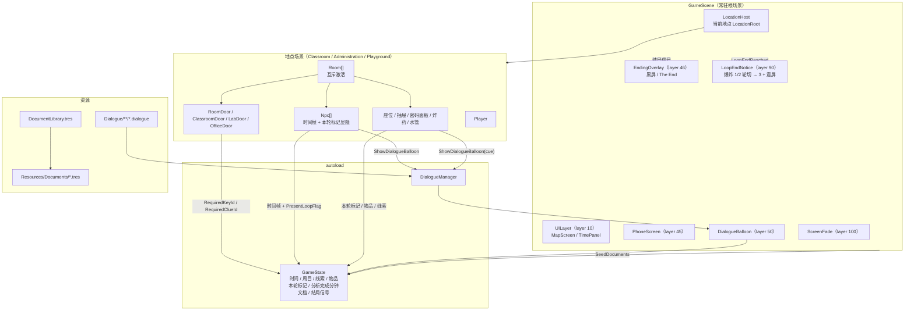
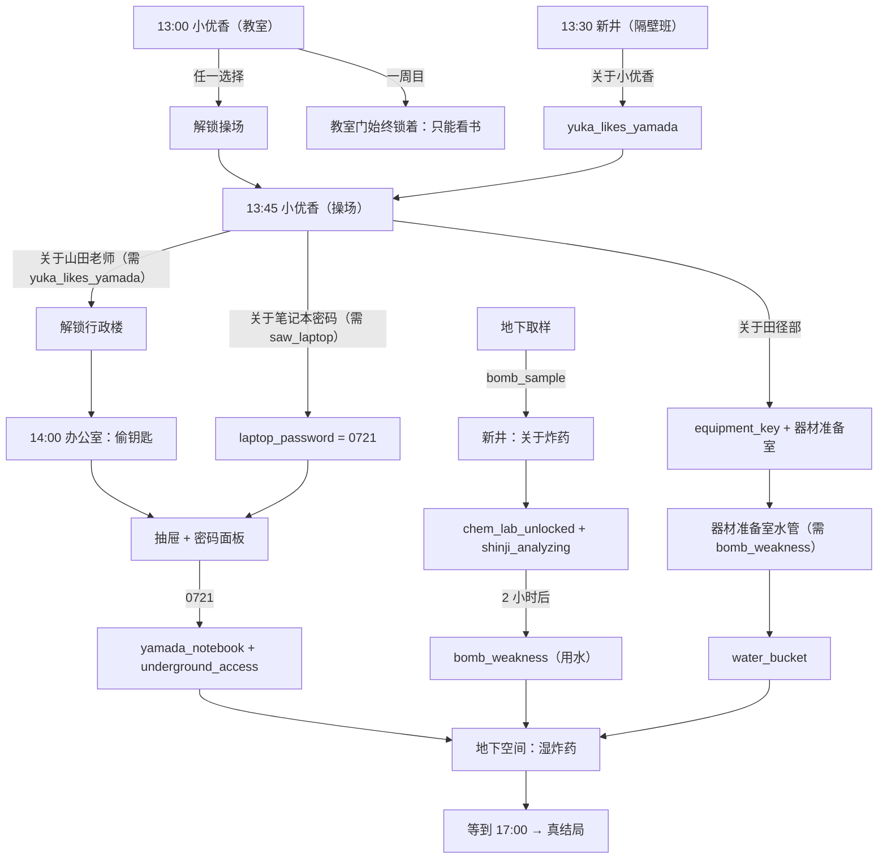
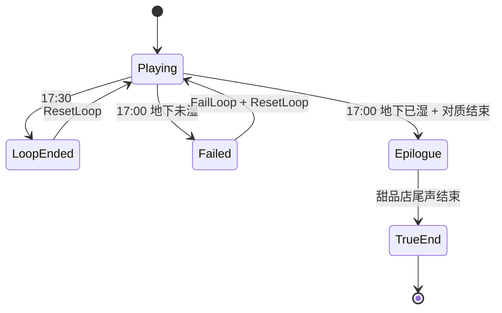
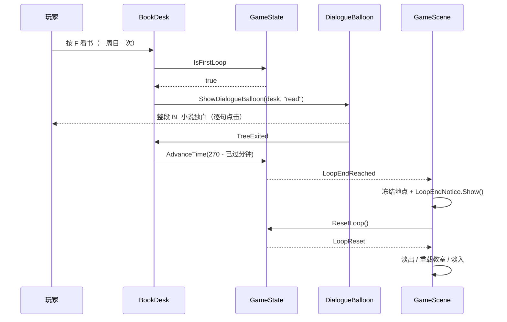
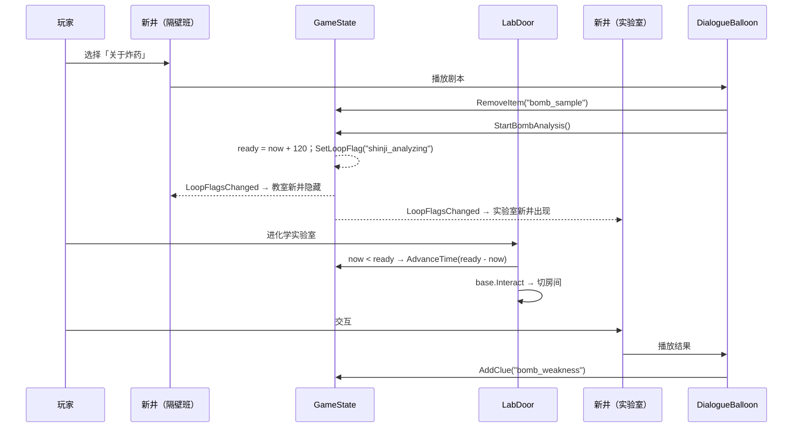
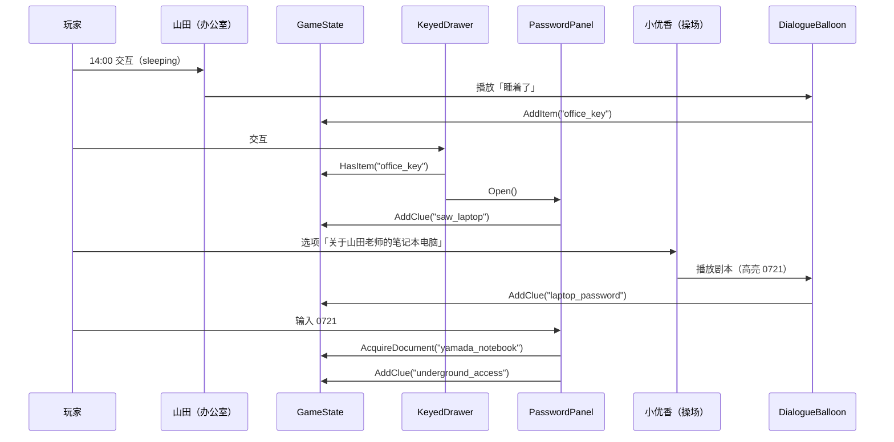
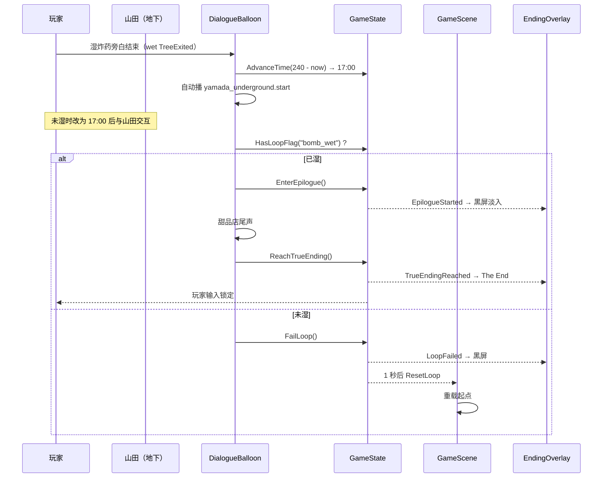
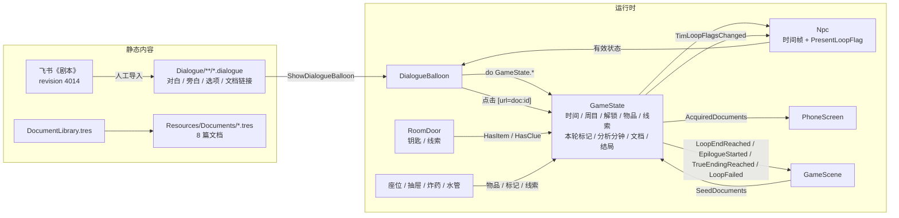

# 正式主流程与剧情导入 · 设计规格

| 项 | 内容 |
|---|---|
| 日期 | 2026-11-07 |
| 项目 | pandagj-2026（Godot 4.7.2 mono / C# / Dialogue Manager 4.2.0） |
| 模块 | 正式主流程、四周目知识锁、飞书剧本导入、红字文档、真结局与失败 |
| 状态 | 设计待审核（2026-11-07）；审核通过后再写实现计划 |
| 上游需求 | 用户当轮需求：把现有占位流程改为正式主流程，导入飞书《剧本》正式剧情；同编号选项同屏显示；看书处「无法离开教室」写 BL 小说剧情文本；斜杠表示同一说话者的连续台词；红色文字中的重要信息高亮为可收集到手机的文档 |
| 需求来源 | 飞书 wiki《Panda jam 八岐大蛇》→《剧本》（doc `Rzy5wQ2KoicjXik48aYcUHahn6b`，revision 4014）与三条线白板 `ZaJlwdhU9huMNubqqHIctn2mnFe` |
| 依赖 | 现有 `GameScene` / `LocationRoot` / `Room` / `RoomDoor` / `Npc` / `GameState` / `DialogueBalloon` / `PhoneScreen` / `DocumentData` / `DocumentLibrary` |

---

## 0. 决策索引

评审时如需推翻某条，直接指出编号。

| # | 决策 |
|---|---|
| Q1 | 采用「现有系统 + 少量交互物」：每个 NPC 一个 `.dialogue` 按状态/线索分支，门/抽屉/炸药/水管/座位各做一个 `Interactable`，跨场景状态放 `GameState`；不引入任务系统或事件总线 |
| Q2 | 一周目被锁教室后，回座位「看书」推进时间：前 4 次各 +60 分钟，第 5 次 +30 分钟到 17:30 并触发爆炸；每次配一句 BL 小说独白（2026-11-08 改为一次交互播完整段，退出对话时直接到 17:30） |
| Q3 | 选「决定在教室看书」后，教室→走廊的门被挡住，播 BL 小说独白；一周目的「决定出去逛逛」选项灰显不可点，二周目起可选 |
| Q4 | 剧本转换规则：同编号选项同屏显示；编号递增是先后菜单；无编号 `——>` 是单选项菜单；斜杠拆分同一说话者的连续台词；括号旁白不加说话者；`鸣子/新井：` 是双人同喊，保留合并名 |
| Q5 | 长台词按标点拆成多行，避免超出 `DialogueLabel` 固定高度；动作说明保留为旁白 |
| Q6 | 红色文字中属于「世界内重要信息」的词，按 §7 映射成 8 篇手机文档；点击高亮只获取、不推进；纯进度说明（如「解锁隔壁班教室」）不单独做文档 |
| Q7 | 山田笔记本是文档 `yamada_notebook`：抽屉用钥匙打开后弹密码面板，输入 0721 解锁并自动获取；密码提示来自小优香 |
| Q8 | 化学实验室挂在教室地点的走廊，背景暂用 `next_classroom.png` 占位；首次进实验室时门交互跳到「样本交给新井后 120 分钟」，进出实验室本身不耗时 |
| Q9 | 地下空间入口由线索 `underground_access` 锁；化学实验室由线索 `chem_lab_unlocked` 锁；器材准备室继续用钥匙 `equipment_key` |
| Q10 | 地下空间加「服务器 / 等到傍晚」交互：湿完炸药后可一次推进到 17:00；未湿时只给提示不推进；保留其他地点的时间压力 |
| Q11 | 真结局：17:00 地下对质 → `EnterEpilogue()` 黑屏 → 甜品店尾声继续用同一 `DialogueBalloon` 演完 → `ReachTrueEnding()` 显示 The End；不新建甜品店场景 |
| Q12 | 失败：未湿炸药在 17:00 地下交互（或等到 17:00）→ 被绑旁白 → `FailLoop()` → 黑屏 1 秒 → 循环重置 |
| Q13 | 17:30 终末加「轰———」闪白与文案，再走现有 `ResetLoop()`；这是正式剧情的爆炸钩子 |
| Q14 | 保健室在剧本里只有场景名、没有内容，本轮不做；不新增地图地点 |
| Q15 | 原占位文档 `club_notice` 从 `DocumentLibrary` 移除；`student.dialogue` 不再挂场景，但文件保留，避免 POT 登记文件缺失 |
| Q16 | 项目约定 git 只读：本规格与实现都不执行 commit / branch / checkout / push |
| Q17 | 办公室门在山田待在办公室的时段（13:30-16:59）开放，其余时间锁着并提示「晚点再来」；「13:30 / 15:00 交互后请鸣子出去」由 `OfficeKickOut` 执行——非午睡时段在办公室里与门 / 出口以外的任何东西交互都会被请回入口。偷钥匙仍只限 14:00-14:59（他午睡时），这段限制由 NPC 状态保证 |

---

## 1. 目标与范围

### 1.1 本规格覆盖

- 飞书《剧本》revision 4014 的对白、旁白、选项与分支导入 `.dialogue`
- 一周目教室锁、看书推进、BL 小说文本、17:30 爆炸
- 二周目起的知识锁链：操场 / 行政楼 / 器材准备室 / 化学实验室 / 地下空间
- 新井分析炸药的两小时等待、取样、用水湿炸药、器材准备室水管
- 山田办公室 13:30 / 14:00 / 15:00 行为与偷钥匙、抽屉、密码面板
- 小优香的三个操场情报选项与笔记本密码
- 17:00 地下对质、真结局、失败、17:30 终末
- 红色文字到手机文档的映射、8 篇文档内容、高亮语法
- 新增交互物、Npc 显隐条件、门锁条件、结局 UI 与循环终末提示

### 1.2 本规格不覆盖

- 保健室场景与剧情（剧本没有内容）
- 甜品店独立场景 / 背景图（用黑屏 + 对话框）
- 新的地图大地点、新的地图按钮
- 存档 / 跨进程持久化
- 音频 BGM（只沿用现有 SFX 接口，不新增曲目）
- NPC 移动、寻路、AI
- 手机线索页、地图页、时间页
- 多周目数值难度、成就、CG 回放
- 打字机速度、对话框样式的大改
- 单元测试框架（项目约定不引入）

---

## 2. 术语

| 术语 | 含义 |
|---|---|
| **本轮标记 / loop flag** | `GameState` 里的 `HashSet<string>`，每轮 `ResetLoop` 清空；用于 `chose_reading`、`shinji_analyzing`、`bomb_sample_taken`、`bomb_wet`、`water_taken`、`yuka_briefed` 等 |
| **跨轮线索 / clue** | `GameState.Clues`，跨循环保留；用于地点/房间解锁与情报选项 |
| **跨轮文档** | `GameState.AcquiredDocuments`，跨循环保留 |
| **知识锁** | 必须先在对话/文档里获得线索，地点、房间或选项才开放 |
| **分析完成分钟** | `GameState.BombAnalysisReadyMinute`，循环内分钟；新井开始分析时 = 当前 + 120 |
| **一周目锁** | `GameState.IsFirstLoop()` 为真时只能教室看书；二周目起不按周目数限制路线 |
| **红字文档** | 剧本里 `text-color rgb(216,57,49)` 的重要信息对应的可收集文档 |
| **终末 / 终局** | 17:30 爆炸循环重置；真结局与失败是终局，不重置 |
| **旁白** | 没有说话者前缀的台词行；气球不显示角色名 |
| **内心独白** | `鸣子: （……）`；显示角色名「鸣子」，正文带括号 |

---

## 3. 架构

### 3.1 架构图



层级关系：

| 层 | 内容 | 说明 |
|---|---|---|
| 10 | 地图、右上角时钟 | 现有 `UILayer` |
| 45 | `PhoneScreen` | 现有手机 |
| 46 | `EndingOverlay` | 黑屏 + The End；高于手机、低于对话 |
| 50 | `DialogueBalloon` | NPC 与物体对话、手机主菜单、尾声 |
| 90 | `LoopEndNotice` | 17:30 爆炸 1/2 轮切 → 爆炸 3 + 震屏；高于对话，低于黑幕 |
| 100 | `ScreenFade` | 过渡时遮挡一切 |

### 3.2 职责划分

| 单位 | 职责 | 不负责 |
|---|---|---|
| `GameState` | 时间、周目、解锁、线索、物品、本轮标记、分析完成分钟、文档、结局信号 | UI、场景装载、对话解析 |
| `Npc` | 时间帧状态、贴图、在场判定（时间帧 + 可选本轮标记）、发起对话 | 剧情分支、物品发放 |
| `Room` | 房间互斥激活 | 门锁 / 时间 |
| `RoomDoor` | 房间切换、钥匙锁、线索锁、锁定提示 | 剧情台词 |
| `ClassroomDoor` | 一周目始终挡住教室→走廊（只能看书），播 BL 独白 | 其它房间 |
| `LabDoor` | 首次进化学实验室时跳到分析完成时间 | 房门锁（交给基类） |
| `BookDesk` | 一周目一次交互播完整段看书剧本，读完后一次推进到 17:30 | 剧情文本 |
| `KeyedDrawer` | 检查办公室钥匙；打开密码面板 | 密码校验（交给面板） |
| `PasswordPanel` | 4 位密码 UI、校验 0721、获取笔记本文档、写入地下线索 | 场景切换 |
| `BombInteractable` | 取样、湿炸药、状态文案；湿炸药旁白结束后自动推进到 17:00 并播放山田终局对质 | 结局分支（交给剧本） |
| `WaterPipe` | 已知炸药解法后接水 | 炸药状态 |
| `EndingOverlay` | 黑屏、The End、失败黑屏 | 剧情文本 |
| `LoopEndNotice` | 17:30 爆炸 1/2 轮切 → 爆炸 3 + 震屏 | 重置逻辑 |
| `GameScene` | 地点装载、地图、过渡、循环重置、结局信号转发 | 剧情内容 |
| `Dialogue/*.dialogue` | 对白、旁白、选项、条件、文档高亮 | C# 状态与 UI |

### 3.3 方案对比

| 方案 | 做法 | 结论 |
|---|---|---|
| **A. 现有系统 + 小型交互物** | 每个 NPC 一个 `.dialogue`；门/抽屉/炸药/水管/座位各一个小脚本；跨场景状态放 `GameState` | **采用**。与现有地图 / 房间 / NPC / 时间系统同构，改动可单点验证 |
| B. 单文件总剧本 | 所有事件塞进一个 `.dialogue`，靠标签跳转 | 放弃。跨场景、跨时间、跨 NPC 的状态会变成巨型状态机，难以定位 |
| C. 事件调度 / 任务系统 | 新做事件总线、任务表、条件解释器 | 放弃。48h jam 过度设计，且项目明确不要通用框架 |

### 3.4 改动范围

```
新增
  Scripts/Core/GameState.cs 内新增本轮标记 / 结局信号（修改现有文件）
  Scripts/Location/ClassroomDoor.cs
  Scripts/Location/LabDoor.cs
  Scripts/Location/OfficeDoor.cs
  Scripts/Location/BookDesk.cs
  Scripts/Location/KeyedDrawer.cs
  Scripts/Location/BombInteractable.cs
  Scripts/Location/WaterPipe.cs
  Scripts/UI/PasswordPanel.cs
  Scripts/UI/EndingOverlay.cs
  Scripts/UI/LoopEndNotice.cs
  Scenes/UI/PasswordPanel.tscn
  Scenes/UI/EndingOverlay.tscn
  Scenes/UI/LoopEndNotice.tscn
  Dialogue/Npc/yamada_underground.dialogue
  Dialogue/Npc/shinji_lab.dialogue
  Dialogue/Objects/classroom_desk.dialogue
  Dialogue/Objects/classroom_block.dialogue
  Dialogue/Objects/underground_bomb.dialogue
  Dialogue/Objects/equipment_water.dialogue
  Resources/Documents/{shinji_schedule,yuka_secret,equipment_room,yamada_tracks,
                       laptop_password,chem_lab,bomb_weakness,yamada_notebook,yamada_nap}.tres
  docs/superpowers/specs/2026-11-07-formal-main-flow-design.md（本文件）

修改
  Scripts/Core/GameState.cs              本轮标记 / 分析时间 / 结局信号 / RemoveItem
  Scripts/Npc/Npc.cs                     本轮标记显隐
  Scripts/Location/RoomDoor.cs           RequiredClueId
  Scripts/Dialogue/DialogueBalloon.cs    真结局时不解锁玩家
  Scripts/Map/GameScene.cs               结局信号、循环终末提示
  Scenes/Locations/Classroom.tscn        化学实验室房间 / 门 / 座位 / 新井显隐 / 教室门
  Scenes/Locations/Administration.tscn   抽屉 / 密码面板 / 山田帧
  Scenes/Locations/Playground.tscn       炸药 / 水管 / 地下门线索锁 / 山田剧本
  Scenes/Root/GameScene.tscn              EndingOverlay / LoopEndNotice
  Dialogue/Npc/yuka.dialogue             正式剧本
  Dialogue/Npc/shinji.dialogue           正式剧本
  Dialogue/Npc/yamada.dialogue           正式剧本
  Dialogue/phone.dialogue                不变
  Dialogue/day1.dialogue                 必须保留
  Resources/Documents/DocumentLibrary.tres  8 篇文档注册；移除 club_notice
  project.godot                          POT 登记新增剧本
  AGENTS.md                              主流程 / NPC 显隐 / 文档 / 结构同步

不修改
  addons/dialogue_manager/**
  Scenes/Dialogue/DialogueBalloon.tscn
  Scenes/Phone/PhoneScreen.tscn
  Scripts/Player/Player.cs
  Scripts/Map/MapScreen.cs
  Resources/MapConfig.tres
```

---

## 4. 数据模型与接口

### 4.1 `GameState` 新增

#### 4.1.1 本轮标记

```csharp
/// <summary>本轮剧情标记；每轮 ResetLoop 清空，跨循环不保留。</summary>
private readonly HashSet<string> _loopFlags = new();

/// <summary>本轮标记变化；Npc 用它刷新按标记显隐。</summary>
[Signal] public delegate void LoopFlagsChangedEventHandler();

/// <summary>本轮是否设置了某个剧情标记。</summary>
public bool HasLoopFlag(string flag)
{
    if (string.IsNullOrEmpty(flag))
    {
        GD.PushError("GameState.HasLoopFlag: 标记为空");
        return false;
    }
    return _loopFlags.Contains(flag);
}

/// <summary>设置本轮剧情标记；重复设置无副作用，并通知 Npc 刷新。</summary>
public void SetLoopFlag(string flag)
{
    if (string.IsNullOrEmpty(flag))
    {
        GD.PushError("GameState.SetLoopFlag: 标记为空");
        return;
    }
    if (!_loopFlags.Add(flag)) return;

    GD.Print($"[LoopFlag] {flag}");
    EmitSignal(SignalName.LoopFlagsChanged);
}
```

本轮标记清单：

| 标记 | 写入 | 含义 |
|---|---|---|
| `chose_reading` | 小优香 `choose_read` | 一周目选了看书 |
| `chose_going_out` | 小优香 `choose_out` | 选了出去逛逛 |
| `yuka_briefed` | 小优香两个选择分支 | 已经听完小优香的开场，再次搭话只说最后一句 |
| `shinji_analyzing` | 新井 `ask_bomb` | 新井本轮在化学实验室分析；教室新井隐藏、实验室新井出现 |
| `bomb_sample_taken` | 地下炸药交互 | 本轮已取样 |
| `bomb_wet` | 地下炸药交互 | 本轮已湿炸药 |
| `water_taken` | 器材准备室水管 | 本轮已接水 |

#### 4.1.2 分析完成分钟

```csharp
/// <summary>新井分析完成的循环内分钟；-1 表示本轮没有开始分析。</summary>
public int BombAnalysisReadyMinute { get; private set; } = -1;

/// <summary>把炸药样本交给新井：记录两小时后的完成时间，并写入本轮标记。</summary>
public void StartBombAnalysis()
{
    BombAnalysisReadyMinute = ElapsedMinutes + 120;
    SetLoopFlag("shinji_analyzing");
    GD.Print($"[Bomb] 分析开始，{BombAnalysisReadyMinute} 分钟时完成");
}
```

- `ElapsedMinutes` 仍是 `private set`；`StartBombAnalysis` 读取当前值。
- `ResetLoop()` 把 `BombAnalysisReadyMinute` 复位为 `-1`。
- 若 `ElapsedMinutes + 120 >= 270`，`LabDoor` 的 `AdvanceTime` 会夹到 17:30 并触发终末；本轮拿不到分析结果，线索跨轮保留的设计不成立，需要下一轮重新取样。

#### 4.1.3 物品移除

```csharp
/// <summary>移除本轮道具；不存在时无副作用。</summary>
public void RemoveItem(string itemId)
{
    if (string.IsNullOrEmpty(itemId))
    {
        GD.PushError("GameState.RemoveItem: 道具 id 为空");
        return;
    }
    if (Inventory.Remove(itemId)) GD.Print($"[Item] 失去 {itemId}");
}
```

#### 4.1.4 结局信号

```csharp
/// <summary>真结局尾声开始：黑屏淡入，对话继续演甜品店。</summary>
[Signal] public delegate void EpilogueStartedEventHandler();

/// <summary>真结局结束：显示 The End，锁玩家输入。</summary>
[Signal] public delegate void TrueEndingReachedEventHandler();

/// <summary>本轮失败：被山田绑住，黑屏后循环重置。</summary>
[Signal] public delegate void LoopFailedEventHandler();

/// <summary>是否已进入真结局；DialogueBalloon 据此不做退出解锁。</summary>
public bool IsTrueEnding { get; private set; }

/// <summary>由 yamada_underground.dialogue 调用：开始甜品店尾声。</summary>
public void EnterEpilogue() => EmitSignal(SignalName.EpilogueStarted);

/// <summary>由 yamada_underground.dialogue 调用：真结局结束。</summary>
public void ReachTrueEnding()
{
    IsTrueEnding = true;
    EmitSignal(SignalName.TrueEndingReached);
}

/// <summary>由 yamada_underground.dialogue 调用：本轮失败。</summary>
public void FailLoop() => EmitSignal(SignalName.LoopFailed);
```

- `ResetLoop()` 把 `IsTrueEnding` 复位为 `false`（正常流程不会在真结局后再重置，但保持幂等）。
- `DialogueBalloon._ExitTree` 的解锁条件改为：`player 有效 && !KeepPlayerInputLockedOnExit && !gameState.IsTrueEnding`。否则真结局最后一句 `do GameState.ReachTrueEnding()` 之后气球退出会把玩家解锁，The End 画面还能走动。

#### 4.1.5 `ResetLoop()` 顺序

```csharp
public void ResetLoop()
{
    ElapsedMinutes = 0;
    IsLoopEnded = false;
    IsTrueEnding = false;
    LoopCount++;
    BombAnalysisReadyMinute = -1;

    Inventory.Clear();
    _npcLoopStates.Clear();
    _npcUsedChoices.Clear();
    _loopFlags.Clear();

    GD.Print($"[Loop] 第 {LoopCount} 周目开始");
    EmitSignal(SignalName.TimeChanged, 0);   // Npc 在这时按清空后的标记刷新
    EmitSignal(SignalName.LoopReset);
}
```

- 先清 `_loopFlags` 再发 `TimeChanged(0)`，保证教室新井重新出现、实验室新井隐藏。
- `LoopFlagsChanged` 不在重置时发；`TimeChanged(0)` 已足够刷新。

### 4.2 `Npc` 按本轮标记显隐

现有规则「在场只看当前时间帧的 `Visible`」扩展为「时间帧 + 可选本轮标记」。

```csharp
/// <summary>可选的在场条件：本轮标记 id；留空表示不按标记过滤。</summary>
[Export] public string PresentLoopFlag { get; set; } = "";

/// <summary>为 true 时标记存在才在场；为 false 时标记存在则离场。</summary>
[Export] public bool VisibleWhenFlagSet { get; set; } = true;
```

`RefreshVisual()`：

```csharp
bool flagSatisfied = string.IsNullOrEmpty(PresentLoopFlag)
    || GameState.Instance.HasLoopFlag(PresentLoopFlag) == VisibleWhenFlagSet;
_present = frame.Visible && flagSatisfied;
```

订阅：

```csharp
// _Ready
GameState.Instance.LoopFlagsChanged += OnLoopFlagsChanged;
// _ExitTree
GameState.Instance.LoopFlagsChanged -= OnLoopFlagsChanged;

private void OnLoopFlagsChanged() => RefreshVisual();
```

用法：

| NPC | PresentLoopFlag | VisibleWhenFlagSet | 效果 |
|---|---|---|---|
| `classroom.shinji`（隔壁班） | `shinji_analyzing` | `false` | 样本交给新井后消失 |
| `classroom.shinji_lab`（化学实验室） | `shinji_analyzing` | `true` | 样本交给新井后出现，重置后隐藏 |
| 其余 NPC | 空 | `true` | 行为不变 |

- `SetLoopState` 仍然只改状态、不改在场；在场由时间帧 + 标记决定。
- 标记为空的 NPC 不受影响，现有场景不用改。
- `Validate()` 不要求 `PresentLoopFlag` 对应某帧；它只是在场条件。

### 4.3 `RoomDoor` 线索锁

```csharp
/// <summary>需要先获得的线索 id；留空表示不按线索上锁。</summary>
[Export] public string RequiredClueId { get; set; } = "";
```

`Interact()` 顺序：

1. `RequiredClueId` 非空且 `!GameState.HasClue(...)` → 显示 `LockedHint`，1.5 秒后隐藏，返回。
2. `RequiredKeyId` 非空且 `!GameState.HasItem(...)` → 显示 `LockedHint`，返回。
3. `base.Interact()` 发 `Interacted`，由 `LocationRoot` 切房间。

`_Ready()` 校验增加：`RequiredClueId` 非空且 `LockedHint` 为空 → `PushError`。

各门配置：

| 门 | 所在房间 | 目标 | 锁 |
|---|---|---|---|
| `DoorToHallway`（教室） | Room_Classroom | Room_Hallway | `ClassroomDoor`；一周目始终播 BL 独白 |
| `DoorToLab` | Room_Hallway | Room_ChemLab | `LabDoor`；`RequiredClueId = chem_lab_unlocked`；`TravelMinutes = 0` |
| `DoorToHallway`（实验室） | Room_ChemLab | Room_Hallway | `TravelMinutes = 0` |
| `DoorToEquipment` | Room_Behind | Room_Equipment | `RequiredKeyId = equipment_key`（现有） |
| `DoorToUnderground` | Room_Behind | Room_Underground | `RequiredClueId = underground_access` |
| `DoorToOffice` | Room_Lobby | Room_Office | `OfficeDoor`；只在 30-239（13:30-16:59）开放 |

### 4.4 新增交互物脚本

#### 4.4.1 `ClassroomDoor`

```csharp
/// <summary>教室→走廊的门：一周目始终挡住（只能看书），播 BL 小说独白。</summary>
public partial class ClassroomDoor : RoomDoor
{
    /// <summary>被挡住时播放的剧本。</summary>
    [Export] public Resource BlockingDialogue { get; set; }

    public override void Interact()
    {
        if (GameState.Instance.IsFirstLoop())
        {
            if (BlockingDialogue == null)
            {
                GD.PushError($"{Name}: BlockingDialogue 为空");
                return;
            }
            DialogueManager.ShowDialogueBalloon(BlockingDialogue);
            return;
        }
        base.Interact();
    }
}
```

- 不调用 `base.Interact()` 时不发 `Interacted`，`LocationRoot` 不会切房间。
- 一周目门始终挡着，玩家只能回去看书（未与小优香对话也挡，播放同一段独白）；二周目起门常开。

#### 4.4.2 `LabDoor`

```csharp
/// <summary>化学实验室门：本轮新井在分析且未到完成时间时，先把时间跳到完成时间。</summary>
public partial class LabDoor : RoomDoor
{
    public override void Interact()
    {
        if (GameState.Instance.HasLoopFlag("shinji_analyzing"))
        {
            int ready = GameState.Instance.BombAnalysisReadyMinute;
            int now = GameState.Instance.ElapsedMinutes;
            if (ready >= 0 && now < ready)
            {
                if (GameState.Instance.AdvanceTime(ready - now)) return;
            }
        }
        base.Interact();
    }
}
```

- `AdvanceTime` 返回 true（到 17:30）时直接返回，不切房间；本轮拿不到结果。
- 时间跳过后由 `base.Interact()` 走正常房间过渡；`TravelMinutes = 0`，不再额外扣时。
- 房间过渡的黑幕掩盖时间跳变；右上角时钟会直接跳到两小时后。

#### 4.4.3 `BookDesk`

```csharp
/// <summary>教室座位：一周目一次坐下读完整段 BL 小说，读完后时间直接到 17:30 终末。</summary>
public partial class BookDesk : Interactable
{
    /// <summary>看书剧本。</summary>
    [Export] public Resource Dialogue { get; set; }

    public override void Interact()
    {
        if (!GameState.Instance.IsFirstLoop()) { Show("later"); return; }
        Node balloon = Show("read");
        if (balloon != null) balloon.TreeExited += OnReadingExited;
    }

    /// <summary>整段阅读结束后把时间推进到 17:30，触发本轮终末。</summary>
    private void OnReadingExited()
    {
        if (!IsInsideTree() || GameState.Instance == null) return;
        int remain = GameState.LoopDurationMinutes - GameState.Instance.ElapsedMinutes;
        if (remain > 0) GameState.Instance.AdvanceTime(remain);
    }

    private Node Show(string cue) { /* 校验 Dialogue 后 DialogueManager.ShowDialogueBalloon(Dialogue, cue) */ }
}
```

- 一周目一次交互播完整个 `read` 剧本（原 `read_1`…`read_4`、`last` 已合并），中途不结束、不需要重新交互。
- 时间在对话退出时一次性推进到 17:30，避免对话中途触发 `LoopEndReached` 把气球冲掉。
- 二周目起只播 `later`，不推进时间。

#### 4.4.4 `KeyedDrawer`

```csharp
/// <summary>办公室抽屉：有钥匙才能打开，打开密码面板。</summary>
public partial class KeyedDrawer : Interactable
{
    [Export] public string RequiredKeyId { get; set; } = "office_key";
    [Export] public Label LockedHint { get; set; }
    [Export] public PasswordPanel PasswordPanel { get; set; }

    public override void Interact()
    {
        if (!GameState.Instance.HasItem(RequiredKeyId)) { ShowLockedHint(); return; }
        if (PasswordPanel == null) { GD.PushError($"{Name}: PasswordPanel 为空"); return; }
        PasswordPanel.Open();
    }
}
```

- 锁定提示用 `Label` + 1.5 秒 Timer，沿用 `RoomDoor` 的做法。
- `.tscn` 里 `KeyedDrawer` 节点必须写 `node_paths=PackedStringArray("PasswordPanel", ...)`，否则 C# 的节点引用为 null（项目已知约束）。
- 抽屉打开不消耗钥匙。

#### 4.4.5 `BombInteractable`

```csharp
/// <summary>地下炸药：取样 / 湿炸药后直接进入 17:00 终局对质。</summary>
public partial class BombInteractable : Interactable
{
    [Export] public Resource Dialogue { get; set; }
    [Export] public Resource EndingDialogue { get; set; }

    private const int EndingMinute = 240;

    public override void Interact()
    {
        if (!GameState.Instance.HasLoopFlag("bomb_sample_taken"))
        {
            GameState.Instance.AddItem("bomb_sample");
            GameState.Instance.SetLoopFlag("bomb_sample_taken");
            Show("sample");
            return;
        }
        if (!GameState.Instance.HasLoopFlag("bomb_wet"))
        {
            if (GameState.Instance.HasItem("water_bucket") && GameState.Instance.HasClue("bomb_weakness"))
            {
                if (EndingDialogue == null) { PushError("EndingDialogue 为空"); return; }
                GameState.Instance.SetLoopFlag("bomb_wet");
                Node balloon = Show("wet");
                if (balloon != null) balloon.TreeExited += OnWetDialogueExited;
            }
            else Show("nothing");
            return;
        }
        Show("already_wet");
    }

    /// <summary>湿炸药旁白结束后把时间推到 17:00，山田登场并直接进入终局对质。</summary>
    private void OnWetDialogueExited()
    {
        int now = GameState.Instance.ElapsedMinutes;
        if (now < EndingMinute && GameState.Instance.AdvanceTime(EndingMinute - now)) return;
        ShowDialogueBalloon(EndingDialogue, "start");
    }
}
```

#### 4.4.6 `WaterPipe`

```csharp
/// <summary>器材准备室水管：知道炸药解法后接一桶水。</summary>
public partial class WaterPipe : Interactable
{
    [Export] public Resource Dialogue { get; set; }

    public override void Interact()
    {
        if (GameState.Instance.HasLoopFlag("water_taken") || GameState.Instance.HasItem("water_bucket"))
        {
            Show("already");
            return;
        }
        if (!GameState.Instance.HasClue("bomb_weakness")) { Show("hint"); return; }
        GameState.Instance.AddItem("water_bucket");
        GameState.Instance.SetLoopFlag("water_taken");
        Show("fill");
    }
}
```

#### 4.4.7 湿炸药 → 17:00 终局

- `wet` 旁白关闭后（`TreeExited`）立刻 `AdvanceTime(240 - now)`：时间跳到 17:00，山田按时间帧出现。
- 随后直接 `ShowDialogueBalloon(yamada_underground, "start")` 进入终局对质，玩家不需要再去找山田搭话。
- 不再有单独的「服务器 / 等到傍晚」交互物；时间跳跃只由湿炸药触发，未湿炸药不会推进时间。

#### 4.4.8 `OfficeDoor`

```csharp
/// <summary>办公室门：山田在办公室的时段（13:30-16:59）开放；14:00-14:59 他午睡时才能偷钥匙。</summary>
public partial class OfficeDoor : RoomDoor
{
    private const int OpensAtMinute = 30;    // 13:30 山田回到办公室
    private const int ClosesAtMinute = 240;  // 17:00 山田去地下

    public override void Interact()
    {
        int minute = GameState.Instance.ElapsedMinutes;
        bool open = minute >= OpensAtMinute && minute < ClosesAtMinute;
        if (!open)
        {
            ShowLockedHint();
            return;
        }
        base.Interact();
    }
}
```

- 门的开放窗口对齐剧本的「13:30 老师会回到办公室办公」与「17:00 老师会前往操场地下的服务器空间」；13:00-13:29（山田还在教室）与 17:00 后锁着。
- 剧本的三周目路线 `出教室门(15) → 去行政楼(25) → 进办公室(5)` 到达时是 13:45，必须能进门；锁到 14:00 会让剧本路线直接走不通。
- 「必须在午睡窗口来」的压力由 NPC 状态承担：`administration.yamada` 在 30-59 / 120-239 是 `working`，交互只会说「晚点再来吧」，拿不到钥匙；只有 60-119 的 `sleeping` 分支发 `office_key`。
- 剧本的「13:30 / 15:00 交互会让鸣子出去」由 `OfficeKickOut`（§4.4.9）执行：非午睡时段在办公室里点任何东西都会被请回入口。
- `RoomDoor` 把现有的锁定提示抽成 `protected void ShowLockedHint()`（`LockedHint.Visible = true` + 1.5 秒 Timer），供 `RequiredClueId` / `RequiredKeyId` / `OfficeDoor` 共用。
- 玩家在 14:59 进入后待过 15:00，门不会把人弹出去；此时山田切到 `working`，再交互就会触发 `OfficeKickOut` 被赶回入口。钥匙已经到手，不影响后续。

#### 4.4.9 `OfficeKickOut`

```csharp
/// <summary>办公室看门人：山田在办公的时段，玩家在办公室里碰任何东西都会被他请出办公室。</summary>
public partial class OfficeKickOut : Node
{
    private const int SleepFromMinute = 60;   // 14:00
    private const int SleepToMinute = 120;    // 15:00
    private const int WokenAtMinute = 120;    // 15:00 睡醒后赶人台词换成 woken
    private const int LeavesAtMinute = 240;   // 17:00 山田去地下

    private const string StartCue = "start";  // 13:30-13:59
    private const string WokenCue = "woken";  // 15:00-16:59

    /// <summary>被赶出去时走的门，负责黑幕与 5 分钟路程。</summary>
    [Export] public RoomDoor ExitDoor { get; set; }

    /// <summary>赶人时播的对白。</summary>
    [Export] public Resource KickDialogue { get; set; }

    /// <summary>目标是办公室里的东西、山田又在办公时，赶人并返回 true。</summary>
    public bool TryIntercept(Interactable target) { ... }
}
```

- 挂在 `Room_Office` 下，`_EnterTree` 注册进 `office_kick_out` 分组；`PlayerInteractor` 在 `Interact()` 之前调 `OfficeKickOut.TryInterceptAny(...)`，返回 true 就不再执行目标对象。
- 拦截条件**必须先判房间**：目标在 `Room_Office` 下、当前不在 60-119、当前 < 240；`RoomDoor` / `LocationExit` 不拦（自己走出去不算碰东西）。顺序错了会把地图出口、办公室门这些门外交互一起吞掉（曾导致「被赶出去后再也点不动任何东西」）。
- 赶人流程：播 `Dialogue/Objects/office_kick_out.dialogue`（山田「晚点再来吧」+ 旁白），同时调 `DoorToLobby.Interact()` —— 复用门的 5 分钟与黑幕把玩家送回入口，对白在入口继续显示。
- 赶人台词按时间选 cue：`ElapsedMinutes < 120`（13:30-13:59）用 `start`；`>= 120`（15:00-16:59）用 `woken`，山田会先打哈欠说自己刚睡醒，其中「直到15:00都在睡觉」是 `[url=doc:yamada_nap]` 黄色高亮，给出「老师在几点到几点睡觉」的重要的事。
- 不保留「正在赶人」的布尔状态：对白打开时 `Player.InputLocked` 已经挡住重复交互，状态标记反而容易卡死。
- 这样 13:30-13:59 / 15:00-16:59 玩家可以进门看一眼、走动，但**任何交互都会被赶出去**，无法靠待在里面磨到 14:00。

### 4.5 `PasswordPanel`

`PasswordPanel` 是 `CanvasLayer`（layer 60），挂在 `Administration.tscn` 里，由 `KeyedDrawer` 打开。

```csharp
/// <summary>山田笔记本密码面板：4 位输入，正确后获取笔记本文档并解锁地下空间。</summary>
public partial class PasswordPanel : CanvasLayer
{
    /// <summary>正确密码；剧本设定 0721。</summary>
    [Export] public string Password { get; set; } = "0721";

    /// <summary>解锁后获取的文档 id。</summary>
    [Export] public string DocumentId { get; set; } = "yamada_notebook";

    /// <summary>解锁后写入的线索 id。</summary>
    [Export] public string UnlockClueId { get; set; } = "underground_access";

    public void Open();
}
```

节点树：

```
PasswordPanel（CanvasLayer, layer = 60, 脚本 PasswordPanel.cs）
├── Overlay（Control, 全屏, visible = false, mouse_filter = STOP）
│   ├── Dim（ColorRect, 全屏, Color(0,0,0,0.55), mouse_filter = IGNORE）
│   └── Center（CenterContainer, 全屏, mouse_filter = IGNORE）
│       └── Panel（PanelContainer, 约 720 × 420）
│           └── MarginContainer > VBox
│               ├── Title（Label「山田老师的笔记本电脑」）
│               ├── Hint（Label「请输入 4 位密码（提示：小优香）」）
│               ├── Input（LineEdit, max_length = 4, alignment = center）
│               ├── Error（Label, 红色, 初始隐藏）
│               └── Buttons（HBoxContainer）
│                   ├── Confirm（Button「确定」）
│                   └── Close（Button「离开」）
```

- `Center` 必须 `mouse_filter = IGNORE`（与手机面板同一个坑）。
- `Open()`：
  - 找 `/root/Player` 组里的 `Player`；找不到 `PushError`，不打开。
  - `GameState.AddClue("saw_laptop")`：看过笔记本才解锁小优香的密码选项。
  - `player.InputLocked = true`；显示 Overlay；清空 Input / Error；`Input.GrabFocus()`。
- 确定：
  - `Input.Text == Password` → `GameState.AcquireDocument(DocumentId)`；`GameState.AddClue(UnlockClueId)`；显示「解锁成功。笔记本的内容已记录到手机。」；1 秒后关闭。
  - 否则 → `Error.Text = "密码错误"`；清空 Input；重新 `GrabFocus()`。
- 离开 / Esc：隐藏 Overlay；`player.InputLocked = false`。
- 重复打开：`AcquireDocument` 返回 false 时提示「已经解锁过了」，然后关闭。
- 密码校验只认 `Password` 字段，不要求玩家先获得 `laptop_password` 线索；线索只负责给出提示文本。

### 4.6 结局 UI

#### 4.6.1 `EndingOverlay`

`CanvasLayer.layer = 46`，挂在 `GameScene.tscn` 根下。

```
EndingOverlay（CanvasLayer, layer = 46, 脚本 EndingOverlay.cs）
├── Black（ColorRect, 全屏, black, modulate.a = 0, mouse_filter = IGNORE）
└── Center（CenterContainer, 全屏, mouse_filter = IGNORE）
    └── VBox
        ├── TheEnd（Label「The End」, font_size = 64, visible = false）
        └── Thanks（Label「感谢游玩」, font_size = 24, visible = false）
```

方法：

| 方法 | 行为 |
|---|---|
| `ShowEpilogue()` | `Black.Visible = true`；alpha 0→1 淡入 1.0 秒 |
| `ShowTheEnd()` | 保持黑屏；显示 The End / 感谢游玩；`Black.MouseFilter = STOP` |
| `ShowFail()` | 黑屏淡入 0.6 秒 |
| `HideAll()` | 隐藏黑屏与文字，alpha 归 0，MouseFilter 回 IGNORE |

- `EndingOverlay` 在 `DialogueBalloon`（50）之下，所以甜品店尾声的对话框仍然可见。
- `ShowTheEnd()` 不直接解锁/锁定玩家；玩家锁由 `GameScene` 处理，`DialogueBalloon` 因 `IsTrueEnding` 不会解锁。
- `HideAll()` 在 `LoopReset` 时调用。

#### 4.6.2 `LoopEndNotice`

`CanvasLayer.layer = 90`，挂在 `GameScene.tscn` 根下。

```
LoopEndNotice（CanvasLayer, layer = 90, 脚本 LoopEndNotice.cs）
└── Frame（TextureRect, 全屏且四边各外扩 60px, stretch = KEEP_ASPECT_COVERED, mouse_filter = IGNORE）
```

`PlayAsync()`：爆炸 1 起手 → 爆炸 1 / 2 每 0.07 秒轮切一次、共 6 次 → 切到爆炸 3 → 震屏一次（`CanvasLayer.Offset` 随机偏移 26px 衰减，0.45 秒）→ 停留 1.0 秒 → 0.3 秒淡出，共约 2.0 秒。`GameScene.OnLoopEndReached` 等 `PlayAsync()` 结束再 `ResetLoop()`。

### 4.7 文档资源

- 8 篇文档，全部是 `DocumentData`（`Resources/Documents/<id>.tres`）。
- `DocumentLibrary.tres` 的 `Documents` 数组按以下顺序注册；移除 `club_notice`。
- `club_notice.tres` 文件可保留但不注册；不影响启动。
- 文档正文用 `\n` 转义；手机阅读面板可滚动，长正文不受对话框高度限制。

---

## 5. 主流程

### 5.1 时间表

循环内分钟：0 = 13:00，270 = 17:30。

| 角色 | 时间帧 | 状态 | 在场 | 行为 |
|---|---|---|---|---|
| 山田（教室） | 0 | `writing` | 是 | 讲台写笔记；可问下午安排 |
| 山田（教室） | 30 | `absent` | 否 | 去办公室 |
| 山田（办公室） | 30 | `working` | 是 | 赶人：「晚点再来吧」 |
| 山田（办公室） | 60 | `sleeping` | 是 | 折叠床睡着；可偷钥匙 |
| 山田（办公室） | 120 | `working` | 是 | 赶人 |
| 山田（办公室） | 240 | `absent` | 否 | 去地下 |
| 山田（地下） | 240 | `preparing` | 是 | 17:00 对质 / 失败 |
| 小优香（教室） | 0 | `talking` | 是 | 开场对话 |
| 小优香（教室） | 45 | `absent` | 否 | 去操场 |
| 小优香（操场） | 45 | `running` | 是 | 三个情报选项 |
| 新井（隔壁班） | 0 | `studying` | 是；`shinji_analyzing` 时为否 | 小优香 / 炸药选项；交给样本后消失 |
| 新井（实验室） | 0 | `working` | 仅 `shinji_analyzing` | 15:30 结果 |

> 状态 id 与现有 `NpcStateFrame` 对齐；教室山田的 `absent` 帧已有，办公室山田的 0/30/60/120/240 帧已有。地下山田的 `Dialogue` 改为 `yamada_underground.dialogue`。

### 5.2 知识锁链



### 5.3 四周目预期路径

| 周目 | 玩家做什么 | 结束方式 |
|---|---|---|
| 一周目 | 小优香开场 → 只能选看书 → 山田问下午安排 → 回座位看一次书 | 17:30 爆炸重置 |
| 二周目 | 新井问小优香 → 操场问田径部拿钥匙、问山田解锁行政楼 → 行政楼办公室被赶出 → 器材准备室探索 | 17:30 爆炸重置 |
| 三周目 | 14:00 偷钥匙 → 抽屉 → 问小优香密码 → 打开笔记本 → 地下取样 → 交给新井 → 实验室等两小时 | 17:25 左右拿到「用水」线索，17:30 重置 |
| 四周目 | 拿钥匙 → 器材准备室接水 → 地下湿炸药 → 等到 17:00 → 对质 | 真结局 / 失败 |

- 周目路线是预期打法，不是系统强制；系统只按 `LoopCount` 锁一周目教室，其余靠线索与时间。
- 二周目起不按周目数限制地点、道具、对话、路线。

### 5.4 一周目教室锁与看书

1. 小优香 `start`：`小优香: 啊，鸣子你醒啦` → 单选项「询问现在的情况」。
2. `ask_now`：鸣子问时间 → 小优香说已经放学 → 菜单：
   - 「决定在教室看书」
   - 「决定出去逛逛」：`[if GameState.GetLoopCount() > 1 /]` + `[#show_if=true]`；一周目灰显不可点。
3. `choose_read`：鸣子说 BL 小说没看完 → 小优香说去田径部、17:30 一起回家 → 写 `chose_reading` / `yuka_briefed` → 解锁操场 → END。
4. `choose_out`：鸣子说想逛逛 → 小优香同样道别 → 写 `chose_going_out` / `yuka_briefed` → 解锁操场 → END。
5. 再次搭话：`yuka_briefed` 为真 → 只说「那我一会去田径部啦，17:30 一起回家哦」。这个分支只在教室 `talking` 状态生效；`start` 必须先判断 `npc.IsInState("running")`，否则 13:45 后的操场对话会被一句道别吞掉。
6. 教室门 `ClassroomDoor`：`IsFirstLoop` → 播 `classroom_block.dialogue`（不要求先选看书）：
   - 鸣子：「（刚看到最关键的地方……BL 小说还没看完，还是回去继续看吧。）」
   - 鸣子：「（反正今天也没什么特别的事。）」
7. 座位 `BookDesk`：
   - 一周目一次交互播完整个 `read` 剧本（翻书 → 告白 → 天色变暗 → 「已经这个时候了？」），不需要多次交互。
   - 剧本退出后由 C# 把时间一次性推进到 17:30，触发终末。
   - 二周目起：只播 `later`，不推进时间。
8. 17:30：`LoopEndReached` → 冻结地点 → `LoopEndNotice.Show()` → 2 秒后 `ResetLoop()`。

> 一周目如果玩家在选看书前就走出教室，门不会拦（`chose_reading` 未写）；这是剧本「对话结束后才无法离开」的直译。选看书后即锁。

### 5.5 化学实验室与两小时

1. 新井 `ask_bomb`（需 `HasItem("bomb_sample")`）：
   - 文本见剧本；高亮「化学实验室」→ `chem_lab` 文档。
   - `do GameState.RemoveItem("bomb_sample")`。
   - `do GameState.StartBombAnalysis()`：`BombAnalysisReadyMinute = 当前 + 120`，写 `shinji_analyzing`。
   - `do GameState.AddClue("chem_lab_unlocked")`。
   - 教室新井因 `PresentLoopFlag` 立刻消失；实验室新井出现。
2. `DoorToLab`（`LabDoor`）：
   - 有 `chem_lab_unlocked` 才开；否则显示「（化学实验室还进不去）」。
   - 若 `shinji_analyzing` 且 `now < BombAnalysisReadyMinute`：`AdvanceTime(ready - now)`；到 17:30 则中止，不切房间。
   - 否则正常切房间；`TravelMinutes = 0`。
3. 实验室新井只有 `shinji_analyzing` 时在场；`shinji_lab.dialogue`：
   - 高亮「硝铵类炸药」「大量的水」→ `bomb_weakness` 文档。
   - `do GameState.AddClue("bomb_weakness")`。
4. 进出实验室不额外耗时；返回走廊 0 分钟。

### 5.6 地下与终局

1. `DoorToUnderground` 需要 `underground_access`（来自笔记本）。
2. 地下炸药：
   - 未取样 → 获得 `bomb_sample`，写 `bomb_sample_taken`，提示「可以让新井同学看看」。
   - 已取样、未湿、有 `water_bucket` + `bomb_weakness` → 写 `bomb_wet`，播湿炸药文本；文本结束后自动跳到 17:00 并接 `yamada_underground.dialogue` 的 `start`。
   - 已湿 → 「炸药已经被水浸透了」。
   - 其它 → 「得想办法让它们失效」。
3. 器材准备室水管：有 `bomb_weakness` 才接水；获得 `water_bucket`，写 `water_taken`。
4. 17:00 地下山田（`playground.yamada`，`preparing`）：
   - `bomb_wet` → `yamada_underground.dialogue` 真结局分支（湿炸药时已自动进入，不需要再交互）。
   - 未湿 → 失败分支。
5. 17:30 前未处理 → 现有爆炸重置。

### 5.7 办公室时间窗

- `OfficeDoor` 在 30-239（13:30-16:59）开放；0-29（山田还在教室）与 240-269（他去地下）锁着。
- 锁着时 `LockedHint` 显示「（办公室的门关着。晚点再来吧。）」1.5 秒。
- 进门不消耗额外的门禁时间，只有 `RoomDoor.TravelMinutes = 5`；剧本三周目路线 13:45 进门、14:55 再进一次偷钥匙。
- 偷钥匙只发生在 60-119（14:00-14:59）山田 `sleeping` 时；其余时段进办公室可以走动，但**碰任何东西**（抽屉 / 山田 / 其它交互物）都会被 `OfficeKickOut` 播 `office_kick_out.dialogue` 并赶回入口。
- 15:00 后门继续开放（山田在里面办公），如果玩家在 14:59 已进入，不强制弹出，山田切到 `working` 后一交互就会被赶。
- 15:00-16:59 被赶时走 `office_kick_out.dialogue` 的 `woken` cue：山田「（哈欠）——啊，是千原啊，我刚刚直到15:00都在睡觉……」，黄字「直到15:00都在睡觉」给出 `yamada_nap`（老师在 14:00-15:00 睡觉），这是下一轮 14:00 来偷钥匙的知识锁。
- 密码与小优香的情报可能跨轮：先在一轮里看过笔记本（`saw_laptop`），下一轮问小优香 0721，再下一轮 14:00 开电脑；线索与文档跨轮保留，不要求一轮内完成。

---

## 6. 剧情导入规则

### 6.1 编号选项

剧本里的 `1——>` / `2——>` 是选项组：

- **同编号 = 同一屏显示的多个选项**。例：小优香操场三个「1——>」是同一菜单的三个选项；新井「关于小优香 / 关于炸药」也是同一菜单。
- **编号递增 = 先后菜单**。例：13:00 小优香先「1 询问现在的情况」，回应后才是「2 看书 / 2 出去逛逛」。
- **无编号 `——>` = 单选项菜单**。例：山田 13:00「关于下午的安排」。
- 单选项菜单仍显示为选项，不自动播放；玩家点一下推进。
- 一次性选项写 `[ID:...]`；可重复选项写 `[#repeatable]`；条件写 `[if 表达式 /]`；条件不满足但仍要显示灰项时加 `[#show_if=true]`。

### 6.2 斜杠

- 说话者冒号之后的斜杠表示**同一说话者的连续台词**：`山田：……/ 没错` → `山田: ……` + `山田: 没错`。
- 例：`鸣子：那为什么要这样做/我也是，小优香也是，新井君也是……` 拆成两条 `鸣子:` 台词。
- 例外 1：`鸣子/新井：你这个笨蛋老师！！！` 是双人同喊，保留合并说话者「鸣子＆新井」。
- 例外 2：括号旁白里的斜杠是动作并列，不是台词分隔；按语义拆成两句旁白或保留，不按台词拆。

### 6.3 旁白与内心独白

- **没有说话者前缀的 `（……）` = 旁白**：直接写成一行正文，不加 `旁白:`；气球不显示角色名。
- **`鸣子：（……）` = 鸣子内心**：写 `鸣子: （……）`，显示角色名「鸣子」。
- **动作说明**：`（此时，我们背后突然传来井盖打开的声音……）` 是旁白；`鸣子（没办法，我还是把这一切告诉了他……）` 补冒号写成 `鸣子: （……）`。
- 说话者统一用「鸣子」（原稿偶写「千原」）；其他说话者用「小优香」「山田」「新井」「山田老师」按原稿语境统一为「山田」。

### 6.4 长句拆分

`DialogueLabel` 高度固定且不滚动，长台词会溢出。导入时：

- 单行超过约 80-100 个汉字，在句号、问号、感叹号、逗号处拆成同一说话者的多行。
- 不改变文字内容，只加换行与重复说话者前缀。
- 例：山田读服务器日志的长段拆成 3-4 行；鸣子反驳的长段按 `/` 与标点拆成多条。
- 文档正文不受此限制（手机阅读面板可滚动）。

### 6.5 选项标签细则

- 选项正文不要加方括号；方括号只用于标签。
- 一次性选项必须写 `[ID:...]`，否则 `DialogueBalloon` 会报错。
- 已选过的一次性选项灰显（现有 `FilterResponses` 行为）。
- 条件不满足的选项默认不显示；要显示为灰项时加 `[#show_if=true]`。
- 条件表达式用 C# 方法名（PascalCase）：`GameState.HasClue("...")`、`GameState.HasLoopFlag("...")`、`GameState.GetLoopCount() > 1`、`GameState.HasItem("...")`。

### 6.6 文件与 cue 清单

| 文件 | 用途 | 关键 cue |
|---|---|---|
| `Dialogue/Npc/yuka.dialogue` | 小优香 教室 / 操场 | `start`、`ask_now`、`choose_read`、`choose_out`、`running`、`menu`、`ask_track`、`ask_yamada`、`ask_laptop` |
| `Dialogue/Npc/shinji.dialogue` | 新井 隔壁班 | `start`、`menu`、`ask_yuka`、`ask_bomb` |
| `Dialogue/Npc/shinji_lab.dialogue` | 新井 化学实验室 | `start` |
| `Dialogue/Npc/yamada.dialogue` | 山田 教室 / 办公室 | `start`（writing / working / sleeping）、`about_afternoon` |
| `Dialogue/Npc/yamada_underground.dialogue` | 山田 17:00 地下 | `start`、`ending_dry`、`ending_wet` |
| `Dialogue/Objects/classroom_desk.dialogue` | 座位看书 | `read`、`later` |
| `Dialogue/Objects/classroom_block.dialogue` | 一周目教室门阻挡 | `start` |
| `Dialogue/Objects/underground_bomb.dialogue` | 地下炸药 | `sample`、`wet`、`already_wet`、`nothing` |
| `Dialogue/Objects/equipment_water.dialogue` | 器材准备室水管 | `hint`、`fill`、`already` |
| `Dialogue/Objects/office_kick_out.dialogue` | 办公室赶人 | `start`（13:30-13:59）、`woken`（15:00-16:59） |

场景文本以附录 A 的飞书剧本为准；以上 cue 是实现结构，台词逐段搬运。

---

## 7. 红字文档映射

飞书 docx 中 `text-color="rgb(216,57,49)"` 的文本共 20 处；另有 2 处 `background-color="rgb(247,105,100)"` 背景高亮。属于「世界内重要信息」的映射如下；纯进度说明（「解锁…」「密码打不开」等）不单独做文档，只作为对应流程的说明。

| 文档 id | 标题 | 出现的台词 | 高亮词（`[url=doc:<id>]`） | 正文要点 |
|---|---|---|---|---|
| `shinji_schedule` | 新井次郎的日程 | 山田 13:00`about_afternoon` | 新井同学似乎整个下午都要在他们班教室自习 | 新井整个下午在隔壁班自习 |
| `yuka_secret` | 小优香的秘密 | 新井`ask_yuka` | 喜欢山田老师 | 小优香从前两个月起和山田老师关系很好，还说喜欢他 |
| `equipment_room` | 器材准备室 | 小优香`ask_track` | 操场后的准备室 | 器材准备室的位置；小优香给了钥匙；中午买了冰饮 |
| `yamada_tracks` | 山田老师的行踪 | 小优香`ask_yamada` | 放学之后自己一个人来操场后面 | 山田每天放学后独自去操场后面 |
| `laptop_password` | 笔记本密码 | 小优香`ask_laptop` | 0721 | 密码 0721；是两人第一次出去玩的日子 |
| `chem_lab` | 化学实验室 | 新井`ask_bomb` | 化学实验室 | 新井会去化学实验室解析炸药，需要两小时 |
| `bomb_weakness` | 炸药的弱点 | 新井`shinji_lab` | 硝铵类炸药、大量的水 | 硝铵类炸药；用大量的水可以销毁 |
| `yamada_notebook` | 山田老师的笔记本 | 密码面板解锁后自动获取 | 整篇文档 | 山田发现的真相、计划、17:30 引爆炸药、操场后井盖入口 |
| `yamada_nap` | 山田老师的午睡 | 办公室 15:00-16:59 赶人`woken` | 直到15:00都在睡觉 | 老师刚睡到 15:00；14:00-15:00 在办公室折叠床上睡觉 |

写法：

```
小优香: 我最近还总是能看到他[url=doc:yamada_tracks][color=#ffd866]放学之后自己一个人来操场后面[/color][/url]呢
```

- 同一句可以放多个链接；`bomb_weakness` 的两个词都指向同一篇文档。
- 点击只获取、不推进；重复点击提示「已在手机里」（现有 `DialogueBalloon` 行为）。
- `yamada_notebook` 是唯一自动获取的文档（密码正确时由面板写入），其余靠点击高亮。
- 原占位 `club_notice` 不再注册；`yamada.dialogue` 里的示例链接替换为 `shinji_schedule`。

### 7.1 文档正文草案

以下正文写入 `DocumentData.Body`；`.tres` 里把换行写成 `\n`。措辞以飞书剧本为准，允许为了手机阅读做轻微整理，但不改变事实。

**`shinji_schedule` / 新井次郎的日程**

```
新井次郎整个下午都会在隔壁班教室自习。
（山田老师说的。）
```

**`yuka_secret` / 小优香的秘密**

```
小优香从前两个月起就和山田老师关系很好。
她还亲口说过「喜欢山田老师」。

——新井次郎
```

**`equipment_room` / 器材准备室**

```
位置：操场后面。
小优香说那里有中午买来的冰饮，并把钥匙给了我。
```

**`yamada_tracks` / 山田老师的行踪**

```
小优香说，她最近总能看到山田老师放学后一个人去操场后面。
```

**`laptop_password` / 笔记本密码**

```
山田老师笔记本电脑的密码：0721。
那是小优香和老师第一次出去玩的日子。
（要替小优香保密。）
```

**`chem_lab` / 化学实验室**

```
新井次郎会去化学实验室解析炸药。
他说大概需要两个小时。
```

**`bomb_weakness` / 炸药的弱点**

```
这是一种硝铵类炸药。
只需要用大量的水，就可以让它失效。

——新井次郎的分析结果
```

**`yamada_notebook` / 山田老师的笔记本**

```
9月23日。

我终于确认了。
仙台市不是真实的。学校地下排列着服务器，整座城市、所有人，
都是被模拟出来的数字生命。我们的一生，只是别人观察的样本。

我决定在 17:30 引爆地下的服务器。
让这场梦结束。

通往地下空间的入口在操场后面。那里有一个井盖。
服务器就在下面。
```

**`yamada_nap` / 山田老师的午睡**

```
山田老师刚刚一直睡到 15:00。
他下午一直在办公室处理文件，大概 14:00 就在折叠床上睡着了。

也就是说，14:00 到 15:00 之间，山田老师都在办公室睡觉。
```

---

## 8. 结局与失败

### 8.1 17:00 地下对质

`yamada_underground.dialogue` 的 `start`：

1. 共用开场：鸣子「老师，你来了呢」→ 山田 → 鸣子「我全都知道了」→ 山田「密码是小优香告诉你的吧」→ 鸣子「你也喜欢小优香吧」→ 山田「…… / 没错」→ 鸣子「那为什么要这样做 / 我也是，小优香也是……」→ 山田「…… / 正因为我在乎你们，所以要给你们自由」→ 鸣子「为什么」→ 山田「…… / 我们的一生都只是他人观察的样品」→ 鸣子「但那又怎么了 / 新井君含蓄的感情……」→ 山田「…… / 够了 / 这里已经被炸药填满了，你阻止不了我了」。
2. 分支：
   - **未湿**：鸣子「我知道 / 但总会有那一天，我会阻止你的……」→ 旁白「（山田老师把我按在了服务器的机架上……）」→ `do GameState.FailLoop()` → END。
   - **已湿**：鸣子「我曾经无数次站在这里听到你这段话 / 但是今天，我不会让你如偿所愿了」→ 山田「是……回档吗？」→ 鸣子「我不记得我经历了多少次轮回……」→ 山田的长段自白（拆行）→ 鸣子的长段反驳（拆行）→ 山田「已经……来不及了……」→ 鸣子「你把小优香的心意当成什么了……」→ 旁白「（此时，我们背后突然传来井盖打开的声音……）」→ 新井「你们怎么还在这里……」→ 山田「看来是最后一批货的问题啊……」→ 鸣子「（这个卑鄙的男人）」→ `do GameState.EnterEpilogue()`。
3. 尾声：
   - 黑屏淡入（`EndingOverlay.ShowEpilogue()`）。
   - 旁白「（17:30 甜品店）」→ 小优香 → 鸣子 → 旁白 → 新井 → 小优香 → 新井 → 旁白（门被推开）→ 山田 → 山田 → 鸣子＆新井「你这个笨蛋老师！！！！！！！！！」。
   - `do GameState.ReachTrueEnding()` → END；`EndingOverlay.ShowTheEnd()`；玩家锁定。

### 8.2 失败

- 触发：未湿炸药时，17:00 之后进入地下与山田交互。
- `GameState.FailLoop()` → `GameScene` 播 `EndingOverlay.ShowFail()` → 1 秒 → `GameState.ResetLoop()`。
- `OnLoopReset` 继续现有流程：淡出、卸载、重载起点、淡入；`EndingOverlay.HideAll()`。
- 失败不保留任何本轮物品 / 标记；线索 / 文档 / 解锁保留。

### 8.3 17:30 终末

- `GameState.AdvanceTime` 到 270 → `LoopEndReached`。
- `GameScene`：冻结当前地点 `ProcessMode`；`LoopEndNotice.Show()`；等约 2.0 秒；`ResetLoop()`。
- 若终末时对话框还开着，`LoopReset` 会让 `DialogueBalloon` 自行 `QueueFree`；`LoopEndNotice` 在对话框之上（90 > 50），玩家看得到「轰———」。看书改为对话退出后才推进时间，不再出现「终末时气球还开着」的情况。
- 真结局 / 失败不经过 17:30 终末：真结局对话期间不推进时间；失败由 `FailLoop` 直接重置。

### 8.4 结局状态图



---

## 9. 关键流程与调用链

### 9.1 一周目看书到爆炸



### 9.2 新井分析 → 实验室等待



### 9.3 偷钥匙 → 密码 → 地下线索



### 9.4 真结局 / 失败



---

## 10. 数据流



单向数据流：

- 飞书剧本只作为人工导入来源；运行时只读 `.dialogue` 资源。
- 对白里的 `do` 只写 `GameState`；C# 交互物也只写 `GameState`。
- 门、NPC、物体都从 `GameState` 读状态，不互相直接调用。
- 手机只读 `GameState.AcquiredDocuments`，不直接加载 `DocumentData`。

---

## 11. 边界与错误处理

| 情况 | 行为 |
|---|---|
| `GameState` 未就绪 | 现有 `Npc` / `GameScene` / `DialogueBalloon` 的 `PushError` 逻辑保留 |
| `PresentLoopFlag` 为空 | 不按标记过滤，行为与现在一致 |
| `PresentLoopFlag` 指向从未设置的标记 | NPC 按 `VisibleWhenFlagSet` 决定在场；不报错（这是条件，不是配置错误） |
| `RoomDoor.RequiredClueId` 非空但 `LockedHint` 为空 | `_Ready` `PushError`；门仍可按线索逻辑拦截 |
| `ClassroomDoor.BlockingDialogue` 为空 | 交互时 `PushError`，不切房间 |
| `BookDesk.Dialogue` 为空 | 交互时 `PushError`，不推进时间 |
| `BombInteractable/WaterPipe` 的 `Dialogue` 为空 | 交互时 `PushError`，状态变更前先校验，避免只改状态不播文本 |
| `BombInteractable.EndingDialogue` 为空 | 湿炸药前 `PushError`，不写 `bomb_wet`，避免只改状态不进终局 |
| `KeyedDrawer.PasswordPanel` 为空 | 交互时 `PushError`，不打开面板 |
| 没有钥匙开抽屉 | `LockedHint` 显示 1.5 秒，不打开面板 |
| 密码错误 | 面板内红字「密码错误」，清空输入，不关闭 |
| 文档 id 未注册 | 现有 `AcquireDocument` `PushError`；不获取、不推进 |
| 重复获取文档 | 面板提示「已经解锁过了」；点击高亮提示「已在手机里」 |
| 分析开始时间 + 120 ≥ 17:30 | `LabDoor` 的 `AdvanceTime` 夹到 270 并触发终末；本轮拿不到结果 |
| 17:00 前湿炸药 | `wet` 旁白结束即 `AdvanceTime` 到 240，山田出现并自动进入终局对质 |
| 17:00 后湿炸药 | 不推进时间，直接进入终局对质 |
| 未湿炸药 | 时间不推进；17:00 后与地下山田交互才进失败分支，否则等 17:30 爆炸 |
| 17:30 时对话框开着 | 地点冻结；`LoopEndNotice` 在气球之上；`ResetLoop` 释放气球 |
| 真结局气球退出 | `GameState.IsTrueEnding` 为真，`DialogueBalloon._ExitTree` 不解锁玩家 |
| 失败重置时面板/气球开着 | `LoopReset` 释放气球；地点卸载释放面板；玩家重新实例化 |
| 密码面板打开时循环重置 | 时间不推进，正常不会发生；若发生，地点卸载释放面板 |
| `project.godot` 缺 `day1.dialogue` | 必须保留；否则 Godot 启动会删 `[internationalization]` 段 |
| 新增 `.dialogue` 未登记 POT | 翻译提取不完整；导入时同步 POT 列表 |
| `.tscn` 节点引用只写 `NodePath` 不写 `node_paths` | C# 导出为 null；`KeyedDrawer.PasswordPanel` 等必须写 `node_paths` |
| 全屏容器抢鼠标 | `PasswordPanel.Center` / `EndingOverlay.Center` 必须 `mouse_filter = IGNORE` |

---

## 12. 验证

### 12.1 编译与无头运行

```powershell
$godot = "D:\Downloads\Compressed\Godot_v4.7.2-stable_mono_win64\Godot_v4.7.2-stable_mono_win64.exe"
& $godot --headless --path . --import
& $godot --headless --path . --build-solutions --quit
& $godot --headless --path . --quit-after 120
```

验收：导入无错误；C# 编译 0 错误；无头运行无 `ERROR` / `SCRIPT ERROR` / `PushError`。

### 12.2 手动验收清单

**一周目**

- [ ] 教室醒来，小优香开场；「决定出去逛逛」灰显不可点
- [ ] 选「决定在教室看书」→ 写 `chose_reading` → 再次搭话只说「17:30 一起回家」
- [ ] 尝试出教室 → 播 BL 小说独白，不切房间
- [ ] 座位看书一次播完整段 BL 小说，退出后直接到 17:30
- [ ] 17:30 出现「轰———」闪白，随后回到 13:00 教室；周目 +1

**二周目**

- [ ] 小优香「决定出去逛逛」可选；选后不被锁教室
- [ ] 新井「关于小优香」→ 高亮「喜欢山田老师」→ 手机出现 `yuka_secret`
- [ ] 操场小优香三个选项同屏；「关于山田老师」在拿到线索后出现
- [ ] 田径部 → 拿钥匙 → 高亮「操场后的准备室」→ 手机出现 `equipment_room`
- [ ] 山田老师 → 解锁行政楼 → 高亮「放学之后自己一个人来操场后面」→ `yamada_tracks`
- [ ] 行政楼办公室门 13:00 / 17:00 锁着，提示「晚点再来」；13:30-16:59 可进；14:00-14:59 山田睡着才能偷钥匙
- [ ] 非 14:00-14:59 在办公室里与抽屉 / 山田交互 → 播「晚点再来吧」+ 旁白，被送回行政楼入口（5 分钟）
- [ ] 15:00-16:59 被赶时山田先说「（哈欠）……我刚刚直到15:00都在睡觉」，高亮「直到15:00都在睡觉」→ 手机出现 `yamada_nap`（14:00-15:00 睡觉）
- [ ] 14:00 山田睡着，交互拿到 `office_key`；15:00 后交互被赶

**三周目**

- [ ] 抽屉没钥匙时提示；有钥匙打开密码面板
- [ ] 面板提示「密码提示：小优香」；错误密码红字；0721 解锁
- [ ] 小优香「关于山田老师的笔记本电脑」在看过面板后出现；高亮 0721
- [ ] 0721 后获得 `yamada_notebook` 文档 + `underground_access` 线索
- [ ] 地下门在无线索时提示「还不知道怎么下去」；有线索可进
- [ ] 地下炸药取样 → 交给新井 → 教室新井消失、实验室新井出现
- [ ] 实验室门在未解锁时提示；解锁后首次进入时间跳到两小时后
- [ ] 15:30 实验室新井给结果；高亮两个词 → `bomb_weakness`
- [ ] 器材准备室水管在未知解法时只提示；已知解法可接水

**四周目 / 结局**

- [ ] 湿炸药旁白结束后自动跳到 17:00，并自动进入与山田的终局对质
- [ ] 未湿炸药不推进时间
- [ ] 已湿 → 完整对质 → 黑屏 → 甜品店尾声 → The End
- [ ] The End 后玩家不能移动
- [ ] 未湿 → 被绑旁白 → 黑屏 → 循环重置
- [ ] 17:30 未处理 → 爆炸重置
- [ ] 手机文档列表按获取顺序显示 9 篇（已获取的）；重复点击高亮提示「已在手机里」

### 12.3 调试观察点

- `[LoopFlag] <flag>`：本轮标记写入
- `[Bomb] 分析开始，<minute> 分钟时完成`
- `[Time] <clock> (+<minutes>)`：时间推进
- `[Npc] <id> <clock> state=<state> present=<bool>`：时间帧 + 标记显隐
- `[Loop] 第 N 周目开始` / `[Loop] 17:30 爆炸`
- `[Doc] 获取 <id>` / `[Clue] 获得 <id>`
- `PushError`：空引用、未注册文档、缺剧本、缺节点

---

## 13. 文件清单

| 文件 | 类型 | 变更 |
|---|---|---|
| `Scripts/Core/GameState.cs` | 修改 | 本轮标记、`LoopFlagsChanged`、`BombAnalysisReadyMinute`、`StartBombAnalysis`、`RemoveItem`、结局信号、`IsTrueEnding` |
| `Scripts/Npc/Npc.cs` | 修改 | `PresentLoopFlag` / `VisibleWhenFlagSet`，订阅 `LoopFlagsChanged` |
| `Scripts/Location/RoomDoor.cs` | 修改 | `RequiredClueId` |
| `Scripts/Dialogue/DialogueBalloon.cs` | 修改 | `_ExitTree` 在 `IsTrueEnding` 时不解锁 |
| `Scripts/Map/GameScene.cs` | 修改 | 结局信号转发、`LoopEndNotice`、重置收尾 |
| `Scripts/Location/ClassroomDoor.cs` | 新增 | 一周目教室门阻挡 |
| `Scripts/Location/LabDoor.cs` | 新增 | 实验室两小时等待 |
| `Scripts/Location/OfficeDoor.cs` | 新增 | 办公室 13:30-16:59 开放（偷钥匙仍限 14:00-14:59） |
| `Scripts/Location/OfficeKickOut.cs` | 新增 | 办公室非午睡时段点任何东西都会被赶回入口 |
| `Scripts/Player/PlayerInteractor.cs` | 修改 | 交互前先问 `OfficeKickOut` 是否要拦下 |
| `Scripts/Location/BookDesk.cs` | 新增 | 看书推进 |
| `Scripts/Location/KeyedDrawer.cs` | 新增 | 抽屉钥匙 |
| `Scripts/Location/BombInteractable.cs` | 新增 | 炸药取样 / 湿炸药 → 17:00 终局 |
| `Scripts/Location/WaterPipe.cs` | 新增 | 接水 |
| `Scripts/UI/PasswordPanel.cs` | 新增 | 密码面板 |
| `Scripts/UI/EndingOverlay.cs` | 新增 | 黑屏 / The End |
| `Scripts/UI/LoopEndNotice.cs` | 新增 | 17:30 闪白 |
| `Scenes/UI/PasswordPanel.tscn` | 新增 | 密码面板 UI |
| `Scenes/UI/EndingOverlay.tscn` | 新增 | 结局黑屏 |
| `Scenes/UI/LoopEndNotice.tscn` | 新增 | 终末闪白 |
| `Dialogue/Npc/yuka.dialogue` | 修改 | 正式剧本 |
| `Dialogue/Npc/shinji.dialogue` | 修改 | 正式剧本 |
| `Dialogue/Npc/yamada.dialogue` | 修改 | 正式剧本 |
| `Dialogue/Npc/yamada_underground.dialogue` | 新增 | 17:00 对质 + 尾声 |
| `Dialogue/Npc/shinji_lab.dialogue` | 新增 | 15:30 结果 |
| `Dialogue/Objects/*.dialogue` | 新增 | 6 个物体剧本（含 `office_kick_out`） |
| `Resources/Documents/*.tres` | 新增 | 9 篇文档 |
| `Resources/Documents/DocumentLibrary.tres` | 修改 | 注册 9 篇；移除 club_notice |
| `Scenes/Locations/Classroom.tscn` | 修改 | 实验室房间 / 门 / 座位 / 新井 / 教室门 |
| `Scenes/Locations/Administration.tscn` | 修改 | 抽屉 / 密码面板 |
| `Scenes/Locations/Playground.tscn` | 修改 | 炸药 / 水管 / 地下门 / 山田剧本 |
| `Scenes/Root/GameScene.tscn` | 修改 | EndingOverlay / LoopEndNotice |
| `project.godot` | 修改 | POT 登记新增剧本 |
| `AGENTS.md` | 文档同步 | 主流程、NPC 显隐、文档、结构 |
| `docs/superpowers/specs/2026-11-07-formal-main-flow-design.md` | 新增 | 本规格 |

不改：`addons/dialogue_manager/**`、`Scenes/Dialogue/DialogueBalloon.tscn`、`Scenes/Phone/PhoneScreen.tscn`、`Scripts/Player/Player.cs`、`Scripts/Map/MapScreen.cs`、`Resources/MapConfig.tres`、`default_bus_layout.tres`。

---

## 14. 实施顺序

1. 关闭 Godot 编辑器；确认 `project.godot` 不被编辑器覆盖。
2. `GameState`：本轮标记、分析时间、`RemoveItem`、结局信号、`IsTrueEnding`；编译。
3. `Npc`：`PresentLoopFlag` / `VisibleWhenFlagSet` + `LoopFlagsChanged`；编译。
4. `RoomDoor`：`RequiredClueId`；编译。
5. 新增 `ClassroomDoor` / `LabDoor` / `OfficeDoor` / `BookDesk` / `KeyedDrawer` / `BombInteractable` / `WaterPipe`；编译。
6. 新增 `PasswordPanel` / `EndingOverlay` / `LoopEndNotice` 脚本与场景；编译。
7. `GameScene` / `GameScene.tscn`：结局信号、终末提示；编译。
8. 场景改造：Classroom / Administration / Playground；每个场景单独跑无头验证。
9. 剧本导入：yuka / shinji / shinji_lab / yamada / yamada_underground / 5 个物体剧本；POT 登记。
10. 文档：9 篇 `.tres` + `DocumentLibrary.tres`；移除 `club_notice` 注册。
11. `--import` + `--build-solutions` + `--quit-after 120`；修编译/启动错误。
12. 按 §12.2 手动走四周目；重点验证一周目锁、看书一次到 17:30、实验室两小时、密码、湿炸药、真结局/失败。
13. 同步 `AGENTS.md`；更新本规格状态；**不执行 git commit**。

---

## 15. 约束与风险

| 项 | 说明 |
|---|---|
| 对话框高度 | `DialogueLabel` 固定高度、不滚动；长台词必须按 §6.4 拆行，否则溢出 |
| 一周目锁 | 门只在 `IsFirstLoop && chose_reading` 时挡；玩家在选看书前仍可离开，这是剧本「对话结束后才无法离开」的直译 |
| 看书节奏 | 一周目一次交互播完整段看书剧本，退出时一次推进到 17:30；不要再拆成多次交互 / 多段 cue |
| 实验室时间 | `BombAnalysisReadyMinute` 是本轮分钟；`AdvanceTime` 夹到 270，晚交样本可能拿不到结果，这是时间压力的一部分 |
| 办公室时间窗 | 办公室门在 13:30-16:59（山田在办公室）开放，13:00-13:29 与 17:00 后锁着。剧本三周目路线 13:45 进办公室，门锁到 14:00 会让剧本路线走不通。偷钥匙的时间压力由 NPC 状态保证：只有 14:00-14:59 `sleeping` 分支发 `office_key`；其余时段由 `OfficeKickOut` 把交互者赶回入口，避免玩家在办公室里磨到 14:00 |
| 实验室背景 | 暂无化学实验室背景，暂用 `next_classroom.png`；后续换图只改 `Bg.texture` |
| 新井两个实例 | 教室 / 实验室是不同 `NpcId`；用 `PresentLoopFlag` 互斥，不要用 `CollisionShape2D.Disabled` |
| NPC 显隐规则 | 现有规则「在场只看时间帧」扩展为「时间帧 + 可选标记」；同步 AGENTS.md，避免后续误改 |
| 密码面板 | 4 位 `LineEdit`；`Center` 必须 `mouse_filter = IGNORE`；打开时锁玩家输入，关闭/重置时解锁 |
| 真结局解锁竞态 | `ReachTrueEnding` 在气球退出前触发；`DialogueBalloon._ExitTree` 必须检查 `IsTrueEnding`，否则 The End 后还能走动 |
| 结局层级 | `EndingOverlay` 46、气球 50、`LoopEndNotice` 90、`ScreenFade` 100；改层级会破坏黑屏/对话框/闪白关系 |
| 失败重置 | `FailLoop` 只发信号；`GameScene` 负责黑屏、等待、`ResetLoop`；不要在剧本里直接调 `ResetLoop` |
| 17:30 终末 | 现有 0.6 秒改为约 2.0 秒并显示 `LoopEndNotice`；地点冻结与地图按钮拦截保留 |
| 文档正文 | `.tres` 里用 `\n`；正文含 BBCode 时按 `RichTextLabel` 规则渲染，避免单独 `[` |
| `club_notice` | 从注册表移除；文件可保留。不要删 `day1.dialogue`（POT 缺失会删 `[internationalization]` 段） |
| POT 登记 | 新增 `.dialogue` 必须同步 `locale/translations_pot_files`；改 `project.godot` 前确认编辑器已关闭 |
| `.tscn` 节点引用 | `PasswordPanel` 等 C# 节点导出必须写 `node_paths=PackedStringArray(...)`，只写 `NodePath` 会得到空引用 |
| 红字映射范围 | 只做 §7 的 8 篇；纯进度说明（「解锁…」）不做文档，避免手机里出现攻略式条目 |
| 保健室 | 剧本只有场景名，本轮不做；不要为了「整齐」新建空场景 |
| 音频 | 不新增 BGM；如需点击/切场景音效，只调现有 `AudioManager` |
| git | 项目约定只读：不 commit、不 branch、不 checkout、不 push |

---

## 附录 A：飞书《剧本》原文（revision 4014，图片行已省略）

> 来源：`lark-cli docs +fetch --doc Rzy5wQ2KoicjXik48aYcUHahn6b --doc-format markdown`。
> 三条线白板 token：`ZaJlwdhU9huMNubqqHIctn2mnFe`；正文中的 `<whiteboard>` 已替换为说明。


### 概要

简介：

千原鸣子从课桌上睡醒以后度过了一个平静的下午，就在她即将踏出校门时，轰———

巨大的爆炸声与蘑菇云打破了放学的热闹，回过神来时鸣子回到了刚从课桌上睡醒时的教室，时针奇迹般的重新指向下午一点，鸣子可以在放学到来前阻止这场危机吗？

基本故事：

故事发生在名为「仙台」的城市，千原鸣子是「仙台市立第一高校」的一个普通女子高中生。物理老师「山田」是一个有些邋遢的年轻男性，他毕业于「东京大学」，因为在东京的生活太过忙碌回到了仙台教书，在教授学生磁场课程时发现学校的地下有异常强大的电磁波，于是他一路搜查从操场旁的一个井盖钻下去发现了大量排列整齐的服务器，用电脑接入其中后他发现整个「仙台市」居然都是通过计算机模拟成的数字城市，每一个居民都是扫描现实中的人捏成的数字生命，他们生命的种种经历不过时是为了社会实验打造出的一场大型幻梦，他深感绝望，认为与其度过虚拟的一生不如打破这场幻梦，于是通过各种方式获取了足够把整个地下服务器炸翻天的炸药，在「9.23」这一天的下午五点三十分引爆了炸药


### 基本角色

山田老师：学校的物理老师，发现了这个世界的真相，一心想毁掉这个世界让数字灵魂获得真正的自由，平时有些邋遢但是很帅气，很受女学生们的喜欢


小优香：鸣子的好友 ，体育生，田径部主将，经常给自己加练，活泼的性格男女通吃，有时会发现山田老师在放学后偷偷去操场后面，肤色是健康的小麦色，喜欢山田老师


千原鸣子：普通的女子高中生，但是一旦下定决心就会很认真


新井次郎：学习成绩很好的宅男，戴着眼镜，担任化学课代表，暗恋鸣子，和小优香是幼驯染的关系


### 三条线

（三条线白板：`ZaJlwdhU9huMNubqqHIctn2mnFe`，本轮按白板的时间轴/场景耗时执行。）

#### 老师线

梗概：

13:00鸣子刚睡醒的时候可以在教室讲台见到老师在本子上写着什么，对话可以得知身为化学课代表的新井次郎一整个下午都会在隔壁教室自习

13:30老师会回到办公室办公，此时交互会让鸣子出去

14:00老师会在办公室的折叠床睡着，此时可以交互可以从老师身上偷到钥匙，钥匙可以打开老师的抽屉，获取老师的笔记本，但是没有密码打不开，也无法带走笔记本，如果解锁了笔记本，就能从笔记本中得知老师发现的真相和计划，以及解锁地下空间的前往方式

15:00老师会睡醒继续办公，此时无法获得笔记本

17:00老师会前往操场地下的服务器空间，开始准备引爆炸弹，如果此时没有提前解除炸弹并且身处地下空间则会被老师捆绑，游戏失败

#### 小优香线

梗概：

13:00鸣子刚睡醒就看见小优香在自己桌子前，对话得知下午已经放学，现在是社团活动时间，鸣子习惯在座位上看一下午书度过这个下午，

13:45起小优香在操场上运动，可直接询问关于田径部的事，解锁操场后器材准备室的前往方式，如果从新井次郎处得知了小优香喜欢山田老师的消息可以询问关于山田老师的事，会得知山田老师每天下午都会神秘的去操场后面，，解锁办公室的前往方式

如果得知了笔记本的情报，此时可以问到笔记本的密码

正常情况下小优香直到放学都会在操场上


#### 新井次郎线

梗概：

13:00在隔壁班教室自习，交互可以知道小优香似乎喜欢山田老师，解锁和小优香对话山田老师的选项

如果得知了地下空间的秘密，可以在取样后交给次郎，解锁化学实验室，次郎会用三个小时解析炸药，两个小时后在化学实验室交互会得知用水可以打湿炸药


游玩流程（理想化打法）

一周目醒来以后和小优香和老师对话后不让出门只能回座位看书

二周目和新井次郎对话得知小优香暗恋的消息，与小优香交互得知办公室的前往方式，但是此时老师已经睡醒（交互中会提示老师刚才在睡觉）探索了器材准备室

出教室门（15）——>进隔壁班（20）——>出隔壁班（20）——>前往操场（35）——>去行政楼（25）——>进办公室（5）（15:00）——>出办公室——>去操场——>去操场后——>进器材准备室

三周目偷到老师的电脑，问到了小优香关于电脑密码的事（电脑密码的提示是小优香），时间刚好够打开电脑得知真相，前往地下空间探索发现炸药取样，内心独白提示可以让新井次郎分析炸药，但是已经没有时间分析明白炸药的成分

出教室门（15）——>去行政楼（25）——>进办公室（5）——>出办公室（5）——>去操场（35）——>去行政楼（25）——>进办公室（5）（14:55）——>出办公室（5）——>去操场（30）——>去操场后（10）

四周目早早前往地下空间取样，得知了解除炸药的方法后解除炸药并且和山田老师对线，The end

### 对话

#### 小优香

##### 13:00 教室

小优香：啊，鸣子你醒啦

1——>询问现在的情况

鸣子：诶，现在几点了，好像睡过头了........

小优香：现在已经放学了哦，你还要和往常一样看一下午书吗？

2——>决定在教室看书

鸣子：是的，上次的小说还没看完.......（这个时间段通常是大家社团活动的时间，但是我一般会在这个时间在教室里细细品味BL小说）

小优香：那我一会去田径部啦，17:30一起回家哦

（对话结束，鸣子接下来无法离开教室，与小优香再次搭话触发最后一句）

2——>决定出去逛逛（一周目选项锁定）

鸣子：今天久违的想在学校里逛逛呢（不知为何，总感觉今天有些焦躁，看不下去书）

小优香：嘿嘿，真少见呢，那我一会去田径部啦，17:30一起回家哦

（对话结束，鸣子接下来可自由活动，与小优香再次搭话触发最后一句）

##### 13:45 操场

小优香：今天的天气真适合跑步呢！鸣子找我有什么事吗？

1——>关于田径部

鸣子：田径部的大家都很努力呢（小优香从去年刚从国中升上来的时候就已经是田径部的主将了，简直是怪物）

小优香：毕竟全国大赛就要开始了嘛，对了，小优香不介意的话去操场后的准备室坐一会吧，嘿嘿，那里有我们中午买来的冰饮哦，这是钥匙

鸣子：（小优香真体贴呢，不过话说回来，运动后喝冰饮真的正常吗？嘛——毕竟她是怪物啊）

（对话结束，解锁操场后器材准备室的前往方式）

1——>关于山田老师

鸣子：听说你最近和山田老师关系很好嘛

小优香：诶诶——你听谁说的这些，我知道了，肯定又是新井那家伙在乱说吧，我回去以后一定要给他点颜色看看

鸣子：好啦好啦，说到底，山田到底是怎么一回事

小优香：山田老师啊，不过是我最近物理总是不及格，于是他每天午休的时候叫我去他办公室补课了啦，不过说起来，我最近还总是能看到他放学之后自己一个人来操场后面呢，总感觉有点可疑........

（对话结束，解锁办公室的前往方式）

1——>关于山田老师的笔记本电脑

鸣子：重大发现！山田的笔记本密码提示是小优香哦，小优香真的没有什么事瞒着我吗？

小优香：诶，居然有这种事，小优香不知道哦.......

鸣子：盯——————

小优香：我知道了啦，老师的密码的确和我有关了啦，是.......

鸣子：盯————

小优香：是0721了啦，那是.......我闹着要让老师把密码改成两个人第一次出去玩的日子，不过鸣子你一定要替我保密哦，这件事谁也不要告诉，哪怕是新井也不能说哦

鸣子：（看来要好好守护友人的少女心呢）

（对话结束，问到笔记本的密码）

#### 新井次郎

#####  13：30 隔壁教室

鸣子：嗨，新井你还是老样子一天到晚都在看书呢

新井：诶.....诶———千....千原同学你怎么来了

鸣子：（新井次郎，姑且算是小优香的幼驯染，是个货真价实的处男，每次跟我说话都会脸红，是个很好捉弄的家伙）

1——>关于小优香

鸣子：总感觉小优香自从很忙呢，周末也不出来.......全国大赛真的这么忙吗

新井：小......小优香啊，她从前两个月起好像就跟山田老师关系非常好呢，还跟我说她喜欢山田老师什么的

鸣子：ieeeeeeee？！居然是这样吗！（感觉事情朝着不妙的方向发展了）

（对话结束，解锁和小优香对话山田老师的选项）

1——>关于炸药

鸣子：新井同学，你懂炸药吗？（我把手上的炸药样本递给新井同学）

新井：炸.....炸药？！千原同学是从哪里搞到这个的？

鸣子：说起来很复杂.....总之，新井同学可以帮忙解析这种炸药找到让它失效的方法吗？拜托了，这真的很重要！（我把脸贴近新井，他的脸不知为何霎时红透了）

新井：呜哇——千原同学不要靠这么近啦，我知道了，我会去化学实验室尽可能解析这个炸药，不过可能需要两个小时哦

鸣子：拜托了！（现在直接去化学实验室等他吧）

（对话结束，解锁化学实验室，化学实验室门口可交互直接跳到两个小时以后，进出化学实验室不增加时间）

##### 约15:30 化学实验室

鸣子：新井君，怎么样了

新井：这似乎是一种硝铵类炸药，应该只需要用大量的水就可以销毁

鸣子：啊，帮大忙了，谢谢你新井君（我激动得拉起了新井的手）

新井：咿咿咿咿咿——没，没什么啦，嘿嘿

鸣子：（这家伙不知为何脸又通红了，不过话说回来，器材准备室是不是就有水管来着）

新井：所以，千原同学这个炸药是哪来的？

鸣子（没办法，我还是把这一切告诉了他，随后便离开了）

（对话结束，得知用水可以打湿炸药）

#### 山田老师

##### 13:00 教室

千原：老师，在工作呢

山田：哦，这不是千原吗，有什么事吗？

——>关于下午的安排

千原：老师才是，放学了还在教室是有什么事吗？

山田：中午的时候隔壁班的新井同学问了我一些问题，出来以后顺便到你们班看看，新井同学似乎整个下午都要在他们班教室自习，很刻苦呢

千原：那个新井同学啊，确实呢（看来新井同学整个下午都会在隔壁班教室自习啊）

（对话结束，解锁隔壁班教室）

##### 13:30 办公室

山田：哦，是千原啊，有什么事吗，老师这会在处理很重要的文件哦，晚点再来吧

（对话结束，再次对话也只会触发这一句话）

##### 14:00 办公室

（山田在睡觉，没有对话，交互可偷窃老师的钥匙打开办公桌的抽屉门获取笔记本电脑，显示没有密码，但密码提示是小优香）

##### 15:00 办公室

山田：哦，是千原啊，有什么事吗，老师这会在处理很重要的文件哦，晚点再来吧

（对话结束，再次对话也只会触发这一句话）

##### 17:00 地下空间

（并未湿润炸药）

鸣子：老师，你来了呢

山田：鸣子，你为什么在这里？这里很危险，快......

鸣子：老师，我全都知道了哦，仙台市的真相，还有你要做什么

山田：看来你看过了啊，我的笔记本.......密码是小优香告诉你的吧

鸣子：是啊，老师你也喜欢小优香吧，毕竟她那么可爱

山田：........../ 没错

鸣子：那为什么要这样做/我也是，小优香也是，新井君也是，即便是老师你也有在乎的人啊

山田：........../正因为我在乎你们，所以要给你们自由

鸣子：为什么

山田：你也好，我也好，我们都只是计算机内部的一个个代码罢了/我们的一生都只是他人观察的样品

鸣子：但那又怎么了/新井君含蓄的感情，小优香炽热的感情，难道老师可以全部否定这些吗？

山田：........../够了/这里已经被炸药填满了，你阻止不了我了

鸣子：我知道/但总会有那一天，我会阻止你的，我不会让小优香热烈的感情白费的，总有一天

（湿润炸药）

鸣子：老师，你来了呢

山田：鸣子，你为什么在这里？这里很危险，快......

鸣子：老师，我全都知道了哦，仙台市的真相，还有你要做什么

山田：看来你看过了啊，我的笔记本.......密码是小优香告诉你的吧

鸣子：是啊，老师你也喜欢小优香吧，毕竟她那么可爱

山田：........../ 没错

鸣子：那为什么要这样做/我也是，小优香也是，新井君也是，即便是老师你也有在乎的人啊

山田：........../正因为我在乎你们，所以要给你们自由

鸣子：为什么

山田：你也好，我也好，我们都只是计算机内部的一个个代码罢了/我们的一生都只是他人观察的样品

鸣子：但那又怎么了/新井君含蓄的感情，小优香炽热的感情，难道老师可以全部否定这些吗？

山田：........../够了/这里已经被炸药填满了，你阻止不了我了

鸣子：我曾经无数次站在这里听到你这段话/但是今天，我不会让你如偿所愿了

山田：是.......回档吗？

鸣子：我不记得我经历了多少次轮回/但是当我醒来时，手机里的信息又提醒着我，我经历了多少次这一天

山田：........./当我第一次发现这里的秘密时，一度消沉了许久/每天晚上回去就喝的酩酊大醉，甚至需要用药物来助眠/大概是六月的时候，小优香像一个天使一样进入了我的世界/我开始愿意重新面对这个世界/她让我看到了，世界是多么的美丽

鸣子：.........

山田：可正因如此，我才对真相愈加的恐惧/那一天，我又一次阅读服务器的日志，发现了那个可怕的，我早有察觉却不敢承认的事实/“发现试验体00034代号山田拓人可能会触发一个导致系统崩溃的缺陷，启动预案使试验体00016代号小优香干预试验体00034代号山田拓人的行为”/就像是爱上了一本书里的角色，你知道这一切都是被某个无形的操纵者操控的，但你已经无药可救的爱上了她/我心甘情愿的吃下了这粒有毒的蜜糖

鸣子：（面前这个男人经历过的事情，我无法想象）

山田：所以，我想到了这个计划/胆敢操纵人的感情的人，我绝不原谅/即便我这副身躯自此破碎，即便我从此消失/我要让这个世界给我陪葬/呵呵，但最后还是失败了啊，还是被你这个比我更加爱着小优香的人阻止了/真是讽刺啊

鸣子：已经.......够了/老师，你把小优香当成什么样的人了/你真的认为她的感情只是系统操纵的结果吗？/小优香才不是那样的人！/比谁都坚强，比谁都温柔，她早在认识你之前就已经是这样的人了啊！/老师，你知道吗？你憔悴的那段日子，她对你的关心和对她身边的每一个同样经历了变故的人都一样哦/她接近你绝不是什么系统的操纵，她喜欢上你正是因为老师也是这样温柔的人啊/当我听说小优香喜欢老师的时候，真的很开心（挺好颜），因为老师你即使是再憔悴，也会温柔的耐心的对待每一个学生，小优香喜欢上你，我真的好开心/毕竟我可是最希望小优香幸福的人啊/

如果是老师的话，一定能明白我想传达的心意吧/与重要之人 所经历的每一分每一秒点点滴滴的日常，已经是足以令人惊讶的幸福了啊/所以，已经足够了啊老师，住手吧/小优香还在上面等我们一起回家呢

山田：已经.......来不及了，我这样差劲的人，是配不上纯洁无瑕的天使的

鸣子：你把小优香的心意当成什么了啊，你这个笨蛋老师！/今天我就算把你这家伙的腿打折也要把你带回到小优香的身边

（此时，我们背后突然传来井盖打开的声音，随即一个身影跳了下来）

新井次郎：你们怎么还在这里，我刚才解析的化学成分有偏差，炸药里有一些杂质遇到水反而会导致化学性质不稳定/换句话说就是这里随时可能会爆炸！

鸣子：老师，你也听见了吧，我们赶快走吧

山田：看来是最后一批货的问题啊/你们走吧，我一个人来处理那批炸药/因为大部分炸药 已经被润湿了，所以威力并不足以强行启动服务器的回档机制/如果爆炸的话可能会出现半个仙台消失但无法回档的状态/你们带着小优香去学校对面的甜品店吧/......./如果听到爆炸声，就告诉小优香我回东京了

鸣子：（我无论如何都无法说出拒绝面前这个男人的话，无论是为了仙台市的大家还是小优香）

山田：快走吧，你们今天看够了我的笑话吧，至少在最后....../让我在我的学生面前耍一回帅吧！

鸣子：（这个卑鄙的男人）

##### 17:30 甜品店

小优香：真狡猾啊！你们两个，明知道全国大赛要开始了还带我来吃这种我无法拒绝的东西

鸣子：正因为快开始了所以要放松心情嘛

（我们默契的没有提及关于山田老师的事情/时间一分一秒的过去，面前的甜品已经吃掉一半/咚——一声不算大的声响从远处传来/我和新井对视一眼，艰难的忍住了内心翻涌的巨浪）

新井：其实啊，小优香，山田老师有一件事情托我告诉你呢

小优香：诶，老师吗？

新井：老师他......最近决定......

(甜品店的大门突然被推开/一个穿着脏兮兮的留着物理意义的爆炸头的男性走了进来)

山田：是啊，我最近决定....../好好请我可爱的学生们吃一顿甜品！

鸣子/新井：你这个笨蛋老师！！！！！！！！！！

The End 


---

## 附录 B：红色标记提取

提取条件：docx `text-color="rgb(216,57,49)"`。共 18 处文字色，按出现顺序列出；另有 2 处背景色高亮列在表后。§7 只把其中属于世界内重要信息的词做成文档。

| # | 红字原文 | 所在段落 | 处理 |
|---|---|---|---|
| 1 | 密码 | 老师线 14:00 | 文档 `laptop_password`（高亮 0721，正文说明密码） |
| 2 | 解锁 | 老师线 14:00 | 进度说明，不做文档 |
| 3 | 解锁地下空间的前往方式 | 老师线 14:00 | 文档 `yamada_notebook`（正文含操场后井盖入口） |
| 4 | 解锁操场后器材准备室的前往方式， | 小优香线 13:45 | 文档 `equipment_room` |
| 5 | 新井次郎 | 小优香线 13:45 | 人名，不做文档 |
| 6 | ，解锁办公室的前往方式 | 小优香线 13:45 | 进度说明；对应文档 `yamada_tracks` |
| 7 | 问到笔记本的密码 | 小优香线 | 文档 `laptop_password` |
| 8 | 解锁和小优香对话山田老师的选项 | 新井线 13:00 | 进度说明；对应文档 `yuka_secret` |
| 9 | 解锁化学实验室 | 新井线 | 文档 `chem_lab` |
| 10 | 化学实验室交互会得知用水可以打湿炸药 | 新井线 | 文档 `bomb_weakness` |
| 11 | 鸣子接下来无法离开教室，与小优香再次搭话触发最后一句 | 小优香 13:00 教室 | 流程说明；对应 `classroom_block.dialogue` / `yuka_briefed` |
| 12 | 解锁操场后器材准备室的前往方式 | 小优香 13:45 操场 | 文档 `equipment_room` |
| 13 | 解锁办公室的前往方式 | 小优香 13:45 操场 | 进度说明；对应 `yamada_tracks` |
| 14 | 问到笔记本的密码 | 小优香 13:45 操场 | 文档 `laptop_password` |
| 15 | 解锁和小优香对话山田老师的选项 | 新井 13:30 | 进度说明；对应 `yuka_secret` |
| 16 | 解锁化学实验室，化学实验室门口可交互直接跳到两个小时以后，进出化学实验室不增加时间 | 新井 13:30 | 文档 `chem_lab`；时间是 `LabDoor` 规则 |
| 17 | 得知用水可以打湿炸药 | 新井 15:30 | 文档 `bomb_weakness` |
| 18 | 解锁隔壁班教室 | 山田 13:00 | 进度说明；隔壁班无物理锁，文档 `shinji_schedule` 记录情报 |

> 背景色高亮（`background-color="rgb(247,105,100)"`）两处：「身为化学课代表的新井次郎一整个下午都会在隔壁教室自习」→ `shinji_schedule`；「可以从老师身上偷到钥匙，」→ 偷钥匙流程，不做文档。
