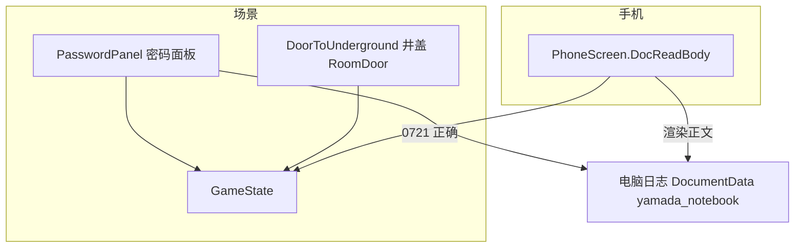
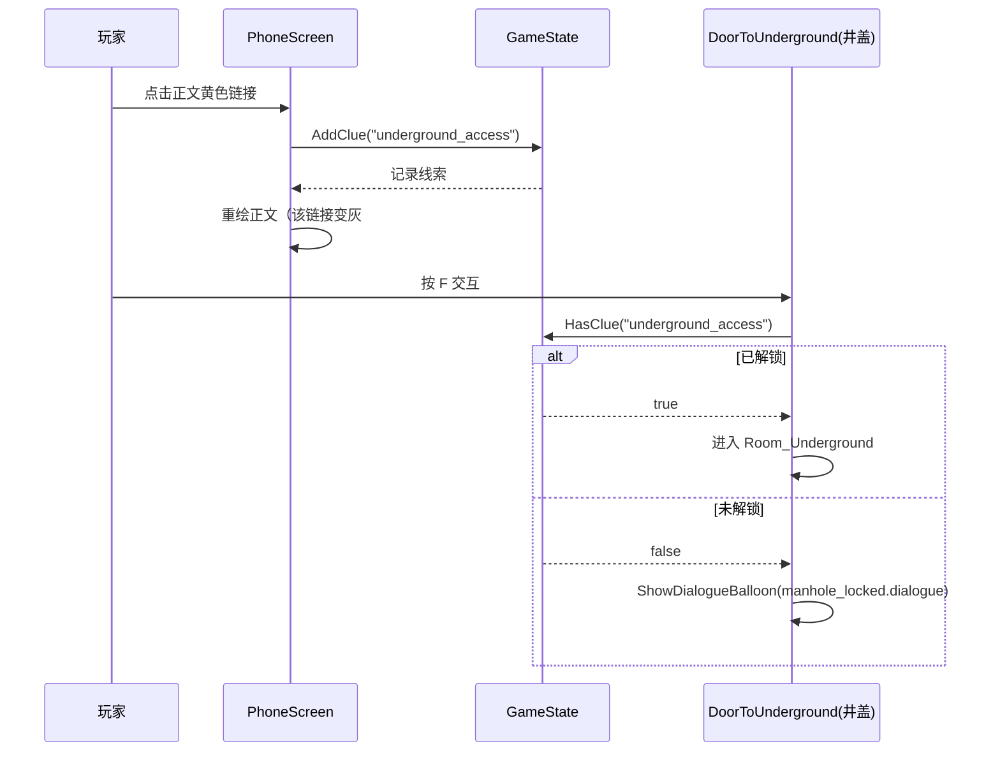

# 电脑日志与地下空间解锁改造设计

日期：2026-11-07

## 目标

把「地下空间的进入方式」从「密码面板直接写线索」改为「在手机里阅读电脑日志、点击黄色高亮文字解锁」，并落地飞书剧本文档里更新后的电脑日志内容。

飞书标红（→ 游戏标黄）文字只有一句：**「我发现了操场后面那个井盖下的秘密空间」**（位于 6 月中旬篇）。

## 现状 vs 目标

| 项 | 现状 | 目标 |
|----|------|------|
| 电脑日志文档 | `yamada_notebook` 正文是旧的「9月23日…」短段 | 正文替换为 5 篇日记（5月中旬／5月下旬／6月中旬／七月中旬／七月下旬） |
| 地下空间解锁 | `PasswordPanel` 输入 0721 后 `AddClue("underground_access")` | 密码面板只 `AcquireDocument("yamada_notebook")`；解锁改由手机里点黄色文字 |
| 文档正文链接 | `DocReadBody`（RichTextLabel）只有拖拽复制，无 meta 点击 | 支持 `[url=clue:<id>]` 点击 → `AddClue`，已解锁的链接变灰 |
| 滚动 | `DocReadScroll`（ScrollContainer）+ `fit_content` 已可上下滚动 | 验证即可，无需改结构 |
| 井盖（DoorToUnderground） | 锁定时只闪 Label「（还不知道怎么下去）」 | 锁定时播对话「很大的井盖不知道有什么用」；解锁后照常下井 |

## 架构图

## 数据流图

## 调用链图

## 实现清单

1. **`Resources/Documents/yamada_notebook.tres`**：`Title` 改「电脑日志」；`Body` 替换为 5 篇日记，其中 6 月中旬篇「我发现了操场后面那个井盖下的秘密空间」用
   `[url=clue:underground_access][color=#ffd866]…[/color][/url]` 包住。`Id` 保持 `yamada_notebook` 不变（`PasswordPanel` 引用它）。

2. **`Scripts/Phone/PhoneScreen.cs`**：`DocReadBody.MetaClicked` 处理 `clue:<id>` → `AddClue`；渲染时已解锁的线索链接把内层 `#ffd866` 换灰 `#8a8a8a`（复用文档链接的灰色约定，见 #443）。

3. **`Scripts/UI/PasswordPanel.cs`**：删除 `UnlockClueId` 属性与 `AddClue(UnlockClueId)` 调用；保留 `AcquireDocument(DocumentId)` 与 `saw_laptop`；文案「笔记本」改「电脑日志」。

4. **`Scripts/Location/RoomDoor.cs`**：新增可选 `[Export] Resource LockedDialogue`；锁定时若 `LockedDialogue != null` 播对话，否则回退 `ShowLockedHint`；`_Ready` 校验改为「锁着且两者皆空才报错」。

5. **`Dialogue/Objects/manhole_locked.dialogue`**：新剧本，台词「鸣子：（很大的井盖，不知道有什么用……）」。

6. **`Scenes/Locations/Playground.tscn`**：`DoorToUnderground` 去掉 `LockedHint`（节点与 `LockedHint` node_path），挂 `LockedDialogue`；`Caption`「门（地下空间）」改「井盖」。

7. **`project.godot`**：`[internationalization] locale/translations_pot_files` 登记 `res://Dialogue/Objects/manhole_locked.dialogue`（改前确认无 Godot 编辑器进程占用）。
