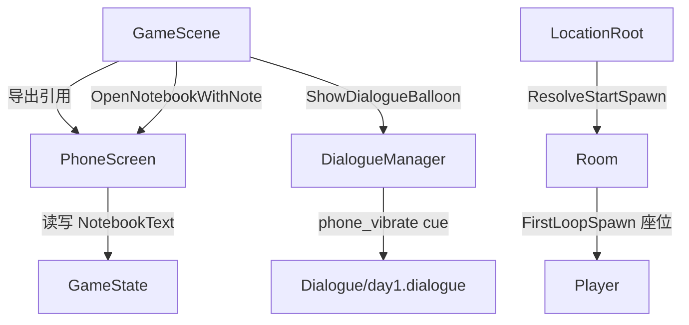
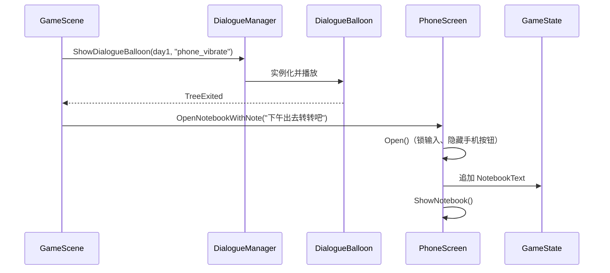

# 2026-11-07 循环开始手机提示设计

## 背景

从二周目起，每周目循环重置后玩家在教室座位上醒来，先播放一句「手机在震动。」，随后自动打开手机记事本，并把提示「下午出去转转吧」写入记事本。

## 需求约束

- 二周目起每轮重置后都播一次；一周目保持原有 `start` 开场。
- 二周目起出生点改为座位（`Room_Classroom/FirstLoopSpawn`，`700,520`）。
- 记事本提示写入 `GameState.NotebookText`，跨循环保留；已有内容时换行追加到末尾，已包含该句则跳过，避免每周目重复叠行。
- 不新增 `.dialogue` 文件，复用已在 POT 列表里的 `Dialogue/day1.dialogue`，不改 `project.godot`。

## 架构图

## 数据流图

## 调用链图

## 实现要点

1. `LocationRoot.ResolveStartSpawn`：去掉 `IsFirstLoop()` 判断，始终优先 `Room.FirstLoopSpawn`，留空时回落 `DefaultSpawn`。`Room.FirstLoopSpawn` 注释同步为「地点起始落点」。
2. `Dialogue/day1.dialogue` 新增 `~ phone_vibrate`，正文一行「手机在震动。」。
3. `GameScene`：
   - 新增导出 `PhoneScreen PhoneScreen`，`GameScene.tscn` 的 `node_paths` 与属性同步。
   - `ShowOpeningNarration` 扩展为 `ShowLoopStartIntro`：一周目播 `start`；`LoopCount >= 2` 播 `phone_vibrate`，等 balloon `TreeExited` 后调 `PhoneScreen.OpenNotebookWithNote(LoopStartNote)`。
   - `_Ready` 与 `OnLoopReset` 末尾调用 `ShowLoopStartIntro`。
   - `LoopStartNote = "下午出去转转吧"`。
4. `PhoneScreen.OpenNotebookWithNote(string note)`：未打开时走 `Open()` 流程（锁输入、隐藏手机按钮），追加建议文本后 `ShowNotebook()`。
   - 追加规则：记事本为空 → 直接写；已包含该句 → 跳过；否则 `text + "\n" + note`。
5. 手机自动打开后，玩家按「返回 / Esc」关闭手机后恢复移动。

## 错误处理

- `OpeningNarration` 为空、`ShowDialogueBalloon` 返回空、`PhoneScreen` 导出引用为空：`GD.PushError` 显式报错，不静默兜底。
- heartbeat：`QueueFree` 后 `ToSignal` 已失效时先 `IsInstanceValid` 判断。
