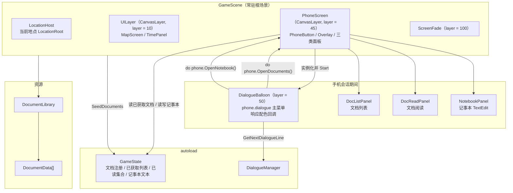
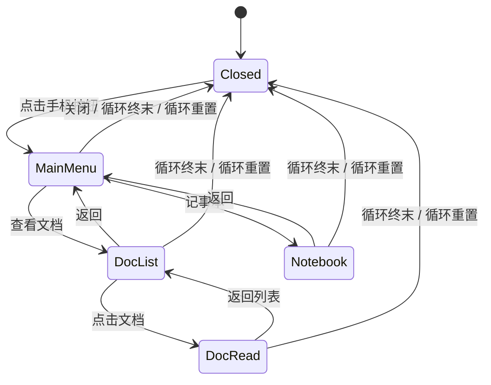
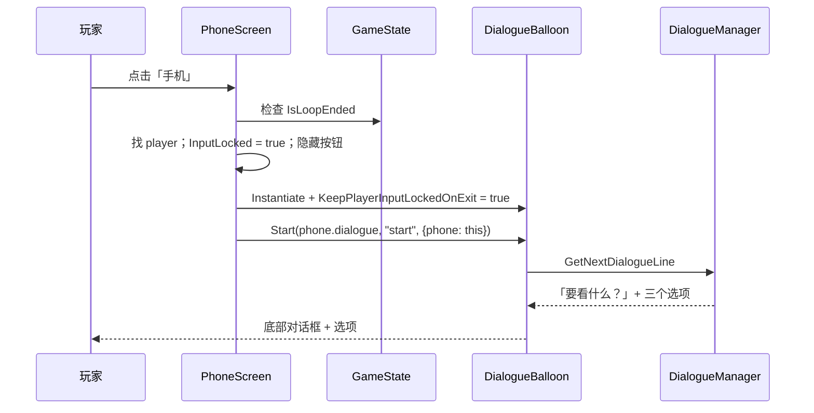
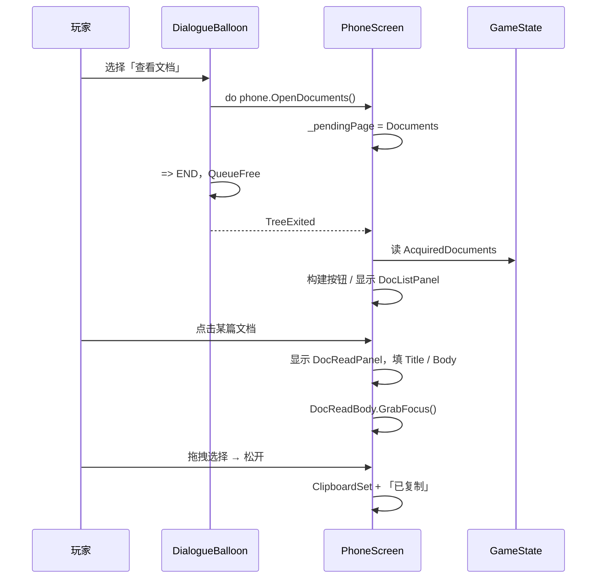
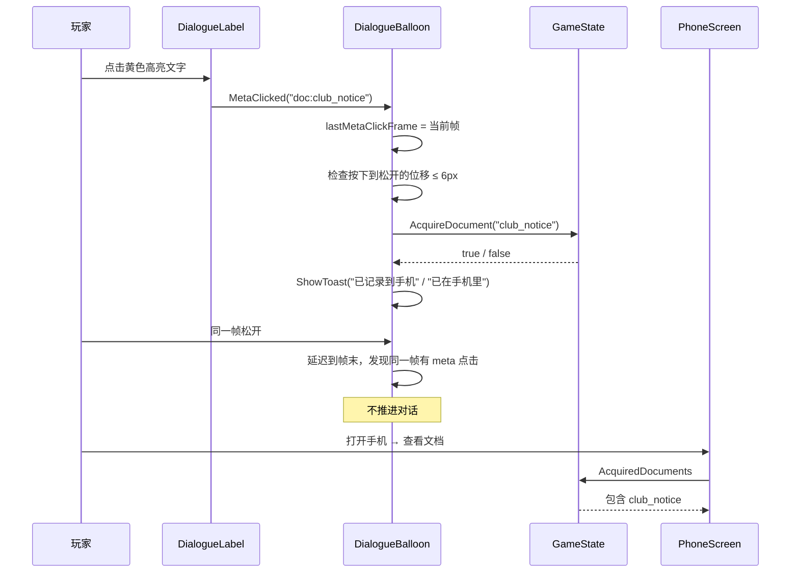
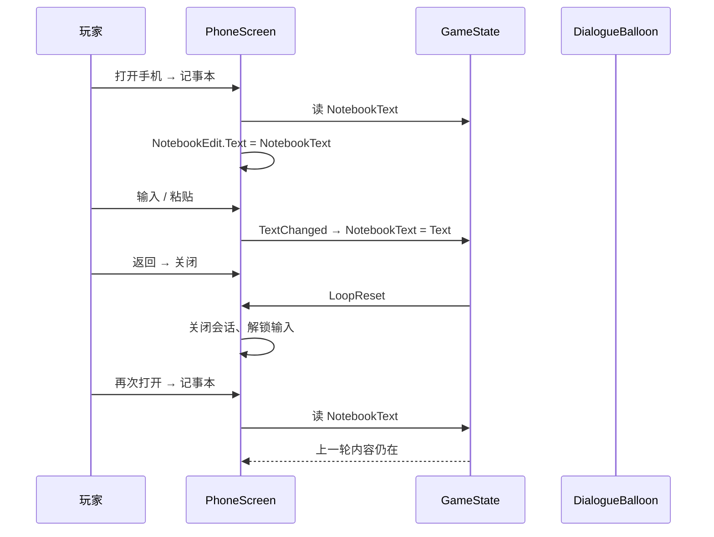
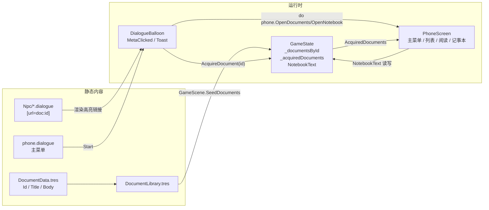

# 手机系统（文档 / 记事本）· 设计规格

| 项 | 内容 |
|---|---|
| 日期 | 2026-11-07 |
| 项目 | pandagj-2026（Godot 4.7.2 mono / C#） |
| 模块 | 手机：左上角入口、文档日志、记事本 |
| 状态 | 已实现（2026-11-07）；headless 导入/编译/启动通过，有窗口交互待手测；实现计划见 `docs/superpowers/plans/2026-11-07-phone-system.md` |
| 上游需求 | 用户当轮需求：左上角手机按钮；点击后复用对话系统显示「查看文档 / 记事本」；文档列表与正文阅读；记事本可自由编辑且跨循环继承。飞书程序文档：「日志文档选项 / 记事本选项：对话与文档文本支持拖拽选择复制，方便粘贴到记事本里」 |
| 依赖 | Dialogue Manager 4.2.0、`DialogueBalloon`、`GameState`、`GameScene`、`DocumentLibrary` / `DocumentData` |

---

## 0. 决策索引

评审时如需推翻某条，直接指出编号。

| # | 决策 |
|---|---|
| Q1 | 手机**主菜单**字面复用现有 `DialogueBalloon`：加载 `Dialogue/phone.dialogue`，显示「查看文档 / 记事本 / 关闭」。文档列表、文档阅读、记事本使用专用面板，样式沿用对话 balloon 的黑色底 + 白边 + 圆角 |
| Q2 | 手机入口是左上角文字按钮「手机」，放在 `PhoneScreen`（`CanvasLayer.layer = 45`）；地点内与地图界面都可见；NPC 对话（layer 50）期间被 balloon 挡住；手机打开时按钮隐藏 |
| Q3 | 打开手机**不推进时间**；整个手机会话锁住玩家移动与交互；关闭手机或循环重置时解锁 |
| Q4 | 文档获取只在 NPC 对话正文里：`[url=doc:<id>][color=#ffd866]高亮文字[/color][/url]`。单击链接获取文档，**不推进对话**；重复获取幂等，只提示「已在手机里」 |
| Q5 | 文档数据用 `DocumentData`（Id / Title / Body）+ `DocumentLibrary` 注册表；`GameState` 保存 id → 文档与已获取顺序；已获取文档跨循环保留 |
| Q6 | 文档列表按**获取顺序**（先获取的在上）；没有文档时显示引导空状态 |
| Q7 | 文档阅读面板支持滚动、拖拽选择、松开自动复制（与对话正文同一套手感）；复制内容只有正文纯文本 |
| Q8 | 记事本是单个 `TextEdit`，内容存 `GameState.NotebookText`；每次 `TextChanged` 直接写入；跨循环保留，**不落盘**，关闭游戏后清空 |
| Q9 | 返回层级：文档阅读 → 文档列表 → 主菜单；记事本 → 主菜单；主菜单「关闭」结束手机会话。Esc 在面板页等价于返回 |
| Q10 | 17:30 终末与循环重置时强制关闭手机并解锁输入；已获取文档与记事本内容保留 |
| Q11 | 不修改 `addons/dialogue_manager/**`；不新增输入动作；不做存档系统；不做手机快捷键 |
| Q12 | 附带一份示例文档与一条示例高亮链接用于验收；内容为占位，可由策划直接替换或删除 |
| Q13 | 项目约定 git 只读：本规格与实现都不执行 commit / branch / checkout |

---

## 1. 目标与范围

### 1.1 本规格覆盖

- 左上角手机按钮的层级、显隐与点击入口
- 手机主菜单：复用 `DialogueBalloon` 显示两个功能选项
- NPC 对话正文里的高亮文档链接：样式、点击命中、与「单击推进 / 拖拽复制」的共存
- `DocumentData` / `DocumentLibrary` 资源与 `GameState` 文档接口
- 文档列表、文档阅读面板（滚动、选择、自动复制）
- 记事本面板（自由编辑、跨循环保存）
- 手机会话的输入锁、返回层级、循环终末 / 重置时的收尾
- 端到端验收清单

### 1.2 本规格不覆盖

- 文档的删除、排序、搜索、已读 / 未读状态
- 多条笔记、笔记分页、笔记标题
- 记事本落盘 / 跨进程存档
- 手机上的线索页、地图页、时间页
- 手机打开时的世界暂停逻辑（时间本来就只在旅行 / 换房间时推进，不需要额外暂停）
- 手机按钮的键盘快捷键、手柄导航
- 文档获取时的音效、动画、粒子
- 文档正文里的图片 / 富媒体（只按 BBCode 文本渲染）
- 移动端 / Web 端的剪贴板兼容层

---

## 2. 术语

| 术语 | 含义 |
|---|---|
| **手机按钮 / PhoneButton** | `Scenes/Phone/PhoneScreen.tscn` 左上角的「手机」按钮 |
| **手机会话** | 从点击手机按钮到关闭手机之间的整段 UI 状态；期间玩家输入锁定 |
| **主菜单** | 用 `DialogueBalloon` 显示的「查看文档 / 记事本 / 关闭」 |
| **菜单 balloon** | `PhoneScreen` 在运行时实例化的 `DialogueBalloon`，只用于主菜单 |
| **文档链接 / 高亮文本** | 对话正文里带 `[url=doc:<id>]` 与特殊颜色的子串 |
| **已获取文档** | 玩家点击过文档链接、写入 `GameState` 的 `DocumentData` |
| **已读文档** | 玩家在手机里打开过正文的文档；与已获取文档一样跨循环保留（见 `2026-11-07-phone-unread-highlight-design.md`） |
| **文档列表** | 手机里列出所有已获取文档标题的面板 |
| **文档阅读面板** | 显示单篇文档标题与正文的面板 |
| **记事本** | 手机里的单个多行 `TextEdit` |
| **DocumentData** | 单篇文档的静态资源：Id、Title、Body |
| **DocumentLibrary** | 文档注册表资源，GameScene 启动时灌入 GameState |

---

## 3. 架构

### 3.1 架构图



层级关系：

| 层 | 内容 | 说明 |
|---|---|---|
| 10 | 地图、右上角时钟 | 现有 `UILayer` |
| 45 | `PhoneScreen` 按钮与面板 | 高于地图，低于 NPC 对话 |
| 50 | `DialogueBalloon` | NPC 对话与手机主菜单共用 |
| 100 | `ScreenFade` | 过渡时遮挡一切 |

### 3.2 职责划分

| 单位 | 职责 | 不负责 |
|---|---|---|
| `PhoneScreen` | 手机按钮、打开 / 关闭会话、页面切换、菜单 balloon 生命周期、输入锁、构建文档列表、阅读 / 记事本面板 | 文档获取判定、对话正文渲染、文档静态内容 |
| `DialogueBalloon` | 渲染主菜单与 NPC 对话；处理文档链接点击；手机会话期间保持输入锁；显示 toast | 手机页面管理、文档注册、记事本 |
| `GameState` | 文档注册表、已获取文档顺序、记事本文本、`AcquireDocument` / `HasDocument` | UI、资源导入、对话解析 |
| `DocumentData` | 单篇文档的 Id / Title / Body | 获取状态 |
| `DocumentLibrary` | 文档注册表 | 运行时状态 |
| `GameScene` | 启动时把 `DocumentLibrary` 灌入 `GameState` | 手机 UI |
| `Dialogue/*.dialogue` | 主菜单文案、NPC 对话里的高亮文档链接 | C# 状态与 UI 逻辑 |

### 3.3 为什么主菜单复用 balloon、其余用专用面板

| 方案 | 做法 | 结论 |
|---|---|---|
| **A. 主菜单 balloon + 专用面板** | 主菜单用现有 `DialogueBalloon`；文档列表 / 阅读 / 记事本用专用面板 | **采用**。字面复用对话系统的主菜单交互；长文档可滚动、可选区复制；记事本可以用原生 `TextEdit` |
| B. 全部页面动态生成 `.dialogue` | 文档列表与正文用 `CreateResourceFromText` 生成剧本，在 balloon 里显示 | 放弃。`DialogueLabel` 高度固定约 219px、`scroll_active = false`，长文档会溢出；正文里的方括号、行首短横线、`=>` 都要转义，运行时编译失败风险高 |
| C. 完全自建仿对话面板 | 主菜单也自己画底部面板与选项 | 放弃。重复实现选项聚焦、鼠标 / 键盘、已选过滤，且不算字面「复用对话系统」 |

### 3.4 改动范围

```
新增
  Scripts/Documents/DocumentData.cs
  Scripts/Documents/DocumentLibrary.cs
  Scripts/Phone/PhoneScreen.cs
  Scenes/Phone/PhoneScreen.tscn
  Dialogue/phone.dialogue
  Resources/Documents/DocumentLibrary.tres
  Resources/Documents/club_notice.tres
  docs/superpowers/specs/2026-11-07-phone-system-design.md   （本文件）

修改
  Scripts/Core/GameState.cs                 文档注册 / 已获取 / 记事本文本
  Scripts/Dialogue/DialogueBalloon.cs       文档链接点击 / 保持输入锁 / toast
  Scripts/Map/GameScene.cs                  校验并灌入 DocumentLibrary
  Scenes/Root/GameScene.tscn                挂载 PhoneScreen、引用 DocumentLibrary
  project.godot                             POT 登记 res://Dialogue/phone.dialogue
  Dialogue/Npc/yamada.dialogue              示例高亮文档链接（占位，可替换）
  AGENTS.md                                 手机系统段落与结构清单

不修改
  addons/dialogue_manager/**
  Scenes/Dialogue/DialogueBalloon.tscn
  Scripts/Player/Player.cs
  Scripts/Map/MapScreen.cs
  default_bus_layout.tres
  Resources/MapConfig.tres
```

---

## 4. 数据模型与接口

### 4.1 `DocumentData`

```csharp
using Godot;

/// <summary>单篇可收集文档的静态内容。</summary>
[GlobalClass]
public partial class DocumentData : Resource
{
    /// <summary>全局唯一 id；对话里的 [url=doc:<id>] 使用它。</summary>
    [Export] public string Id { get; set; } = "";

    /// <summary>手机文档列表里显示的名字。</summary>
    [Export] public string Title { get; set; } = "";

    /// <summary>文档正文，允许多行与 BBCode。</summary>
    [Export(PropertyHint.MultilineText)] public string Body { get; set; } = "";
}
```

- `Body` 由阅读面板的 `RichTextLabel` 按 BBCode 渲染；plain text 也可以。
- 不把正文写进 `.dialogue`，避免转义与排版问题。

### 4.2 `DocumentLibrary`

```csharp
using Godot;

/// <summary>启动时注册的全部文档；由 GameScene 灌入 GameState。</summary>
[GlobalClass]
public partial class DocumentLibrary : Resource
{
    [Export] public DocumentData[] Documents { get; set; } = System.Array.Empty<DocumentData>();
}
```

- 资源路径：`Resources/Documents/DocumentLibrary.tres`。
- 单篇文档按 `Resources/Documents/<DocumentData.Id>.tres` 命名；本次示例是 `Resources/Documents/club_notice.tres`（Id `club_notice`，Title「社团活动申请表」）。

### 4.3 `GameState` 新增

```csharp
using System.Collections.Generic;

// 文档注册表：id → DocumentData
private readonly Dictionary<string, DocumentData> _documentsById = new();

// 已获取文档，按获取顺序；跨循环保留
private readonly List<DocumentData> _acquiredDocuments = new();

// 已获取 id 集合，O(1) 判重
private readonly HashSet<string> _acquiredDocumentIds = new();

/// <summary>已获取的文档，按获取顺序。</summary>
public IReadOnlyList<DocumentData> AcquiredDocuments => _acquiredDocuments;

/// <summary>手机记事本内容；跨循环保留，不落盘。</summary>
public string NotebookText { get; set; } = "";

/// <summary>把 DocumentLibrary 里的文档灌入注册表；重复调用只重建注册表。</summary>
public void SeedDocuments(DocumentLibrary library)
{
    if (library == null)
    {
        GD.PushError("GameState.SeedDocuments: DocumentLibrary 为空");
        return;
    }

    if (library.Documents == null)
    {
        GD.PushError("GameState.SeedDocuments: Documents 为空");
        return;
    }

    _documentsById.Clear();
    foreach (DocumentData document in library.Documents)
    {
        if (document == null)
        {
            GD.PushError("GameState.SeedDocuments: Documents 里有 null 项");
            continue;
        }
        if (string.IsNullOrEmpty(document.Id))
        {
            GD.PushError($"GameState.SeedDocuments: {document.ResourcePath} 的 Id 为空");
            continue;
        }
        if (!_documentsById.TryAdd(document.Id, document))
        {
            GD.PushError($"GameState.SeedDocuments: 文档 id 重复 —— {document.Id}");
            continue;
        }
        if (string.IsNullOrEmpty(document.Title))
        {
            GD.PushError($"GameState.SeedDocuments: 文档 {document.Id} 的 Title 为空");
        }
        if (string.IsNullOrEmpty(document.Body))
        {
            GD.PushError($"GameState.SeedDocuments: 文档 {document.Id} 的 Body 为空");
        }
    }
}

/// <summary>获取一篇文档；已获取或 id 未注册时返回 false。</summary>
public bool AcquireDocument(string documentId)
{
    if (string.IsNullOrEmpty(documentId))
    {
        GD.PushError("GameState.AcquireDocument: 文档 id 为空");
        return false;
    }
    if (!_documentsById.TryGetValue(documentId, out DocumentData document))
    {
        GD.PushError($"GameState.AcquireDocument: 文档 {documentId} 没有在 DocumentLibrary 里注册");
        return false;
    }
    if (!_acquiredDocumentIds.Add(documentId)) return false;

    _acquiredDocuments.Add(document);
    GD.Print($"[Doc] 获取 {documentId}");
    return true;
}

/// <summary>是否已经获取过某篇文档。</summary>
public bool HasDocument(string documentId)
{
    if (string.IsNullOrEmpty(documentId))
    {
        GD.PushError("GameState.HasDocument: 文档 id 为空");
        return false;
    }
    return _acquiredDocumentIds.Contains(documentId);
}
```

`ResetLoop()`：

- `Inventory`、`_npcLoopStates`、`_npcUsedChoices` 继续清空。
- **不清空** `_acquiredDocuments` / `_acquiredDocumentIds` / `_documentsById` / `NotebookText`。
- 把方法 XML 注释更新为「清本轮状态，保留解锁、线索、文档与记事本」。

### 4.4 `GameScene` 启动灌入

- `GameScene` 新增导出：

```csharp
/// <summary>全部可收集文档的注册表。</summary>
[Export] public DocumentLibrary DocumentLibrary { get; set; }
```

- `_Ready` 的空引用校验增加 `|| DocumentLibrary == null`。
- 在 `SeedInitialUnlocks(MapConfig)` 之后调用：

```csharp
GameState.Instance.SeedDocuments(DocumentLibrary);
```

- `Scenes/Root/GameScene.tscn` 增加 `DocumentLibrary = ExtResource("...")`，指向 `res://Resources/Documents/DocumentLibrary.tres`。

### 4.5 `PhoneScreen` 对外接口

`PhoneScreen` 是 `CanvasLayer`，只向对话暴露两个方法：

```csharp
/// <summary>由 phone.dialogue 的 do 调用：关闭主菜单后打开文档列表。</summary>
public void OpenDocuments();

/// <summary>由 phone.dialogue 的 do 调用：关闭主菜单后打开记事本。</summary>
public void OpenNotebook();
```

- 两个方法只记录 `_pendingPage`；真正打开面板发生在菜单 balloon 的 `TreeExited` 之后，避免 balloon 还压在面板上。
- 手机未打开时被调用属于逻辑错误，`PushError`。

---

## 5. NPC 对话里的文档高亮与获取

### 5.1 剧本写法

对话正文里的高亮文档链接统一写成：

```
这是[url=doc:club_notice][color=#ffd866]社团活动申请表[/color][/url]，你看看。
```

- `[url=doc:<id>]`：`RichTextLabel` 原生可点击链接，`MetaClicked` 的 meta 字符串就是 `doc:<id>`。
- `[color=#ffd866]`：暖黄色高亮，作为「可点击」的视觉提示。
- `DialogueLabel` 已经设置 `meta_underlined = false`，默认不会出现下划线；如需下划线由剧本自行加 `[u]`。
- 一个链接的文字可以出现在句子的任意位置，也可以一句里放多个链接。

示例（`Dialogue/Npc/yamada.dialogue` 的 `~ ask_shinji`，占位内容）：

```
~ ask_shinji
山田老师: 新井吗？他整个下午都在隔壁教室自习。
山田老师: 对了，这份[url=doc:club_notice][color=#ffd866]社团活动申请表[/color][/url]你拿去看看吧。
=> END
```

### 5.2 `DialogueBalloon` 新增能力

#### 5.2.1 保持输入锁

主菜单 balloon 结束时，`PhoneScreen` 还要继续打开文档 / 记事本面板，因此 balloon 不能把玩家解锁。

```csharp
/// <summary>为 true 时 _ExitTree 不释放玩家输入锁；由 PhoneScreen 在会话结束时统一释放。</summary>
public bool KeepPlayerInputLockedOnExit { get; set; }
```

`_ExitTree()` 改为：

```csharp
if (GodotObject.IsInstanceValid(player) && !KeepPlayerInputLockedOnExit)
{
    player.InputLocked = false;
}
```

- NPC 对话不设置该属性，默认 `false`，行为不变。
- 手机主菜单 balloon 在 `Start` 之前设为 `true`。

#### 5.2.2 文档链接点击

新增字段：

```csharp
private ulong lastMetaClickFrame = ulong.MaxValue;
private Vector2 pressGlobalPosition;
```

`_Ready()`：

```csharp
dialogueLabel.MetaClicked += OnDialogueMetaClicked;
```

`_ExitTree()`：

```csharp
if (GodotObject.IsInstanceValid(dialogueLabel))
{
    dialogueLabel.MetaClicked -= OnDialogueMetaClicked;
}
```

按下时记录全局坐标（在现有 `OnBalloonGuiInput` 的按下分支）：

```csharp
pressGlobalPosition = mouseButton.GlobalPosition;
```

链接处理：

```csharp
private void OnDialogueMetaClicked(Variant meta)
{
    lastMetaClickFrame = Engine.GetProcessFrames();

    // 拖拽选择结束时松开在链接上：算复制，不算点击获取。
    if (pressGlobalPosition.DistanceTo(GetViewport().GetMousePosition()) > ClickDragThreshold)
    {
        return;
    }

    string url = meta.AsString();
    if (!url.StartsWith("doc:"))
    {
        GD.PushError($"DialogueBalloon: 不支持的高亮链接 {url}");
        return;
    }

    string documentId = url["doc:".Length..];
    if (string.IsNullOrEmpty(documentId))
    {
        GD.PushError("DialogueBalloon: 文档链接的 id 为空");
        return;
    }
    if (GameState.Instance == null)
    {
        GD.PushError("DialogueBalloon: GameState 未就绪，无法记录文档");
        return;
    }

    bool added = GameState.Instance.AcquireDocument(documentId);
    if (added)
    {
        ShowToast("已记录到手机");
        return;
    }

    // 未注册的 id 已由 AcquireDocument 报错；只有重复获取才提示已在手机里。
    if (GameState.Instance.HasDocument(documentId))
    {
        ShowToast("已在手机里");
    }
}
```

#### 5.2.3 点击链接不推进对话

现有「单击正文推进」是松开时直接 `Next`。如果链接点击和推进在同一帧发生，顺序不可靠，因此改成延迟到帧末提交：

```csharp
// OnBalloonGuiInput 的松开分支
if (dragDistance <= ClickDragThreshold
    && isWaitingForInput
    && filteredResponses.Count == 0)
{
    GetViewport().SetInputAsHandled();
    string nextId = dialogueLine.NextId;
    Callable.From(() => AdvanceAfterMetaClick(nextId)).CallDeferred();
    return;
}
```

```csharp
private void AdvanceAfterMetaClick(string nextId)
{
    if (!GodotObject.IsInstanceValid(this)) return;
    // 同一帧内发生过 meta 点击：这次松开是点链接，不是推进。
    if (lastMetaClickFrame == Engine.GetProcessFrames()) return;
    Next(nextId);
}
```

- `MetaClicked` 是同步信号；`CallDeferred` 在当帧输入处理之后执行，因此无论信号先于还是晚于 `GuiInput` 的松开分支，帧号检查都能拦住推进。
- 单击普通正文：`lastMetaClickFrame` 是旧帧号，正常推进；只延迟一帧，不可感知。
- 拖拽选择：位移 > 阈值，本来就不会走推进分支；复制逻辑保持现有行为。

#### 5.2.4 toast 复用

把现有 `ShowCopyToast()` 泛化为：

```csharp
private void ShowToast(string text)
{
    if (copyToast == null) return;   // 缺失已在 _Ready 报错

    copyToast.Text = text;
    copyToastTween?.Kill();
    copyToast.Visible = true;
    copyToast.Modulate = new Color(1, 1, 1, 0);

    copyToastTween = CreateTween();
    copyToastTween.TweenProperty(copyToast, "modulate:a", 1.0f, 0.1f);
    copyToastTween.TweenInterval(0.35f);
    copyToastTween.TweenProperty(copyToast, "modulate:a", 0.0f, 0.25f);
    copyToastTween.TweenCallback(Callable.From(() => copyToast.Visible = false));
}
```

- 复制路径调用 `ShowToast("已复制")`。
- 获取路径调用 `ShowToast("已记录到手机")` / `ShowToast("已在手机里")`。
- `CopyToast` 节点名保持不变；不新增节点、不改 `DialogueBalloon.tscn`。

### 5.3 输入判定表

| 操作 | 行为 |
|---|---|
| 打字中点击链接 | 只跳过打字；不获取文档。打字完成后再点才获取 |
| 单击高亮链接（位移 ≤ 6px） | 获取文档；`ShowToast`；对话**不推进** |
| 拖拽选择（位移 > 6px）松开在链接上 | 视为选择；按现有逻辑复制选中文本；不获取文档、不推进 |
| 单击普通正文（位移 ≤ 6px） | 正常推进 |
| 有选项菜单时点击链接 | 获取文档；选项菜单保持显示 |
| 自动推进（`[time]`）等待时点击链接 | 获取文档；到点仍会自动推进（已知行为） |
| 重复点击已获取链接 | `ShowToast("已在手机里")`；不推进 |
| 链接 id 未在 DocumentLibrary 注册 | `PushError`；不推进 |
| 链接前缀不是 `doc:` | `PushError`；不推进 |
| 链接点击后同一帧的松开 | 帧号检查拦下推进，停在原句 |

---

## 6. 手机 UI 与页面流

### 6.1 `PhoneScreen` 场景树

```
PhoneScreen（CanvasLayer, layer = 45, 脚本 PhoneScreen.cs）
├── PhoneButton（Button，左上角，text = "手机"）
└── Overlay（Control，全屏，visible = false，mouse_filter = STOP）
    ├── Dim（ColorRect，全屏，Color(0, 0, 0, 0.45)，mouse_filter = IGNORE）
    └── Center（CenterContainer，全屏，mouse_filter = IGNORE）
        ├── DocListPanel（PanelContainer，visible = false）
        │   └── MarginContainer > VBoxContainer
        │       ├── Header（Label「文档」）
        │       ├── DocScroll（ScrollContainer）
        │       │   └── DocList（VBoxContainer，运行时生成按钮）
        │       ├── DocEmpty（Label，空状态）
        │       └── DocListBack（Button「返回」）
        ├── DocReadPanel（PanelContainer，visible = false）
        │   └── MarginContainer > VBoxContainer
        │       ├── DocReadTitle（Label）
        │       ├── DocReadScroll（ScrollContainer）
        │       │   └── DocReadBody（RichTextLabel）
        │       ├── DocCopyToast（Label「已复制」）
        │       └── DocReadBack（Button「返回列表」）
        └── NotebookPanel（PanelContainer，visible = false）
            └── MarginContainer > VBoxContainer
                ├── Header（Label「记事本」）
                ├── NotebookEdit（TextEdit）
                └── NotebookBack（Button「返回」）
```

- 所有脚本访问的节点设 `unique_name_in_owner = true`，脚本用 `GetNode<T>("%Name")` 取。
- `PhoneScreen` 只导出两个资源：

```csharp
[Export] public PackedScene DialogueBalloonScene { get; set; }
[Export] public Resource PhoneDialogue { get; set; }
```

分别指向 `res://Scenes/Dialogue/DialogueBalloon.tscn` 与 `res://Dialogue/phone.dialogue`。

### 6.2 手机按钮

- 锚定左上角，`offset_left = 24`、`offset_top = 24`，`custom_minimum_size = (120, 56)`。
- 文本「手机」，字号 24，`focus_mode = None`（避免键盘焦点误触）。
- 样式沿用右上角时间面板的 HUD 风格：深色半透明底（`Color(0.047, 0.047, 0.071, 0.62)`）、1px 白色 16% 边框、圆角 10。
- 地点内、地图界面都可见；被 `Overlay` 或 balloon 挡住时不可点。
- 打开手机后隐藏；关闭后重新显示。
- 17:30 终末时隐藏，循环重置后恢复。

### 6.3 主菜单 `Dialogue/phone.dialogue`

```
~ start
手机: 要看什么？
- 查看文档 [ID:open_documents] [#repeatable] => documents
- 记事本 [ID:open_notes] [#repeatable] => notes
- 关闭 [#repeatable] => END

~ documents
do phone.OpenDocuments()
=> END

~ notes
do phone.OpenNotebook()
=> END
```

- 主菜单 balloon 由 `PhoneScreen` 实例化，`Start(PhoneDialogue, "start", states)`，其中：

```csharp
var states = new Array<Variant>
{
    new Godot.Collections.Dictionary { { "phone", this } }
};
```

- `phone` 是 `PhoneScreen` 实例，`do phone.OpenDocuments()` 通过对话系统的 extra game state 调用 C# 方法。
- 菜单选项都带 `[#repeatable]`；`Npc` 为空时本来也不会记录一次性选项，标签只用于语义清晰。
- 「关闭」走 `=> END`，balloon 退出后 `PhoneScreen` 没有待打开页面，结束会话。
- `phone.dialogue` 必须加入 `project.godot` 的 `[internationalization] locale/translations_pot_files`；新增剧本后同步登记，避免 POT 配置与实际文件不一致。

### 6.4 文档列表面板

- 标题「文档」；正文是已获取文档按钮的纵向列表。
- 每颗按钮文本 = `DocumentData.Title`，点击后打开该文档的阅读面板。
- 列表顺序 = `GameState.AcquiredDocuments` 的顺序（获取顺序）。
- 没有文档时：
  - 隐藏列表按钮；
  - 显示 `DocEmpty`：「还没有记录任何文档。在对话里点击高亮文字即可记录。」
- `DocScroll` 使用 `ScrollContainer`，文档多时可滚动；打开时滚回顶部。
- 每次重建列表前先对 `DocList` 的旧子节点 `RemoveChild` + `QueueFree`，避免同一帧内新旧按钮并存。
- 「返回」回主菜单。
- 打开时把焦点给第一颗文档按钮；没有文档时给「返回」按钮。

### 6.5 文档阅读面板

- `DocReadTitle` = 文档 Title；`DocReadBody.Text = document.Body`。
- `DocReadBody`：
  - `bbcode_enabled = true`
  - `fit_content = true`
  - `scroll_active = false`
  - `selection_enabled = true`（显示时设置；隐藏时设回 false 清选区）
  - `autowrap_mode = WordSmart`
  - 主题 `RichTextLabel/colors/selection_color = Color(1, 1, 1, 0.35)`
- `DocReadScroll` 负责纵向滚动；显示新文档时 `ScrollVertical = 0`（延迟一帧，等布局更新）。
- 拖拽选择与自动复制：
  - 在 `DocReadBody.GuiInput` 里记录按下位置；
  - 松开时若位移 > `ClickDragThreshold`（6px）且 `GetSelectedText()` 非空，写剪贴板并显示 `DocCopyToast`「已复制」；
  - 没有剪贴板能力时 `PushError`，不弹提示；
  - 复制内容与对话一致：只有正文纯文本，不含 BBCode。
- 显示时 `DocReadBody.GrabFocus()`，让键盘焦点落在正文而不是「返回」按钮，避免空格误触返回。
- 「返回列表」回文档列表。

### 6.6 记事本面板

- 单个 `TextEdit`：
  - `wrap_mode = Boundary`
  - `placeholder_text = "在这里整理线索、粘贴对话……"`
  - `custom_minimum_size = (900, 560)`
  - `theme_override_font_sizes/font_size = 20`
  - `theme_override_colors/font_color = Color(1, 1, 1, 0.9)`
  - `theme_override_colors/caret_color = Color(1, 1, 1, 1)`
  - `theme_override_colors/selection_color = Color(1, 1, 1, 0.35)`
  - `normal` / `focus` StyleBox 用深色底 + 白边，与文档面板一致
- 打开时：
  - `NotebookEdit.Text = GameState.Instance.NotebookText`
  - `GrabFocus()`
  - 光标移到文本末尾
- `TextChanged` → `GameState.Instance.NotebookText = NotebookEdit.Text`（每次修改直接保存，没有「保存」按钮）。
- 「返回」回主菜单；内容已经实时保存。
- 原生的 Ctrl+V 粘贴可用，配合对话 / 文档的自动复制，形成「复制 → 记事本粘贴」的闭环。

### 6.7 样式

- 文档 / 阅读 / 记事本面板沿用 `DialogueBalloon` 的视觉语言：
  - 面板底：`Color(0, 0, 0, 1)`
  - 边框：3px `Color(1, 1, 1, 1)`
  - 圆角：5
  - 默认字号：20
  - 按钮：深灰底 `Color(0.121569, 0.121569, 0.121569, 1)`，灰边 `Color(0.6, 0.6, 0.6, 1)`；hover / focus 用白边
- 这些 StyleBox 在 `PhoneScreen.tscn` 里复制现有 balloon 主题的数值，**不抽出公共 Theme 资源**，避免改动 `DialogueBalloon.tscn` 的现有外观。
- 面板尺寸：
  - 文档列表：约 `1000 × 760`
  - 文档阅读：约 `1100 × 800`
  - 记事本：约 `1000 × 760`
  - 具体值可在编辑器里微调；以 1920×1080 视口为准。

### 6.8 页面流与返回



- 主菜单只有「关闭」能结束会话；Esc 在主菜单不关闭（balloon 的 Esc 仍是跳过打字）。
- 面板页按 Esc 等价于返回上一级。
- 循环终末 / 重置从任意页面直接回到 `Closed`。

### 6.9 `PhoneScreen` 内部状态

```csharp
private enum PhonePage
{
    Documents,
    Notebook
}

private bool _open;
private bool _loopEnded;
private PhonePage? _pendingPage;
private DialogueBalloon _menuBalloon;
private Player _player;
private bool _closing;
```

关键流程：

```csharp
private void Open()
{
    if (_open) return;
    if (_loopEnded) return;
    if (GameState.Instance == null) { GD.PushError("PhoneScreen: GameState 未就绪"); return; }

    _player = GetTree().GetFirstNodeInGroup("player") as Player;
    if (_player == null) { GD.PushError("PhoneScreen: 找不到 player"); return; }

    _open = true;
    _player.InputLocked = true;
    PhoneButton.Hide();
    ShowMainMenu();
}

public void OpenDocuments()
{
    if (!_open) { GD.PushError("PhoneScreen.OpenDocuments: 手机未打开"); return; }
    if (_closing) return;
    _pendingPage = PhonePage.Documents;
}

public void OpenNotebook()
{
    if (!_open) { GD.PushError("PhoneScreen.OpenNotebook: 手机未打开"); return; }
    if (_closing) return;
    _pendingPage = PhonePage.Notebook;
}

private void OnMenuBalloonExited()
{
    if (_closing || !_open) return;
    _menuBalloon = null;

    PhonePage? page = _pendingPage;
    _pendingPage = null;

    switch (page)
    {
        case PhonePage.Documents: ShowDocumentList(); break;
        case PhonePage.Notebook: ShowNotebook(); break;
        default: CloseSession(); break;
    }
}
```

- `ShowMainMenu()`：
  - 校验 `DialogueBalloonScene` / `PhoneDialogue`；为空则 `PushError` 并 `CloseSession()`，避免输入锁卡死；
  - 隐藏 `Overlay` 与所有面板；
  - 断开并释放旧的菜单 balloon；
  - 实例化 `DialogueBalloonScene`，作为 `PhoneScreen` 的子节点；
  - 设置 `KeepPlayerInputLockedOnExit = true`；
  - 连接 `TreeExited`；
  - `Start(PhoneDialogue, "start", states)`。
- `ShowDocumentList()` / `ShowDocumentRead()` / `ShowNotebook()`：
  - 显示 `Overlay`；
  - 只显示目标面板；
  - 隐藏手机按钮。
- `BackToMainMenu()`：
  - 隐藏 `Overlay` 与面板；
  - `ShowMainMenu()`。
- `CloseSession()`：
  - `_closing = true`；
  - `_pendingPage = null`；
  - 断开 `TreeExited` 后释放菜单 balloon；
  - 隐藏 `Overlay`、所有面板；
  - 显示手机按钮；
  - `_open = false`；
  - 解锁玩家；
  - `_closing = false`。
- 循环信号：

```csharp
private void OnLoopEndReached()
{
    _loopEnded = true;
    if (_open) CloseSession();
    PhoneButton.Hide();
}

private void OnLoopReset()
{
    _loopEnded = false;
    if (_open) CloseSession();
    PhoneButton.Show();
}
```

- `_ExitTree()`：断开 GameState 信号、释放 balloon、解锁玩家。

---

## 7. 关键流程与调用链

### 7.1 打开手机 → 主菜单



### 7.2 选择「查看文档」→ 文档列表 → 阅读



### 7.3 NPC 对话里点击高亮 → 获取文档 → 手机列表



### 7.4 记事本编辑 → 循环重置 → 再打开



---

## 8. 数据流



单向数据流：

- 文档静态内容只在启动时从 `DocumentLibrary` 进入 `GameState` 的注册表；
- 对话点击只做「id → 已获取」的写入；
- 手机只读 `GameState`，不直接加载 `DocumentData`；
- 记事本只读写 `GameState.NotebookText`。

---

## 9. 边界与错误处理

| 情况 | 行为 |
|---|---|
| `DocumentLibrary` 为空 | `GameScene` 启动时报错并停止；手机不会在没有文档配置的情况下进入游戏 |
| 文档 id 为空 / 重复 | `SeedDocuments` `PushError`，跳过错项；其余文档继续注册 |
| 文档 Title / Body 为空 | `SeedDocuments` `PushError`；文档仍注册（便于先搭结构后补内容） |
| 链接 id 未注册 | `AcquireDocument` `PushError`；不获取、不推进 |
| 链接不是 `doc:` 前缀 | `DialogueBalloon` `PushError`；不推进 |
| 重复获取 | `AcquireDocument` 返回 false；toast「已在手机里」；不重复加入列表 |
| 没有文档时打开文档列表 | 显示空状态文案；「返回」可用 |
| 文档正文很长 | `DocReadScroll` 滚动；正文 `fit_content` 撑开内容高度 |
| 文档正文为空 | 阅读面板只显示标题；不报错（Body 为空已在注册时报错） |
| 文档正文里有方括号 / BBCode | 按 `RichTextLabel` 的 BBCode 规则渲染；正文由策划控制，不做额外转义 |
| 平台没有剪贴板 | 文档阅读的自动复制 `PushError`，不弹「已复制」 |
| 笔记本文本为空 | 显示 placeholder；不报错 |
| 手机打开时玩家不存在 | `PhoneScreen` `PushError`，不打开 |
| `DialogueBalloonScene` / `PhoneDialogue` 为空 | `PhoneScreen` `_Ready` / `Open` `PushError`，不打开 |
| 菜单 balloon 启动后立刻结束 | `TreeExited` → 没有待打开页面 → `CloseSession`，不会卡在输入锁 |
| `phone.OpenDocuments()` 在手机未打开时被调用 | `PushError`；不改变状态 |
| 循环终末 / 重置时手机开着 | 强制关闭、解锁输入；文档与记事本保留 |
| 17:30 后再次点手机按钮 | `_loopEnded` / `GameState.IsLoopEnded` 拦住；按钮此时隐藏 |
| 过渡黑幕期间点手机按钮 | `ScreenFade`（layer 100）挡住，点不到 |
| NPC 对话期间点手机按钮位置 | balloon（layer 50）全屏 Control 挡住，点不到 |
| 手机打开时重复点手机按钮 | 按钮已隐藏；`_open` 也会拦住 |
| 菜单 balloon 被循环重置释放 | `PhoneScreen` 先/后收到 `LoopReset` 都会走 `CloseSession`；释放是幂等的 |
| `KeepPlayerInputLockedOnExit` 为 true 但 `PhoneScreen` 异常 | 所有关闭路径（关闭按钮、返回、循环信号、`_ExitTree`）都解锁；风险表里单列 |

---

## 10. 验证

### 10.1 编译与无头运行

```powershell
$godot = "D:\Downloads\Compressed\Godot_v4.7.2-stable_mono_win64\Godot_v4.7.2-stable_mono_win64.exe"
& $godot --headless --path . --import
& $godot --headless --path . --build-solutions --quit
& $godot --headless --path . --quit-after 120
```

验收标准：导入无错误、C# 编译 0 错误、无头运行无脚本报错。

### 10.2 手动验收清单

- [ ] 地点内左上角可见「手机」按钮；地图界面也可见
- [ ] 点击按钮 → 底部出现对话 balloon，角色名「手机」，选项为「查看文档 / 记事本 / 关闭」
- [ ] NPC 对话期间点手机按钮位置 → 被 balloon 挡住，不会打开手机
- [ ] 点「关闭」→ 手机消失，玩家可以继续移动
- [ ] 没有任何文档时点「查看文档」→ 显示空状态文案，不报错
- [ ] 在 NPC 对话里点击黄色高亮文字 → 出现「已记录到手机」，对话不推进
- [ ] 再次点击同一高亮文字 → 出现「已在手机里」，不重复加入列表
- [ ] 拖拽选择对话正文后松开 → 只复制，不获取文档、不推进
- [ ] 点击普通对话正文（非高亮）→ 正常推进
- [ ] 打开手机 → 查看文档 → 列表按获取顺序显示标题
- [ ] 点击文档 → 显示标题与正文；长正文可以滚动
- [ ] 在文档正文拖拽选择 → 松开自动复制；粘贴到记事本内容一致
- [ ] 文档阅读「返回列表」→ 回列表；列表「返回」→ 回主菜单
- [ ] 记事本输入 / 粘贴 → 返回再打开，内容仍在
- [ ] 记事本里按 A/D → 输入文字，玩家不移动
- [ ] 记录一篇文档 + 记事本输入文字 → 触发 17:30 终末 / `ResetLoop` → 手机自动关闭、输入解锁
- [ ] 循环重置后再次打开手机 → 文档与记事本内容都还在
- [ ] 手机打开时按 Esc（面板页）→ 返回上一级
- [ ] 手机打开时点面板外区域 → 被 Overlay 挡住，不会操作到世界
- [ ] 手机打开时玩家 A/D / F → 不移动、不交互
- [ ] 关闭手机后玩家 A/D / F 恢复正常
- [ ] 不同窗口尺寸下按钮与面板位置合理

> 记事本跨循环的验收需要触发 `GameState.ResetLoop()`。项目没有调试重置键，可用 Godot 远程调试或临时测试场景调用；**不要把调试入口留在工程里**。

### 10.3 调试观察点

- `[Doc] 获取 <id>`：文档首次进入手机
- `[Doc] 已在手机里`（如有需要可加日志）：重复获取
- `[Phone]` 打开 / 关闭 / 页面切换（建议加）
- `[Dialogue] 打开 (无 NPC)`：手机主菜单 balloon 正常启动
- `PushError`：未注册文档、空 id、缺资源、缺节点

---

## 11. 文件清单

| 文件 | 类型 | 变更 |
|---|---|---|
| `Scripts/Documents/DocumentData.cs` | 新增 | 文档资源 |
| `Scripts/Documents/DocumentLibrary.cs` | 新增 | 文档注册表 |
| `Scripts/Phone/PhoneScreen.cs` | 新增 | 手机 UI 与会话状态机 |
| `Scenes/Phone/PhoneScreen.tscn` | 新增 | 手机按钮、Overlay、文档列表 / 阅读 / 记事本面板 |
| `Dialogue/phone.dialogue` | 新增 | 手机主菜单剧本 |
| `Resources/Documents/DocumentLibrary.tres` | 新增 | 文档注册表资源 |
| `Resources/Documents/club_notice.tres` | 新增 | 示例文档（占位，可替换） |
| `Scripts/Core/GameState.cs` | 修改 | 文档注册 / 已获取 / 记事本文本；ResetLoop 保留它们 |
| `Scripts/Dialogue/DialogueBalloon.cs` | 修改 | `MetaClicked` 文档获取、帧末推进判定、`KeepPlayerInputLockedOnExit`、`ShowToast` |
| `Scripts/Map/GameScene.cs` | 修改 | 校验并 `SeedDocuments` |
| `Scenes/Root/GameScene.tscn` | 修改 | 挂载 `PhoneScreen`、引用 `DocumentLibrary` |
| `project.godot` | 修改 | POT 登记 `res://Dialogue/phone.dialogue` |
| `Dialogue/Npc/yamada.dialogue` | 修改 | 示例高亮文档链接（占位） |
| `AGENTS.md` | 文档同步 | 「手机系统」段落、结构清单、POT 清单 |
| `docs/superpowers/specs/2026-11-07-phone-system-design.md` | 新增 | 本规格 |

不改：

- `addons/dialogue_manager/**`
- `Scenes/Dialogue/DialogueBalloon.tscn`
- `Scripts/Player/Player.cs`
- `Scripts/Map/MapScreen.cs`
- `Resources/MapConfig.tres`
- `default_bus_layout.tres`

---

## 12. 实施顺序

1. 关闭 Godot 编辑器（避免编辑器保存场景时覆盖外部改动的 `project.godot`）。
2. 新增 `DocumentData.cs` / `DocumentLibrary.cs`，编译通过。
3. 在编辑器里创建 `Resources/Documents/DocumentLibrary.tres` 与示例 `club_notice.tres`；用 Godot MCP 的 `create_scene` / 资源创建能力，避免手写 `.tres` 破坏引用。
4. 修改 `GameState.cs`：文档注册表、已获取列表、`AcquireDocument` / `HasDocument` / `SeedDocuments`、`NotebookText`；`ResetLoop` 保留这些字段。
5. 修改 `GameScene.cs` 与 `GameScene.tscn`：导出 `DocumentLibrary`、启动灌入、挂载 `PhoneScreen`（稍后创建）。
6. 新增 `Dialogue/phone.dialogue`，并在 `project.godot` 的 POT 列表里登记。
7. 修改 `DialogueBalloon.cs`：`KeepPlayerInputLockedOnExit`、`MetaClicked`、帧末推进判定、`ShowToast`。
8. 新增 `Scripts/Phone/PhoneScreen.cs` 与 `Scenes/Phone/PhoneScreen.tscn`；节点用编辑器 / Godot MCP 创建，不要手写 `.tscn`。
9. 在 `yamada.dialogue` 加示例高亮链接；确认 `DocumentLibrary` 里注册了对应文档。
10. `--import` + `--build-solutions` + `--quit-after 120`，修掉编译与启动错误。
11. 按 §10.2 手测；重点验证「点链接不推进」「拖拽不误获取」「关闭/重置后输入解锁」「记事本跨循环」。
12. 同步 `AGENTS.md`：手机系统、文档获取语法、结构清单、POT 清单。
13. 更新本规格状态为「已实现」，记录验证结果；**不执行 git commit**。

---

## 13. 约束与风险

| 项 | 说明 |
|---|---|
| 层级 | `PhoneScreen` 必须高于地图（10）、低于 balloon（50）；`ScreenFade` 保持 100。改层级会破坏「NPC 对话挡住手机按钮」和「过渡挡住一切」 |
| 菜单 balloon 的挂载 | 菜单 balloon 作为 `PhoneScreen` 的子节点实例化（嵌套 `CanvasLayer`，自身 `layer = 50`）。若实测层级或焦点表现不符合预期，改为挂到 `GameScene` 根节点，`PhoneScreen` 仍通过 `TreeExited` 管理；不要改 balloon 场景本身的 `layer` |
| 输入锁所有权 | 手机会话由 `PhoneScreen` 统一解锁；菜单 balloon 设置 `KeepPlayerInputLockedOnExit = true`，否则选完「查看文档」balloon 退出时会把玩家解锁，文档面板期间还能走动 |
| `DialogueBalloon.Start` 是 async void | 启动后可能立刻 `QueueFree`；`PhoneScreen` 必须先连接 `TreeExited` 再 `Start`，并在回调里处理「没有待打开页面 → 关闭会话」 |
| 菜单 balloon 的释放回调 | `ShowMainMenu` 替换旧 balloon 时先断开 `TreeExited`，否则旧 balloon 的退出会触发一次多余的页面切换 |
| 链接点击与推进 | 必须用帧末提交（`Callable.From(...).CallDeferred()`）判断同一帧是否发生 `MetaClicked`；直接在松开时 `Next` 会因信号顺序不稳定而偶尔多翻一句 |
| 链接点击与拖拽复制 | `MetaClicked` 里用「按下到当前鼠标位置的位移 > 6px」排除拖拽；否则在链接上拖选会被误判为获取 |
| `[url]` BBCode | Dialogue Manager 会保留未知 BBCode；`DialogueLabel` 已 `bbcode_enabled = true`、`meta_underlined = false`。若后续改用自定义标签，需要额外的预处理 |
| `RichTextLabel` 选区焦点 | 文档阅读的 `DocReadBody` 打开选区后 `focus_mode` 会变成 `FOCUS_ALL`；这是期望行为（不是对话 balloon），但「返回」按钮不要抢焦点，避免空格误触 |
| 文档正文格式 | `DocumentData.Body` 按 BBCode 渲染；正文里的方括号会被当作 BBCode。策划写纯文本时避免单独使用 `[`；需要字面方括号时转义或改写 |
| 记事本不落盘 | 只跨循环，关闭游戏即丢失；这是 Q8 的明确范围。若以后要存档，单独加 `user://` 读写，不在本次 |
| `project.godot` 外部修改 | 修改 POT 列表前必须确认 Godot 编辑器已关闭；编辑器保存时会整文件写回（项目已有约束） |
| `phone.dialogue` 必须存在 | 若 POT 登记的剧本缺失，Godot 启动时会删掉 `[internationalization]` 段；新增文件与 POT 登记必须同时完成 |
| `phone.dialogue` 的 do-only cue | `~ documents` / `~ notes` 只有 `do` + `=> END`；实现后要确认 Dialogue Manager 能正常执行 mutation 并结束。若运行时发现问题，可在 cue 里加一行提示文本，或改用 `PhoneScreen` 直接响应菜单选择 |
| 示例文档 | `club_notice` 与 yamada 的高亮句是占位，只用于验收；策划可替换标题、正文与出现位置 |
| 手机按钮的键盘焦点 | 设为 `None`，避免玩家在别处按空格 / 回车时误开手机；手机打开后由 balloon / TextEdit 接管焦点 |
| 文本复制 | 文档阅读的自动复制只在桌面平台可用；没有剪贴板时 `PushError`，不伪装成功 |
| 循环信号顺序 | `PhoneScreen` 与 `DialogueBalloon` 都订阅 `LoopReset`；两边的关闭都是幂等的，不依赖谁先收到 |
| git | 项目约定只读：不 commit、不 branch、不 checkout；本规格与实现都不改变 git 状态 |
