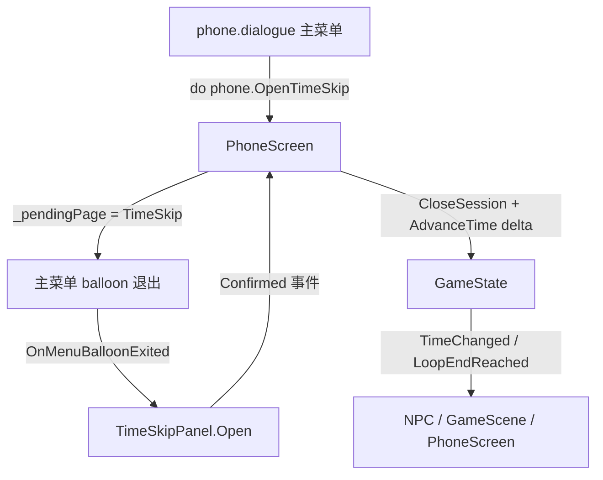
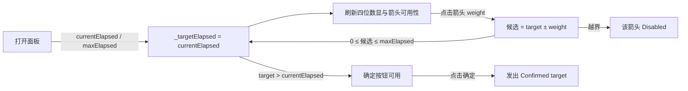

# 手机「玩手机消磨时间」设计

## 目标

手机主菜单新增一个消耗时间的入口：玩家自行指定要等到几点，确认后直接推进到该时刻。用于替代「反复跑图 / 站着等」的等待流程。

## 架构



- `PhoneScreen` 仍然只做会话与页面调度；时间选择器的交互全部在新增的 `TimeSkipPanel`（`PanelContainer` 脚本）里。
- 不新增 `GameState` API：跳到目标时刻 = `AdvanceTime(目标 elapsed - 当前 elapsed)`。

## 数据流



## 界面

```
        ▲        ▲        ▲        ▲
      ┌──┐     ┌──┐  :  ┌──┐     ┌──┐
      │ 1│     │ 3│     │ 2│     │ 5│
      └──┘     └──┘     └──┘     └──┘
        ▼        ▼        ▼        ▼

                  [ 确定 ]
```

- 四个数字格（时十位 / 时个位 / 分十位 / 分个位），每格上方 ▲、下方 ▼。
- 步进为该位权值：时十位 ±600 分钟、时个位 ±60、分十位 ±10、分个位 ±1；数字自然进位（13:09 → 分个位 ▲ → 13:10）。
- 面板打开时显示当前时间，「确定」为灰色不可点（`Disabled = true`）。
- 可选范围是本轮循环时间 13:00–17:30；允许调到早于当前或等于当前的时间，此时「确定」保持置灰。会让结果越界的箭头直接置灰不可点。时十位在 13:00–17:30 内恒为 1，因此该格两个箭头始终置灰。
- 「确定」在底部居中；点击后关闭手机会话并推进时间，目标为 17:30 时按既有规则触发终末重置。
- Esc 返回手机主菜单，与既有面板一致。

## 行为细节

- 面板打开期间玩家输入保持锁定（沿用 `DialogueBalloon.KeepPlayerInputLockedOnExit` + `PhoneScreen` 统一释放）。
- `TimeSkipPanel` 只暴露 `Open(int currentElapsedMinutes, int maxElapsedMinutes)` 与 `Confirmed` 事件；越界点击属于程序错误，`PushError` 后忽略，不做静默夹取。
- 确认时 `delta <= 0` 一律视为错误：按钮在目标不大于当前时始终不可点。

## 改动文件

- `Dialogue/phone.dialogue`：新增选项 `[ID:waste_time] [#repeatable]` 与 cue `waste_time`。
- `Scripts/Phone/TimeSkipPanel.cs`：新增，四位数显 + 箭头可用性 + `Confirmed`。
- `Scenes/Phone/PhoneScreen.tscn`：`Overlay/Center/TimeSkipPanel` 节点，复用 `Theme_phone` 与既有 StyleBox。
- `Scripts/Phone/PhoneScreen.cs`：`PhonePage.TimeSkip`、`OpenTimeSkip()`、`ShowTimeSkip()`、确认回调、Esc 处理、`HideAllPages` 隐藏。

## 验证

- `--build-solutions` 编译通过；`--headless --path . --quit-after 120` 无脚本报错。
- 手动：打开手机 → 玩手机消磨时间 → 时间等于当前时确定置灰 → 调到 13:30 确定 → 时钟变 13:30 且手机关闭；调到 17:30 确定 → 触发终末重置。
