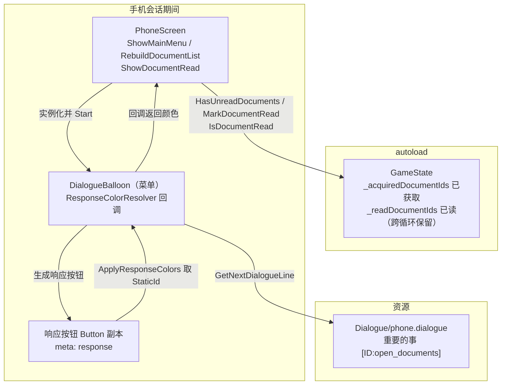
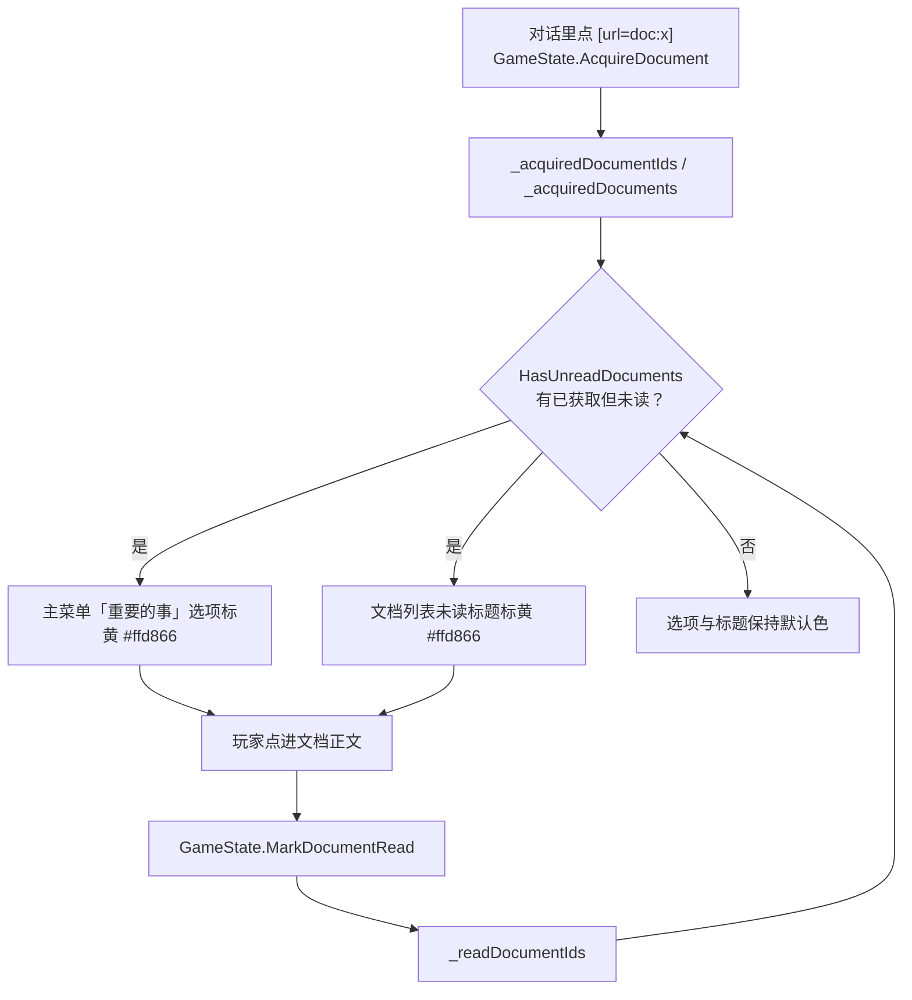
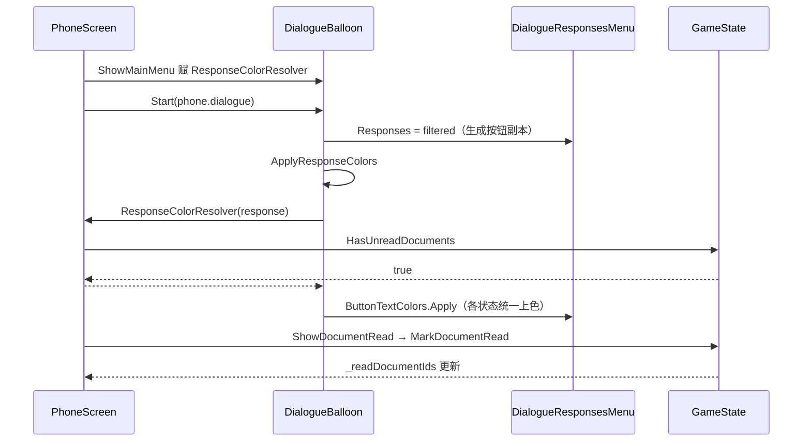

# 手机「重要的事」未读高亮

日期：2026-11-07
相关文档：`2026-11-07-phone-system-design.md`（手机系统主设计）

---

## 1. 目标

- 手机主菜单里的「重要的事」选项文字，在存在未读文档时标黄。
- 「重要的事」列表里还没读过的文档标题同样标黄。
- 在手机里点进文档正文即视为已读，高亮随之消失；未读状态跨循环保留。

---

## 2. 术语

| 术语 | 含义 |
|---|---|
| **已获取文档** | 玩家点过对话里的文档链接，写入 `GameState` 的 `DocumentData` |
| **已读文档** | 玩家在手机里打开过正文的文档 |
| **未读高亮** | `#ffd866`，与对话里未收集文档链接的高亮同色 |

判定规则：**打开正文才算已读**。只看列表、或者点链接收进手机，都不算已读。

---

## 3. 架构

### 3.1 架构图

关键点：

- 已读状态放在 `GameState`（autoload），与已获取文档一样跨循环保留；`ResetLoop()` 不清。
- 通用 balloon 不写手机规则：`DialogueBalloon` 只提供一个通用的「响应配色回调」，由 `PhoneScreen` 决定颜色。
- 响应按钮由 addon 的 `DialogueResponsesMenu` 生成（`ResponseTemplate` 的 `Button` 副本），只读不改 addon 目录。

### 3.2 数据流图

### 3.3 调用链图

---

## 4. 实现要点

| 位置 | 内容 |
|---|---|
| `Scripts/Core/GameState.cs` | 新增 `_readDocumentIds`、`MarkDocumentRead(id)`、`IsDocumentRead(id)`、`HasUnreadDocuments` |
| `Scripts/UI/ButtonTextColors.cs` | `Apply(button, color)`：把同一颜色写到 `font_color` / `font_hover_color` / `font_focus_color` / `font_pressed_color` / `font_hover_pressed_color` |
| `Scripts/Dialogue/DialogueBalloon.cs` | 新增 `ResponseColorResolver`（`Func<DialogueResponse, Color?>`）与 `ApplyResponseColors()`，在 `responsesMenu.Responses = filtered` 之后调用 |
| `Scripts/Phone/PhoneScreen.cs` | 主菜单注入配色回调（只匹配 `StaticId == "open_documents"`）；列表重建时给未读标题上色；`ShowDocumentRead` 里标记已读 |

- 「重要的事」选项的 id 来自 `Dialogue/phone.dialogue` 的 `[ID:open_documents]`，代码侧常量 `DocumentsOptionId` 与之对应。
- 配色必须先所有交互状态一起覆盖，不能只写 `font_color`：按钮一旦获得焦点（列表重建后首项 `GrabFocus`、菜单项 `mouse_entered` 即 `grab_focus`）或悬浮 / 按下，引擎改读主题的 `font_focus_color` / `font_hover_color` / `font_pressed_color`（默认近白 0.95），只覆盖 `font_color` 会导致黄色在聚焦 / 悬浮 / 按下时消失。统一走 `ButtonTextColors.Apply`，不新建 Theme 资源。
- `MarkDocumentRead` 对未获取的文档 id 报错，不用默认值静默兜底。

---

## 5. 验证

- `dotnet build`：0 错误（仅既有 `LoopEndNotice.Show()` 警告）。
- 运行时（临时场景驱动 `phone.dialogue` 的主菜单）：
  - 「重要的事」`staticId=open_documents`，`staticId` 命中且 `HasUnreadDocuments` 为真时五个状态色都是 `#ffd866`；按钮聚焦（`grab_focus`）后文字仍是黄色；
  - 「记事本」「关闭」无 override；
  - 「重要的事」列表里未读标题在聚焦 / 悬浮 / 按下时都保持 `#ffd866`；
  - 标记已读后 `HasUnreadDocuments == false`，列表重建后该条无 override、回到默认色。
