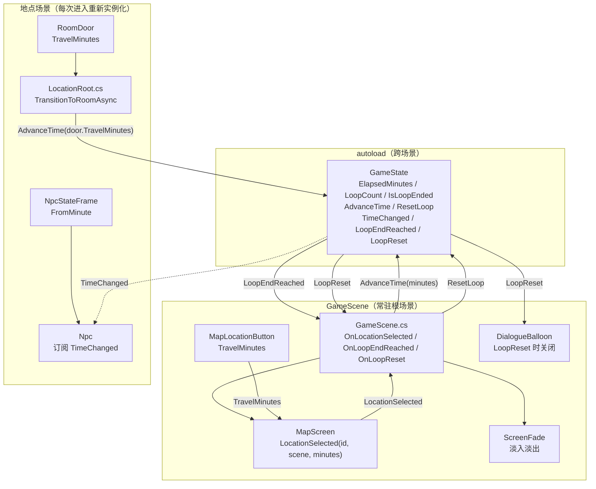
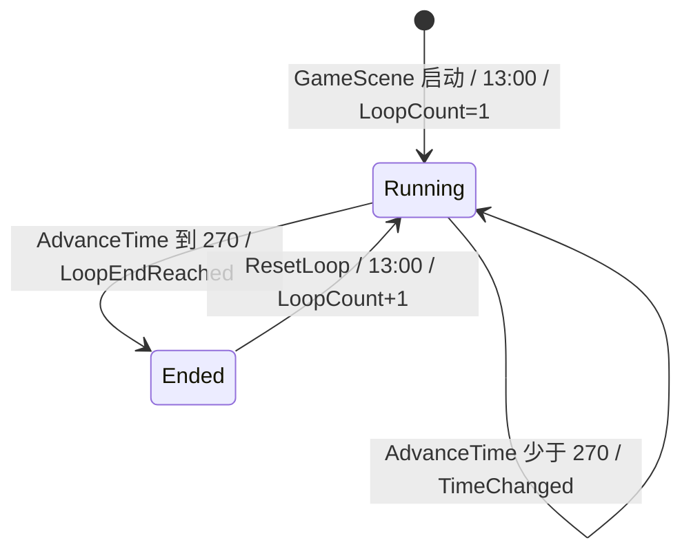
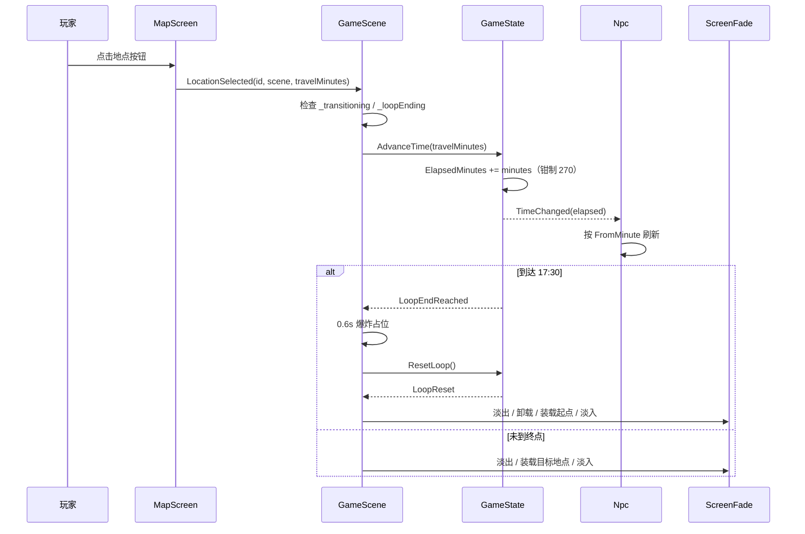
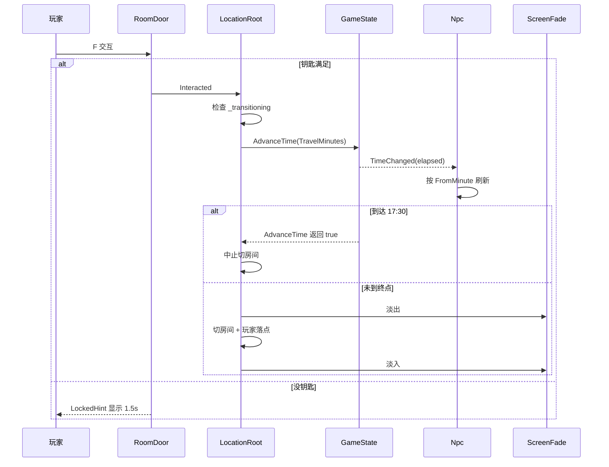

# 时间系统 · 设计规格

| 项 | 内容 |
|---|---|
| 日期 | 2026-11-07 |
| 项目 | pandagj-2026（Godot 4.7.2 mono / C#） |
| 模块 | 时间系统（程序文档「模块划分」中的「时间系统」） |
| 状态 | 已实现（2026-11-07） |
| 上游需求 | 飞书 wiki《Panda jam 八岐大蛇》· 剧本《三条线》画板 · 程序文档 |
| 可视化 | 剧本「三条线」标题下的画板（token `ZaJlwdhU9huMNubqqHIctn2mnFe`） |
| 依赖 | 地图&场景系统（`2026-11-06-map-scene-system-design.md`）、NPC 系统（`2026-11-06-npc-system-design.md`）、Dialogue Manager 4.2.0 |

参考链接：

- 主 wiki：<https://my.feishu.cn/wiki/IjAAwgxwviZZHrkELxVcACSjnEg>
- 剧本：<https://my.feishu.cn/wiki/Rzy5wQ2KoicjXik48aYcUHahn6b>
- 程序文档：<https://my.feishu.cn/wiki/R7MZwJONni4kgVkH5J6c5rd5n8c>

---

## 0. 决策索引

评审时如需推翻某条，直接指出编号。

| # | 决策 |
|---|---|
| Q1 | 时间用「循环内分钟」表示：`ElapsedMinutes`，0 = 13:00，270 = 17:30；不用步数、不用真实时间 |
| Q2 | 时间的默认推进点只有两类移动：地图旅行、房间切换；对话 / 调查 / 拾取不扣时 |
| Q3 | `AdvanceTime(minutes)` 是**通用公开接口**；一周目书桌看书、等待、以后的延迟任务都可以显式调用，不把时间流逝锁死在移动上 |
| Q4 | 转移耗时配置在转移物件上：`MapLocationButton.TravelMinutes` 默认 30，`RoomDoor.TravelMinutes` 默认 5；不引入集中式 `TimeConfig` |
| Q5 | 地图旅行按**目的地按钮**扣时；从当前地点退到地图（`LocationExit`）不扣时；房间门按门扣时，往返各计一次 |
| Q6 | NPC 状态帧从 `FromStep` 改为 `FromMinute`（0 = 13:00）；首帧必须 0，严格递增 |
| Q7 | 17:30 是唯一硬终点；`AdvanceTime` 钳制到 270，发 `LoopEndReached`，**不在自己的调用栈里调 `ResetLoop`** |
| Q8 | `GameScene` 负责终末占位与调用 `ResetLoop`；现有 `OnLoopReset` 负责黑幕、卸载、回起点、淡入 |
| Q9 | `LoopCount` 只在当前进程内有效：开局 1，每次 `ResetLoop` 后 +1；不写档、不跨 exe 继承 |
| Q10 | `LoopCount` **只用于一周目固定锁**；二 / 三 / 四周目是预期打法，不是系统强制的状态机，不按周目数限制地点、道具、对话或路线 |
| Q11 | 新开 exe = 新游戏：`LoopCount = 1`，`UnlockedLocations` / `Clues` / `Inventory` 全部从初始状态开始；玩家自己的知识不受影响 |
| Q12 | 时间系统不实现通用延迟任务调度器；新井三小时分析由内容层用 `GetElapsedMinutes()` + 自己的时间戳字段实现 |
| Q13 | 17:00 老师下地下、地下被抓失败属于内容层；核心时钟只提供时间与信号 |
| Q14 | 时间 UI / HUD / 手机时钟不在本次范围；`GetClockText()` 先用于调试与未来 UI |
| Q15 | 现有 `TimeStep` / `TimeAdvanced` 全部移除，改为 `ElapsedMinutes` / `TimeChanged(int)`；旧 NPC 规格中 `FromStep` 的条款由本规格取代 |
| Q16 | 负数时间 `PushError`；0 是合法的无操作；跨过 17:30 只触发一次终末 |
| Q17 | 地下空间入口、化学实验室、保健室不在本次接入；等剧本补入口与耗时后再加转移配置 |
| Q18 | 器材准备室 5 分钟为初值（剧本没写），可在场景里改，不改代码 |
| Q19 | 三周目标注的 14:50 与括号累加 15:00 不一致；以括号耗时为数据源，14:50 视为内容标注误差 |

---

## 1. 目标与范围

### 1.1 本规格覆盖

- 循环内分钟时钟：13:00 开始，17:30 终末；`ElapsedMinutes`、`GetClockText()`
- 时间推进接口 `AdvanceTime(int minutes)` 与返回值语义
- 地图旅行的耗时（`MapLocationButton.TravelMinutes`）
- 房间切换的耗时（`RoomDoor.TravelMinutes`）
- NPC 时间表从步数迁移到分钟（`NpcStateFrame.FromMinute`、`Npc` 刷新）
- 17:30 终末信号与循环重置流程（时间、背包、NPC 状态、已选选项、解锁/线索的继承）
- 周目计数 `LoopCount` 与一周目固定锁的接口
- 与现有地图 / NPC / 对话系统的接口改动
- 端到端验收清单

### 1.2 本规格不覆盖

- 时间 UI / HUD / 手机时钟的显示
- 通用延迟任务调度器；新井三小时分析的具体实现
- 炸药爆炸的 VFX / 音效；只做 0.6 秒占位与黑幕
- 17:00 地下失败的具体剧情与表现
- 地下空间入口、化学实验室、保健室的转移接入
- 二 / 三 / 四周目的路线强制；只保留一周目固定锁
- 存档 / 读档
- 对话、调查、拾取的时间消耗（它们默认免费；只有显式调用 `AdvanceTime` 的交互才扣时）

---

## 2. 术语

| 术语 | 含义 |
|---|---|
| **循环内分钟 / ElapsedMinutes** | 从本轮 13:00 起经过的分钟数，范围 0–270；13:45 = 45 |
| **时钟文本 / ClockText** | `GetClockText()` 返回的 `"13:45"` 形式，给调试和未来 UI 用 |
| **转移物件** | 会扣时的两类节点：`MapLocationButton`（地图旅行）与 `RoomDoor`（房间切换） |
| **时间帧 / FromMinute** | NPC 状态帧的生效时间；`FromMinute = 45` 表示 13:45 起生效 |
| **周目 / LoopCount** | 当前进程内的循环序号；开局 1，每次重置 +1；只用于一周目固定锁 |
| **终末 / LoopEndReached** | 时间首次到达 270（17:30）时发出的信号 |
| **一周目固定锁** | 内容层用 `IsFirstLoop()` 限制的一周目演出；二周目起不再有周目级限制 |

---

## 3. 架构

### 3.1 架构图



### 3.2 职责划分

| 单位 | 职责 | 不负责 |
|---|---|---|
| `GameState` | 时钟、周目计数、终末状态、循环重置、时间信号 | 场景装载、NPC 视觉、终末表现 |
| `GameScene` | 地图选点入口、终末占位、调用 `ResetLoop`、响应 `LoopReset` 重载起点 | 时间计算、转移耗时配置 |
| `MapScreen` | 把按钮点击转成带 `travelMinutes` 的 `LocationSelected` | 扣时、装载场景 |
| `MapLocationButton` | 持有 `LocationId` / `LocationScene` / `TravelMinutes` | 时间推进 |
| `LocationRoot` | 房间切换、在切换前扣时、终末时中止切换 | 地图旅行、NPC 状态 |
| `RoomDoor` | 钥匙判定、持有 `TravelMinutes`、发 `Interacted` | 扣时、切房间 |
| `Npc` | 按 `ElapsedMinutes` 解析时间帧、刷新立绘/在场、暴露条件方法 | 时间推进、场景切换 |
| `NpcStateFrame` | 纯数据：`FromMinute` / `StateId` / `Texture` / `Visible` | 任何逻辑 |
| `DialogueBalloon` | 循环重置时关闭自身、释放输入锁（已有） | 时间计算 |

### 3.3 与现有规格的关系

本规格**取代**以下旧条款：

| 旧规格 | 旧条款 | 新做法 |
|---|---|---|
| 地图&场景规格 | `GameState.TimeStep`（int 步数）、`AdvanceTime()` 无参、`TimeAdvanced(int timeStep)` | `ElapsedMinutes`（分钟）、`AdvanceTime(int minutes)`、`TimeChanged(int elapsedMinutes)` |
| 地图&场景规格 Q8 | 时间推进只发生在移动上 | 默认仍只发生在移动上；额外允许内容显式调用 `AdvanceTime`（一周目书桌看书） |
| 地图&场景规格 §5.1 | `AdvanceTime()` 不得在自己的调用栈里触发 `ResetLoop()` | 继续遵守：`AdvanceTime` 只发 `LoopEndReached`；`GameScene` 等 0.6 秒后再调 `ResetLoop` |
| NPC 规格 | `NpcStateFrame.FromStep`、`Npc` 用 `TimeStep` 解析帧 | `FromMinute`、`Npc` 用 `ElapsedMinutes` 解析帧 |

旧规格作为历史记录保留，不回改；实现完成后同步更新 `AGENTS.md` 中关于 `TimeStep` / `FromStep` 的描述。

### 3.4 脚本目录

不新建脚本目录，全部是现有文件的修改：

```
Scripts/
├── Core/       GameState.cs（修改：时钟 / 周目 / 终末 / 重置）
├── Map/        GameScene.cs（修改：分钟参数 / 终末响应）
│               MapScreen.cs（修改：信号带分钟）
│               MapLocationButton.cs（修改：TravelMinutes）
├── Location/   LocationRoot.cs（修改：房间切换扣时）
│               RoomDoor.cs（修改：TravelMinutes）
├── Npc/        Npc.cs（修改：按分钟解析）
│               NpcStateFrame.cs（修改：FromMinute）
└── ...         其余脚本不动
```

不新增 autoload、不新增资源类型、不引入 namespace。

---

## 4. 契约

### 4.1 `GameState`（`Scripts/Core/GameState.cs`）

常量：

```csharp
public const int LoopStartMinuteOfDay = 13 * 60;              // 780
public const int LoopEndMinuteOfDay = 17 * 60 + 30;           // 1050
public const int LoopDurationMinutes = LoopEndMinuteOfDay - LoopStartMinuteOfDay; // 270
```

状态：

| 成员 | 类型 | 说明 |
|---|---|---|
| `ElapsedMinutes` | `int`，`private set` | 0–270；0 = 13:00 |
| `LoopCount` | `int`，`private set`，初始 1 | 当前进程内的周目序号 |
| `IsLoopEnded` | `bool`，`private set` | 到达 270 后为 true，`ResetLoop` 后为 false |
| `UnlockedLocations` | `HashSet<string>` | 已有；跨循环保留（同一进程内） |
| `Inventory` | `HashSet<string>` | 已有；每轮清空 |
| `Clues` | `HashSet<string>` | 已有；跨循环保留（同一进程内） |
| `Instance` | `static GameState` | 已有 |

信号：

| 信号 | 参数 | 触发时机 |
|---|---|---|
| `TimeChanged` | `int elapsedMinutes` | `AdvanceTime` 改变了时间之后；`ResetLoop` 归零之后 |
| `LoopEndReached` | 无 | 时间首次到达 270；每轮一次 |
| `LoopReset` | 无 | `ResetLoop` 完成重置之后 |
| `LocationUnlocked` | `string locationId` | 已有，不变 |

方法：

| 方法 | 说明 |
|---|---|
| `bool AdvanceTime(int minutes)` | 推进时间；返回 `true` 表示本次推进触发或已处于终末 |
| `void ResetLoop()` | 时间归零、`LoopCount++`、清本轮状态、发 `TimeChanged(0)` 与 `LoopReset` |
| `string GetClockText()` | 返回 `"13:45"` |
| `int GetElapsedMinutes()` | 只读访问器，供 `.dialogue` / 内容层使用 |
| `int GetLoopCount()` | 只读访问器，供 `.dialogue` / 内容层使用 |
| `bool IsFirstLoop()` | `LoopCount == 1`；一周目固定锁用 |
| `SeedInitialUnlocks` / `UnlockLocation` / `IsLocationUnlocked` / `HasItem` / `AddItem` / `HasClue` / `GetNpcLoopState` / `SetNpcLoopState` / `IsChoiceUsed` / `MarkChoiceUsed` | 已有，不变 |

`AdvanceTime` 语义：

```
if (IsLoopEnded) return true;
if (minutes < 0) { PushError("AdvanceTime: minutes 不能为负"); return false; }
if (minutes == 0) return false;

ElapsedMinutes = Min(ElapsedMinutes + minutes, LoopDurationMinutes);
GD.Print($"[Time] {GetClockText()} (+{minutes})");
EmitSignal(TimeChanged, ElapsedMinutes);

if (ElapsedMinutes >= LoopDurationMinutes)
{
    IsLoopEnded = true;
    EmitSignal(LoopEndReached);
    return true;
}
return false;
```

要点：

- **钳制**：超过 270 的部分丢弃，时钟停在 17:30。
- **返回 `true` 的调用方必须中止自己的后续动作**（不装载目标地点、不切房间、不再做自己的演出）。
- **不在 `AdvanceTime` 里调用 `ResetLoop`**；`LoopEndReached` 只负责通知，重置由 `GameScene` 在独立流程里做。
- 已经在终末状态时再调用：直接返回 `true`，不推进、不发信号。
- `minutes == 0`：合法的无操作，返回 `false`，不发信号。
- 负数：报错，返回 `false`，不改变时间。

`ResetLoop` 语义：

```
ElapsedMinutes = 0;
IsLoopEnded = false;
LoopCount++;

Inventory.Clear();
_npcLoopStates.Clear();
_npcUsedChoices.Clear();

GD.Print($"[Loop] 第 {LoopCount} 周目开始");
EmitSignal(TimeChanged, 0);
EmitSignal(LoopReset);
```

`GetClockText()`：

```
int total = LoopStartMinuteOfDay + ElapsedMinutes;
return $"{total / 60:00}:{total % 60:00}";
```

`LoopCount` 语义：

- 字段初始值 1；`GameScene` 启动时不调用 `ResetLoop`。
- 每次 `ResetLoop` +1；没有其他重置入口。
- **只在当前进程内有效**：没有存档，新开 exe 从 1 开始。
- **只给一周目固定锁用**：二 / 三 / 四周目不按 `LoopCount` 限制任何地点、道具、对话或路线。
- 内容层要读它时用 `GetLoopCount()` / `IsFirstLoop()`，不要直接改。

### 4.2 `MapLocationButton`（`Scripts/Map/MapLocationButton.cs`）

新增导出：

```csharp
/// <summary>前往该地点消耗的分钟数；0 表示免费。</summary>
[Export] public int TravelMinutes { get; set; } = 30;
```

- 默认 30，对应剧本「前往操场 / 去行政楼 30」。
- 0 合法（免费旅行）；负数在 `MapScreen.Validate` 里 `PushError`。
- 耗时属于**目的地**：从任何地点去操场都读操场按钮的 30；不按出发地计算。

### 4.3 `MapScreen`（`Scripts/Map/MapScreen.cs`）

信号改为：

```csharp
[Signal] public delegate void LocationSelectedEventHandler(
    string locationId,
    PackedScene locationScene,
    int travelMinutes);
```

- `_Ready()` 连接按钮时透传 `captured.TravelMinutes`。
- `Validate()` 增加：`TravelMinutes < 0` → `PushError`。
- 负值时该按钮仍可见（避免地图死锁）；点击时 `AdvanceTime` 报错并返回 `false`，地点仍会装载，即实际不扣时。错误必须在控制台可见。

### 4.4 `GameScene`（`Scripts/Map/GameScene.cs`）

新增：

```csharp
private bool _loopEnding;

private void OnLocationSelected(string locationId, PackedScene scene, int travelMinutes)
{
    if (_transitioning || _loopEnding) return;
    if (GameState.Instance.AdvanceTime(travelMinutes)) return;
    _ = EnterLocationAsync(locationId, scene);
}

private async void OnLoopEndReached()
{
    if (_loopEnding) return;
    _loopEnding = true;

    GD.Print("[Loop] 17:30 爆炸");
    await ToSignal(GetTree().CreateTimer(0.6), Timer.SignalName.Timeout);

    GameState.Instance.ResetLoop();
    _loopEnding = false;
}
```

`_Ready()` 增加：

```csharp
GameState.Instance.LoopEndReached += OnLoopEndReached;
```

`OnLoopReset()` 保持现有职责：守卫 → 淡出 → 卸载 → 重载 `StartLocation` → 淡入。`OnLoopEndReached` 不重复做这段过渡。

工程只保留移动与交互输入；循环重置只由 `OnLoopEndReached` 触发。

### 4.5 `RoomDoor`（`Scripts/Location/RoomDoor.cs`）

新增导出：

```csharp
/// <summary>穿过这扇门消耗的分钟数；0 表示免费。</summary>
[Export] public int TravelMinutes { get; set; } = 5;
```

- 默认 5；剧本里的 15 / 20 / 5 / 10 在具体门上覆盖。
- `_Ready()` 增加：`TravelMinutes < 0` → `PushError`。
- 钥匙不满足时在 `Interact()` 里直接返回，**不会走到 `base.Interact()`**，所以撞锁不扣时。

### 4.6 `LocationRoot`（`Scripts/Location/LocationRoot.cs`）

`TransitionToRoomAsync`：

```csharp
private async Task TransitionToRoomAsync(RoomDoor door)
{
    if (_transitioning) return;
    if (GameState.Instance.AdvanceTime(door.TravelMinutes)) return;

    _transitioning = true;
    // 原有：淡出 → 切房间 → 玩家落点 → 相机限位 → 淡入
}
```

- 先推进时间，再置 `_transitioning`；终末时直接返回，不切房间。
- 时间变化信号在切房间之前发出；未激活房间里的 NPC 也会收到信号并刷新，切过去时状态已经正确。

### 4.7 `NpcStateFrame`（`Scripts/Npc/NpcStateFrame.cs`）

```csharp
/// <summary>从循环内第几分钟开始生效；0 = 13:00，45 = 13:45。</summary>
[Export] public int FromMinute { get; set; }
```

其余字段不变：`StateId`、`Texture`、`Visible`。

### 4.8 `Npc`（`Scripts/Npc/Npc.cs`）

- `_Ready()`：订阅 `GameState.Instance.TimeChanged`；`_ExitTree()` 退订。
- `OnTimeChanged(int elapsedMinutes)` → `RefreshVisual()`。
- 当前帧解析：最后一个 `FromMinute <= GameState.Instance.ElapsedMinutes` 的帧。
- 有效状态、在场规则不变：本轮覆盖优先改状态与贴图；在场只看当前时间帧的 `Visible`。
- 调试标签显示 `$"{NpcId}:{_effectiveStateId} @{GameState.Instance.GetClockText()}"`。
- 校验：
  - `Frames` 非空
  - 首帧 `FromMinute == 0`
  - `FromMinute` 严格递增
  - `StateId` 非空
  - `Visible == true` 的帧必须有 `Texture`
  - 同一 `StateId` 跨帧贴图一致
- 校验失败：`PushError` 且该 NPC `Monitorable = false`、`Visible = false`（沿用现有行为）。

### 4.9 `.dialogue` 可用接口

时间系统只新增只读方法；剧本条件继续遵守「调方法、不读属性」：

| 表达式 | 用途 |
|---|---|
| `GameState.GetElapsedMinutes() >= 240` | 17:00 老师下地下 / 地下失败判定 |
| `GameState.IsFirstLoop()` | 一周目固定锁 |
| `GameState.GetLoopCount() == 1` | 需要显式比较周目时 |
| `GameState.GetClockText()` | 调试或未来 UI；不建议在条件里做字符串比较 |

新井三小时分析不在本规格实现；需要时内容层记录 `start = GameState.GetElapsedMinutes()`，之后用 `GetElapsedMinutes() - start >= 180` 判断。

---

## 5. 状态与配置

### 5.1 时间常量

| 名称 | 值 | 说明 |
|---|---|---|
| 循环开始 | 13:00（780 分） | `LoopStartMinuteOfDay` |
| 终末 | 17:30（1050 分） | `LoopEndMinuteOfDay` |
| 循环长度 | 270 分 | `LoopDurationMinutes` |
| 时钟格式 | `HH:mm` | `GetClockText()` |

### 5.2 转移耗时表

| 操作 | 配置对象 | 分钟 | 来源 |
|---|---|---|---|
| 教室 ↔ 走廊 | `RoomDoor.TravelMinutes` | 15 | 剧本「出教室门 15」；反向按同值 |
| 走廊 ↔ 隔壁班 | `RoomDoor.TravelMinutes` | 20 | 剧本「进/出隔壁班 20」 |
| 地图 → 操场 | `MapLocationButton.TravelMinutes` | 30 | 剧本「前往操场 30」 |
| 地图 → 行政楼 | `MapLocationButton.TravelMinutes` | 30 | 剧本「去行政楼 30」 |
| 行政楼 ↔ 办公室 | `RoomDoor.TravelMinutes` | 5 | 剧本「进/出办公室 5」 |
| 操场 → 操场后 | `RoomDoor.TravelMinutes` | 10 | 剧本「去操场后 10」 |
| 操场后 → 器材准备室 | `RoomDoor.TravelMinutes` | 5（初值） | 剧本没写；可在场景里改 |
| 其他地图旅行 | `MapLocationButton.TravelMinutes` | 30（默认） | 剧本统一按 30 |
| 其他房间门 | `RoomDoor.TravelMinutes` | 5（默认） | 未配置时的默认 |
| 从地点退回地图 | `LocationExit` | 0 | 不扣时；地图旅行由目标按钮扣 |

补充：

- 地图旅行按目的地扣时，不按出发地；如果以后需要按起点/终点不同，再加新字段，不在本规格。
- 房间门耗时按**单次**计；往返各走一扇门，各扣一次。
- 地下空间入口不在本表：剧本没有给出耗时，本次不接入；等剧本补数后加一扇 `RoomDoor` 并填 `TravelMinutes`。
- 化学实验室、保健室不在本次场景流程内；本次不接入，等剧本补数后再加。

### 5.3 继承 / 重置清单

| 状态 | 同一进程内跨循环 | 每轮重置 | 新开 exe |
|---|---|---|---|
| `UnlockedLocations` | ✅ | | ❌ 从 `MapConfig` 重新开始 |
| `Clues` | ✅ | | ❌ 清空 |
| `LoopCount` | ✅（递增） | | ❌ 回到 1 |
| `Inventory` | | ✅ 清空 | ❌ 清空 |
| `ElapsedMinutes` | | ✅ 归零 | ❌ 0 |
| `IsLoopEnded` | | ✅ false | ❌ false |
| `NpcLoopStates`（本轮覆盖） | | ✅ 清空 | ❌ 清空 |
| `NpcUsedChoices`（已选选项） | | ✅ 清空 | ❌ 清空 |
| NPC 时间帧状态 | | ✅ 由时间重新推导 | ❌ 由时间重新推导 |
| 房间门锁 / 已拾取物 | | ✅ 场景重建复原 | ❌ 复原 |
| 对话进度 | | ✅ 下次交互回 hub | ❌ 回 hub |

> `UnlockedLocations` / `Clues` 的「跨循环继承」只在同一进程内成立；没有存档，新开 exe 不继承。玩家自己的记忆不受影响，二周目起游戏不额外上锁。

### 5.4 时间变化时机

| 触发 | 谁刷新 | 说明 |
|---|---|---|
| NPC `_Ready` | 自己 | 进入地点时按当前 `ElapsedMinutes` 解析 |
| `GameState.TimeChanged` | 所有已实例化 NPC | 房间切换 / 地图旅行时在装载前发出；未激活房间的 NPC 也会收到 |
| `Npc.SetLoopState` | 自己 | 对话突变后立即刷新；不改在场 |
| `GameState.LoopReset` | 场景重建 | 旧地点卸载，新地点 `_Ready` 按 0 解析 |

顺序约束：**先推进时间，再淡出 / 装载**。新场景的 NPC 在 `_Ready` 里读到的就是新时间。

### 5.5 剧本时间节点

| 时间 | `ElapsedMinutes` | 事件 |
|---|---|---|
| 13:00 | 0 | 循环开始；小优香在教室；老师在讲台；新井在隔壁班 |
| 13:30 | 30 | 老师回办公室；交互会被请出去 |
| 13:45 | 45 | 小优香去操场 |
| 14:00 | 60 | 老师在办公室折叠床睡着，可偷钥匙 |
| 15:00 | 120 | 老师睡醒 |
| 17:00 | 240 | 老师去操场地下服务器空间（内容层判断） |
| 17:30 | 270 | 炸药爆炸，`LoopEndReached` |

NPC 帧按角色实际变化取上表中的时间点；不是每个 NPC 都需要全部六帧。17:30 不需要 NPC 帧：地点会被重置卸载。

### 5.6 周目语义

| 周目 | 系统语义 | 内容语义 |
|---|---|---|
| 一周目 | `LoopCount == 1`；可用 `IsFirstLoop()` 判定 | 操作限死：与小优香、老师对话后不能出门，只能回座位看书 |
| 二周目 | `LoopCount == 2`；**没有周目级限制** | 预期打法：新井 → 小优香 → 办公室 → 器材准备室；玩家也可以不按这个顺序 |
| 三周目 | `LoopCount == 3`；没有周目级限制 | 预期打法：偷电脑 → 问密码 → 开电脑 → 地下取样；玩家可以提前做 |
| 四周目 | `LoopCount >= 4`；没有周目级限制 | 预期打法：早取样 → 等三小时 → 解除炸药 → The End |

关键约束：

- **二 / 三 / 四周目不是状态机**。系统不记录「现在应该走哪条线」，也不按周目数锁地点/道具/对话。
- 玩家能做什么，只由 `UnlockedLocations`、`Clues`、`Inventory`、NPC 状态与对话条件决定。
- 一个已经通关的玩家新开 exe：重复一周目固定演出；从二周目开始，只要知识锁允许，就可以直接跑完整操作。
- `LoopCount` 只用于一周目固定锁和可选的内容分支；不要拿它当二 / 三 / 四周目的通行证。

---

## 6. 数据流


数据是单向的：

1. **转移**：地图按钮 / 房门 → `AdvanceTime(minutes)` → `GameState`。转移物件不认识 NPC。
2. **时间**：`GameState` → `TimeChanged` → `Npc` 刷新。NPC 不认识场景。
3. **终末**：`GameState` → `LoopEndReached` → `GameScene` → `ResetLoop` → `LoopReset` → 场景重载。

---

## 7. 关键流程与调用链

### 7.1 循环生命周期



### 7.2 地图旅行 → 终末



顺序：**先 `AdvanceTime`，后装载**。终末时本次旅行不装载目标地点，玩家留在原地看终末。

### 7.3 房间切换



### 7.4 时间到点 → NPC 刷新

```
GameState.AdvanceTime(minutes)
├── ElapsedMinutes += minutes（钳制 270）
├── 发 TimeChanged(ElapsedMinutes)
│   └── 所有已实例化 Npc.OnTimeChanged()
│       └── RefreshVisual()
│           ├── 当前帧 ← 最后一个 FromMinute <= ElapsedMinutes
│           ├── 有效状态 ← 本轮覆盖 ?? 当前帧.StateId
│           └── 在场 ← 当前帧.Visible
└── 到 270 → IsLoopEnded = true → 发 LoopEndReached
```

### 7.5 循环重置

```
GameScene.OnLoopEndReached()
├── 守卫 _loopEnding
├── GD.Print("[Loop] 17:30 爆炸")
├── await 0.6s（爆炸占位；以后接 VFX / 音效）
└── GameState.ResetLoop()
    ├── ElapsedMinutes = 0
    ├── IsLoopEnded = false
    ├── LoopCount++
    ├── Inventory.Clear()
    ├── _npcLoopStates.Clear()
    ├── _npcUsedChoices.Clear()
    ├── 发 TimeChanged(0)
    └── 发 LoopReset
        ├── DialogueBalloon.OnLoopReset → QueueFree()（已有）
        └── GameScene.OnLoopReset
            ├── 淡出
            ├── 卸载当前地点
            ├── 装载 StartLocation
            └── 淡入
```

### 7.6 一周目固定锁

```
内容层（对话/交互）：
    if GameState.IsFirstLoop():
        教室出口 / 「决定出去逛逛」选项锁住
        玩家只能和小优香、老师对话 → 回座位看书
        书桌交互调用 AdvanceTime(...) 推进时间
    else:
        不做周目级限制，按知识锁正常推进

时间系统只提供：
    GetLoopCount() / IsFirstLoop() / GetElapsedMinutes()
```

书桌每次推进多少分钟由内容决定；本规格只保证 `AdvanceTime` 可被任意交互调用，并且跨过 17:30 时只触发一次终末。

---

## 8. 剧本时间轴与路线校对

### 8.1 角色时间轴

| 时间 | 鸣子（玩家） | 山田老师 | 小优香 | 新井次郎 |
|---|---|---|---|---|
| 13:00 | 醒来；与小优香 / 老师对话 | 教室讲台写笔记 | 教室 · 鸣子桌前 | 隔壁班自习 |
| 13:30 | 一周目：对话后锁教室看书；其他周目：自由行动 | 回办公室办公 | 教室 → 准备去操场 | 隔壁班自习 |
| 13:45 | 同上 | 办公室办公 | 操场运动 | 隔壁班自习 |
| 14:00 | 同上 | 办公室折叠床睡着；可偷钥匙 | 操场运动 | 隔壁班自习 |
| 15:00 | 同上 | 睡醒，继续办公 | 操场运动 | 隔壁班自习 |
| 17:00 | 同上 | 前往操场地下服务器空间 | 操场运动 | 隔壁班自习 |
| 17:30 | 爆炸 → 循环重置 | 引爆炸药 | 放学 | 还在隔壁班 |

新井的条件事件：交炸药样本后 +180 分钟，在化学实验室交互得知「用水可以打湿炸药」。这是内容层时间戳，不是全局调度器。

### 8.2 理想路线校对

二周目：

```
出教室门 15
→ 进隔壁班 20
→ 出隔壁班 20
→ 前往操场 30
→ 去行政楼 30
→ 进办公室 5
= 120 分钟 → 13:00 + 120 = 15:00 ✓
```

三周目：

```
出教室门 15
→ 去行政楼 30
→ 进办公室 5
→ 出办公室 5
→ 去操场 30
→ 去行政楼 30
→ 进办公室 5
= 120 分钟 → 15:00
剧本标 14:50，差 10 分钟 ⚠
```

后续 `出办公室 5 + 去操场 30 + 去操场后 10 = 45 分钟`，从 15:00 算是 15:45；剧本没有标这一步的终点。

### 8.3 三周目 14:50 的处理

- 以**括号里的分钟数**为唯一数据源；`15 + 30 + 5 + 5 + 30 + 30 + 5 = 120`，所以 15:00。
- 剧本标注的 14:50 视为内容标注误差，不在代码里写死路线或时间戳。
- 如果内容校对后确实要 14:50，改某一段 `TravelMinutes`（例如把某段 30 改成 20）即可，不改代码。
- 周目路线是预期打法，不是系统强制；时间系统只负责按配置扣分钟。

### 8.4 不在本次接入的内容

| 内容 | 处理 |
|---|---|
| 地下空间入口 | 剧本没写耗时；画板标「未标注」；本次不加 `RoomDoor`，等补数 |
| 化学实验室 | 新井三小时分析在这里；本次不接入，等剧本补数后再加 |
| 保健室 | 剧情地点，但不在三条线的理想路线里；本次不接入 |
| 17:00 地下被抓失败 | 内容层用 `GetElapsedMinutes() >= 240` 判断；核心时钟不实现 |
| 一周目书桌看书 | 内容层交互调用 `AdvanceTime`；本次只提供接口，不做书桌交互 |
| 新井三小时分析 | 内容层记录时间戳；本次不做调度器 |

---

## 9. 错误处理

项目约定：空引用 / 资源缺失必须显式报错，不静默兜底。

| 场景 | 处理 |
|---|---|
| `AdvanceTime` 传负数 | `PushError`；不改变时间，返回 `false` |
| `AdvanceTime` 传 0 | 合法无操作；返回 `false`，不发信号 |
| `AdvanceTime` 在 `IsLoopEnded` 后调用 | 返回 `true`；不推进、不发信号（正常保护，不是错误） |
| `AdvanceTime` 跨过 270 | 钳制到 270；只发一次 `LoopEndReached` |
| `MapLocationButton.TravelMinutes < 0` | `MapScreen.Validate` 里 `PushError`；按钮仍可见；点击时 `AdvanceTime` 报错并返回 `false`，地点仍装载，实际不扣时（避免地图死锁） |
| `RoomDoor.TravelMinutes < 0` | `RoomDoor._Ready` 里 `PushError`；门仍可开，`AdvanceTime` 报错且不扣时 |
| `NpcStateFrame.FromMinute < 0` | `Npc` 校验报错；该 NPC `Monitorable=false`、`Visible=false` |
| 首帧 `FromMinute != 0` | 报错；该 NPC 不参与交互 |
| `FromMinute` 重复或倒退 | 报错；该 NPC 不参与交互 |
| `StateId` 为空 / `Visible=true` 但 `Texture` 为空 | 报错；该 NPC 不参与交互 |
| 同一 `StateId` 跨帧贴图不一致 | 报错；该 NPC 不参与交互 |
| `GameState.Instance` 为空 | `GameScene` / `LocationRoot` 在调用前 `PushError` 并中止；`Npc` 沿用现有保护 |
| `GameScene` 的导出引用为空 | 沿用现有报错；停止启动 |
| 过渡期间收到新的进入 / 返回请求 | 静默忽略（正常连点保护） |
| 终末判定到 `ResetLoop` 之间收到地图 / 房门请求 | `_loopEnding` / `AdvanceTime` 返回 `true` 阻断；`ResetLoop` 后进入黑幕重载，沿用现有过渡守卫，不做第二次终末 |
| 对话中触发终末 | 0.6 秒后 `ResetLoop`；`DialogueBalloon` 在 `LoopReset` 时关闭并解锁 |

---

## 10. 验收

### 10.1 验收清单

- [x] 启动后 `GetClockText()` 为 `13:00`，`LoopCount == 1`，NPC 处于 13:00 帧
- [x] 走一次房间门扣配置分钟；地图旅行扣 30；从地点退回地图不扣时
- [x] 对话、调查、拾取不改变时间；锁着的门撞一次不改变时间
- [x] 当前地点内的 NPC 在配置的 `FromMinute` 到点时立即换帧（demo 用 0 / 30 / 60 / 120 / 240 验证），不重新进地点
- [x] 17:30：本次转移中止、`LoopEndReached` 只发一次、回起点教室、`GetClockText()` 回到 `13:00`、`LoopCount == 2`
- [x] 17:30 重置后：`Inventory` 清空、本轮 NPC 覆盖 / 已选选项清空；`UnlockedLocations` / `Clues` 保留
- [x] 从 17:20 做一次 30 分钟转移：时间钳制在 17:30，只触发一次终末，不装载目标地点
- [x] 任意交互临时调用 `AdvanceTime(270)`（或一周目书桌接入后）能推进到 17:30，且只触发一次终末
- [x] 负数分钟 `PushError` 且不改变时间；0 分钟合法无变化
- [x] 新开 exe：`LoopCount == 1`、`IsFirstLoop()` 为 true；第一次重置后 `LoopCount == 2`、`IsFirstLoop()` 为 false；二周目没有周目级路线限制
- [x] `--headless --build-solutions --quit` 无编译错误
- [x] `--headless --path . --quit-after 120` 无运行时报错

> 2026-11-07 验收：用户在运行中的游戏里手测启动状态、锁门 / 开门扣时、地图旅行、NPC 换帧、17:30 转移中止与重置；负数 / 0、AdvanceTime(270) 直调、新开 exe 等项由代码审查确认，未单独手测。

### 10.2 调试观察点

- `AdvanceTime` 每次打印 `[Time] 13:45 (+30)`
- `ResetLoop` 打印 `[Loop] 第 2 周目开始`
- NPC 调试标签显示 `classroom.student:standing @13:45`
- `GameScene.OnLoopEndReached` 打印 `[Loop] 17:30 爆炸`

---

## 11. 文件清单

| 文件 | 类型 | 变更 |
|---|---|---|
| `Scripts/Core/GameState.cs` | 修改 | 分钟时钟、周目计数、终末信号、`ResetLoop` 新语义、只读方法 |
| `Scripts/Map/MapLocationButton.cs` | 修改 | `TravelMinutes` 导出 |
| `Scripts/Map/MapScreen.cs` | 修改 | `LocationSelected` 增加 `travelMinutes`；校验负值 |
| `Scripts/Map/GameScene.cs` | 修改 | 新签名、`AdvanceTime` 返回值、`LoopEndReached`、`_loopEnding` |
| `Scripts/Location/RoomDoor.cs` | 修改 | `TravelMinutes` 导出与校验 |
| `Scripts/Location/LocationRoot.cs` | 修改 | 切房间前 `AdvanceTime`，终末时中止 |
| `Scripts/Npc/NpcStateFrame.cs` | 修改 | `FromStep` → `FromMinute` |
| `Scripts/Npc/Npc.cs` | 修改 | 按 `ElapsedMinutes` 解析、订阅 `TimeChanged`、校验与调试标签 |
| `Scenes/Locations/Classroom.tscn` | 修改 | demo 帧 `FromMinute 0/30/60/120/240`；房门按需填分钟 |
| `Scenes/Map/MapScreen.tscn` | 修改 | 按钮可显式填 `TravelMinutes`（不填走默认 30） |
| `project.godot` | 修改 | 删除旧的输入动作；只保留 `move_left` / `move_right` / `interact` |
| `AGENTS.md` | 文档同步 | 实现后把 `TimeStep` / `FromStep` 的描述改成分钟时钟 |

不改：

- `Dialogue/*.dialogue`（条件接口已够用；内容后续自己改）
- `Resources/MapConfig.tres`
- `Scripts/Audio/AudioManager.cs`
- `Scripts/Core/ScreenFade.cs`

---

## 12. 约束与风险

| 项 | 说明 |
|---|---|
| `AdvanceTime` 不能自调 `ResetLoop` | 地图规格 §5.1 的约束继续有效：`AdvanceTime` 只发 `LoopEndReached`，`GameScene` 等 0.6 秒后再重置，避免「正要进地点时被重置」的调用栈交错 |
| 调用方必须检查返回值 | 所有 `AdvanceTime` 调用都要 `if (AdvanceTime(...)) return;`；否则终末后仍可能装载目标地点 |
| 信号名变更 | `TimeAdvanced` → `TimeChanged`；目前只有 `Npc` 订阅，改签名时一起改，避免漏订阅 |
| `.tscn` 旧字段 | `NpcStateFrame` 改名后，`Classroom.tscn` 里的 `FromStep` 会被忽略、所有帧默认 0，触发「FromMinute 重复」校验；实现时必须同步迁移场景 |
| 未激活房间的 NPC | `Room.SetActive` 会设 `ProcessMode=Disabled`，但信号回调仍会执行；NPC 在下一次切进房间前就已刷新，切过去时状态正确 |
| 锁着的门 | `RoomDoor.Interact` 在钥匙不足时直接返回，不会发 `Interacted`，因此不扣时；时间推进只发生在 `LocationRoot` 收到信号之后 |
| `LoopCount` 的作用域 | 只用于一周目固定锁；二 / 三 / 四周目是预期打法，不是系统状态机。不要按 `LoopCount` 锁地点/道具/对话 |
| 新开 exe | 没有存档；`LoopCount`、解锁、线索、背包全部从初始状态开始。玩家自己的知识不受影响 |
| 三周目 14:50 | 以括号耗时为数据源；14:50 是内容标注误差。数据驱动，改配置即可 |
| 地下空间 / 化学实验室 / 保健室 | 本次不接入；等剧本补入口与耗时后加门/场景；不要临时用默认 5 分钟静默补上 |
| 时间 UI | 本次不做；用 `GetClockText()` 和 `[Time]` 日志验收；未来接 HUD/手机时钟时只读 `GetElapsedMinutes()` |
| 爆炸表现 | 本次只有 0.6 秒停顿 + 黑幕；VFX / 音效后续接在 `OnLoopEndReached` 里，不改时间系统 |
| 过渡期间键盘交互 | `ScreenFade` 淡入时只挡鼠标；F 键在 0.25 秒过渡内仍可能触发一次门。本次沿用现有过渡守卫，不新增全局输入锁 |
| 一周目书桌 | 书桌交互本身不在本次实现；只保证 `AdvanceTime` 可被任意交互调用。一周目没有书桌时，时间不会自己走到 17:30，这是内容接入前的已知空档 |
